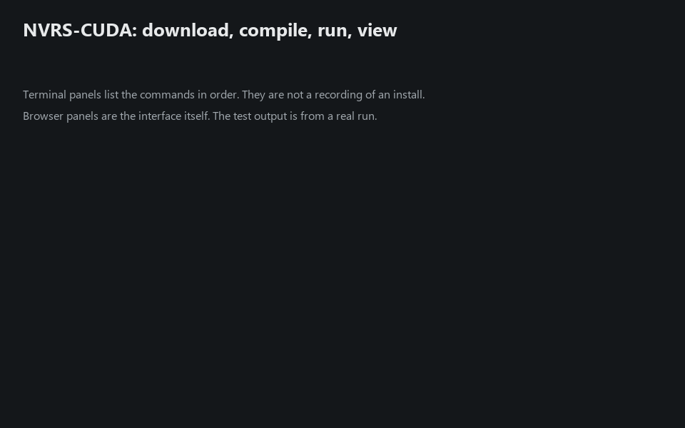
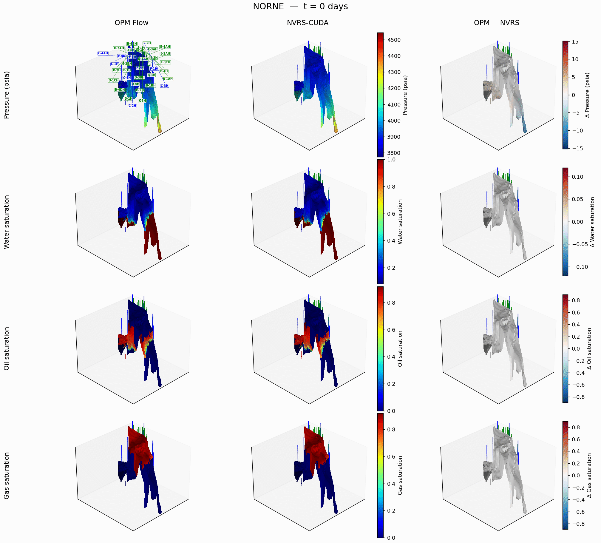
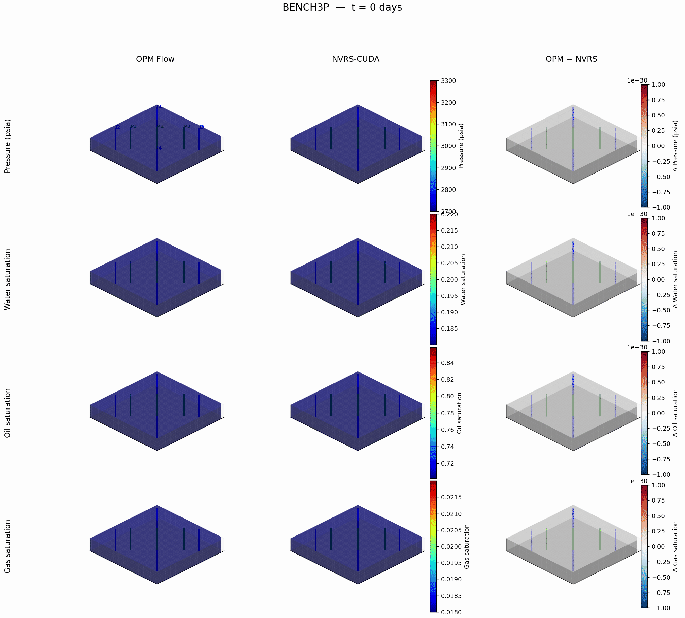

# Mixed-Precision Reservoir Simulation on GB200 and VR72

**Authors:** Clement Etienam, Tsubasa Onishi, Oleg Ovcharenko, Nick Luiken, Issam Said

**Paper:** *A Mixed-Precision, GPU-Native Constrained-Pressure-Residual Solver for Fully Implicit Reservoir Simulation.* Available on [Zenodo](https://doi.org/10.5281/zenodo.23669176).

Two companion studies of precision in a fully-implicit reservoir linear solve (an FGMRES solver
with a two-stage **CPR** (Constrained Pressure Residual) preconditioner and benchmarked on a
single **GB200**) plus the **full reservoir simulator** those solvers were built for. The
multigrid inside CPR is **AmgX** (default) or **HYPRE BoomerAMG**, selected by one deck keyword;
both run FP32 inside an FP64 Krylov, so the precision argument is the same either way.

Both studies solve the *same* two-field (pressure–saturation) operator with the *same* solver.
They differ in **one** thing: where the FP64 arithmetic comes from. The third folder takes that
solver and wraps a complete black-oil and compositional reservoir simulator around it.

```
reservoir_simulator/
├── mixed_precision_fp64_fp32/     ← Study 1: native FP64 operator + FP32 preconditioner
├── mixed_precision_emmulation/    ← Study 2: FP64 operator EMULATED from FP32 slices
└── full_reservoir_simulator/      ← The simulator: real physics on top of that solver
```

## Walkthrough



The terminal panels list the commands in order and are not a recording of an install.
The browser panels are the interface itself, and the Tensor Core test output is from a real run.

## Run it: step by step

Do these in order on a Linux machine with an NVIDIA GPU, Docker or Podman, and
`nvidia-smi` working. You do not choose a CUDA architecture: the build detects
your GPU. Set `CUDA_ARCH=100` (for example) only to pin one.

**1. Get the code.**

```bash
git clone --branch feature/norne-examples --single-branch \
  https://github.com/clementetienam/physicsnemo.git
cd physicsnemo/examples/reservoir_simulation/reservoir_simulator
```

**2. Start the container.** The first build takes tens of minutes. You land in
a shell at `/workspace/project`, which is this folder, mounted.

```bash
./build_container.sh
```

It is CUDA 12.8 on Ubuntu 22.04 with UCX, PMIx and OpenMPI built from source, so MPI is
CUDA-aware, and your folder is mounted rather than copied. Running it again in another
terminal joins the same container. `./build_container.sh check` proves MPI can send a GPU
buffer, and `./build_container.sh help` lists the rest.

**3. Install everything.** This builds HYPRE, AmgX, Ginkgo, OPM Flow, Nsight
Systems and `nvrs_cuda`. It is safe to re-run after a failure; it resumes.

```bash
cd full_reservoir_simulator/GPU_reservoir_simulator/cuda/benchmark
./nvrs.sh install
```

**4. Check what is ready.**

```bash
./nvrs.sh
./nvrs.sh cases
```

**5. Run a case.** Each command fetches or generates the deck, runs the
simulator against OPM Flow, profiles it, and writes the report. Use
`--no-opm` to run the simulator alone.

```bash
./nvrs.sh all NORNE
./nvrs.sh all SPE10
./nvrs.sh all BENCH3P
```

**6. Open the result.** The report is an HTML file with the field images, the
animation and the profiling figures, in
`full_reservoir_simulator/GPU_reservoir_simulator/cuda/benchmark/runs/`:

```bash
ls runs/compare_*.html
```

**7. Use the browser interface (optional).** It builds, runs decks, streams the
log, and shows the reports, movies and manual, with the mathematics typeset. From
the top of the project, in the same container shell:

```bash
cd /workspace/project
python3 gui/server.py
```

Then open **http://127.0.0.1:8765** in a browser on the same machine. The container
publishes that port to your machine. If the GPU machine is remote, run this on your
laptop first and open the same address:

```bash
ssh -L 8765:127.0.0.1:8765 user@gpu-machine
```

Without a container, `python3 gui/server.py` from this folder does the same. Opening
`gui/index.html` directly from disk shows the method, results and manual only;
starting work needs the server.

**Your own deck:**

```bash
NVRS_DECK=/path/to/MY.DATA ./nvrs.sh all MYFIELD
```

### Every command

| Command | What it does |
|---|---|
| `./nvrs.sh` | the menu: commands, options, and what is ready on this machine |
| `./nvrs.sh install` | HYPRE, AmgX, Ginkgo, OPM Flow, Nsight and `nvrs_cuda` |
| `./nvrs.sh cases` | every case, and whether its deck is ready |
| `./nvrs.sh get <CASE>` | fetch or generate the deck and its data |
| `./nvrs.sh run <CASE>` | the backends, against OPM Flow |
| `./nvrs.sh profile <CASE>` | Nsight Systems, once per backend |
| `./nvrs.sh report <CASE>` | the figures, folded into the HTML |
| `./nvrs.sh all <CASE>` | all four of the above, in order |

| Option | Applies to | Meaning |
|---|---|---|
| `--no-opm` | run, all | NVRS only; do not run OPM Flow |
| `--backend <b>` | run, profile | `amgx`, `hypre`, or `both` (default both) |
| `--ranks <n>` | run, profile | MPI ranks for NVRS |
| `--no-profile` | all | skip the profiling step |
| `--no-scaling` | run, all | one GPU only; skip the 2/4-GPU strong-scaling sweep |
| `--scaling` | run, all | force the sweep on (SPE10 defaults to off) |
| `--ncu` | profile, all | add Nsight Compute counters (~100x slower) |
| `--fraction <f>` | profile, all | history to profile: `0.25`, or `all` (default `0.1`) |
| `--tend <days>` | profile, all | profile exactly this many days instead |
| `--steps <n>` | profile, all | **NORNE only**: report steps, or `all` |
| `--heartbeat <s>` | profile, all | progress interval, `0` to silence |
| `--deck <path>` | get, run, all | your own `.DATA`, for a case not under `decks/` |

`--no-scaling` matters for the large cases. By default a run is repeated on 2,
4 and however many GPUs are present, which is the point for the BENCH family
and wasted time for SPE10: 1.12 million cells that exist to stress the solver,
where each extra rank repeats a long run to answer a question the case was not
chosen to ask. SPE10 therefore defaults to a single GPU, and `--scaling`
overrides that.

`--steps` is Norne-only on purpose: a report step is a fortnight there and
something else in every other deck, so it is refused rather than quietly
misapplied. Use `--fraction` or `--tend` elsewhere.

Some worked examples:

```bash
./nvrs.sh all NORNE --no-opm              # skip Flow, NVRS only
./nvrs.sh all NORNE --backend amgx        # one backend, faster
./nvrs.sh all NORNE --steps all           # the whole 247-step history
./nvrs.sh all SPE10 --fraction 0.5        # half of SPE10's history
./nvrs.sh all MYFIELD --deck /path.DATA   # a deck of your own
./nvrs.sh profile NORNE --ncu             # add the kernel counters
./nvrs.sh report NORNE                    # rebuild the HTML only
```

### Newer GPUs, and machines without root

Two things are handled automatically and are worth knowing about:

**A GPU newer than any CUDA that can target it.** Vera Rubin reports compute
capability 10.7 and no toolkit has an sm_107 target. The install scripts emit
PTX for the newest architecture not newer than the device, which the driver
JIT-compiles into native code at load. `CUDA_ARCH=100` pins it if you are
cross-building. The first run pays the compile once; the benchmark scripts keep
the JIT cache on the mounted filesystem so it is not paid again, and timings
from a JIT-compiled machine are not comparable with a natively-built one.

**No root inside the container.** `dpkg` needs to be root and `sudo` is
usually not setuid, so missing dependencies are downloaded and unpacked into a
prefix rather than installed. That prefix is *appended* to `LD_LIBRARY_PATH`,
never prepended, because prepending it once shadowed the container's Open MPI and
broke the launcher.

## Results on GB200 and VR72

Open these in a browser after cloning, or from the Results tab of the interface.
GitHub does not render HTML files of this size.

| Case | GB200 | VR72 |
|---|---|---|
| Norne | [report](results/GB200/compare_NORNE.html) | [report](results/VR72/compare_NORNE.html) |
| SPE10 model 2 | [report](results/GB200/compare_SPE10.html) | [report](results/VR72/compare_SPE10.html) |
| BENCH3P | [report](results/GB200/compare_BENCH3P.html) | [report](results/VR72/compare_BENCH3P.html) |
| Size ladder, 1 to 4 GPUs | [study](results/GB200/backend_study/index.html) | [study](results/VR72/backend_study/index.html) |

The timing, scaling and profile data behind them are beside each report, in
[`results/`](results).






---

## Tensor Core Jacobian (optional, chosen at compile time)

The simulator above is unchanged by this option: the default build compiles none
of it. Build it, then select it with one keyword, as `MIXED` selects precision.

```bash
cd full_reservoir_simulator/GPU_reservoir_simulator/cuda/benchmark
TENSORCORE=1 ./nvrs.sh install      # also fetches CUTLASS and builds nvrs_cuda_tc
```

| Deck keyword | Values | Meaning |
|---|---|---|
| `JACOBIAN` | `TENSORCORE` | connection blocks by a batched operator product |
| `TCPRECISION` | `TF32` (default), `FP32` | Tensor Core GEMM, or the same product on CUDA cores |
| `TCVALIDATE` | `0` (default), `1` | report the difference from the analytic blocks |

It covers two-phase and three-phase black oil on Cartesian and corner-point grids.
Run a deck both ways, and test the factorisation against all the analytic kernels:

```bash
./run_tensorcore.sh                 # SMOKE and RESERVOIR, analytic then Tensor Core
./run_tensorcore.sh NORNE           # or any deck in decks/
cd .. && make TENSORCORE=1 test_tc_jacobian && ./test_tc_jacobian tf32
```

**The method.** For an oriented connection $(i,j)$ the residual is a product of
eleven features $z$, the phase mobilities $M_\alpha$, potentials
$\Delta\Phi_\alpha$ and upstream factors $b_\alpha^u, R_s^u, R_v^u$. With
$F_\alpha = T_{ij} M_\alpha \Delta\Phi_\alpha$,

$$
R_o = -\bigl(b_o^u F_o + R_v^u b_g^u F_g\bigr), \qquad
R_w = -b_w^u F_w, \qquad
R_g = -\bigl(b_g^u F_g + R_s^u b_o^u F_o\bigr),
$$

so the chain rule is a matrix product, with $x_{ij}$ the primaries of both cells,

$$
\frac{\partial R}{\partial x_{ij}} =
\underbrace{\frac{\partial R}{\partial z}}_{L_{\mathrm{flux}} \in \mathbb{R}^{b_s \times 11}}
\underbrace{\frac{\partial z}{\partial x_{ij}}}_{L_{\mathrm{props}} \in \mathbb{R}^{11 \times 2 b_s}} .
$$

Both factors are padded to $16 \times 16$ tiles and all connections are issued as
one strided batched GEMM in TF32 with FP32 accumulation. The analytic kernel still
runs first and supplies the residual, accumulation, wells and CPR weights;
neighbour blocks are replaced by the product and the self block is corrected,

$$
J_{ii} \leftarrow J_{ii} + \sum_{\mathrm{conn}}
\bigl(J^{\mathrm{product}}_{\mathrm{conn},i} - J^{\mathrm{FP64}}_{\mathrm{conn},i}\bigr).
$$

**Status.** `test_tc_jacobian` passes on all five assembly cases with the FP32
product: the factorisation matches the analytic kernels to FP64 round-off, and the
product matches them to FP32 round-off. TF32 and full simulations have not been
measured yet. Because the analytic kernel still runs, this path adds to the assembly
time; each run reports analytic, fill, product and scatter seconds separately.

---

## Headline

The published **Norne field deck**, 44,431 active cells over 3312 days and 247
report steps, one GPU and one rank, with six solver arms run back to back on each
machine. All numbers are **version 2** of the code: the coupled operator stored
as 3x3 blocks with one index per block (`BLOCKSPMV 1`) and the Krylov tail
replayed from CUDA graphs (`CUDAGRAPH 1`). Version 1 is the same code with scalar
CSR and direct launches.

| Run | GB200 | VR72 | Over Flow, GB200 | Over Flow, VR72 |
|---|---|---|---|---|
| OPM Flow 2024.10 | 488.51 s | 243.88 s | | |
| NVRS-CUDA (HYPRE BoomerAMG, FP32) | 71.51 s | 73.54 s | 6.83x | 3.32x |
| NVRS-CUDA (Ginkgo, FP16) | 80.55 s | 50.02 s | 6.06x | 4.88x |
| NVRS-CUDA (Ginkgo, FP32) | 70.42 s | 49.31 s | 6.94x | 4.95x |
| NVRS-CUDA (Ginkgo FP16 + adaptive block-Jacobi) | 76.61 s | 57.27 s | 6.38x | 4.26x |
| NVRS-CUDA (AmgX, FP32, native FP64 operator) | 43.19 s | 34.91 s | 11.31x | 6.99x |
| **NVRS-CUDA (AmgX, FP32, default)** | **44.95 s** | **35.73 s** | **10.87x** | **6.83x** |

That factor is against Flow on one rank with two host threads, and most of it is host work Flow does on two threads.
Given the whole node, Flow is fastest with its CPU CPR solver on 16 ranks, and
**the factor is 3.5x on GB200 and 2.5x on VR72** (NVRS median of three runs).

| Flow 2024.10 configuration | GB200 | NVRS faster by | VR72 | NVRS faster by |
|---|---|---|---|---|
| GPU ILU(0), 1 rank x 2 threads | 488.51 s | 10.45x | 243.88 s | 6.82x |
| GPU ILU(0), every host thread | 348.95 s | 7.46x | 543.49 s | 15.2x |
| **CPU CPR, 16 ranks (fastest)** | **165.62 s** | **3.54x** | **88.48 s** | **2.47x** |

NVRS runs a looser material-balance tolerance than Flow (MB 3.5e-5 against
1e-7); its exact discrete water balance closes to -0.68 %.

On GB200 the AmgX run takes 1,497 Newton iterations against Flow's 1,985, and
each costs 30.0 ms against 246.1 ms. It rebuilds the AMG hierarchy 172 times at
10.2 ms each and retries 3 of the 247 report steps; BoomerAMG takes 1,506 Newton
iterations. On VR72 the AmgX run takes 1,571 Newton iterations at 22.7 ms each.

Where the time goes on GB200, in seconds:

| Run | Total | Linear solve | of which AMG | Outside the solve |
|---|---|---|---|---|
| OPM Flow | 488.51 | 97.22 | n/a | 391.29 |
| NVRS-CUDA (AmgX) | **44.95** | 23.60 | 14.56 | 21.36 |
| NVRS-CUDA (HYPRE) | 71.51 | 49.91 | 34.12 | 21.61 |
| NVRS-CUDA (Ginkgo FP16) | 80.55 | 56.30 | 41.52 | 24.24 |

Under AmgX the run splits 38.2 % native FP32, 2.2 % emulated FP64 (the operator
apply alone) and 59.6 % native FP64 (54.3 / 2.5 / 43.1 % under BoomerAMG).


### Every ablation and study

Norne on one GPU unless a row says otherwise; each row changes one thing
from the default. GB200 walls are medians of three runs with [min, max]
unless marked as a single run; Newton and Krylov counts are GB200.

| Study | Change from the default | GB200 wall, s | Newton / Krylov | VR72 wall, s | Finding |
|---|---|---|---|---|---|
| **Default** | | | | | |
| Default configuration | block CSR, captured Krylov tail, df64 operator, quasi-IMPES, block-Jacobi stage 2, AMG reused up to 10 Newton | 46.75 [46.45, 46.99] | 1,497 / 41,114 | 35.76 [35.64, 36.62] | reference point; 11.6 s of it is output |
| **Storage and launch (2x2)** | | | | | |
| Scalar CSR, direct launches | version 1 operator | 51.24 [51.22, 51.55] | 2,004 / 45,125 | 40.08 | operator 64.1 us per Krylov |
| Block CSR, direct launches | no graph capture | 45.25 [44.74, 45.47] | 1,497 / 41,114 | 34.89 | 52.0 us: storage alone 1.23x (model 1.31x); fastest |
| Scalar CSR, captured tail | no block storage | 52.55 [52.44, 52.56] | 2,004 / 45,125 | 40.86 | capture costs 2.9 s; not repaid |
| Block CSR, captured, reuse guard | CUDAGRAPHMINREUSE 2 | 45.21 [44.91, 45.33] | 1,497 / 41,114 | 34.91 | guard stops after 192 captures (0.22 reuses each) |
| **Operator arithmetic** | | | | | |
| Native FP64 operator | EMULATE 0 | 44.04 [43.82, 44.21] | 1,400 / 38,869 | 34.56 | 11.37 us per apply; path differs, not arithmetic |
| FP32-stored operator, FP64 master | EMULATE 2 | 47.62 [47.52, 47.81] | 1,654 / 42,608 | 34.36 | apply 7% cheaper, run 8% slower; 9 of 1,663 solves continued on the true residual |
| **Preconditioner** | | | | | |
| Rebuild AMG every Newton | AMGREUSE 0 (single run) | 54.90 | 1,532 / 31,479 | 59.73 | reuse is worth 1.17x (1.67x on VR72) |
| Dynamic row-sum decoupling | CPRDECOUPLE DRS (single run) | 45.21 | 1,440 / 40,149 | 37.11 | Krylov per Newton 27.9 vs 27.5 |
| Plain row-sum decoupling | CPRDECOUPLE SUM (single run) | 47.41 | 1,596 / 42,864 | 37.41 | 26.9 per Newton: decoupling within 5% |
| Vertical line stage 2 | STAGE2 ZLINE | n/a | n/a | n/a | needs the Cartesian neighbour map; falls back to block-Jacobi on Norne |
| BoomerAMG, coarse grid 20,000 rows | AMGMAXCOARSE 20000, vs BoomerAMG 71.51 s (single run) | 87.35 | 1,723 / 136,274 | 73.39 | V-cycle 0.24 vs 0.44 ms but 1.87x Krylov |
| **Time integration** | | | | | |
| Flow's accepted substeps imposed | DTSEQFILE | 47.68 [47.23, 47.82] | 1,580 / 42,867 | 32.35 | Newton ratio to Flow 1.26 (1.33 unconstrained) |
| **Reference (Flow 2024.10)** | | | | | |
| (P) GPU ILU(0), 1 rank x 2 threads | two-thread configuration | 488.51 | 1,985 / 30,072 | 243.88 | NVRS 10.45x faster (VR72 6.82x) |
| (G) GPU ILU(0), every host thread | 1 x 144 (VR72 1 x 352) | 348.95 | 1,985 | 543.49 | 7.46x; threads slow VR72 down |
| (C) CPU CPR, best of 8/16/32 ranks | 16 ranks on both | 165.62 | 1,263 | 88.48 | 3.54x (VR72 2.47x) |
| **Scaling, 1 to 4 GPUs** | | | | | |
| 1 million cells | aggregation, NCCL, one imposed step sequence | 24.92 -> 27.22 | 683 -> 687 | 16.84 -> 25.67 | 0.92x (VR72 0.66x): too small to scale |
| 5 million cells | as above | 104.68 -> 80.60 | 683 -> 685 | 69.16 -> 56.73 | 1.30x, 33% efficiency (VR72 1.22x) |
| **Kernels in isolation** | | | | | |
| Block FP64 vs cuSPARSE CSR / BSR | Norne-sized box, us per apply | 14.4 vs 34.8 / 39.0 |  | 11.1 vs 29.7 / 32.3 | 2.42x / 2.71x (VR72 2.69x / 2.92x) |
| df64 vs native FP64 | same box | 18.5 vs 14.4 |  | 13.3 vs 11.1 | emulation costs 1.28x (VR72 1.21x) |
| Graph capture break-even r* | capture cost / saving per replay | 2.3 |  | 30 | Norne reuses each graph 1.16 times |
| **Accuracy** | | | | | |
| Pressure-matrix conditioning | cond2(A_p) = 5.2e3 | u32: 3e-4, u16: 2.5 |  | same | FP32 hierarchy safe; FP16 outside Proposition 1 |
| Exact discrete water ledger | NVRS_SUBSTEP_BALANCE=1 | -0.68% (trapezoid 1.75%) |  | -0.70% (1.15%) | bias due to the MB tolerance; the remainder is integration error in the balance |

### Version 2: block storage and CUDA graphs

| Norne, GB200, AmgX | Version 1 | Version 2 |
|---|---|---|
| Operator apply, per Krylov iteration | 64.0 us | **24.1 us** |
| Orthogonalisation (CGS2), per Krylov iteration | 91.0 us | **44.8 us** |
| AMG V-cycle | 0.31 ms | 0.31 ms |
| Kernel launches in the Nsight trace | 173,083 | **129,499** |
| Wall clock, GB200 | 46.52 s | **44.95 s** |
| Wall clock, VR72 | 44.65 s | **35.73 s** |

The two changes were introduced together; the 2x2 ablation below separates
them. Block storage makes the operator 1.23x cheaper per Krylov iteration, close
to the 1.31x the traffic model predicts. Graph capture halves the operator time
the solver's timer sees, but on Norne each graph is reused only 1.16 times
against a measured break-even of 2.3, the captures cost 2.9 s, and the run is
3 % slower than with direct launches. The reuse guard (`CUDAGRAPHMINREUSE`)
stops capturing after 192 captures and recovers the direct-launch time. On
SPE10 each graph is reused 159 times and capture stays on.

### Emulated against native FP64 in the operator

A sixth arm runs AmgX with `EMULATE 0`: the operator apply in native FP64,
everything else, the FP32 multigrid included, unchanged. It is not a comparison
of FP64 against FP32; both arms are equally mixed precision.

| AmgX, one GPU | Wall | Newton | Operator | Per apply |
|---|---|---|---|---|
| Norne, GB200, df64 | 44.95 s | 1,497 | 0.99 s | 11.8 us |
| Norne, GB200, native FP64 | 43.19 s | 1,400 | 0.90 s | 11.3 us |
| Norne, VR72, df64 | 35.73 s | 1,571 | 0.99 s | 11.6 us |
| Norne, VR72, native FP64 | 34.91 s | 1,526 | 0.96 s | 11.6 us |

Inside the solver the cost per apply is the same within 4 %, and the operator
is 2 % of the run, so the wall-clock differences are the Newton path, not the
arithmetic. Measured in isolation on a fixed input, the df64 apply costs 1.28x
the native one on GB200 and 1.21x on VR72: a df64 pair is the same 8 bytes as
FP64, but it does ten to twenty times the arithmetic. Emulation buys FP64
semantics, not speed. A third arm stores the operator in FP32 with an FP64
master for every residual that decides convergence (`EMULATE 2`): the apply is
7 % cheaper and the run 8 % slower on GB200, because the perturbed operator
lengthens the nonlinear path. On SPE10, whose deck already uses the native
operator, the two runs agree to 0.5 %.

### Ginkgo: a third multigrid, down to half precision

Ginkgo's parallel-graph-matching AMG (Anzt et al., ACM TOMS 2022) runs the whole
V-cycle in IEEE FP16 (or FP32 for a control), optionally with Ginkgo's
adaptive-precision block-Jacobi (Flegar et al., ACM TOMS 2021) as the second CPR
stage. It **does not beat AmgX**: its best arm is 1.57x slower on GB200 and 1.38x
on VR72, while beating BoomerAMG on both (1.02x and 1.49x).

| Norne, one GPU | V-cycle GB200 | V-cycle VR72 | Mean R^2 GB200 | Mean R^2 VR72 |
|---|---|---|---|---|
| **AmgX FP32** | **0.31 ms** | **0.23 ms** | 0.901 | 0.910 |
| AmgX FP32, native FP64 operator | 0.31 ms | 0.23 ms | 0.908 | 0.759* |
| BoomerAMG FP32 | 0.44 ms | 0.44 ms | 0.902 | 0.910 |
| Ginkgo FP16 | 0.65 ms | 0.36 ms | 0.851* | 0.903 |
| Ginkgo FP32 | 0.65 ms | 0.37 ms | 0.905 | 0.898 |
| Ginkgo FP16 + adaptive bJ | 0.64 ms | 0.36 ms | 0.893 | 0.911 |

\* One producer, D-4AH, moved its water breakthrough in that run; the other 21
wells match the other arms. The agreement measures used in the [paper](https://doi.org/10.5281/zenodo.23669176)
(range-normalised error, cumulative error, breakthrough offset) are reported
there.

Half precision keeps the answer but not a speed-up. The measured conditioning
of the Norne pressure matrix says why it costs iterations: cond(A_p) x u32 is
3e-4, well inside the condition of the paper's Proposition 1, but cond(A_p) x
u16 is 2.5, outside it, and FP16 Ginkgo takes 1.21x the Krylov iterations of
FP32 Ginkgo. On traffic: a CSR matrix with 32-bit
column indices moves 4 + w bytes per nonzero, so halving the value width saves at
most a quarter of the traffic, and the Nsight traces show the Norne kernels bound
by launch latency, with about 15 % of Ginkgo's GPU time in per-application solver
bookkeeping.

### Norne, every producer scored against Flow

Each of the 22 producers is scored separately by the R^2 of its whole history
against OPM Flow, on six quantities (GB200, AmgX). 🟢 R^2 >= 0.80,
🟡 0.70 to 0.80, 🔴 below 0.70. Where Flow's value is constant over the history
(a well held at a pressure limit), the error is measured against 5 % of that
level, so shut-in periods do not give negative scores.

| Well | WOPR | WWPR | WWCT | WGPR | WGOR | WBHP |
|---|---:|---:|---:|---:|---:|---:|
| B-1BH | 🟢 0.99 | 🟡 0.76 | 🟢 0.84 | 🟢 0.97 | 🟢 0.98 | 🟢 0.98 |
| B-1H | 🟢 0.95 | 🟢 0.83 | 🟢 0.93 | 🟢 0.97 | 🟢 0.85 | 🟢 0.92 |
| B-2H | 🟢 0.96 | 🟢 0.92 | 🟢 0.94 | 🟢 0.92 | 🟢 0.83 | 🔴 **0.28** |
| B-3H | 🟢 0.93 | 🟢 0.94 | 🟢 0.94 | 🟢 0.93 | 🟢 0.93 | 🟢 0.92 |
| B-4BH | 🟢 0.98 | 🟢 0.99 | 🟢 0.99 | 🟢 0.96 | 🟢 0.93 | 🟢 0.99 |
| B-4DH | 🟢 0.95 | 🟢 0.92 | 🟢 0.95 | 🟢 0.97 | 🟢 0.95 | 🟢 0.95 |
| B-4H | 🟢 0.98 | 🟢 0.98 | 🟢 0.96 | 🟢 0.98 | 🟢 0.97 | 🟢 1.00 |
| D-1CH | 🟢 0.99 | 🟢 0.98 | 🟢 1.00 | 🟢 0.97 | 🟢 0.97 | 🟢 0.96 |
| D-1H | 🟢 0.98 | 🟢 0.97 | 🟢 0.86 | 🟢 0.96 | 🟢 0.97 | 🟢 0.95 |
| D-2H | 🟢 0.97 | 🟢 0.90 | 🟢 0.93 | 🟢 0.95 | 🟢 0.80 | 🔴 **0.53** |
| D-3AH | 🟢 0.98 | 🟢 0.97 | 🟢 0.97 | 🟢 0.98 | 🟢 0.97 | 🟢 0.97 |
| D-3BH | 🟢 0.99 | 🟡 0.78 | 🟢 0.86 | 🟢 0.99 | 🟢 0.98 | 🟢 0.90 |
| D-4AH | 🔴 **0.67** | 🔴 **-0.25** | 🔴 **0.53** | 🟢 0.92 | 🟡 0.72 | 🟢 0.97 |
| D-4H | 🟢 0.98 | 🟢 0.95 | 🟢 0.89 | 🟢 0.96 | 🟢 0.97 | 🟢 0.99 |
| E-1H | 🟢 0.97 | 🟢 0.98 | 🟢 0.98 | 🟢 0.94 | 🟢 0.93 | 🟢 0.91 |
| E-2AH | 🟢 0.86 | 🟢 0.96 | 🟢 0.90 | 🟢 0.81 | 🟡 0.74 | 🟢 0.99 |
| E-2H | 🟢 0.98 | 🟢 0.96 | 🟢 0.99 | 🟢 0.94 | 🟢 0.96 | 🟢 0.94 |
| E-3AH | 🟢 0.93 | 🔴 **0.68** | 🟢 0.84 | 🟢 0.86 | 🔴 **0.69** | 🟢 0.99 |
| E-3CH | 🟢 0.84 | 🟢 0.97 | 🟢 0.99 | 🟢 0.82 | 🟢 0.97 | 🟡 0.78 |
| E-3H | 🟢 0.98 | 🟢 0.98 | 🟢 0.98 | 🟢 0.97 | 🟢 0.98 | 🟢 0.98 |
| E-4AH | 🟢 0.90 | 🟢 0.88 | 🟢 0.92 | 🟡 0.77 | 🔴 **0.52** | 🟢 1.00 |
| K-3H | 🔴 **0.64** | 🔴 **0.65** | 🟢 0.93 | 🟢 0.97 | 🔴 **0.67** | 🟢 0.95 |
| **wells >= 0.70** | **20/22** | **19/22** | **21/22** | **22/22** | **19/22** | **20/22** |

**20 of the 22 producers match Flow at R^2 >= 0.70 on oil rate, 21 on water cut,
all 22 on gas rate, and 19 on all four rate quantities at once** (all but D-4AH,
E-3AH and K-3H). The mean over producers and quantities is 0.901. The VR72 run
gives 20 of 22 on all four rates and a mean of 0.910.


Field recovery agrees to a fraction of a percent:

| | OPM Flow | NVRS-CUDA |
|---|---|---|
| Peak field oil rate | 227.52 k STB/day | 232.20 k STB/day |
| Best single well (E-2H) | 57.75 k STB/day | 54.33 k STB/day |
| Cumulative oil, 3312 days | 422.78 M STB | **425.07 M STB** |
| **Recovery factor** | **41.8 %** | **41.5 %** |
| Implied B_o | 1.303 | 1.289 |

The oil balance closes: what the saturation field gives up accounts for
**100 %** of what the well rates report. Water gained over the history is
523.0 M STB against Flow's 518.4; reconciled against reported injection the
water balance closes to +6.2 % (GB200) and +6.6 % (VR72) against Flow's +3.8 %.


### SPE10 model 2 against OPM Flow

1,122,000 cells, 1000 days, one Eclipse deck (`decks/SPE10_MATCHED.DATA`) read
by both simulators, CPRW, `LINTOL 3e-2`, native FP64 operator, one GPU. OPM Flow
runs on the VR72 host (its GPU bridge needs block size 3 and SPE10 is two-phase).


| Run | GB200 | VR72 | Over Flow | Mean R^2 |
|---|---|---|---|---|
| OPM Flow 2024.10 (CPU) | n/r | 766.16 s | | reference |
| NVRS-CUDA (HYPRE) | 99.22 s | 91.74 s | 8.37x | 0.999 |
| **NVRS-CUDA (AmgX)** | **53.06 s** | **41.21 s** | **18.59x** | **0.999** |

Recovery factor 21.1 % in both codes and the water balance closes exactly.
AmgX needs 39.2 Krylov iterations per Newton step against BoomerAMG's 69.9.


### Every model, every backend, both machines, one GPU


| Model | Cells | Flow GB200 | HYPRE GB200 | Ginkgo GB200 | AmgX GB200 | Flow VR72 | HYPRE VR72 | Ginkgo VR72 | AmgX VR72 |
|---|---|---|---|---|---|---|---|---|---|
| Norne, field | 44,431 | 488.51 | 71.51 | 80.55 | **44.95** | 243.88 | 73.54 | 50.02 | **35.73** |
| Bench3P | 4,800 | 9.25 | 3.00 | n/r | **0.89** | 5.32 | 3.44 | n/r | **0.95** |
| SPE10 model 2 | 1,122,000 | n/r | 99.22 | n/r | **53.06** | 766.16 (CPU) | 91.74 | n/r | **41.21** |
| Million | 1,000,000 | n/r | 26.23 | n/r | **21.17** | n/r | 19.94 | n/r | **14.87** |
| Million-2M | 2,000,000 | n/r | 49.94 | n/r | **39.38** | n/r | 38.23 | n/r | **27.17** |
| Million-4M | 4,000,000 | n/r | 81.87 | n/r | **77.67** | n/r | 60.97 | n/r | **52.33** |
| Million-5M | 5,000,000 | n/r | 102.32 | n/r | **95.61** | n/r | 76.65 | n/r | **63.77** |

Seconds, one GPU. AmgX is the fastest library on every model on both machines.
Solid bars are GB200, hatched bars VR72; green AmgX, blue BoomerAMG, on Norne
orange, violet and teal for the three Ginkgo arms (FP16 shown in the table), and
dark olive for AmgX with a native FP64 operator. `n/r` marks an arm that was not
run.

### Scaling across GPUs: AmgX against BoomerAMG, GB200 and VR72


At two and four GPUs the two arms take the same Newton path to within four
iterations, and each backend is also measured against **its own** single-GPU
rate:

| Cells | Backend | GB200 1 / 2 / 4 GPUs | GB200 1 to 4 | VR72 1 / 2 / 4 GPUs | VR72 1 to 4 |
|---|---|---|---|---|---|
| 4,800 | BoomerAMG | 3.00 / 6.22 / 7.91 s | 0.38x | 3.44 / 7.98 / 13.29 s | 0.26x |
| | AmgX | 0.89 / 2.00 / 2.75 s | 0.32x | 0.95 / 2.33 / 3.93 s | 0.24x |
| 1,000,000 | BoomerAMG | 26.23 / 33.85 / 43.27 s | 0.61x | 19.94 / 28.88 / 49.61 s | 0.40x |
| | AmgX | 21.17 / 18.96 / **18.26** s | **1.16x** | 14.87 / **14.02** / 16.17 s | 0.92x |
| 2,000,000 | BoomerAMG | 49.94 / 52.84 / 65.32 s | 0.76x | 38.23 / 43.83 / 72.11 s | 0.53x |
| | AmgX | 39.38 / 31.05 / **30.84** s | **1.28x** | 27.17 / **21.24** / 23.62 s | **1.16x** |
| 4,000,000 | BoomerAMG | 81.87 / 80.00 / 86.67 s | 0.94x | 60.97 / 60.96 / 85.21 s | 0.72x |
| | AmgX | 77.67 / 58.01 / **51.78** s | **1.50x** | 52.33 / 36.58 / **41.14** s | **1.27x** |
| 5,000,000 | BoomerAMG | 102.32 / 96.16 / 96.64 s | 1.06x | 76.65 / 77.49 / 93.30 s | 0.81x |
| | AmgX | 95.61 / 71.14 / **61.71** s | **1.55x** | 63.77 / 43.91 / **42.26** s | **1.51x** |

BoomerAMG does not scale on this problem: its hierarchy setup grows with ranks
(5.2 s to 17.6 s at a million cells on GB200) while AmgX's shrinks. At four GPUs
AmgX is faster in absolute terms by 1.64x to 2.37x on GB200 and 2.24x to 3.10x
on VR72. On one GPU from a million cells up AmgX takes about 694 Newton
iterations to BoomerAMG's 362 (its single-rank classical hierarchy; at two ranks
it builds aggregates and the counts agree), and is still 2.1x to 2.7x cheaper per
Newton iteration.

**VR72 against GB200.** AmgX gains 1.30x to 1.41x across the million-cell
family, 1.29x on SPE10 and 1.26x on Norne; Bench3P, at 4,800 cells, is too small
to gain. Keep the CUDA JIT cache enabled on VR72: the device reports a compute
capability no released toolkit targets, so every kernel is compiled from PTX at
load.

**Time integration follows OPM Flow's**: a continuous timestep carried across
report steps and rescaled from the Newton count of the last converged sub-step,
with Flow's pore-volume-weighted convergence criterion (`DTCONTROL`, `OPMCONV`,
`NEWTONSTALLMAX`).

Reproduce a case with
`cd full_reservoir_simulator/GPU_reservoir_simulator/cuda/benchmark && ./nvrs.sh all NORNE`
(or `SPE10`, or `BENCH3P`).

## The three folders

### 📁 [`mixed_precision_fp64_fp32/`](mixed_precision_fp64_fp32/): classical mixed precision

**The baseline.** Everything that sets accuracy runs in **native FP64** on hardware that has
FP64: the operator apply $`Ax`$, the true residual $`b - Ax`$, the Krylov dot products and norms.
Everything that only shapes convergence (the AMG V-cycle on the pressure block, the stage-2
smoother, the hierarchy storage) is narrowed to **FP32**.

This is the standard, well-founded mixed-precision recipe: *narrow the preconditioner, keep the
operator exact.* Flexible GMRES makes it safe, because a perturbed preconditioner changes only
the search subspace, never the residual the method reports.

**Question answered:** how much speed does FP32 preconditioning actually buy on GB200, and what
would it take to reach 4×?

**Headline result** (solve phase, `tol = 1e-8`, restart 30):

| grid | FP64 solve | mixed solve | speedup | FP64 iters | mixed iters |
|---|---:|---:|---:|---:|---:|
| $`32^3`$ | 64.58 ms | 63.08 ms | 1.02× | 30 ✓ | 29 ✓ |
| $`64^3`$ | 162.77 ms | 155.84 ms | 1.04× | 80 ✗ | 80 ✗ |
| $`96^3`$ | 218.23 ms | 201.97 ms | 1.08× | 80 ✗ | 80 ✗ |
| $`128^3`$ | 321.70 ms | 281.19 ms | **1.14×** | 80 ✗ | 80 ✗ |

FP32 preconditioning is **numerically free** (29 iterations instead of 30, and a *better* final
residual) and the speedup grows with problem size as the preconditioner comes to dominate byte
traffic. (Only $`32^3`$ converged inside the 80-iteration cap; the larger grids are equal-iteration
time/residual comparisons.)

---

### 📁 [`mixed_precision_emmulation/`](mixed_precision_emmulation/): emulated FP64

**The same solver, with the native FP64 taken away.** On accelerators where FP64 throughput is
scarce, FP64-quality products can be *synthesised* from low-precision units. This study uses
**double-word arithmetic** (Dekker; Bailey's QD): each double is carried as a pair of FP32 numbers
and sums and products are accumulated with error-free transformations, giving ~48 significand
bits, near FP64's 53. This is distinct from the Ozaki scheme, which slices whole matrices and is
what cuBLAS ships for dense `GEMM`.

This folder replaces the operator SpMV, the true residual, and the Galerkin $`RAP`$ product with an
emulated-FP64 implementation (a `double-single` CUDA kernel built from error-free
transformations), and asks whether the solver notices.

**Question answered:** *is emulated-FP64 mixed precision as good as true-FP64 mixed precision,
and is it any faster?*

**Two headline results, and they point in opposite directions:**

> ✅ **Accuracy: yes, indistinguishable.** Emulated-FP64 FGMRES-CPR tracks the native-FP64
> residual history to **1.3 × 10⁻⁵ relative agreement at every iteration**: a perturbation
> **32× smaller** than the FP32 preconditioner that mixed precision already accepts as free. On
> GB200 the emulated run converges in 36 iterations against 40 for native FP64.
>
> ❌ **Speed: no, and provably not.** The reservoir solve has arithmetic intensity
> ≈ 0.25 flop/byte, about **20× below the FP64 ridge point** of a GB200 (5 flop/byte). Emulation
> adds flops while moving identical bytes, so below the ridge the emulated and native kernels sit
> on the *same* bandwidth roof. Measured emulated solve time is within **±2%** of native FP64.

The same analysis shows emulation gaining **~24×** on dense LU / HPL ($`I \approx 120`$
flop/byte). **Emulation is the right answer for HPL and the wrong answer for a sparse reservoir
solve**: not because it is inaccurate, but because accuracy was never the bottleneck.

The emulation folder's [README](mixed_precision_emmulation/README.md) develops all of this in
full: the error analysis of residual splitting, the $`s(s+1)/2`$ cost law, the Dekker/Knuth
error-free transformations behind the CUDA kernel, the inexact-Krylov residual-gap bound, the
roofline trade-off theorem, and the byte-traffic model for reaching 4×.

---

### 📁 [`full_reservoir_simulator/`](full_reservoir_simulator/): the simulator itself

**Where the solver goes to work.** The two studies above measure a linear solve in isolation. This
folder is the reservoir simulator built around it: a CUDA C++ **black-oil (2- and 3-phase) and
compositional** simulator with a structured TPFA finite-volume discretisation, fully-implicit
Newton, Peaceman wells, an MPI domain decomposition that scales from one GPU to multi-node, and an
**α-REKI Bayesian history-matching** layer on top.

The mixed-precision CPR solver from Study 1 and the df64-emulated operator from Study 2 are both
here as deck options (`MIXED`, `EMULATE`), so the precision findings can be exercised on real
reservoir physics rather than a synthetic operator.

The stage-1 multigrid is interchangeable: `LINSOLVER AMGX` (default) or `LINSOLVER HYPRE`. Only
the multigrid changes; the FP64 FGMRES, the df64-emulated operator, the FP64 quasi-IMPES weights
and the block-Jacobi second stage are identical, and both multigrids run FP32. On the Norne field
deck AmgX is **1.60× faster** than BoomerAMG on one GB200 (44.95 s against 71.51 s) and 1.56× faster than the best Ginkgo arm (70.42 s), it is the faster backend on every model on both GB200
and VR72, and it is the backend that keeps scaling past one GPU: at five million cells it reaches
1.55× on four GB200 GPUs and 1.51× on four VR72 GPUs, where BoomerAMG sits at 1.06× and 0.81×.

Two defaults were added after measuring them on **SPE10 model 2** (1.12 M cells, 10⁷ permeability
contrast: the standard heterogeneity stress test), and both apply to every case:

- **Adaptive implicit time stepping** (`AIM`, on by default). Cells whose throughput CFL is below
  threshold run explicit in saturation; wells and fronts stay fully implicit. `AIM 0` for the
  fully implicit scheme.
- **Automatic multigrid hierarchy**: classical PMIS on one rank (the stronger preconditioner:
half the Krylov count on heterogeneous rock), aggregation on several (the one that survives a
  decomposition). The run banner states which and why.

In the ablation they took SPE10 from **861 s to 342 s** on one GB200, a 2.52× speed-up
over the out-of-the-box configuration. On the matched SPE10 deck (1000 days) SPE10 model 2 completes in **53.06 s** on one GB200 and **41.21 s** on one VR72 under AmgX, 18.5× faster than OPM Flow on the VR72 host, with a mean per-well R² of 0.999.

📘 **[`docs/manual.pdf`](docs/manual.pdf):
the user reference manual**: every deck keyword with its admissible values and defaults,
the numerical formulation, adaptive implicit, parallel execution, output formats, verification,
a tuning guide and troubleshooting, with a clickable keyword index.  It carries a complete
Norne/OPM parity chapter: schedule semantics, metric-unit conversions, well-rate and history-RESV
mathematics, group controls, water accounting, the per-producer R² table of the version 2 results, regression gates and a reproducible Git-LFS installation/runbook.

### Aligned Norne run on a development workstation

The validation of the improved method after rebasing on `main` uses matched rock properties
and OPM Flow 2025.10 (CPU) against NVRS-AmgX on one GPU of a development workstation: Flow
**205.28 s**, NVRS **32.58 s** (6.30× faster). Cumulative oil is **422.71 M STB** for Flow and
**425.64 M STB** for NVRS, with recovery factors of **41.8 %** and **41.5 %**. The water-inventory
diagnostic gives closure errors of **3.6 %** and **6.8 %**; its accounting definition changed in
the merged report, so these values are not directly comparable with the earlier 1.2 % and 2.2 %.
At 3260 days, normalised field RMS differences are 5.14 % for pressure and 1.60 %, 2.02 % and
1.85 % for water, oil and gas saturation.

The project is a research demonstration of GPU-accelerated reservoir simulation, mixed precision
and next-generation accelerator behaviour, not a proposal to replace INTERSECT or ECHELON. See the
[industry context and positioning](full_reservoir_simulator/GPU_reservoir_simulator/cuda/docs/industry_context.md).
Raw per-well R² must be read with active-time and scale-aware errors because shut or nearly
constant reference series can produce arbitrarily negative R² values.  The manual records the
diagnostic hierarchy and the limitations that remain (`GCONINJE RESV/REIN/VREP`, VFP/THP,
DRSDT/DRVDT enforcement, PINCH and multi-segment/network models).

**Running the benchmarks**, from `full_reservoir_simulator/GPU_reservoir_simulator/cuda/`:

```bash
GPUS="1 2 3 4" ./scripts/backend_study.sh all   # all six cases, both backends
./scripts/run_spe10.sh                          # SPE10 full run + detailed report
```

The first writes `benchmark/backend_study/index.html` (performance, all cases) and
`benchmark/backend_study/study.log` (one log for the whole session). The second writes
`benchmark/spe10/spe10.html` (permeability and porosity fields, a flood animation over the
twenty report steps, well responses, timings and the run log) plus `benchmark/spe10/spe10_run.log`.

The study's own report, as it renders in a browser (the interactive page is
[`results/GB200/backend_study/index.html`](results/GB200/backend_study/index.html)):


**Question answered:** does the mixed-precision CPR result hold up on a full nonlinear reservoir
problem (real relative permeability, PVT, wells, and Newton) not just one linear system?

| | |
|---|---|
| Physics | black oil (2/3-phase), compositional ($`n_c`$-component Wilson-K + Rachford–Rice flash) |
| Discretisation | structured Cartesian TPFA, phase-potential upstream weighting, fully-implicit Newton |
| Linear solver | CPR always; outer Krylov selectable FGMRES / BiCGSTAB; FP32 AMG + df64 operator by default |
| Parallelism | MPI K-slab decomposition, one GPU per rank, single-node → multi-node |
| Output | ECLIPSE/OPM `EGRID`, `INIT`, `UNRST`, `SMSPEC`, `UNSMRY`, `RSM`: opens in ResInsight |
| Plotting | automatic: 3-D voxel views with wells, orthogonal slices, movies, well curves, HTML report |
| Inversion | α-REKI ensemble history matching, simulator or neural surrogate as the forward map |

Its [README](full_reservoir_simulator/README.md) develops the mathematics from first principles:
the conservation/Darcy system, the black-oil and compositional closures, TPFA and the
monotonicity of upstream weighting, Newton's quadratic convergence, the two-stage CPR composition
proposition, the df64 accuracy lemma, Peaceman's equivalent radius, and the α-REKI inflation
schedule.

---

## How the two studies relate

| | `mixed_precision_fp64_fp32` | `mixed_precision_emmulation` |
|---|---|---|
| operator $`Ax`$, residual $`b-Ax`$ | **native FP64** | **emulated FP64** (double-word df64, FP32 pairs) |
| preconditioner (AMG V-cycle, smoother) | FP32 | FP32 |
| Krylov dots / norms | FP64 | FP64 |
| target hardware | has FP64 throughput | FP64-scarce |
| bytes per matrix nonzero | 8 (one double) | 8 (two floats: `hi`,`lo`) |
| flops per product | 1 | 3 |
| measured solve speedup vs FP64 | 1.02–1.14× | 1.02–1.12× |
| what it establishes | the mixed-precision baseline | that the baseline survives without native FP64 |

Read together, they separate two questions that are easy to conflate:

1. **Does narrowing the *preconditioner* cost accuracy?** No (Study 1). Flexible GMRES absorbs it.
2. **Does narrowing the *operator* cost accuracy?** Catastrophically, yes; a plain-FP32 operator
   makes FGMRES report $`2.6\times10^{-12}`$ while its true residual is $`2.4\times10^{-6}`$, a
   residual gap of $`9\times10^{5}`$. But **emulated** FP64 closes that gap completely, at zero
   time cost (Study 2).

The practical synthesis: **emulation guards accuracy, narrowing buys speed.** Neither alone
reaches the 4× target. The byte-traffic model says that requires INT8/FP8 storage in the deep AMG
levels ($`w \approx 1.1`$ B/value) *and* a preconditioner carrying $`f \ge 0.85`$ of the traffic,
which projects to **4.5×**, and is only safe because the accuracy-critical 20% of the solve can
be held at FP64 quality by emulation.

---

## Common ground

Both studies share the same problem setup and infrastructure:

- **Operator**: two-field fully-implicit discretisation on an $`\ell^3`$ grid, $`n = 2\ell^3`$
  unknowns; elliptic pressure block with heterogeneous log-normal transmissibilities
  ($`\sigma = 1.5`$) plus local saturation coupling.
- **Solver**: FGMRES with incremental Givens-QR and CGS2 orthogonalisation, preconditioned by
  two-stage CPR (BoomerAMG V-cycle on the pressure block, then a $`2\times2`$ block-Jacobi
  correction).
- **Hardware**: single NVIDIA GB200 (`sm_100`), HYPRE + cuSPARSE/cuBLAS/cuSolver, NVIDIA HPC SDK
  25.3 / CUDA 12.8, aarch64.
- **Build recipes**: `scripts/docker/` in each folder (HYPRE and AMGX for `sm_100`, container
  build, pipeline driver).

## Paper and documentation

- **Paper:** Clement Etienam, Tsubasa Onishi, Oleg Ovcharenko, Nick Luiken and Issam Said, *A Mixed-Precision, GPU-Native Constrained-Pressure-Residual Solver for Fully Implicit Reservoir Simulation*, 2026. [Zenodo](https://doi.org/10.5281/zenodo.23669176).
- **User manual:** [`docs/manual.pdf`](docs/manual.pdf), every deck keyword with its defaults, the methods, the benchmarks and troubleshooting.
- **The mathematics in full:** [`full_reservoir_simulator/README.md`](full_reservoir_simulator/README.md).
- **Verification against OPM Flow and profiling with Nsight:** [`benchmark/README.md`](full_reservoir_simulator/GPU_reservoir_simulator/cuda/benchmark/README.md).
- **Tests:** [`tests/README.md`](full_reservoir_simulator/GPU_reservoir_simulator/cuda/tests/README.md).

## Citation

```bibtex
@misc{etienam2026mixed,
  title  = {A Mixed-Precision, GPU-Native Constrained-Pressure-Residual Solver for Fully Implicit Reservoir Simulation},
  author = {Etienam, Clement and Onishi, Tsubasa and Ovcharenko, Oleg and
            Luiken, Nick and Said, Issam},
  year   = {2026},
  doi    = {10.5281/zenodo.23669176}
}
```

## License

Apache-2.0. See the SPDX headers in each source file.

## References

The three interchangeable stage-1 multigrids, the reference simulator, and the
methods and cases behind every number above.

**Solver libraries**

- **AmgX** (default stage-1 multigrid, `LINSOLVER AMGX`). M. Naumov, M. Arsaev,
  P. Castonguay, J. Cohen, J. Demouth, J. Eaton, S. Layton, N. Markovskiy,
  I. Reguly, N. Sakharnykh, V. Sellappan and R. Strzodka, *AmgX: a library for
  GPU accelerated algebraic multigrid and preconditioned iterative methods*,
  SIAM J. Sci. Comput. 37(5), S602–S626, 2015.
  <https://github.com/NVIDIA/AMGX>
- **HYPRE BoomerAMG** (`LINSOLVER HYPRE`). V. E. Henson and U. M. Yang,
  *BoomerAMG: a parallel algebraic multigrid solver and preconditioner*, Appl.
  Numer. Math. 41(1), 155–177, 2002; R. D. Falgout and U. M. Yang, *hypre: a
  library of high performance preconditioners*, ICCS, 632–641, 2002.
  <https://github.com/hypre-space/hypre>
- **Ginkgo** (`LINSOLVER GINKGO`, FP16 or FP32 hierarchy). H. Anzt, T. Cojean,
  G. Flegar, F. Göbel, T. Grützmacher, P. Nayak, T. Ribizel, Y.-H. M. Tsai and
  E. S. Quintana-Ortí, *Ginkgo: a modern linear operator algebra framework for
  high performance computing*, ACM TOMS 48(1), 1–33, 2022.
  <https://github.com/ginkgo-project/ginkgo>
- **Adaptive-precision block-Jacobi** (`STAGE2 GINKGO`). G. Flegar, H. Anzt,
  T. Cojean and E. S. Quintana-Ortí, *Adaptive precision block-Jacobi for high
  performance preconditioning in the Ginkgo linear algebra software*, ACM TOMS
  47(2), 1–28, 2021.
- **OPM Flow** (the reference simulator). A. F. Rasmussen et al., *The Open
  Porous Media Flow reservoir simulator*, Comput. Math. Appl. 81, 159–185,
  2021. <https://opm-project.org>

**Method**

- J. R. Wallis, *Incomplete Gaussian elimination as a preconditioning for
  generalized conjugate gradient acceleration*, SPE 12265, 1983; H. Cao,
  H. A. Tchelepi, J. R. Wallis and H. E. Yardumian, *Parallel scalable
  unstructured CPR-type linear solver for reservoir simulation*, SPE 96809,
  2005.
- J. W. Ruge and K. Stüben, *Algebraic multigrid*, in Multigrid Methods, SIAM,
  73–130, 1987.
- Y. Saad, *A flexible inner-outer preconditioned GMRES algorithm*, SIAM
  J. Sci. Comput. 14(2), 461–469, 1993.
- S. C. Eisenstat and H. F. Walker, *Choosing the forcing terms in an inexact
  Newton method*, SIAM J. Sci. Comput. 17(1), 16–32, 1996.
- D. W. Peaceman, *Interpretation of well-block pressures in numerical
  reservoir simulation*, SPE J. 18(3), 183–194, 1978.

**Mixed precision and emulation**

- T. J. Dekker, *A floating-point technique for extending the available
  precision*, Numer. Math. 18, 224–242, 1971.
- K. Ozaki, T. Ogita, S. Oishi and S. M. Rump, *Error-free transformations of
  matrix multiplication by using fast routines of matrix multiplication and its
  applications*, Numer. Algorithms 59, 95–118, 2012; H. Ootomo, K. Ozaki and
  R. Yokota, *DGEMM on integer matrix multiplication unit*, Int. J. HPC Appl.,
  2024.
- N. J. Higham and T. Mary, *Mixed precision algorithms in numerical linear
  algebra*, Acta Numerica 31, 347–414, 2022.
- S. Williams, A. Waterman and D. Patterson, *Roofline: an insightful visual
  performance model for multicore architectures*, Comm. ACM 52(4), 65–76, 2009.

**Cases, inversion and surrogates**

- M. A. Christie and M. J. Blunt, *Tenth SPE comparative solution project*, SPE
  Reservoir Eval. Eng. 4(4), 308–317, 2001 (SPE10 model 2).
- Open Porous Media initiative, *The Norne field data set*, 2012.
- M. A. Iglesias, K. J. H. Law and A. M. Stuart, *Ensemble Kalman methods for
  inverse problems*, Inverse Problems 29(4), 045001, 2013.
- Z. Li, N. Kovachki, K. Azizzadenesheli, B. Liu, K. Bhattacharya, A. Stuart
  and A. Anandkumar, *Fourier neural operator for parametric partial
  differential equations*, ICLR, 2021.

The full bibliography, with the derivations that use it, is in the user manual
(`docs/manual.pdf`,
Chapter "References").
