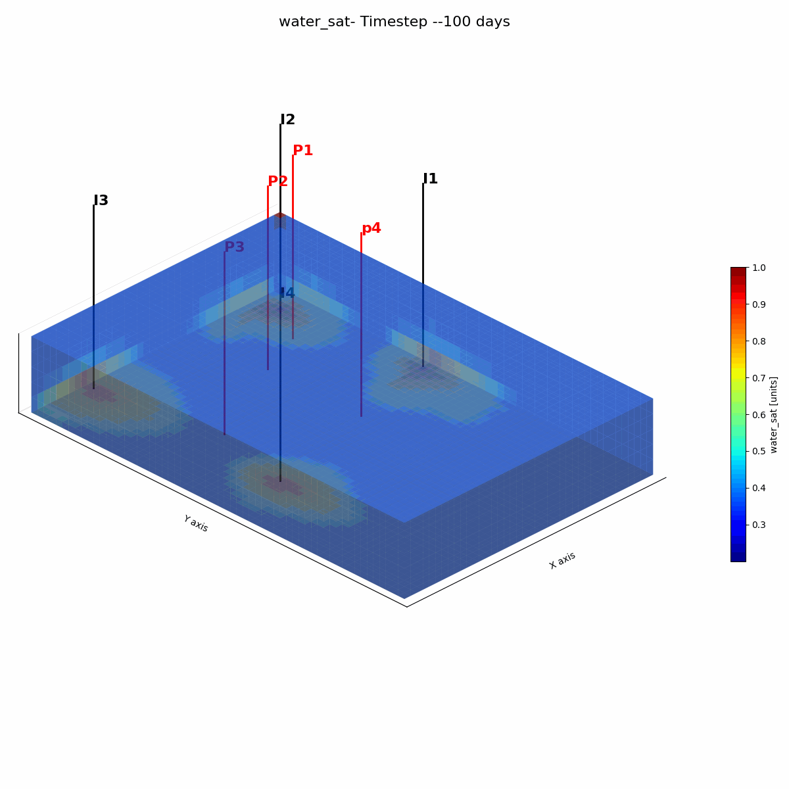
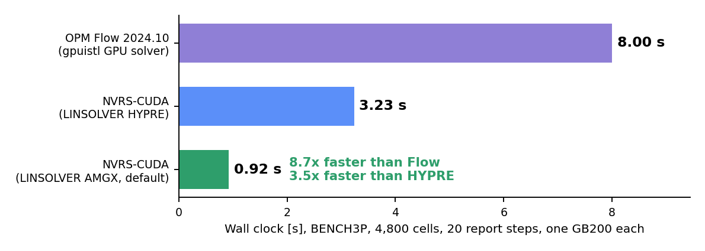

# GPU accelerated Reservoir Simulator

## Headline

The published **Norne field deck**, 44,431 active cells over 3312 days and 247
report steps, one GPU and one rank, with six solver arms run back to back on each
machine. All numbers are **version 2** of the code: the coupled operator stored
as 3x3 blocks with one index per block (`BLOCKSPMV 1`) and the Krylov tail
replayed from CUDA graphs (`CUDAGRAPH 1`). Version 1 is the same code with scalar
CSR and direct launches.

| Run | GB200 | VR72 | Over Flow, GB200 | Over Flow, VR72 |
|---|---|---|---|---|
| OPM Flow 2024.10 | 488.51 s | 243.88 s | | |
| NVRS-CUDA (HYPRE BoomerAMG, FP32) | 71.51 s | 73.54 s | 6.83x | 3.32x |
| NVRS-CUDA (Ginkgo, FP16) | 80.55 s | 50.02 s | 6.06x | 4.88x |
| NVRS-CUDA (Ginkgo, FP32) | 70.42 s | 49.31 s | 6.94x | 4.95x |
| NVRS-CUDA (Ginkgo FP16 + adaptive block-Jacobi) | 76.61 s | 57.27 s | 6.38x | 4.26x |
| NVRS-CUDA (AmgX, FP32, native FP64 operator) | 43.19 s | 34.91 s | 11.31x | 6.99x |
| **NVRS-CUDA (AmgX, FP32, default)** | **44.95 s** | **35.73 s** | **10.87x** | **6.83x** |

These are single runs from one session (the comparison session), used to compare the backends with
one another. Run three times in a second session, the default configuration takes **46.75 s**
[46.45, 46.99] on GB200 and 35.76 s on VR72, on the same Newton path (1,497 Newton, 41,114 Krylov);
the 4 % GB200 difference between sessions sits in the launch-bound phases. Wall clocks are compared
only within a session, and every factor against Flow below uses the repeated session.

Against Flow on one rank with two host threads NVRS is **10.45x** faster, and most of that is host work Flow does on two threads.
Given the whole node, Flow is fastest with its CPU CPR solver on 16 ranks, and
**the factor is 3.5x on GB200 and 2.5x on VR72** (NVRS median of three runs).

| Flow 2024.10 configuration | GB200 | NVRS faster by | VR72 | NVRS faster by |
|---|---|---|---|---|
| GPU ILU(0), 1 rank x 2 threads | 488.51 s | 10.45x | 243.88 s | 6.82x |
| GPU ILU(0), every host thread | 348.95 s | 7.46x | 543.49 s | 15.2x |
| **CPU CPR, 16 ranks (fastest)** | **165.62 s** | **3.54x** | **88.48 s** | **2.47x** |

NVRS runs a looser material-balance tolerance than Flow (MB 3.5e-5 against
1e-7); its exact discrete water balance closes to -0.68 %. At Flow's MB 1e-7 the NVRS Newton
iteration stagnates (one VR72 run took 2,901 s, 33x Flow's CPU CPR), so every factor here holds
only at the NVRS tolerance; this is the main limitation, and a trust-region saturation update is
the planned fix.

On GB200 the AmgX run takes 1,497 Newton iterations against Flow's 1,985, and
each costs 30.0 ms against 246.1 ms. It rebuilds the AMG hierarchy 172 times at
10.2 ms each and retries 3 of the 247 report steps; BoomerAMG takes 1,506 Newton
iterations. On VR72 the AmgX run takes 1,571 Newton iterations at 22.7 ms each.

Where the time goes on GB200, in seconds:

| Run | Total | Linear solve | of which AMG | Outside the solve |
|---|---|---|---|---|
| OPM Flow | 488.51 | 97.22 | n/a | 391.29 |
| NVRS-CUDA (AmgX) | **44.95** | 23.60 | 14.56 | 21.36 |
| NVRS-CUDA (HYPRE) | 71.51 | 49.91 | 34.12 | 21.61 |
| NVRS-CUDA (Ginkgo FP16) | 80.55 | 56.30 | 41.52 | 24.24 |

Under AmgX the run splits 38.2 % native FP32, 2.2 % emulated FP64 (the operator
apply alone) and 59.6 % native FP64 (54.3 / 2.5 / 43.1 % under BoomerAMG).


### Every ablation and study

Norne on one GPU unless a row says otherwise; each row changes one thing
from the default. GB200 walls are medians of three runs with [min, max]
unless marked as a single run; Newton and Krylov counts are GB200.

| Study | Change from the default | GB200 wall, s | Newton / Krylov | VR72 wall, s | Finding |
|---|---|---|---|---|---|
| **Default** | | | | | |
| Default configuration | block CSR, captured Krylov tail, df64 operator, quasi-IMPES, block-Jacobi stage 2, AMG reused up to 10 Newton | 46.75 [46.45, 46.99] | 1,497 / 41,114 | 35.76 [35.64, 36.62] | reference point; 11.6 s of it is output |
| **Storage and launch (2x2)** | | | | | |
| Scalar CSR, direct launches | version 1 operator | 51.24 [51.22, 51.55] | 2,004 / 45,125 | 40.08 | operator 64.1 us per Krylov |
| Block CSR, direct launches | no graph capture | 45.25 [44.74, 45.47] | 1,497 / 41,114 | 34.89 | 52.0 us: storage alone 1.23x (model 1.31x); fastest |
| Scalar CSR, captured tail | no block storage | 52.55 [52.44, 52.56] | 2,004 / 45,125 | 40.86 | capture costs 2.9 s; not repaid |
| Block CSR, captured, reuse guard | CUDAGRAPHMINREUSE 2 | 45.21 [44.91, 45.33] | 1,497 / 41,114 | 34.91 | guard stops after 192 captures (0.22 reuses each) |
| **Operator arithmetic** | | | | | |
| Native FP64 operator | EMULATE 0 | 44.04 [43.82, 44.21] | 1,400 / 38,869 | 34.56 | 11.37 us per apply; path differs, not arithmetic |
| FP32-stored operator, FP64 master | EMULATE 2 | 47.62 [47.52, 47.81] | 1,654 / 42,608 | 34.36 | apply 7% cheaper, run 8% slower; 9 of 1,663 solves continued on the true residual |
| **Preconditioner** | | | | | |
| Rebuild AMG every Newton | AMGREUSE 0 (single run) | 54.90 | 1,532 / 31,479 | 59.73 | reuse is worth 1.17x (1.67x on VR72) |
| Dynamic row-sum decoupling | CPRDECOUPLE DRS (single run) | 45.21 | 1,440 / 40,149 | 37.11 | Krylov per Newton 27.9 vs 27.5 |
| Plain row-sum decoupling | CPRDECOUPLE SUM (single run) | 47.41 | 1,596 / 42,864 | 37.41 | 26.9 per Newton: decoupling within 5% |
| Vertical line stage 2 | STAGE2 ZLINE | n/a | n/a | n/a | needs the Cartesian neighbour map; falls back to block-Jacobi on Norne |
| BoomerAMG, coarse grid 20,000 rows | AMGMAXCOARSE 20000, vs BoomerAMG 71.51 s (single run) | 87.35 | 1,723 / 136,274 | 73.39 | V-cycle 0.24 vs 0.44 ms but 1.87x Krylov |
| **Time integration** | | | | | |
| Flow's accepted substeps imposed | DTSEQFILE | 47.68 [47.23, 47.82] | 1,580 / 42,867 | 32.35 | Newton ratio to Flow 1.26 (1.33 unconstrained) |
| **Reference (Flow 2024.10)** | | | | | |
| (P) GPU ILU(0), 1 rank x 2 threads | two-thread configuration | 488.51 | 1,985 / 30,072 | 243.88 | NVRS 10.45x faster (VR72 6.82x) |
| (G) GPU ILU(0), every host thread | 1 x 144 (VR72 1 x 352) | 348.95 | 1,985 | 543.49 | 7.46x; threads slow VR72 down |
| (C) CPU CPR, best of 8/16/32 ranks | 16 ranks on both | 165.62 | 1,263 | 88.48 | 3.54x (VR72 2.47x) |
| **Scaling, 1 to 4 GPUs** | | | | | |
| 1 million cells | aggregation, NCCL, one imposed step sequence | 24.92 -> 27.22 | 683 -> 687 | 16.84 -> 25.67 | 0.92x (VR72 0.66x): too small to scale |
| 5 million cells | as above | 104.68 -> 80.60 | 683 -> 685 | 69.16 -> 56.73 | 1.30x, 33% efficiency (VR72 1.22x) |
| **Kernels in isolation** | | | | | |
| Block FP64 vs cuSPARSE CSR / BSR | Norne-sized box, us per apply | 14.4 vs 34.8 / 39.0 |  | 11.1 vs 29.7 / 32.3 | 2.42x / 2.71x (VR72 2.69x / 2.92x) |
| df64 vs native FP64 | same box | 18.5 vs 14.4 |  | 13.3 vs 11.1 | emulation costs 1.28x (VR72 1.21x) |
| Graph capture break-even r* | capture cost / saving per replay | 2.3 |  | 30 | Norne reuses each graph 1.16 times |
| **Accuracy** | | | | | |
| Pressure-matrix conditioning | cond2(A_p) = 5.2e3 | u32: 3e-4, u16: 2.5 |  | same | FP32 hierarchy safe; FP16 outside Proposition 1 |
| Exact discrete water ledger | NVRS_SUBSTEP_BALANCE=1 | -0.68% (trapezoid 1.75%) |  | -0.70% (1.15%) | bias due to the MB tolerance; the remainder is integration error in the balance |

### Version 2: block storage and CUDA graphs

| Norne, GB200, AmgX | Version 1 | Version 2 |
|---|---|---|
| Operator apply, per Krylov iteration | 64.0 us | **24.1 us** |
| Orthogonalisation (CGS2), per Krylov iteration | 91.0 us | **44.8 us** |
| AMG V-cycle | 0.31 ms | 0.31 ms |
| Kernel launches in the Nsight trace | 173,083 | **129,499** |
| Wall clock, GB200 | 46.52 s | **44.95 s** |
| Wall clock, VR72 | 44.65 s | **35.73 s** |

The two changes were introduced together; the 2x2 ablation below separates
them. Block storage makes the operator 1.23x cheaper per Krylov iteration, close
to the 1.31x the traffic model predicts. Graph capture halves the operator time
the solver's timer sees, but on Norne each graph is reused only 1.16 times
against a measured break-even of 2.3, the captures cost 2.9 s, and the run is
3 % slower than with direct launches. The reuse guard (`CUDAGRAPHMINREUSE`)
stops capturing after 192 captures and recovers the direct-launch time. On
SPE10 each graph is reused 159 times and capture stays on.

### Emulated against native FP64 in the operator

A sixth arm runs AmgX with `EMULATE 0`: the operator apply in native FP64,
everything else, the FP32 multigrid included, unchanged. It is not a comparison
of FP64 against FP32; both arms are equally mixed precision.

| AmgX, one GPU | Wall | Newton | Operator | Per apply |
|---|---|---|---|---|
| Norne, GB200, df64 | 44.95 s | 1,497 | 0.99 s | 11.8 us |
| Norne, GB200, native FP64 | 43.19 s | 1,400 | 0.90 s | 11.3 us |
| Norne, VR72, df64 | 35.73 s | 1,571 | 0.99 s | 11.6 us |
| Norne, VR72, native FP64 | 34.91 s | 1,526 | 0.96 s | 11.6 us |

Inside the solver the cost per apply is the same within 4 %, and the operator
is 2 % of the run, so the wall-clock differences are the Newton path, not the
arithmetic. Measured in isolation on a fixed input, the df64 apply costs 1.28x
the native one on GB200 and 1.21x on VR72: a df64 pair is the same 8 bytes as
FP64, but it does ten to twenty times the arithmetic. Emulation buys FP64
semantics, not speed. A third arm stores the operator in FP32 with an FP64
master for every residual that decides convergence (`EMULATE 2`): the apply is
7 % cheaper and the run 8 % slower on GB200, because the perturbed operator
lengthens the nonlinear path. On SPE10, whose deck already uses the native
operator, the two runs agree to 0.5 %.

### Ginkgo: a third multigrid, down to half precision

Ginkgo's parallel-graph-matching AMG (Anzt et al., ACM TOMS 2022) runs the whole
V-cycle in IEEE FP16 (or FP32 for a control), optionally with Ginkgo's
adaptive-precision block-Jacobi (Flegar et al., ACM TOMS 2021) as the second CPR
stage. It **does not beat AmgX**: its best arm is 1.57x slower on GB200 and 1.38x
on VR72, while beating BoomerAMG on both (1.02x and 1.49x).

| Norne, one GPU | V-cycle GB200 | V-cycle VR72 | Mean R^2 GB200 | Mean R^2 VR72 |
|---|---|---|---|---|
| **AmgX FP32** | **0.31 ms** | **0.23 ms** | 0.901 | 0.910 |
| AmgX FP32, native FP64 operator | 0.31 ms | 0.23 ms | 0.908 | 0.759* |
| BoomerAMG FP32 | 0.44 ms | 0.44 ms | 0.902 | 0.910 |
| Ginkgo FP16 | 0.65 ms | 0.36 ms | 0.851* | 0.903 |
| Ginkgo FP32 | 0.65 ms | 0.37 ms | 0.905 | 0.898 |
| Ginkgo FP16 + adaptive bJ | 0.64 ms | 0.36 ms | 0.893 | 0.911 |

\* One producer, D-4AH, moved its water breakthrough in that run; the other 21
wells match the other arms. The agreement measures used in the arXiv paper
(range-normalised error, cumulative error, breakthrough offset) are reported
there.

Half precision keeps the answer but not a speed-up. The measured conditioning
of the Norne pressure matrix puts FP16 outside the guarantee: cond(A_p) x u32 is
3e-4, well inside the condition of the paper's Proposition 1, but cond(A_p) x
u16 is 2.5, outside it. Per Newton iteration, however, FP16 Ginkgo needs no more
Krylov iterations than FP32 Ginkgo (32.0 against 33.5 on GB200, 35.5 against
34.6 on VR72); its 1.21x larger total comes from a longer nonlinear path (1,826
against 1,437 Newton), which `REVIEW_PARTS=fp16steps` tests on one imposed
substep sequence. On traffic: a CSR matrix with 32-bit
column indices moves 4 + w bytes per nonzero, so halving the value width saves at
most a quarter of the traffic, and the Nsight traces show the Norne kernels bound
by launch latency, with about 15 % of Ginkgo's GPU time in per-application solver
bookkeeping.

### Norne, every producer scored against Flow

Each of the 22 producers is scored separately by the R^2 of its whole history
against OPM Flow, on six quantities (GB200, AmgX). 🟢 R^2 >= 0.80,
🟡 0.70 to 0.80, 🔴 below 0.70. Where Flow's value is constant over the history
(a well held at a pressure limit), the error is measured against 5 % of that
level, so shut-in periods do not give negative scores.

| Well | WOPR | WWPR | WWCT | WGPR | WGOR | WBHP |
|---|---:|---:|---:|---:|---:|---:|
| B-1BH | 🟢 0.99 | 🟡 0.76 | 🟢 0.84 | 🟢 0.97 | 🟢 0.98 | 🟢 0.98 |
| B-1H | 🟢 0.95 | 🟢 0.83 | 🟢 0.93 | 🟢 0.97 | 🟢 0.85 | 🟢 0.92 |
| B-2H | 🟢 0.96 | 🟢 0.92 | 🟢 0.94 | 🟢 0.92 | 🟢 0.83 | 🔴 **0.28** |
| B-3H | 🟢 0.93 | 🟢 0.94 | 🟢 0.94 | 🟢 0.93 | 🟢 0.93 | 🟢 0.92 |
| B-4BH | 🟢 0.98 | 🟢 0.99 | 🟢 0.99 | 🟢 0.96 | 🟢 0.93 | 🟢 0.99 |
| B-4DH | 🟢 0.95 | 🟢 0.92 | 🟢 0.95 | 🟢 0.97 | 🟢 0.95 | 🟢 0.95 |
| B-4H | 🟢 0.98 | 🟢 0.98 | 🟢 0.96 | 🟢 0.98 | 🟢 0.97 | 🟢 1.00 |
| D-1CH | 🟢 0.99 | 🟢 0.98 | 🟢 1.00 | 🟢 0.97 | 🟢 0.97 | 🟢 0.96 |
| D-1H | 🟢 0.98 | 🟢 0.97 | 🟢 0.86 | 🟢 0.96 | 🟢 0.97 | 🟢 0.95 |
| D-2H | 🟢 0.97 | 🟢 0.90 | 🟢 0.93 | 🟢 0.95 | 🟢 0.80 | 🔴 **0.53** |
| D-3AH | 🟢 0.98 | 🟢 0.97 | 🟢 0.97 | 🟢 0.98 | 🟢 0.97 | 🟢 0.97 |
| D-3BH | 🟢 0.99 | 🟡 0.78 | 🟢 0.86 | 🟢 0.99 | 🟢 0.98 | 🟢 0.90 |
| D-4AH | 🔴 **0.67** | 🔴 **-0.25** | 🔴 **0.53** | 🟢 0.92 | 🟡 0.72 | 🟢 0.97 |
| D-4H | 🟢 0.98 | 🟢 0.95 | 🟢 0.89 | 🟢 0.96 | 🟢 0.97 | 🟢 0.99 |
| E-1H | 🟢 0.97 | 🟢 0.98 | 🟢 0.98 | 🟢 0.94 | 🟢 0.93 | 🟢 0.91 |
| E-2AH | 🟢 0.86 | 🟢 0.96 | 🟢 0.90 | 🟢 0.81 | 🟡 0.74 | 🟢 0.99 |
| E-2H | 🟢 0.98 | 🟢 0.96 | 🟢 0.99 | 🟢 0.94 | 🟢 0.96 | 🟢 0.94 |
| E-3AH | 🟢 0.93 | 🔴 **0.68** | 🟢 0.84 | 🟢 0.86 | 🔴 **0.69** | 🟢 0.99 |
| E-3CH | 🟢 0.84 | 🟢 0.97 | 🟢 0.99 | 🟢 0.82 | 🟢 0.97 | 🟡 0.78 |
| E-3H | 🟢 0.98 | 🟢 0.98 | 🟢 0.98 | 🟢 0.97 | 🟢 0.98 | 🟢 0.98 |
| E-4AH | 🟢 0.90 | 🟢 0.88 | 🟢 0.92 | 🟡 0.77 | 🔴 **0.52** | 🟢 1.00 |
| K-3H | 🔴 **0.64** | 🔴 **0.65** | 🟢 0.93 | 🟢 0.97 | 🔴 **0.67** | 🟢 0.95 |
| **wells >= 0.70** | **20/22** | **19/22** | **21/22** | **22/22** | **19/22** | **20/22** |

**20 of the 22 producers match Flow at R^2 >= 0.70 on oil rate, 21 on water cut,
all 22 on gas rate, and 19 on all four rate quantities at once** (all but D-4AH,
E-3AH and K-3H). The mean over producers and quantities is 0.901. The VR72 run
gives 20 of 22 on all four rates and a mean of 0.910.


Field recovery agrees to a fraction of a percent:

| | OPM Flow | NVRS-CUDA |
|---|---|---|
| Peak field oil rate | 227.52 k STB/day | 232.20 k STB/day |
| Best single well (E-2H) | 57.75 k STB/day | 54.33 k STB/day |
| Cumulative oil, 3312 days | 422.78 M STB | **425.07 M STB** |
| **Recovery factor** | **41.8 %** | **41.5 %** |
| Implied B_o | 1.303 | 1.289 |

The oil balance closes: what the saturation field gives up accounts for
**100 %** of what the well rates report. Water gained over the history is
523.0 M STB against Flow's 518.4; reconciled against reported injection the
water balance closes to +6.2 % (GB200) and +6.6 % (VR72) against Flow's +3.8 %.


### SPE10 model 2 against OPM Flow

1,122,000 cells, 1000 days, one Eclipse deck (`decks/SPE10_MATCHED.DATA`) read
by both simulators, CPRW, `LINTOL 3e-2`, native FP64 operator, one GPU. OPM Flow
runs on the VR72 host (its GPU bridge needs block size 3 and SPE10 is two-phase).


| Run | GB200 | VR72 | Over Flow | Mean R^2 |
|---|---|---|---|---|
| OPM Flow 2024.10 (CPU) | n/r | 766.16 s | | reference |
| NVRS-CUDA (HYPRE) | 99.22 s | 91.74 s | 8.37x | 0.999 |
| **NVRS-CUDA (AmgX)** | **53.06 s** | **41.21 s** | **18.59x** | **0.999** |

Recovery factor 21.1 % in both codes and the water balance closes exactly.
AmgX needs 39.2 Krylov iterations per Newton step against BoomerAMG's 69.9.


### Every model, every backend, both machines, one GPU


| Model | Cells | Flow GB200 | HYPRE GB200 | Ginkgo GB200 | AmgX GB200 | Flow VR72 | HYPRE VR72 | Ginkgo VR72 | AmgX VR72 |
|---|---|---|---|---|---|---|---|---|---|
| Norne, field | 44,431 | 488.51 | 71.51 | 80.55 | **44.95** | 243.88 | 73.54 | 50.02 | **35.73** |
| Bench3P | 4,800 | 9.25 | 3.00 | n/r | **0.89** | 5.32 | 3.44 | n/r | **0.95** |
| SPE10 model 2 | 1,122,000 | n/r | 99.22 | n/r | **53.06** | 766.16 (CPU) | 91.74 | n/r | **41.21** |
| Million | 1,000,000 | n/r | 26.23 | n/r | **21.17** | n/r | 19.94 | n/r | **14.87** |
| Million-2M | 2,000,000 | n/r | 49.94 | n/r | **39.38** | n/r | 38.23 | n/r | **27.17** |
| Million-4M | 4,000,000 | n/r | 81.87 | n/r | **77.67** | n/r | 60.97 | n/r | **52.33** |
| Million-5M | 5,000,000 | n/r | 102.32 | n/r | **95.61** | n/r | 76.65 | n/r | **63.77** |

Seconds, one GPU. AmgX is the fastest library on every model on both machines.
Solid bars are GB200, hatched bars VR72; green AmgX, blue BoomerAMG, on Norne
orange, violet and teal for the three Ginkgo arms (FP16 shown in the table), and
dark olive for AmgX with a native FP64 operator. `n/r` marks an arm that was not
run.

### Scaling across GPUs: AmgX against BoomerAMG, GB200 and VR72


At two and four GPUs the two arms take the same Newton path to within four
iterations, and each backend is also measured against **its own** single-GPU
rate:

| Cells | Backend | GB200 1 / 2 / 4 GPUs | GB200 1 to 4 | VR72 1 / 2 / 4 GPUs | VR72 1 to 4 |
|---|---|---|---|---|---|
| 4,800 | BoomerAMG | 3.00 / 6.22 / 7.91 s | 0.38x | 3.44 / 7.98 / 13.29 s | 0.26x |
| | AmgX | 0.89 / 2.00 / 2.75 s | 0.32x | 0.95 / 2.33 / 3.93 s | 0.24x |
| 1,000,000 | BoomerAMG | 26.23 / 33.85 / 43.27 s | 0.61x | 19.94 / 28.88 / 49.61 s | 0.40x |
| | AmgX | 21.17 / 18.96 / **18.26** s | **1.16x** | 14.87 / **14.02** / 16.17 s | 0.92x |
| 2,000,000 | BoomerAMG | 49.94 / 52.84 / 65.32 s | 0.76x | 38.23 / 43.83 / 72.11 s | 0.53x |
| | AmgX | 39.38 / 31.05 / **30.84** s | **1.28x** | 27.17 / **21.24** / 23.62 s | **1.16x** |
| 4,000,000 | BoomerAMG | 81.87 / 80.00 / 86.67 s | 0.94x | 60.97 / 60.96 / 85.21 s | 0.72x |
| | AmgX | 77.67 / 58.01 / **51.78** s | **1.50x** | 52.33 / 36.58 / **41.14** s | **1.27x** |
| 5,000,000 | BoomerAMG | 102.32 / 96.16 / 96.64 s | 1.06x | 76.65 / 77.49 / 93.30 s | 0.81x |
| | AmgX | 95.61 / 71.14 / **61.71** s | **1.55x** | 63.77 / 43.91 / **42.26** s | **1.51x** |

BoomerAMG does not scale on this problem: its hierarchy setup grows with ranks
(5.2 s to 17.6 s at a million cells on GB200) while AmgX's shrinks. At four GPUs
AmgX is faster in absolute terms by 1.64x to 2.37x on GB200 and 2.24x to 3.10x
on VR72. On one GPU from a million cells up AmgX takes about 694 Newton
iterations to BoomerAMG's 362 (its single-rank classical hierarchy; at two ranks
it builds aggregates and the counts agree), and is still 2.1x to 2.7x cheaper per
Newton iteration.

**VR72 against GB200.** AmgX gains 1.30x to 1.41x across the million-cell
family, 1.29x on SPE10 and 1.26x on Norne; Bench3P, at 4,800 cells, is too small
to gain. Keep the CUDA JIT cache enabled on VR72: the device reports a compute
capability no released toolkit targets, so every kernel is compiled from PTX at
load.

**Time integration follows OPM Flow's**: a continuous timestep carried across
report steps and rescaled from the Newton count of the last converged sub-step,
with Flow's pore-volume-weighted convergence criterion (`DTCONTROL`, `OPMCONV`,
`NEWTONSTALLMAX`).

Reproduce a case with
`cd full_reservoir_simulator/GPU_reservoir_simulator/cuda/benchmark && ./nvrs.sh all NORNE`
(or `SPE10`, or `BENCH3P`).

## Start here: the container

Everything in this repository was measured inside one image, and it is the
supported way to build and run any of it.  From this folder:

```bash
../../build_container.sh
```

That builds the image if it does not exist and drops you into a shell already
in `/workspace/project`, which **is** this repository, mounted rather than
copied, so
an edit on the host is an edit in the container, and rebuilding the simulator
never means rebuilding the image.

Then, inside the container:

```bash
cd full_reservoir_simulator/GPU_reservoir_simulator/cuda && make -j
```

Before trusting any multi-GPU timing, prove the image is what it claims:

```bash
../../build_container.sh check
```

A container can carry CUDA and an MPI and still not have **CUDA-aware** MPI,
and a successful build says nothing either way.  `check` compiles and runs a
two-rank `MPI_Send`/`MPI_Recv` on a `cudaMalloc`'d pointer and reports what
actually happened.  It matters: NVRS ranks exchange *device* buffers directly,
and a stock OpenMPI stages them through host memory. It still runs, and it is
quietly several times slower, which is the worst kind of difference because
nothing fails.

[`Dockerfile`](../../Dockerfile) is CUDA 12.8 on Ubuntu 22.04 with UCX
1.18.1, PMIx 4.2.8 and OpenMPI 4.1.5 built from source (`--with-cuda
--with-ucx --with-pmix --with-slurm`).  UCX's own test programs are not built: they are not used here, and pinning
them to one CUDA version is what broke the first build of this image.  The base image is multi-architecture,
so it builds on x86_64 and on aarch64 (GB200) unchanged.  The first build
compiles three libraries from source and takes tens of minutes; later builds
come from the layer cache.

[`build_container.sh`](../../build_container.sh) also takes `build`,
`rebuild`, `shell`, `run <cmd>` and `help`.  It uses `podman` when `docker` is
absent, and where neither is permitted (common on a shared cluster) it prints
the Apptainer equivalent.

---

### Forward problem
**Black oil model**;

 - Our simplified model for two-phase flow in porous media for reservoir simulation is given as [7].
```math
\begin{equation}
φ\frac{∂S_w}{∂t} - \nabla .[T_{w} (\nabla.p_{w} + ρ_{w}gk)]= Q_{w} 
\end{equation}
```
```math
\begin{equation}
φ\frac{∂S_o}{∂t}- \nabla .[T_{o} (\nabla.p_{o} + ρ_{o} gk)]= Q_{o}     
\end{equation}
```
$`φ(x)`$ stands for the porosity,subscript $`w`$ stands for water and subscript $`o`$ stands for oil. $`T_{o},T_{w},T`$ stands for the transmissibilities, which are known functions of the permeability $`K`$ and the water saturation $`S_w`$. The system is closed by adding two additional equations

```math
\begin{equation}
P_{cwo} = p_o- p_w  ; S_w+ S_o=1. 
\end{equation}
``` 
This gives four unknowns
```math
\begin{equation}
p_{o}, p_{w}, S_{w}, S_{o}
\end{equation}
``` 
Gravity effects are considered by the terms 
```math
\begin{equation}
ρ_{w}gk,ρ_{o}gk\quad Ω \subset R^{n}(n = 2, 3) 
\end{equation}
``` 
The subsequent water, oil and overall transmissibilities is given by,
```math
\begin{equation} 
T_w = \frac{K(x) K_{rw}S_w}{μ_w}  ;T_o = \frac{K(x) K_{ro}S_o}{μ_o}   ;T= T_w + T_o          
\end{equation}
``` 
The relative permeabilities $`K_{rw} (S_w ),K_{ro} (S_w )`$ are available as tabulated functions, and $`μ_w,μ_o`$ denote the viscosities of each phase. 

We define the oil flow, the water flow, and the total flow, respectively, which are measured at the well position as; 
```math
\begin{equation} 
Q = Q_{o}  + Q_{w }
\end{equation}
``` 

The final pressure and saturation equations for a two-phase oil-water flow is
```math
\begin{equation} 
- ∇ .[T∇p]=Q   
\end{equation}
```  
```math
\begin{equation}                                               
φ\frac{∂S_w}{∂t} - \nabla .[T_{w} (\nabla.p_{w}]= Q_{w} 
\end{equation}
```  


## Then: one command

`nvrs.sh` is the whole workflow behind one entry point. It does not replace any
of the scripts below; it calls them in order and knows which one a given case
needs, because that is where the steps were being lost: sourcing an environment
file between two installers, or knowing that Norne is downloaded
while SPE10 is generated and the BENCH cases are computed, or that the figures
need a second command after the profile.

```bash
cd full_reservoir_simulator/GPU_reservoir_simulator/cuda/benchmark

./nvrs.sh                  # what is installed, what is ready, what to type
./nvrs.sh install          # HYPRE, AmgX, OPM Flow, Nsight, and nvrs_cuda
./nvrs.sh all NORNE        # fetch it, run it, profile it, report it
```

That last line ends with `runs/compare_NORNE.html`: NVRS against OPM Flow, the
field images, the animation, and the Nsight Systems figures for both multigrid
backends, in one page.

Any case works the same way:

```bash
./nvrs.sh cases            # every case, and whether its deck is ready
./nvrs.sh all SPE10
./nvrs.sh all BENCH3P
NVRS_DECK=/path/to/MY.DATA ./nvrs.sh all MYFIELD
```

Or one step at a time, when a stage needs re-running on its own:

| Command | What it does |
|---|---|
| `./nvrs.sh` | the menu: commands, options, and what is ready on this machine |
| `./nvrs.sh install` | HYPRE, AmgX, OPM Flow, Nsight and `nvrs_cuda` |
| `./nvrs.sh cases` | every case, and whether its deck is ready |
| `./nvrs.sh get <CASE>` | fetch or generate the deck and its data |
| `./nvrs.sh run <CASE>` | the backends, against OPM Flow |
| `./nvrs.sh profile <CASE>` | Nsight Systems, once per backend |
| `./nvrs.sh report <CASE>` | the figures, folded into the HTML |
| `./nvrs.sh all <CASE>` | all four of the above, in order |

Options are flags, and every command prints the ones it takes when it starts,
so there is nothing to memorise:

```
  in effect now         --backend amgx --no-opm
  'profile' also takes  --backend  --fraction  --tend  --steps  --ncu  --deck
  full list             ./nvrs.sh --help
```

| Option | Applies to | Meaning |
|---|---|---|
| `--no-opm` | run, all | NVRS only; do not run OPM Flow |
| `--backend <b>` | run, profile | `amgx`, `hypre`, or `both` (default both) |
| `--ranks <n>` | run, profile | MPI ranks for NVRS |
| `--no-profile` | all | skip the profiling step |
| `--no-scaling` | run, all | one GPU only; skip the 2/4-GPU strong-scaling sweep |
| `--scaling` | run, all | force the sweep on (SPE10 defaults to off) |
| `--ncu` | profile, all | add Nsight Compute counters (~100x slower) |
| `--fraction <f>` | profile, all | history to profile: `0.25`, or `all` (default `0.1`) |
| `--tend <days>` | profile, all | profile exactly this many days instead |
| `--steps <n>` | profile, all | **NORNE only**: report steps, or `all` |
| `--heartbeat <s>` | profile, all | progress interval, `0` to silence |
| `--deck <path>` | get, run, all | your own `.DATA`, for a case not under `decks/` |

`--no-scaling` matters for the large cases. By default a run is repeated on 2,
4 and however many GPUs are present, which is the point for the BENCH family
and wasted time for SPE10: 1.12 million cells that exist to stress the solver,
where each extra rank repeats a long run to answer a question the case was not
chosen to ask. SPE10 therefore defaults to a single GPU, and `--scaling`
overrides that.

`--steps` is Norne-only on purpose: a report step is a fortnight there and
something else in every other deck, so it is refused rather than quietly
misapplied. Use `--fraction` or `--tend` elsewhere.

Some worked examples:

```bash
./nvrs.sh all NORNE --no-opm              # skip Flow, NVRS only
./nvrs.sh all NORNE --backend amgx        # one backend, faster
./nvrs.sh all NORNE --steps all           # the whole 247-step history
./nvrs.sh all SPE10 --fraction 0.5        # half of SPE10's history
./nvrs.sh all MYFIELD --deck /path.DATA   # a deck of your own
./nvrs.sh profile NORNE --ncu             # add the kernel counters
./nvrs.sh report NORNE                    # rebuild the HTML only
```

The older environment variables (`SKIP_OPM`, `NVRS_BACKENDS`, `PROF_FRACTION`
and the rest) still work; the flags override them.

Each install step is skipped when its output is already present, so
`./nvrs.sh install` is safe to re-run after a failure and resumes rather than
starting over. Nothing in it needs root.

## Newer GPUs, and machines without root

Two things are handled automatically and are worth knowing about:

**A GPU newer than any CUDA that can target it.** Vera Rubin reports compute
capability 10.7 and no toolkit has an sm_107 target. The install scripts emit
PTX for the newest architecture not newer than the device, which the driver
JIT-compiles into native code at load. `CUDA_ARCH=100` pins it if you are
cross-building. The first run pays the compile once; the benchmark scripts keep
the JIT cache on the mounted filesystem so it is not paid again, and timings
from a JIT-compiled machine are not comparable with a natively-built one.

**No root inside the container.** `dpkg` needs to be root and `sudo` is
usually not setuid, so missing dependencies are downloaded and unpacked into a
prefix rather than installed. That prefix is *appended* to `LD_LIBRARY_PATH`,
never prepended, because prepending it once shadowed the container's Open MPI and
broke the launcher.

Everything installs in one command:

```bash
cd full_reservoir_simulator/GPU_reservoir_simulator/cuda/benchmark && ./install_all.sh
```

## Two implementations

This directory holds the original **CuPy/Python** simulator, documented below.
A **CUDA C++** translation of it lives in [`cuda/`](cuda/README.md): same
physics, same discretisation, same solver algorithm, rewritten for one GPU to
multi-node clusters and reading OPM/Eclipse-style decks instead of YAML.

The C++ version is where the mixed-precision linear solver work happens. Its
CPR preconditioner takes the stage-1 multigrid from **AmgX** (default) or
**HYPRE BoomerAMG**, selected with `LINSOLVER` in the deck, both running FP32
inside an FP64 Krylov.

### Building it, with both solvers

**1. HYPRE**: `CUDA_ARCH`: 70 V100, 80 A100, 90 H100, 100 GB200.

```bash
cd ../Mixed_precision
CUDA_ARCH=100 ./scripts/docker/install_hypre_sm100.sh
source hypre_env.sh                      # sets HYPRE_FP32_DIR
```

**2. AmgX**: the default stage-1 multigrid.

```bash
cd ../GPU_reservoir_simulator/cuda
./benchmark/install_amgx.sh              # clone, build, install
source ../../amgx-install/amgx_env.sh    # sets AMGX_DIR
```

**3. The simulator, against both.**

```bash
make -j                                  # reads both env vars
```

**`make` and `cmake` are not interchangeable.** They write different binaries:

| Built with | Produces | Used by the benchmarks |
|---|---|---|
| `make -j` | `cuda/nvrs_cuda` | **yes** |
| `cmake --build build` | `cuda/build/nvrs_cuda` | no |

Every script here runs `cuda/nvrs_cuda`, and says so when the other exists:
`note : ignoring older .../cuda/build/nvrs_cuda`. They also find AmgX
differently, since cmake is given `-DAMGX_DIR` outright while make reads the
environment, so one can have AmgX and the other not. Build with `make` unless
you have a reason not to, and if you build both, make last.

Check that it found AmgX. This is the one line worth reading in the build
output:

```
  AmgX: /path/to/amgx-install          <- good
  AmgX: not found -- HYPRE only        <- stop here
```

AmgX missing is not an error. The build carries on, the run prints one warning,
and the benchmark then measures BoomerAMG under a label that says AmgX. On
SPE10 the difference is a 100-day timestep against 571 Newton iterations and
60,262 Krylov iterations, so it is worth ten seconds to confirm.

The usual cause is an install with the library but not the headers. AmgX's own
`make install` has historically skipped them, which is why `install_amgx.sh`
copies them itself and refuses to finish without `amgx_c.h`. If a prefix has
`lib/libamgxsh.so` and no `include/amgx_c.h`, it was never completed:

```bash
FORCE_AMGX=1 ./benchmark/install_all.sh    # or ./benchmark/nvrs.sh install
```

A run then names the backend it actually used:
A run then names the backend it actually used:

```
*      Mixed-precision CPR: AmgX aggregation AMG + block-Jacobi on CUDA      *
  Linear   : stage-1 multigrid from AmgX
```

**AmgX is optional.** Skip step 2 and everything still builds and runs on HYPRE
BoomerAMG, with a warning if a deck asked for AmgX, never a silent
substitution. It is worth having: **1.60× faster** than BoomerAMG (and 1.56× faster than the best Ginkgo arm) on the Norne field deck and **3.6× faster** on the 4,800-cell `BENCH3P`.



See [`cuda/README.md`](cuda/README.md) for the full build, the deck keywords,
and the measured comparison against OPM Flow.

## Features
* Simulates 2 / 3-phase flow Black oil forward Modeling with GPU enhanced linear inverse problem solution ansatz
* cuSOLVER integrated workflow for matrix algebra computation and sparse linear solver
* Configures from a Yaml file
* Creates an animation at the end

## Important Dependencies & Prerequisites:
- Nvidia's in-house GPU based black oil reservoir simulator - **NVRS**
- CUDA 11.8 : [link](https://developer.nvidia.com/cuda-11-8-0-download-archive)
- CuPy : [link](https://github.com/cupy/cupy.git)
- Python 3.8 upwards

## Getting Started:
- These instructions will get you a copy of the project up and running on your local machine for development and testing purposes. 
- The code is developed in a Linux enviroment.

## Installation

- From terminal create a new conda enviroment named **MDLO** (check if conda is installed) .
```bash
conda create --name MDLO python=3.8
```

Clone this code base repository in a dedicated **work folder**.
```bash
cd **work folder**
conda activate MDLO
git clone --branch feature/norne-examples --single-branch \
  https://github.com/clementetienam/physicsnemo.git
cd physicsnemo/examples/reservoir_simulation/reservoir_simulator

```
- From terminal, install (missing) dependencies in 'requirements.txt' in the conda enviroment **MDLO**
- Follow instructions to install CuPy from : [link](https://github.com/cupy/cupy.git)

```bash
# enable shell script execution.
sudo chmod +x ./scripts/docker/docker-build.sh
# Build docker image
./scripts/docker/docker-build.sh

# enable shell script execution.
sudo chmod +x ./scripts/docker/docker-run.sh
# Run docker container (also enables X server for docker)
./scripts/docker/docker-run.sh
```

### Run
**NVRS** is a fully GPU based Black oil reservoir simulator.
Solvers include;
1) Left-Preconditioned GMRES [link](https://docs.cupy.dev/en/stable/reference/generated/cupyx.scipy.sparse.linalg.gmres.html)
2) LSQR [link](https://docs.cupy.dev/en/stable/reference/generated/cupyx.scipy.sparse.linalg.lsqr.html)
3) Left Preconditoned Conjugate gradient [link](https://docs.cupy.dev/en/stable/reference/generated/cupyx.scipy.sparse.linalg.cg.html)
4) Constrained pressure residual -CPR  (V cycle 2stage AMG for presure solve and left-precondioned GMRES with ILU(0) as preconditoner for saturation sole) [link](https://doi.org/10.2118/96809-MS)
6) Spsolve [link](https://docs.cupy.dev/en/stable/reference/generated/cupyx.scipy.sparse.linalg.spsolve.html)


**CPR is the default solver**.
1) Pressure solver: V cycle 2 stage AMG with Aggregation and Level scheduling for the coarsening/restriction operations
2) Saturation solver:  Left preconditoned GMRES with ILU(0) as preconditioner
3) Smoothers include : Jacobi, Gauss-Seidel, SOR

## How to run

Corner-point field decks (Norne and the like) are read directly:

```bash
cd GPU_reservoir_simulator/cuda
./benchmark/get_norne.sh
NGPU=1 ./scripts/run.sh decks/NORNE.DATA
```

In version 2 on one GB200, the 247 report steps take **44.95 s** with AmgX, **80.55 s** with Ginkgo FP16 or **71.51 s** with HYPRE, against OPM Flow's **488.51 s** (on one VR72: 35.73 s, 50.02 s, 73.54 s and 243.88 s), and 19 of the 22 producers match Flow at R^2 >= 0.70 on all four rate quantities. The
field deck's own saturation tables are used, not the run deck's placeholder
(`FIELDSATFUNC`, on by default); `PROPSARRAYS` and `USEENDSCALE` additionally
take the deck's per-cell arrays and endpoint scaling, and both default off
because they change the initial state rather than merely refine it. See
[`cuda/benchmark/README.md`](cuda/benchmark/README.md) §8 and the 100-page
[`cuda/docs/manual.pdf`](cuda/docs/manual.pdf), Chapter 10.

```bash
```

Always launch through `scripts/run.sh`, because the simulator is an MPI program and
exits with a UCX message if started directly.


```
python NVRS/simulator.py Run.yaml
```
## Results
| Reservoir 1 (Nx =33, Ny =33, Nz =1) | Reservoir 2 (Nx = 40, Ny = 40, Nz =3)| Reservoir 3  (Nx= 40, Ny = 60 ,Nz =5)|
|, , , , , , --|, , , , , , , |, , , , , , , |
| ![Image 1][img1]     | ![Image 2][img2]     | ![Image 3][img3]     |
| **Figure(a) -Permeability**| **Figure (b) - Permeability**| **Figure (c) - Permeability**|
|, , , , , , --|, , , , , , , |, , , , , , , |
| ![Image 4][img4]     | ![Image 5][img5]     | ![Image 6][img6]     |
| **Figure (d) -Pressure**| **Figure (e) -Pressure**| **Figure (f) - Pressure** |
|, , , , , , --|, , , , , , , |, , , , , , , |
| ![Image 7][img7]     | ![Image 8][img8]     | ![Image 9][img9]     |
| **Figure (g) -Water saturation**| **Figure (h) - Water saturation** | **Figure (i) - Water saturation** |
|, , , , , , --|, , , , , , , |, , , , , , , |
| ![Image 10][img10]  | ![Image 11][img11]   | ![Image 12][img12]   |
| **Figure (j) - Oil saturation** | **Figure (k) - Oil saturation** | **Figure (l) - Oil saturation**|
|, , , , , , --|, , , , , , , |, , , , , , , |
| ![Image 13][img13]  | ![Image 14][img14]   | ![Image 15][img15]   |
| **Figure (m) - P- wave impedance** | **Figure (n) - P- wave impedance** | **Figure (o) - P - wave impedance**|


[img1]: RESULTS/33331/Permeability.png "Permeability Field ( 33 by 33 by 1)"
[img2]: RESULTS/40403/Permeability.png "Permeability Field ( 40 by 40 by 3)"
[img3]: RESULTS/40605/Permeability.png "Permeability Field ( 40 by 60 by 5)"
[img4]: RESULTS/33331/Evolution_pressure_3D.gif "Pressure Field (33 by 33 by 1)"
[img5]: RESULTS/40403/Evolution_pressure_3D.gif "Pressure Field (40 by 40 by 3)"
[img6]: RESULTS/40605/Evolution_pressure_3D.gif "Pressure Field (40 by 60 by 5)"
[img7]: RESULTS/33331/Evolution_water_3D.gif "Water Field (33 by 33 by 1)"
[img8]: RESULTS/40403/Evolution_water_3D.gif "Water Field (40 by 40 by 3)"
[img9]: RESULTS/40605/Evolution_water_3D.gif "Water Field (40 by 60 by 5)"
[img10]: RESULTS/33331/Evolution_oil_3D.gif "Oil Field (33 by 33 by 1)"
[img11]: RESULTS/40403/Evolution_oil_3D.gif "Oil Field (40 by 40 by 3)"
[img12]: RESULTS/40605/Evolution_oil_3D.gif "Oil Field (40 by 60 by 5)"
[img13]: RESULTS/33331/Evolution2_impededance.gif "Impedance Field (33 by 33 by 1)"
[img14]: RESULTS/40403/Evolution2_impededance.gif "Impedance Field (40 by 40 by 3)"
[img15]: RESULTS/40605/Evolution2_impededance.gif "Impedance Field (40 by 60 by 5)"


### Contacts

Clement Etienam

Tsubasa Onishi

Oleg Ovcharenko

Issam Said

## Profiling: Nsight Systems (and Nsight Compute if you want it)

Run these from `cuda/benchmark`
(and `scripts/backend_study.sh` from `cuda`).

`nsys` answers *where the time goes*, independently of the wall-clock split the
run claims for itself. That independence is the point: a phase boundary drawn
in the wrong place inside the code produces a self-consistent table that is
wrong, and only an outside measurement catches it.

Any benchmark profiles itself if asked. `NVRS_PROFILE=1` adds **Nsight
Systems** only:

```bash
NVRS_PROFILE=1 ./run_norne.sh                      # Norne
NVRS_PROFILE=1 ./run_comparison.sh BENCH2P BENCH3P # the generated cases
NVRS_PROFILE=1 ./scripts/backend_study.sh all      # every arm of the study
```

Or standalone, on **any deck**, without re-running a benchmark:

```bash
./profile_case.sh SPE1                 # nsys, first 10% of that deck's history
./profile_case.sh SPE10 both           # add the kernel counters
./profile_case.sh NORNE                # any case under decks/
./profile_case.sh                      # lists the decks it can see
NVRS_DECK=/path/to/MY.DATA ./profile_case.sh MYFIELD
```

The case name picks the deck (`decks/<CASE>.DATA`, unless `NVRS_DECK` names
one) and decides where the output goes. Nothing else differs between cases:
one implementation, so profiling a new field cannot quietly behave differently
from profiling Norne.

How much of the history to cover:

```bash
PROF_FRACTION=0.25 ./profile_case.sh SPE1  # a quarter of the deck's TEND
PROF_FRACTION=all  ./profile_case.sh SPE1  # the deck as written
PROF_TEND=140      ./profile_case.sh SPE1  # exactly 140 days
```

A **fraction**, not a step count, because a step count means nothing without
knowing how long a step is and that varies by deck. Norne's are a fortnight;
`profile_norne.sh` is a thin wrapper that keeps `PROF_STEPS` for the one deck
where the answer is known:

```bash
./profile_norne.sh                     # nsys, 24 report steps
PROF_STEPS=10 ./profile_norne.sh       # shorter
PROF_STEPS=all ./profile_norne.sh      # all 247 steps
```

Both backends, kept side by side rather than one overwriting the other:

```bash
./profile_case.sh SPE1                        # amgx
NVRS_BACKEND=hypre ./profile_case.sh SPE1     # hypre, alongside it
```

Then the figures and the report:

```bash
python3 profile_plots.py --case SPE1  # draws them
python3 compare.py --case SPE1        # folds them into compare_SPE1.html
```

Everything lands in `runs/<CASE>/profile/<backend>/`, and the figures go into
the **same** `runs/compare_<CASE>.html` as the field images and the animation.
There is no separate profiling report. The field images come from the full
unprofiled benchmark runs; only the profile figures come from here.

With more than one backend profiled, each figure is drawn once per backend and
named for it, `profile_timeline_amgx.png` beside `profile_timeline_hypre.png`
, and the report captions say which is which. `profile_cpr.png` is drawn once,
because it comes from the run's own timers and already shows both together.

### What each figure needs

| Figure | Needs | Answers |
|---|---|---|
| `profile_cpr.png` | **no profiler** | how the linear solve divides: AMG setup, V-cycles, stage-2, operator SpMV, CGS2 |
| `profile_timeline.png` | nsys | *when* each phase runs, the whole run above, the busiest window below |
| `profile_time.png` | nsys | *how much* GPU time each phase and kernel takes |
| `profile_roofline.png` | ncu | where each kernel sits against the roofline |
| `profile_limiters.png` | ncu | what limits each kernel: bandwidth, compute, or latency |

The first needs no profiler because the solver times its own CPR phases and
writes them to `meta.json`. That is the only way to tell a multigrid V-cycle
from the operator apply in the Krylov loop: they are the same sparse kernel, and
no trace can separate them from outside.

In `profile_timeline.png`, each row of the upper panel is shaded against **its
own** busiest moment, so colours show when a phase is active and are **not**
comparable between rows. Use `profile_time.png` for relative size.

### Nsight Compute, when you want it

Off by default and asked for explicitly, because it serialises and replays every
kernel and is roughly **100x slower per kernel**:

```bash
./profile_case.sh NORNE both         # timeline + counters
./profile_case.sh NORNE ncu          # counters only
NCU_COUNT=40 ./profile_case.sh NORNE ncu   # fewer, faster
```

Bounded by `NCU_SKIP` (launches to skip past cold start-up, default 200) and
`NCU_COUNT` (launches to profile, default 120) rather than let loose on a run.
`NCU_CLOCK` defaults to `--clock-control none`: pinning the GPU to base clocks
needs a privilege a container usually lacks, and refusing to profile is worse
than absolute rates that depend on where the clocks were. Nothing here quotes an
absolute rate, the counters give ratios, the wall clock comes from unprofiled
runs.

### Watching it, and what it is doing

The run's own output goes to the terminal and to `nsys_run.log`, and a heartbeat
prints elapsed time and GPU utilisation every 20 seconds (`NVRS_HEARTBEAT=0` to
silence, or a different interval):

```
  [profile] profiling ...   40s   util 87 %, device mem 3565 MiB in use
```

A GPU at 90% is working. A GPU at 0% for minutes is worth interrupting. The
memory figure is the **whole device**, CUDA context, library workspaces, every
process on it, not this run's arrays.

The heartbeat also covers the phase after the run, where `nsys stats` builds a
SQLite database from the report in silence. On a long trace that takes as long
as the run did.

When it finishes, the heaviest kernels are printed without opening anything:

```
  [profile] top 3 kernels by GPU time (of 46 distinct), over 140 days:
  [profile]   1.  41.2%    12345.7 ms     48231 x  amgx::spmv_kernel
```

`NVRS_TOPK` changes how many.

### The profiler options

The defaults are copied from a configuration that produces working reports on
this hardware, not derived:

```
--trace=cuda,nvtx --cuda-memory-usage=true --wait=all --mpi-impl=openmpi
```

`--mpi-impl` is passed only when the launcher was detected as Open MPI, and both
it and `--wait` are checked against `nsys profile --help` first, so an older
build is never handed an option it will reject. `NSYS_OPTS` replaces the set
entirely, useful for narrowing a profiler problem by hand, and setting it also
suppresses the automatic retry described below.

A profiled deck sets `AUTOPLOT 0`. At the end of a run the simulator shells out
to `plot_results.py`, and under a profiler that Python process is a traced
child; with `--wait=all` nsys will not finalise until it exits, so a four-second
simulation ends up held open by matplotlib for minutes. It reads as a hang, and
interrupting it aborts nsys before it flushes, which is how a run that launched
thousands of kernels produces a report containing none. `PROF_PLOTS=1` draws
them afterwards instead, with the profiler detached.

### The trace, and its size

`profile_timeline.png` is drawn from `cuda_gpu_trace`, one row per kernel launch.
A full 247-step Norne run launches on the order of ten million, so the trace is
**sampled, not truncated**: every Nth launch, with N derived from the launch
count in the kernel summary so that it fits `PROF_TRACE_ROWS` (default 400 000).
Truncating would keep the opening minutes and draw them as though they were the
history. The stride is stated in the figure whenever it is not 1.

```bash
PROF_TRACE_ROWS=2000000 ./profile_case.sh SPE1    # finer, larger file
PROF_TIMELINE=0 ./profile_case.sh SPE1            # skip the trace entirely
```

`PROF_TRACE_ROWS` applies to `profile_plots.py` as well, so set it on both when
you raise it.

### If it captures no kernels

The script prints `nsys_run.log` and the program's own output at the point of
failure, then retries once with a minimal option set. An empty kernel table
means nsys wrote no kernel rows, which happens both when a process launches none
and when the profiler cannot attach or the process dies before the buffers
flush, so read the logs rather than assuming either.

A profiled run is deliberately **shortened**. The kernel *mix* is the
benchmark's, since the same assembly, V-cycle and SpMV run at every step; the
wall-clock *total* is not, and neither the report nor the paper quotes it as one.

## References

The three interchangeable stage-1 multigrids, the reference simulator, and the
methods and cases behind every number above.

**Solver libraries**

- **AmgX** (default stage-1 multigrid, `LINSOLVER AMGX`). M. Naumov, M. Arsaev,
  P. Castonguay, J. Cohen, J. Demouth, J. Eaton, S. Layton, N. Markovskiy,
  I. Reguly, N. Sakharnykh, V. Sellappan and R. Strzodka, *AmgX: a library for
  GPU accelerated algebraic multigrid and preconditioned iterative methods*,
  SIAM J. Sci. Comput. 37(5), S602–S626, 2015.
  <https://github.com/NVIDIA/AMGX>
- **HYPRE BoomerAMG** (`LINSOLVER HYPRE`). V. E. Henson and U. M. Yang,
  *BoomerAMG: a parallel algebraic multigrid solver and preconditioner*, Appl.
  Numer. Math. 41(1), 155–177, 2002; R. D. Falgout and U. M. Yang, *hypre: a
  library of high performance preconditioners*, ICCS, 632–641, 2002.
  <https://github.com/hypre-space/hypre>
- **Ginkgo** (`LINSOLVER GINKGO`, FP16 or FP32 hierarchy). H. Anzt, T. Cojean,
  G. Flegar, F. Göbel, T. Grützmacher, P. Nayak, T. Ribizel, Y.-H. M. Tsai and
  E. S. Quintana-Ortí, *Ginkgo: a modern linear operator algebra framework for
  high performance computing*, ACM TOMS 48(1), 1–33, 2022.
  <https://github.com/ginkgo-project/ginkgo>
- **Adaptive-precision block-Jacobi** (`STAGE2 GINKGO`). G. Flegar, H. Anzt,
  T. Cojean and E. S. Quintana-Ortí, *Adaptive precision block-Jacobi for high
  performance preconditioning in the Ginkgo linear algebra software*, ACM TOMS
  47(2), 1–28, 2021.
- **OPM Flow** (the reference simulator). A. F. Rasmussen et al., *The Open
  Porous Media Flow reservoir simulator*, Comput. Math. Appl. 81, 159–185,
  2021. <https://opm-project.org>

**Method**

- J. R. Wallis, *Incomplete Gaussian elimination as a preconditioning for
  generalized conjugate gradient acceleration*, SPE 12265, 1983; H. Cao,
  H. A. Tchelepi, J. R. Wallis and H. E. Yardumian, *Parallel scalable
  unstructured CPR-type linear solver for reservoir simulation*, SPE 96809,
  2005.
- J. W. Ruge and K. Stüben, *Algebraic multigrid*, in Multigrid Methods, SIAM,
  73–130, 1987.
- Y. Saad, *A flexible inner-outer preconditioned GMRES algorithm*, SIAM
  J. Sci. Comput. 14(2), 461–469, 1993.
- S. C. Eisenstat and H. F. Walker, *Choosing the forcing terms in an inexact
  Newton method*, SIAM J. Sci. Comput. 17(1), 16–32, 1996.
- D. W. Peaceman, *Interpretation of well-block pressures in numerical
  reservoir simulation*, SPE J. 18(3), 183–194, 1978.

**Mixed precision and emulation**

- T. J. Dekker, *A floating-point technique for extending the available
  precision*, Numer. Math. 18, 224–242, 1971.
- K. Ozaki, T. Ogita, S. Oishi and S. M. Rump, *Error-free transformations of
  matrix multiplication by using fast routines of matrix multiplication and its
  applications*, Numer. Algorithms 59, 95–118, 2012; H. Ootomo, K. Ozaki and
  R. Yokota, *DGEMM on integer matrix multiplication unit*, Int. J. HPC Appl.,
  2024.
- N. J. Higham and T. Mary, *Mixed precision algorithms in numerical linear
  algebra*, Acta Numerica 31, 347–414, 2022.
- S. Williams, A. Waterman and D. Patterson, *Roofline: an insightful visual
  performance model for multicore architectures*, Comm. ACM 52(4), 65–76, 2009.

**Cases, inversion and surrogates**

- M. A. Christie and M. J. Blunt, *Tenth SPE comparative solution project*, SPE
  Reservoir Eval. Eng. 4(4), 308–317, 2001 (SPE10 model 2).
- Open Porous Media initiative, *The Norne field data set*, 2012.
- M. A. Iglesias, K. J. H. Law and A. M. Stuart, *Ensemble Kalman methods for
  inverse problems*, Inverse Problems 29(4), 045001, 2013.
- Z. Li, N. Kovachki, K. Azizzadenesheli, B. Liu, K. Bhattacharya, A. Stuart
  and A. Anandkumar, *Fourier neural operator for parametric partial
  differential equations*, ICLR, 2021.

The full bibliography, with the derivations that use it, is in the user manual
(`full_reservoir_simulator/GPU_reservoir_simulator/cuda/docs/manual.pdf`,
Chapter "References").
