# NVRS-CUDA vs OPM Flow

> Install, run commands, measured results and the paper are in the [top-level README](../../../../README.md).

A head-to-head verification of the mixed-precision CUDA simulator against
[OPM Flow](https://opm-project.org/), on decks generated from one parameter set
so the two runs cannot drift apart.

`./nvrs.sh` drives all of it, as the top-level README shows. These are the pieces it calls:

```bash
./install_amgx.sh         # build AmgX  (the default stage-1 multigrid)
./install_ginkgo.sh       # build Ginkgo with CUDA and FP16 (the third multigrid)
./install_opm_gpu.sh      # build Flow 2024.10 with CUDA, and its dependencies
./install_nsys.sh         # Nsight Systems, for images that ship without it
./check_hypre.sh          # which HYPRE is loaded, and can this GPU run it
```

`run_comparison.sh` generates the decks, runs Flow under `mpirun`, runs NVRS, times
both, and builds the report.

## What the install does

`./nvrs.sh install` runs, in dependency order: HYPRE, AmgX, OPM Flow (with DUNE, Boost and
SuiteSparse), Nsight Systems, and finally `nvrs_cuda` itself. Each step is
skipped if its output is already there, so re-running after a failure resumes
rather than starting over, and a step that fails does not stop the others: a
missing AmgX still leaves a working HYPRE build.

`SKIP_HYPRE=1`, `SKIP_AMGX=1`, `SKIP_OPM=1`, `SKIP_NSYS=1` and `SKIP_BUILD=1`
turn off individual steps. `FORCE_HYPRE=1` and friends rebuild something that
is already present.

Then:

```bash
cd full_reservoir_simulator/GPU_reservoir_simulator/cuda/benchmark && NVRS_PROFILE=1 ./run_norne.sh
```

## When the GPU is newer than the CUDA that has to build for it

`nvidia-smi` reporting a compute capability no toolkit lists is not an error to
work around. Vera Rubin reports 10.7, and CUDA 13.1 knows 100, 103, 110, 120
and 121, with nothing at 107. Nothing can compile *to* sm_107.

The answer is PTX. Every install script picks the newest architecture **not
newer than** the device and emits PTX for it, which the driver JIT-compiles at
load, targeting the real hardware. So the code that finally executes is native
sm_107 produced by the driver; the `103` is the version of the intermediate
form, not what the kernels end up as.

The direction matters. PTX JITs forward onto newer hardware and never back onto
older, and a cubin runs at an equal or higher *minor* revision within one major
capability, never a lower one. So `compute_103` PTX is right for a 10.7 device
and `compute_121` PTX would not run on it at all. Taking the toolkit's newest
architecture is the obvious wrong answer.

This is automatic.

Two consequences worth knowing:

* **The first run is slow.** Every kernel is compiled from PTX on first launch.
  Norne's report step 1 took 63.5 s that way against 1.5 s for the average
  step. The driver caches the result, so it is a one-off, and the benchmark
  scripts point `CUDA_CACHE_PATH` at `runs/.jitcache` with a 4 GiB
  `CUDA_CACHE_MAXSIZE` so the cache lives on the mounted filesystem and
  survives the container. If your environment sets `CUDA_CACHE_DISABLE=1`, the
  banner says so and every run pays the cost again.
* **Do not compare timings across machines.** JIT-compiled kernels on one GPU
  and native cubins on another are not the same measurement. The kernel *mix*
  in a profile is still valid; the wall clock is not.

`./check_hypre.sh` reports which architectures are inside the HYPRE that NVRS
actually loads, and whether the GPU can run any of them.

## Installing dependencies without root

Inside a Slurm container the user is typically not root: `dpkg` refuses with
*requested operation requires superuser privilege*, and `sudo` is not setuid.
`apt-get download` needs no privilege, though, and `dpkg-deb -x` unpacks into
any directory you own. So `install_opm_gpu.sh` fetches what is missing (Boost,
SuiteSparse, ZOLTAN, METIS, Scotch and the rest) into a prefix under
the build tree and points CMake at it. DUNE is built from source into the same
prefix OPM installs to, since the packaged version is older than OPM wants.

`install_nsys.sh` does the same for Nsight Systems, which several images omit
while shipping Nsight Compute.

One rule that comes out of this: **when a prefix is added to
`LD_LIBRARY_PATH`, append it.** It exists to supply libraries nothing else
provides, so last place is the correct place. Prepending it once put Ubuntu's
Open MPI ahead of the container's source-built one, and `orterun` then rejected
every argument it has, including `--version`, which looks exactly like a
launcher with strange syntax and is not. The MPI stack, the fabric libraries
and the process managers are never unpacked at all now, whatever the
dependency resolver says about them.

## MPI launcher

`--oversubscribe` and `--allow-run-as-root` are Open MPI spellings, and the
first `mpirun` on `PATH` is not necessarily the MPI the binaries were linked
against, since a module system can put its own ahead of the container's. The
benchmark scripts prefer `$OMPI_HOME/bin/mpirun`, and add those flags only
after confirming the launcher really is Open MPI. `MPIRUN=/path/to/mpirun`
overrides the choice.

`nvrs_cuda` is always launched under MPI, profiling included. A bare launch
does not merely fail: a singleton `MPI_Init` under Slurm's PMIx takes the whole
job step down.

## Profiling

```bash
NVRS_PROFILE=1 ./run_norne.sh        # nsys: where the time goes
NVRS_PROFILE=both ./run_norne.sh     # add Nsight Compute's kernel counters
```

nsys costs about 1.2x runtime and can ride along with any benchmark. ncu
replays every kernel it profiles and is roughly 100x slower per kernel, so it
is always asked for explicitly. Both are found where they are actually
installed (`/opt/nvidia/nsight-systems/*/target-linux-*/`, the CUDA toolkit's
`bin`, the HPC SDK), not only on `PATH`; `NSYS=` and `NCU=` name
them directly.

Four figures reach the HTML report. The first needs no profiler at all: the
solver times its own phases, which is the only way to separate a multigrid
V-cycle from the operator apply, since both are the same sparse kernel and a
trace cannot tell them apart. The other three come from nsys and ncu, and the
report says plainly when they are absent rather than implying Nsight measured
what it did not.

### When the profilers do not work

Both tools depend on the driver and on what the container exposes, so either
can fail on a machine where the simulator itself runs perfectly. The failures
are quiet by nature, and each looks like something it is not.

**nsys runs and collects no CUDA.** The report is written, nsys exits 0, and
the only sign is in its own diagnostics:

```
CUDA profiling might have not been started correctly.
No CUDA events collected. Does the process use CUDA?
```

Two causes. The profiled process may have exited before reaching the GPU: check
the session duration; a run that lasted two seconds did not simulate
anything. Or nsys is older than the GPU: an nsys that does not know the
architecture cannot trace CUDA on it, and says nothing clearer than the above.
`nsys --version` against the age of the hardware settles which.

`profile_run.sh` reports an empty kernel summary rather than passing it on, so
this does not reach the report as a missing figure with no explanation.

**ncu fails to initialise.**

```
Failed to initialize the profiler: LibraryNotLoaded.
Check that a compatible driver library is loaded.
```

This is not a permissions problem; that one says `ERR_NVGPUCTRPERM` and is
lifted by an administrator setting `NVreg_RestrictProfilingToAdminUsers=0`.
`LibraryNotLoaded` means the driver's profiling components are not reachable
inside the container, which is a matter of what the container runtime was told
to expose: `NVIDIA_DRIVER_CAPABILITIES` has to include `compute,utility`, and
profiling generally wants `CAP_SYS_ADMIN`.

To tell "ncu is broken here" from "ncu is broken on this application", profile
something trivial:

```bash
printf '__global__ void k(float*a){a[threadIdx.x]=1;}\nint main(){float*d;cudaMalloc(&d,1024);k<<<1,64>>>(d);cudaDeviceSynchronize();}\n' > t.cu
nvcc t.cu -o t && ncu --metrics gpu__time_duration.sum ./t
```

If that fails too, nothing in this repository can help; if it succeeds, the
problem is in how the application is being launched.

Note that ncu writes its CSV to **stdout**, so its error messages land in
`ncu_kernels.csv` rather than `ncu.log`, which holds only whatever MPI said
afterwards. `profile_run.sh` prints both when a profile comes back too small,
because reading only the log points at the wrong cause.

`NSYS=/path/to/nsys` and `NCU=/path/to/ncu` select a particular copy, useful
when the one bundled with the CUDA toolkit differs from a standalone install.

**A profile is only comparable to a run on the same hardware.** On a machine
where everything is JIT-compiled from PTX, the kernel mix is still valid and
the wall clock is not. Timings meant to be compared against a baseline should
be taken where the binaries are native.

## 1. What comes out

`benchmark/runs/compare.html`: one self-contained page, separate from the
`index.html` that `scripts/plot_results.py` writes for a single NVRS run.
Per case it holds:

| Section | Contents |
|---|---|
| Wall clock | Seconds for each simulator, with the hardware and rank count each actually used |
| Well response | One figure per quantity (WOPR, WWPR, WWCT, WGOR, WBHP), every producer overlaid for both simulators, with the per-well difference beneath |
| Field agreement | Per report step: RMS, max and RMS/range for pressure and each saturation |
| Evolution | The panel sequence as an animation |
| Report steps | Per step, a 3 × 4 grid of **3-D** voxel renderings: columns OPM Flow / NVRS-CUDA / difference, rows pressure, $`S_w`$, $`S_o`$, $`S_g`$ |

Every figure is base64-embedded, so the page can be `scp`'d anywhere and opened
in a browser with no other files.

---

## 2. Making it an apples-to-apples comparison

A benchmark whose two inputs describe different physics measures nothing.
`make_decks.py` emits both decks from a single `SHARED` dictionary and matches
the two formulations term by term. NVRS's residual is

```math
\frac{V\phi}{\Delta t}\left(b_p S_p - b_p S_p^{\,n}\right)
-\sum_{\text{faces}} b_p\,T\,\lambda_p\,\Delta\Phi_p
- b_p\,\mathrm{WI}\,\lambda_p\,(p - p_{wf}) = 0,
\qquad b_p = 1/B_p .
```

Five things are needed to make ECLIPSE solve the same system:

1. **Constant PVT.** NVRS normally re-evaluates $`B_o`$, $`B_g`$, $`R_s`$ and $`\mu_g`$
   once per report step from the correlations in `include/pvt.hpp`. Those are a
   1:1 port of the CuPy reference and are *not* a dimensionally consistent
   field-unit property set; they give $`B_g \sim 1`$ RB/SCF and
   $`R_s = 5658`$ SCF/STB, so they cannot be written into an ECLIPSE PVT table
   and mean the same thing. The deck keyword **`PVTCONST 1`** (added for this
   benchmark) pins the fluid to the deck constants, and the ECLIPSE deck holds
   exactly those constants.

2. **Zero fluid compressibility.** NVRS's accumulation is $`V\phi/\Delta t`$ with
   $`\phi`$ and $`b_p`$ fixed, i.e. an incompressible system. `PVTW` and `PVCDO`
   therefore carry zero compressibility, which keeps $`B_o`$ and $`B_w`$ exactly
   constant and every flux term identical.

   `ROCK` is the one deliberate exception. Flow's default CPR preconditioner
   extracts its pressure equation from weights built on
   $`\partial(\text{accumulation})/\partial p`$. With every compressibility at
   zero that derivative vanishes, the pressure matrix has no strong
   connections, and the run dies at time step 0 with

   ```
   Could not build any aggregates. Probably no connected nodes.
   UMFPACK: WARNING: matrix is singular
   Error: Solver failed to converge after cutting timestep 10 times.
   ```

   A small ordinary sandstone value, $`c_r = 4\times10^{-6}`$ /psi, restores a
   well-defined pressure equation. Its physical effect is a pore volume varying
   by $`c_r\,\Delta p \approx 8\times10^{-4}`$ over the run, three orders of
   magnitude below the differences the benchmark reports.

3. **No dissolved gas.** `RS 0` removes NVRS's $`R_s b_o S_o`$ term and the
   ECLIPSE deck omits `DISGAS`, so both are immiscible.

4. **Matched gravity.** NVRS uses the *surface* density as the reservoir
   density in the gravity head; ECLIPSE uses $`\rho_{\text{surf}}/B`$. The
   densities are chosen so $`\rho_{\text{surf}}/B`$ is the same for every phase
   and equal to what NVRS uses, so the hydrostatic gradient is identical and
   there is no buoyancy for the two to disagree about. (0.4335 psi/ft per g/cc
   and 1/144 psi/ft per lb/ft³ are the same constant.)

5. **Identical well index.** NVRS uses $`r_e = \texttt{REFACTOR}\cdot dx`$ rather
   than the anisotropic Peaceman radius Flow derives for itself, so the
   connection transmissibility factor is written explicitly into `COMPDAT`
   item 8, which ECLIPSE defines as exactly NVRS's
   $`\mathrm{WI} = 2\pi c\,k\,h/(\ln(r_e/r_w)+S)`$.

### The one difference that cannot be removed

For **three-phase** flow the oil relative permeability conventions differ:

```math
\text{NVRS:}\quad k_{ro} = \frac{S_o}{1-S_{wi}-S_{wr}}\,k_{row}(S_w)\,k_{rog}(S_g)
\qquad\text{(Baker)}
```

```math
\text{ECLIPSE:}\quad k_{ro} = \frac{S_g k_{rog} + (S_w - S_{wco})k_{row}}
                                   {S_g + S_w - S_{wco}}
```

Flow implements the ECLIPSE default plus Stone I and II; it has no Baker option
and NVRS has no Stone option. Rather than hide that, there are two cases:

| Case | Phases | Status |
|---|---|---|
| **`BENCH2P`** | oil / water | **Exact.** NVRS's two-phase kernel uses analytic Corey curves ($`k_{rw}=S^2`$, $`k_{ro}=(1-S)^2`$) and never reads `SWOF`; the ECLIPSE deck tabulates precisely those curves to 6 × 10⁻⁶. Every term in the two residuals matches, so any difference is discretisation, linear solver and time stepping alone. **This is the case that measures NVRS.** |
| **`BENCH3P`** | oil / water / gas | Everything matches except the $`k_{ro}`$ convention above. Exercises the three-phase path and gives the gas comparison; the model difference is included in the numbers and flagged in the report. |

`make_decks.py` prints a self-check for each case: permeability and porosity
range, well index range, pore volume, injected fraction of a pore volume, the
hydrostatic gradient, and for `BENCH2P` the largest deviation between the
emitted `SWOF` and the analytic `relperm2`.

---

## 3. Choosing the size: cases and `BENCH_GRID`

Six cases ship, all describing the **same** 2000 × 2000 × 60 ft reservoir with
the same rock, the same wells and the same 2000-day schedule. The `2P`/`3P` in
the name is the number of *phases*; `_L` and `_XL` are the number of *cells*:

| Case | Grid | Cells | Cell size (ft) |
|---|---|---|---|
| `BENCH2P` / `BENCH3P` | 40 × 40 × 3 | 4,800 | 50 × 50 × 20 |
| `BENCH2P_L` / `BENCH3P_L` | 120 × 120 × 9 | 129,600 | 16.7 × 16.7 × 6.7 |
| `BENCH2P_XL` / `BENCH3P_XL` | 200 × 200 × 15 | 600,000 | 10 × 10 × 4 |

For any size that is not one of those, set **`BENCH_GRID`**:

```bash
BENCH_GRID="46 112 22" ./run_comparison.sh BENCH3P
```

### What `BENCH_GRID` changes, and what it deliberately does not

`BENCH_GRID="NX NY NZ"` overrides the grid of **every case named on the command
line**. It is three whitespace-separated integers, and it is passed straight
through to `make_decks.py --grid`, so both decks are regenerated from it and
both simulators get the same one.

The reservoir keeps its extent: the cells simply get smaller, `dx = 2000/NX`
and so on. That is the point of the knob: pore volume, well locations, injected
volume and the fraction of a pore volume displaced all stay put, so **the only
thing that changed is the size of the linear system**. A timing difference
between two `BENCH_GRID` values is a statement about the solver, not about a
different flood.

Well head locations are remapped proportionally, so a well 4/40 of the way
across the base grid stays 4/40 of the way across the new one.

**One caveat worth knowing.** The permeability field on disk is 40 × 40 × 3, and
`load_rock()` resamples it with nearest-neighbour block refinement. The three
predefined sizes are exact integer multiples of 40 × 40 × 3, so their resampling
is exact. An arbitrary `BENCH_GRID` (46 × 112 × 22 among them) is not a
multiple, so the rock is a nearest-neighbour *approximation* of the base field
rather than a refinement of it. This does not weaken the comparison at all:
`make_decks.py` writes the resampled field to `<CASE>_perm.txt` and both decks
read that one file, so NVRS and Flow are handed bit-identical rock either way.
It only means the geology is not literally the published `iglesias3` field.

### Which sizes are worth running

- **`nz` sets the ceiling on the scaling sweep.** NVRS decomposes into K-slabs,
  so a rank per layer is the most it can use; the sweep is capped at `nz`.
- **Cells per GPU is what decides whether more GPUs help**: see
  [How many GPUs is too many](#how-many-gpus-is-too-many). Below ~500,000 cells
  per GPU this solver will not scale, so `BENCH_GRID="46 112 22"` is a
  single-GPU case however many GPUs the node has.
- **`BENCH2P` at 4,800 cells is the accuracy case**, not a performance one. It
  is small on purpose: every term in the two residuals matches exactly there, so
  any difference is discretisation, linear solver and time stepping alone.
- Formatting the ECLIPSE arrays is not free (600,000 cells writes a 2.7 MB
  deck) so name only the cases you are about to run.

---

## 4. Reading the wall clock honestly

The two numbers are wall clock for the whole run, measured the same way outside
both processes. They are **not** a like-for-like hardware comparison unless you
make them one: by default Flow gets `OPM_RANKS=8` MPI ranks and NVRS gets
`NVRS_RANKS=1` GPU. The report prints the hardware and rank count next to each
time so the ratio is never quoted without its context.

### The measured result

The backend study's `BENCH3P`, 40×40×3 = 4,800 cells, 20 report steps over
2000 days, **one GB200 each** (version 2). Flow's `gpuistl` path is
single-rank only, so one GPU against one GPU is the honest framing here rather
than a concession.

| | OPM Flow 2024.10 | NVRS + HYPRE | NVRS + AmgX |
|---|---|---|---|
| Wall clock | 8.93 s | 3.21 s | **0.88 s** |
| Linear solve | 4.88 s (55 %) | 2.99 s (93 %) | 0.67 s (76 %) |
| Outside the linear solve | 4.05 s | 0.22 s | 0.22 s |
| Newton iterations | 287 | 264 | 239 |
| Krylov iterations | 3,666 | 6,829 | **1,279** |
| Linear solver | `gpubicgstab` + `OPMGPUILU0`, FP32 factors | CPR: FP32 BoomerAMG + block-Jacobi, FP64 FGMRES | CPR: FP32 AmgX aggregation AMG + block-Jacobi, FP64 FGMRES |

**NVRS-CUDA with AmgX is 10.1× faster than OPM Flow on the same GPU, and 3.6×
faster than its own HYPRE backend.** Both NVRS columns solve a comparable
nonlinear problem (239 Newton iterations against 264) so most of the 3.6×
between them is the multigrid: AmgX's aggregation V-cycle resolves each linear system in a
fifth of the Krylov iterations that BoomerAMG's classical hierarchy needs on
this operator. These are the numbers behind
[`backend_study/index.html`](../../../../results/GB200/backend_study/index.html), measured in one session
by `../scripts/backend_study.sh`; Flow's phase split is from
`backend_study/bench3p/opm/flow.log`.

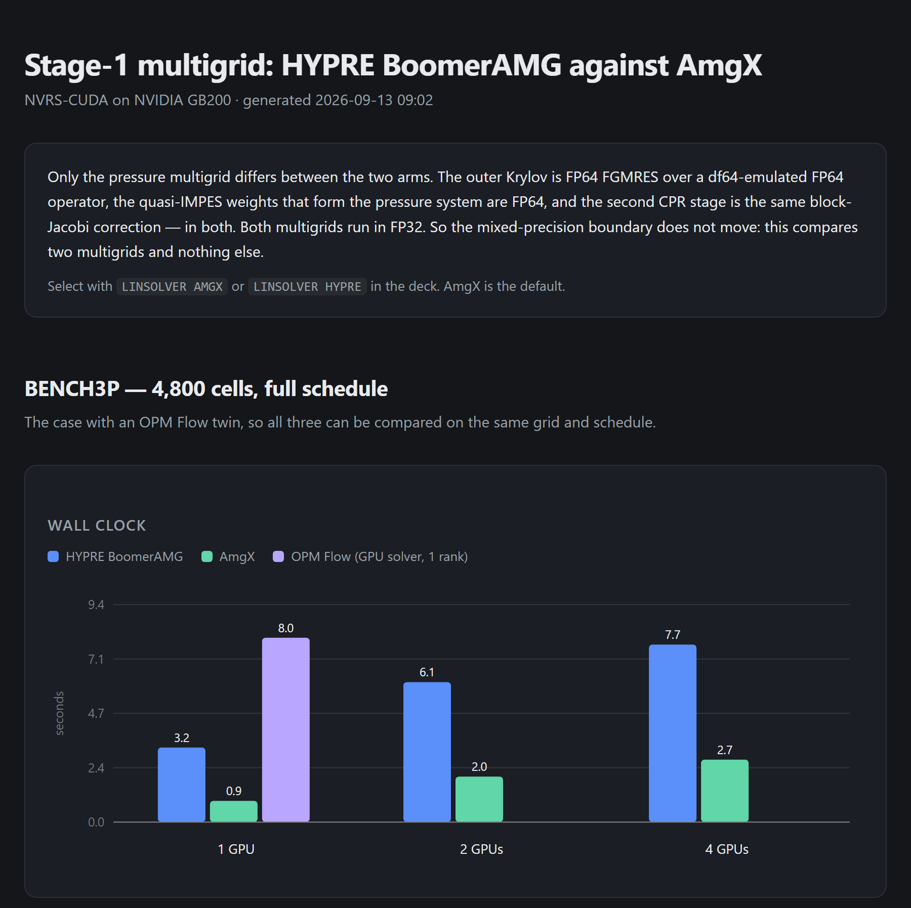

The page above is `backend_study/index.html` as a browser renders it:
self-contained inline SVG, 55 kB, regenerated by `scripts/backend_report.py`
from the committed `scaling.json` files. The same head-to-head as a plain
chart:


The same study across the size ladder: 1M to 5M cells, full schedules, both
backends at 1, 2 and 4 GPUs. The two backends scale in opposite directions,
and the setup phase is why:

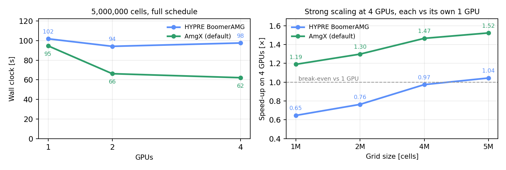

(The interactive report behind these charts is `backend_study/index.html`: GitLab shows raw HTML in the browser, so download it and open locally; the charts above are rendered from the same committed `scaling.json` files by `../scripts/backend_figs.py`.)

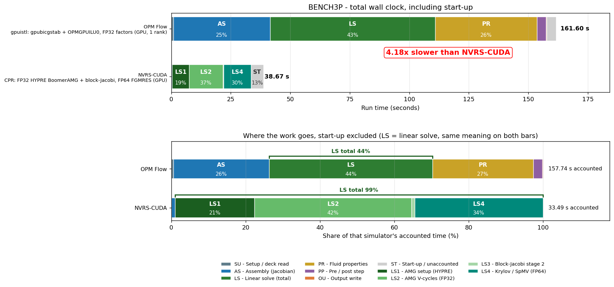

The two bars are broken into the same phases with the same short codes, so `LS`
on one side is `LS` on the other. Note what the split says: Flow spends 62 % of
its run in the linear solver and most of the rest in assembly and property
updates; NVRS spends 79 % in the linear solver because everything outside it
is 0.19 s.
That is the part a GPU-native residual buys, and it is why the speed-up is
larger than the linear-solver ratio alone.

Full transcripts, exactly as the run produced them:
[`docs/logs/run.log`](docs/logs/run.log) (the whole session),
[`BENCH3P_opm.log`](docs/logs/BENCH3P_opm.log),
[`BENCH3P_nvrs_1gpu.log`](docs/logs/BENCH3P_nvrs_1gpu.log). The reports
themselves are [`docs/compare_BENCH3P.html`](docs/compare_BENCH3P.html) and
[`docs/compare_BENCH2P.html`](docs/compare_BENCH2P.html) (Git LFS; download and
open in a browser, every figure is embedded, so no other files are needed).

### Does it agree?

Speed means nothing without it. Water in place from each run's own saved
saturation field and its own `INIT` pore volume, against the 4 Mbbl the deck
injects:

| Run | WIP t=0 | WIP t=2000 d | Gained | Produced | Implied injected | vs target |
|---|---|---|---|---|---|---|
| OPM Flow | 1.397 | 3.652 | 2.255 | 1.713 | 3.968 | **−0.8 %** |
| NVRS-CUDA | 1.397 | 3.590 | 2.193 | 1.787 | 3.980 | **−0.5 %** |

Million reservoir barrels. Both conserve water to under 1 %, which is the test
that says the two are solving the same system rather than two that merely look
alike.

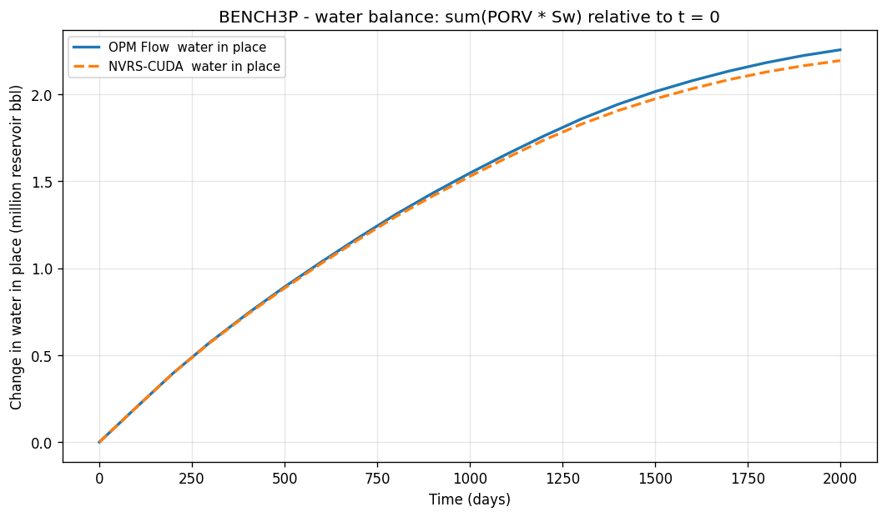

Well by well, both simulators overlaid with the difference beneath:

| | |
|---|---|
| 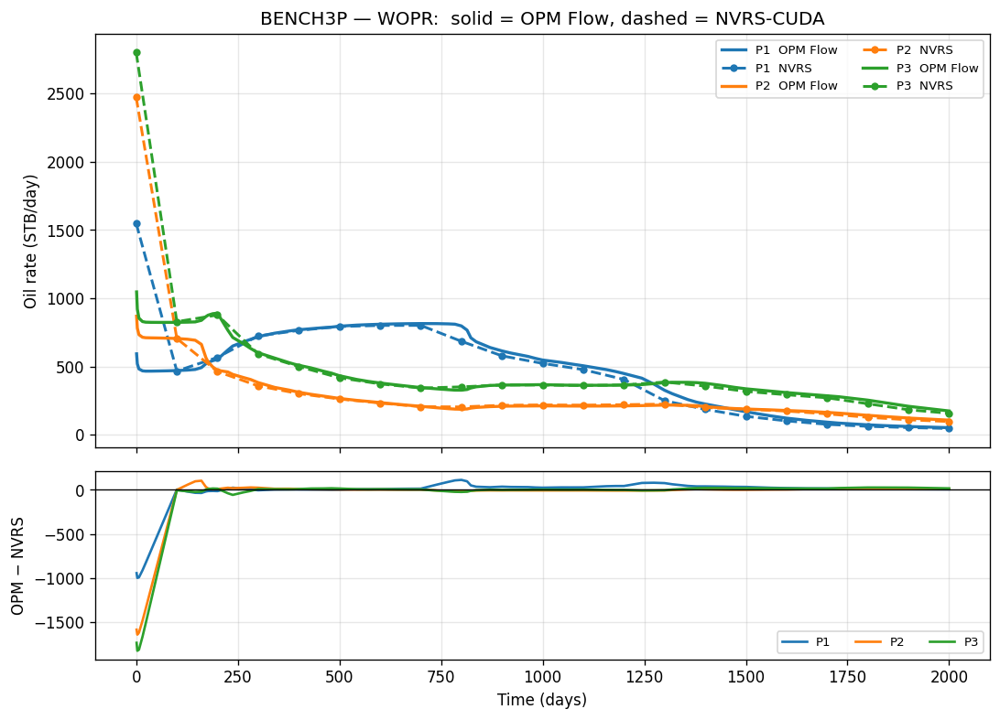 | 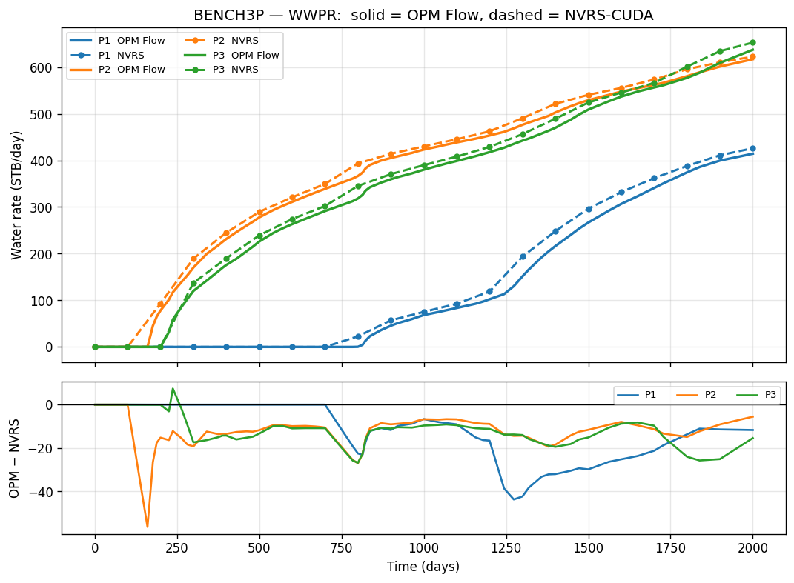 |
| 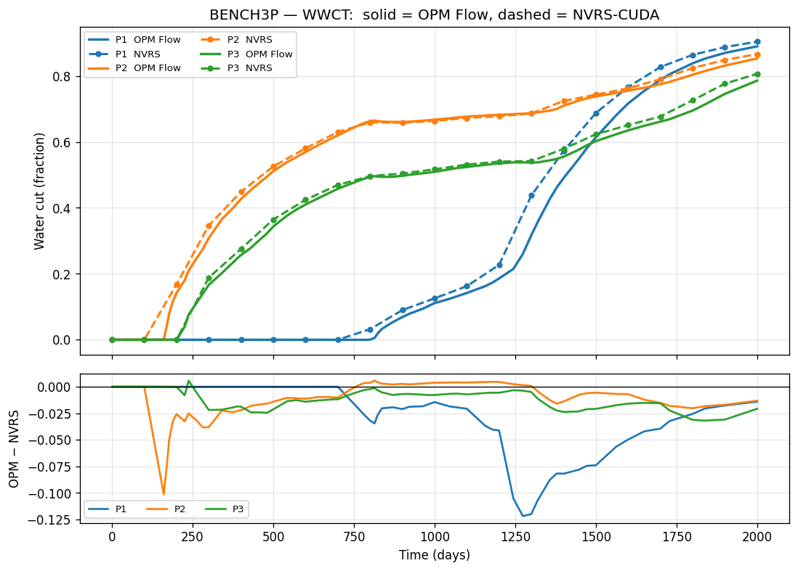 | 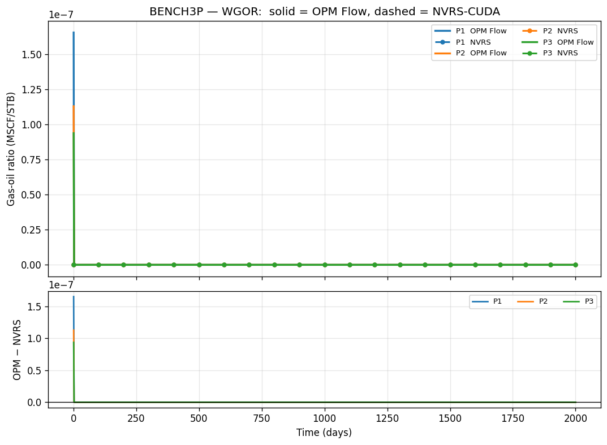 |
| 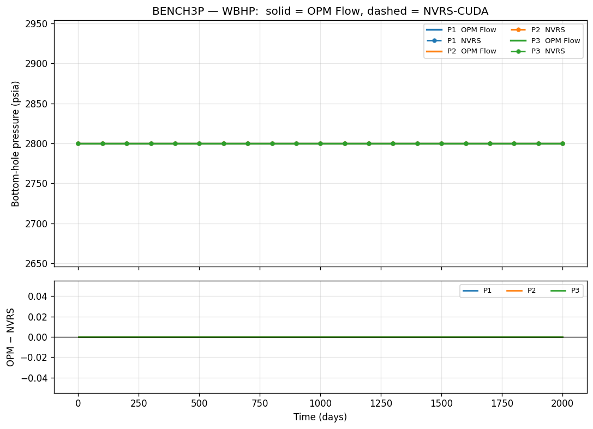 | |

The rock both decks are built from: one field, resampled once and written to
disk so neither simulator resamples it independently:

| | |
|---|---|
| 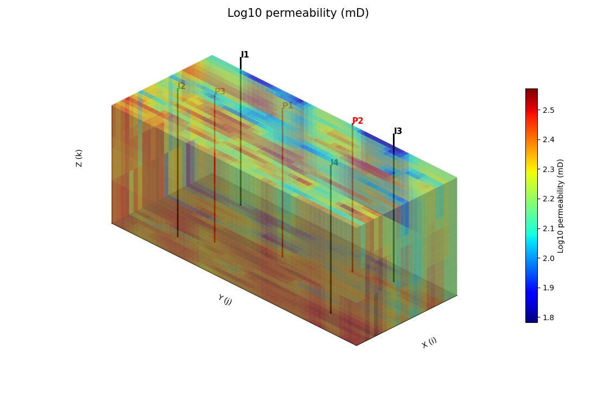 | 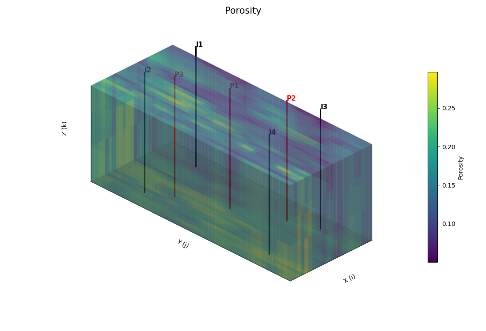 |

And the flood itself, all 20 report steps: columns OPM Flow / NVRS-CUDA /
difference, rows pressure and each saturation:

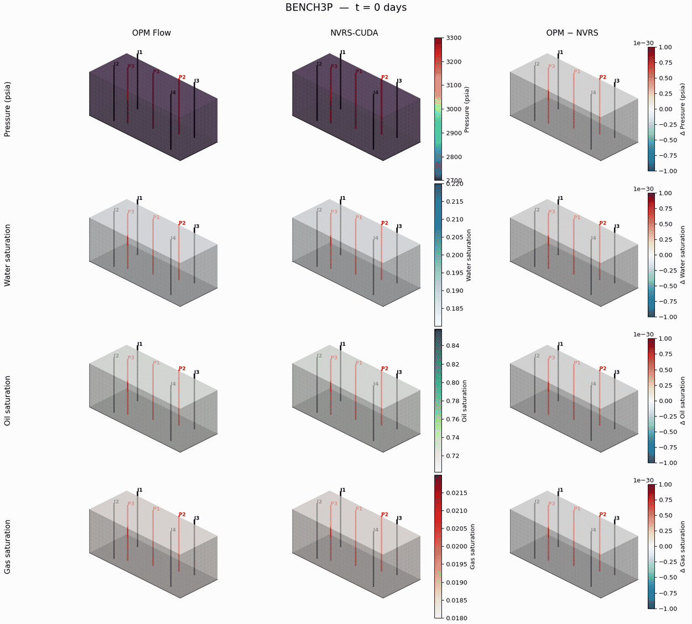

### `BENCH2P`: the case with no model difference at all

`BENCH3P` carries one irreducible model difference (the $`k_{ro}`$ convention,
above). `BENCH2P` carries none: NVRS's two-phase kernel uses analytic Corey
curves and the ECLIPSE deck tabulates exactly those, so every term in the two
residuals matches and any difference left is discretisation, linear solver and
time stepping alone. **This is the case that measures NVRS.**

| Run | WIP t=0 | WIP t=2000 d | Gained | Produced | Implied injected | vs target |
|---|---|---|---|---|---|---|
| OPM Flow | 1.397 | 3.101 | 1.704 | 2.240 | 3.943 | −1.4 % |
| NVRS-CUDA | 1.397 | 3.102 | 1.706 | 2.247 | 3.952 | −1.2 % |

Water saturation agrees to **0.42 % of range** at the final step, and the
agreement *improves* monotonically through the run, 2.59 % at step 1, 0.83 %
averaged over all 20, 0.42 % at step 20. A front that is merely under-resolved
diverges with time; this converges, which is what a discretisation difference
rather than a physics difference looks like.

At 4,800 cells this is a correctness case, not a performance one; the grid is
far too small to occupy a GB200, and NVRS is 1.94× faster (4.35 s vs 8.46 s)
only because both runs are dominated by fixed overhead.

| | |
|---|---|
| 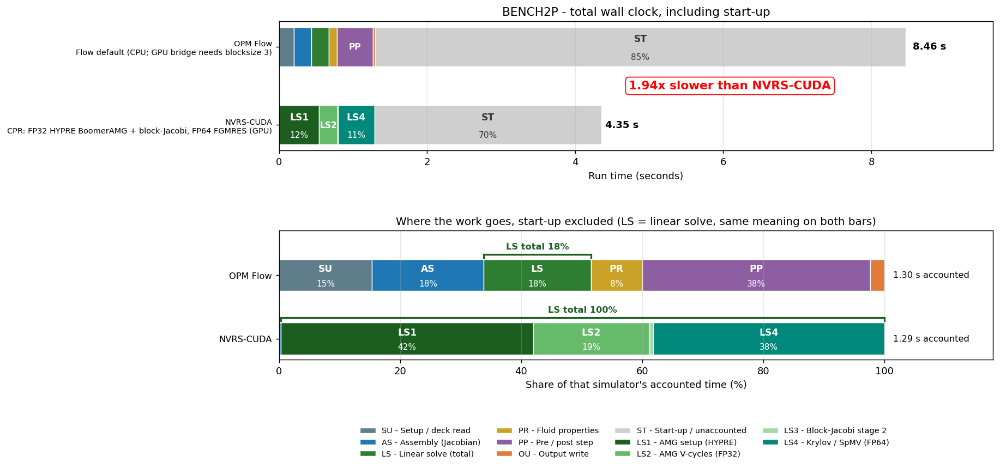 | 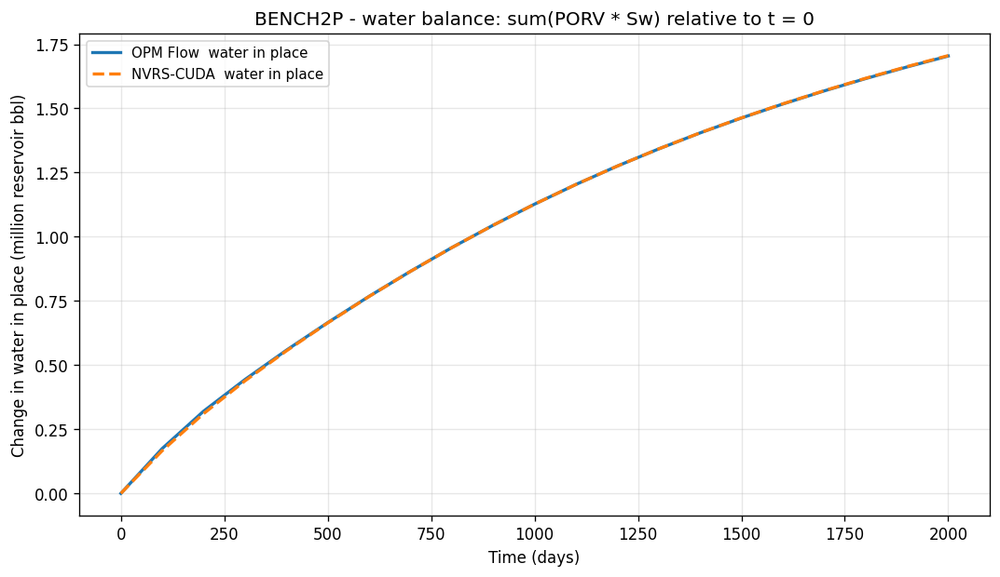 |
| 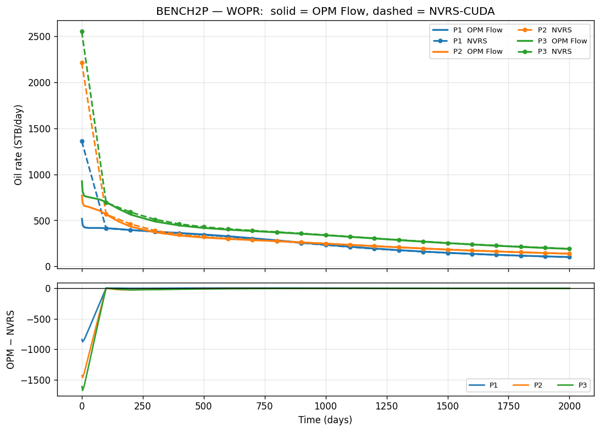 | 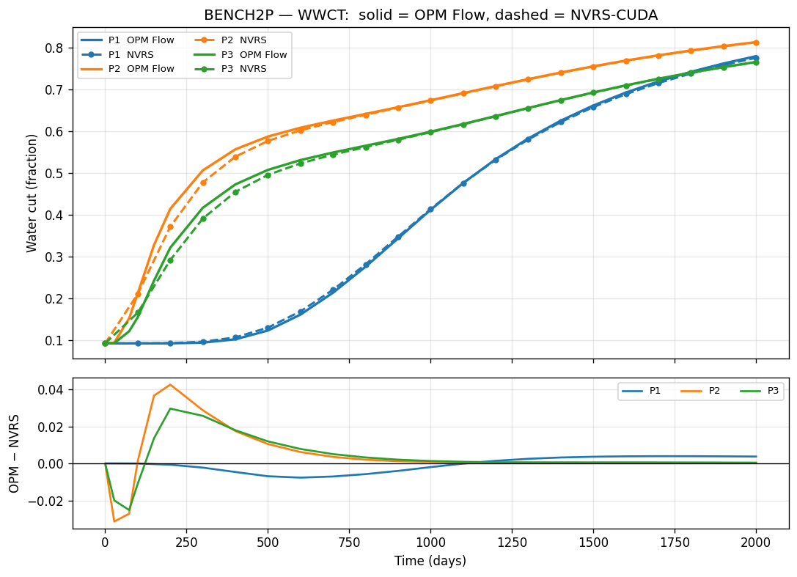 |

`install_opm_gpu.sh` builds Flow with CUDA and reports which GPU linear-solver
option the binary exposes; `run_comparison.sh` probes for it and passes it if
present, because the option name has moved between OPM releases and an unknown
option is a hard parse error in Flow. If the build has no GPU solver, the run
still works and the table says the linear solver was on the CPU.

## 5. NVRS strong scaling

Straight after the head-to-head, and on the same deck while the machine is in
the same state, `run_comparison.sh` runs NVRS alone on 1, 2, 4, ... GPUs, the
powers of two up to the GPU count, plus the count itself if it is not one. The
report gets wall clock, speed-up against ideal, and parallel efficiency.

The rank list is capped at `nz`: NVRS decomposes the grid into K-slabs, so
beyond `nz` a rank owns no layers and its timing says more about MPI than about
the simulator.

Every rank count's final field is compared cell by cell against the 1-GPU
result. A decomposition that drops a halo layer still converges and still
reports plausible well rates: timings alone cannot tell you the answer
survived being split up, so the table carries `max |Δp|` and `max |ΔSw|`
against 1 GPU and they should be at solver tolerance.

```bash
NVRS_SCALING=0 ./run_comparison.sh BENCH3P_XL     # head-to-head only
NVRS_MAX_GPUS=2 ./run_comparison.sh BENCH3P_XL    # cap the scaling sweep
```

### The measured sweep

Same deck, 46 × 112 × 22, run straight after the head-to-head so the machine is
in the same state:

| GPUs | Cells / GPU | Wall clock (s) | Speed-up | Efficiency | Linear solve (s) | AMG setup (s) | AMG rebuilds | Newton | Krylov | max ǀΔpǀ vs 1 GPU | max ǀΔS<sub>w</sub>ǀ |
|---|---|---|---|---|---|---|---|---|---|---|---|
| 1 | 113,344 | **38.64** | 1.00× | 100 % | 33.15 | 7.17 | 232 of 995 | 508 | 3146 | 0 psi | 0 |
| 2 | 56,672 ⚠ | 67.53 | 0.57× | 29 % | 61.49 | 24.25 | 234 of 991 | 503 | 3128 | 0.00171 psi | 1.19e−4 |
| 4 | 28,336 ⚠ | 91.69 | 0.42× | 11 % | 84.55 | 36.92 | 229 of 991 | 504 | 3141 | 2.44e−4 psi | 8.05e−6 |

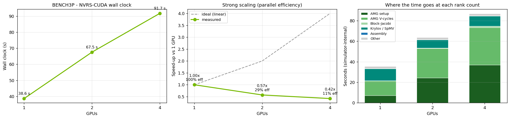

**This is a deck too small to divide, not a broken parallel solver**, and the
iteration columns are what prove it: Newton holds at 508/503/504 and Krylov at
3146/3128/3141, under 1 % across all three rank counts. The preconditioner is
rank-invariant, so nothing algorithmic degraded; the same iterations simply cost
more. What grew is AMG **setup**, 5.2× from 7.2 s to 36.9 s for the same number
of rebuilds, and that is parallel coarsening: a chain of small per-level
neighbour exchanges and global reductions whose cost is nearly independent of
how many cells each rank holds. Splitting the grid adds it without dividing it.

It is also *not* NUMA or memory-bandwidth contention. Contention would land on
the V-cycle apply, which is bandwidth-bound; the apply roughly doubled while
setup went up 5.2×. That signature is latency and collectives.

The last two columns are the check that the answer survived being split up at
all: a halo exchange that drops a layer still converges and still reports
plausible well rates, so timings alone cannot tell you. At 2.4 × 10⁻⁴ psi these
are at solver tolerance.

Transcripts: [1 GPU](docs/logs/BENCH3P_nvrs_1gpu.log) ·
[2 GPU](docs/logs/BENCH3P_nvrs_2gpu.log) ·
[4 GPU](docs/logs/BENCH3P_nvrs_4gpu.log).

### How many GPUs is too many

Below roughly **500,000 cells per GPU** this solver will not scale, and the
report marks those rank counts with ⚠ so a low efficiency figure is not read as
a defect. On 46 × 112 × 22 (113,344 cells) four GPUs is 28,336 cells each:
and the measured result is 0.42× (11 % efficiency).

The scaling table carries the columns that say *why*, because "more GPUs made it
slower" has three causes that need opposite responses:

- **Krylov count rises with rank count** → BoomerAMG coarsened differently on N
  ranks and the preconditioner itself got weaker. Algorithmic; more ranks cannot
  fix it.
- **Counts hold steady but AMG setup grows** → parallel coarsening, which is
  communication-bound and barely divides when the grid does. **This is what this
  deck shows** (508/503/504 Newton and 3146/3128/3141 Krylov, setup 7.2 → 24.3 →
  36.9 s).
- **Ranks did not get separate GPUs** → the per-rank banner line at start-up
  says which device each one bound.

Note that this is *not* a NUMA or bandwidth story. Contention would land on the
V-cycle apply, which is bandwidth-bound; here the apply roughly doubled while
setup grew 5.2×, which is latency and collectives.

To make several GPUs worth it, make the problem bigger rather than the machine;
`BENCH3P_XL` at 600,000 cells, or a `BENCH_GRID` of a few million.

### AMG hierarchy reuse (`AMGREUSE`)

Rebuilding the BoomerAMG hierarchy every Newton iteration used to be the largest
single cost in the run, 29.9 s of a 64.5 s solve on one GPU (46 %), and 158.3 s
of 225.3 s on four (70 %). `AMGREUSE n` lets the next `n` Newton iterations keep
the hierarchy the last rebuild produced; `AMGREUSE 0` restores the old behaviour
exactly.

What it bought, same deck and same hardware, `AMGREUSE 0` → `AMGREUSE 4`:

| | AMGREUSE 0 | AMGREUSE 4 |
|---|---|---|
| Wall clock, 1 GPU | 64.54 s | **38.64 s** (1.67×) |
| AMG setup, 1 GPU | 29.94 s | **7.17 s** (4.2× less) |
| Hierarchy rebuilds | 503 of 503 | **232 of 995** |
| Wall clock, 4 GPUs | 225.31 s | **91.69 s** (2.46×) |
| Speed-up vs OPM Flow | 2.51× | **4.18×** |

The 4-GPU run improves the most in relative terms and is still slower than one
GPU, which is the point of the section above: reuse removes most of the *cost*
of the parallel coarsening but cannot create work that is not there. (The
numbers in this table are the reuse A/B as it was measured, on the HYPRE
backend before AmgX existed; the current headline against Flow is the 10.45× (median of three runs; 3.5× against Flow on the full node) on the Norne field deck at the top of this page, and the multi-GPU picture with AmgX is in
[`backend_study/index.html`](../../../../results/GB200/backend_study/index.html).)

HYPRE has no option for this; there is no "reuse setup" flag in the BoomerAMG
API. Reuse is entirely a caller-side decision: you simply do not call
`HYPRE_BoomerAMGSetup` again. NVRS therefore also skips reloading the pressure
matrix, so the preconditioner is the one frozen at the last rebuild rather than
a fresh matrix wearing a stale hierarchy's smoother data.

A stale hierarchy is abandoned as soon as it costs more than `AMGREUSEGROWTH`
(default 1.3) times the Krylov iterations the fresh one needed, and a timestep
chop invalidates it outright, since the rollback throws away the state it was
built for. On the run above the guard fired 70 times out of 995; the trade was
winning 93 % of the time and was cut short the other 7 %, which is the balance
the default is aiming for. The run prints it:

```
AMG setup: 232 of 995 rebuilt (763 reused, 70 cut short by the growth guard),
           30.9 ms each, 7.16 s total
```

This is not a thumb on the scale against Flow, which reuses its own CPR setup by
default (`--cpr-reuse-setup`); the technique is standard in production CPR.

---

### OPM's GPU solver needs a three-phase deck

Flow's cusparse/BDA bridge only handles **blocksize 3**: three-phase black
oil. Handed a two-phase deck it prints

```
Warning: BdaSolver only accepts blocksize = 3 at this time
```

falls back to Dune, and then aborts on an assertion, because the solver JSON
asked for `gpubicgstab` and Dune cannot supply it. So:

| Case | Phases | Blocksize | OPM linear solver |
|---|---|---|---|
| `BENCH2P` | oil / water | 2 | **CPU**: the GPU bridge refuses |
| `BENCH3P` | oil / water / gas | 3 | **GPU**: `gpubicgstab` + `OPMGPUILU0` |

`run_comparison.sh` detects this from the generated deck and picks the CPU
solver for a two-phase case rather than crashing, saying why. **Use `BENCH3P`
for a GPU-vs-GPU comparison**; `BENCH2P` stays the rigorous accuracy case, with
Flow on the CPU.

### OPM's GPU solver is single-GPU

OPM's `gpuistl` path has no distributed GPU linear solve in 2024.10; it runs
on **one rank, one GPU**. `run_comparison.sh` therefore forces `OPM_RANKS=1`
whenever it selects the GPU solver, and says so; set `OPM_RANKS_FORCED=1` to
override. Running it on 8 ranks would either fall back to the CPU solver or
split the matrix across ranks that cannot solve it on the GPU.

NVRS defaults to `NVRS_RANKS=1` as well, so the GPU comparison is one GPU
against one GPU. On the CPU fallback the rank counts differ and the report
records both, because then it is not a like-for-like hardware comparison and
should not be read as one.

`OPM_RANKS` defaults to **8** for the CPU fallback, not 32. The benchmark grid is 4800 cells, and on
32 ranks the load balancer hands some ranks fewer than 100 owned cells with more
overlap than interior, which starves Flow's AMG and makes the comparison unfair
to it. Raise it for a larger model.

To vary it:

```bash
OPM_RANKS=16 NVRS_RANKS=4 ./run_comparison.sh BENCH2P
```

If Flow's linear solver still misbehaves, fall back to a solver that does not
extract a pressure equation at all:

```bash
OPM_EXTRA="--linear-solver=ilu0" ./run_comparison.sh BENCH2P
```

That changes only how Flow solves each linear system, not the physics, but it
is slower than CPR, so quote the wall clock from a CPR run.

---

## 6. Files

| File | Role |
|---|---|
| `install_opm_gpu.sh` | Build OPM Flow 2024.10 with CUDA. GPU-only, no CPU fallback |
| `make_decks.py` | One parameter set → `<CASE>.DATA` (NVRS) and `<CASE>_OPM.DATA` (ECLIPSE) |
| `make_spe10.py` | Fetch the public SPE10 model 2 dataset and generate its deck (§7) |
| `amgx_configs/` | AmgX configurations for the tuning harness, plain `key=value` form |
| `run_comparison.sh` | Run both, time both, build the report |
| `compare.py` | Read both ECLIPSE outputs, render everything, write `runs/compare.html` |

Both simulators are read through the same reader (`scripts/ecl.py`), from the
EGRID/UNRST/SMSPEC/UNSMRY each writes, NVRS produces these when `ECLOUT 1` is
set, which the generated deck does. Nothing can differ because of how a file
was parsed.

## 7. SPE10 model 2

A third benchmark alongside the OPM comparison and the size ladder: the
standard heterogeneity stress test, 60×220×85 = 1,122,000 cells at 20×10×2 ft
with a 3×10⁷ permeability contrast, two-phase, 2000 days.

```bash
./scripts/backend_study.sh spe10   # timings, into backend_study/index.html
./scripts/run_spe10.sh             # full run + the detailed spe10.html
./scripts/spe10_tune.sh            # solver A/B harness, one knob per row
```

SPE10 is the sixth case of the backend study, alongside `bench3p` and the
1M/2M/4M/5M ladder, and it is included in `backend_study.sh all`. It sweeps
**one GPU** where the ladder sweeps 1–4: at 1.12M cells the case is below the
threshold where decomposition pays, every published SPE10 number is
single-rank, and more than one rank would force the weaker aggregation
hierarchy. Set `SPE10_GPUS="1 2 3 4"` for a deliberate scaling probe.

`run_spe10.sh` is the deep dive rather than the timing run. It writes
`benchmark/spe10/spe10.html`: permeability by layer on a log scale with its
distribution and vertical profile, the independent porosity field, the Kz/Kx
ratio behind `PERMZFILE`, water saturation at three times **plus an animation
across all twenty report steps**, pressure, well responses, a timing table and
the tail of the log, and `benchmark/spe10/spe10_run.log` with the complete
run. `STEPS=4 ./scripts/run_spe10.sh` shortens the schedule for a quick look
without touching the committed deck.

`make_spe10.py` downloads the public Christie & Blunt dataset (ODbL, via OPM's
`opm-data`) into `cuda/dataset/SPE10/` on first use: 77 MB, git-ignored,
written to a temporary name and renamed only on completion. It verifies
`ky == kx` before writing the deck and records every simplification it makes in
its header. The spec's Corey curves are analytically identical to the
two-phase kernel at `SWI = SWR = 0.2`, so no saturation table is involved.

Measured on one GB200, each row an A/B against the one above:

| Configuration | Wall clock | Speed-up |
|---|---:|---:|
| Aggregation hierarchy, fully implicit | 861.3 s | 1.00× |
| Classical PMIS hierarchy | 402.6 s | 2.14× |
| **+ adaptive implicit** | **342.1 s** | **2.52×** |

*That ablation was measured earlier on the 2000-day SPE10 configuration. On the matched SPE10 deck (1000 days, CPRW, one Eclipse deck read by both simulators) SPE10 model 2 completes in **53.06 s** on one GB200 and **41.21 s** on one VR72 under AmgX, 18.5x faster
than OPM Flow on the VR72 host, with a mean per-well R^2 of 0.999.*

Both improvements are simulator defaults now, classical is selected
automatically on one rank, and `AIM` is on, so a plain single-GPU run gets the
last row. `spe10_tune.sh` also reproduces the candidates that *lost*: two
V-cycles per application (diverged), `MULTICOLOR_DILU` (better convergence,
dearer smoother), the Appleyard chop (143 s vs 120 s), `RESTART 60` and
`STAGE2 ZLINE` (27% fewer Krylov iterations, 3× the kernel cost).

Reported single-GPU: at 1.12 M cells the case is below the threshold where
decomposition pays, and multiple ranks would force the weaker aggregation
hierarchy.

## 8. Norne

Equinor's Norne field model, the corner-point deck the industry uses as its
open reference case. 46×112×22, 44,431 active cells, 61 faults with 7,617
non-neighbour connections, 36 wells and 247 dated report steps over nine years.

```bash
./get_norne.sh                       # 61 files, ~26 MB, on demand
SKIP_OPM=1 ./run_norne.sh            # NVRS only, reusing existing Flow output
./run_norne.sh                       # both simulators, from scratch
python compare.py --case NORNE       # rebuild compare_NORNE.html alone
```

| 247 report steps, one GPU | GB200 | VR72 |
|---|---:|---:|
| OPM Flow (`gpuistl`) | 488.51 s | 243.88 s |
| NVRS-CUDA, AmgX | **44.95 s**: 10.87× faster than Flow | **35.73 s**: 6.83× |
| NVRS-CUDA, AmgX, native FP64 operator | **43.19 s**: 11.31× | **34.91 s**: 6.99× |
| NVRS-CUDA, Ginkgo FP16 | **80.55 s**: 6.06× faster than Flow | **50.02 s**: 4.88× |
| NVRS-CUDA, Ginkgo FP32 | **70.42 s**: 6.94× | **49.31 s**: 4.95× |
| NVRS-CUDA, Ginkgo FP16 + adaptive bJ | **76.61 s**: 6.38× | **57.27 s**: 4.26× |
| NVRS-CUDA, HYPRE | **71.51 s**: 6.83× faster than Flow | **73.54 s**: 3.32× |

Version 2, from `compare_NORNE.html` in each machine's archive. The six NVRS arms overlay almost exactly in the physical plots, so
the differences between them are the multigrid and nothing else.

`compare_NORNE.html` puts the two side by side: per-well WOPR, WWCT, WGOR and
BHP on a 5×5 grid, one panel per producer, with OPM in red and every NVRS
solver arm in its own colour; an R² per well per quantity, computed per
timestep against OPM as the reference; and the field structure, saturation
fields and water balance.

### Comparing like with like

Two simulators reading the same deck is not the same as two simulators solving
the same problem, and the difference is easy to miss.

**The saturation tables have to come from the field deck.** A run deck that
names `FIELDDECK` is describing that field, so its own `SWOF`/`SGOF` are a
placeholder; Flow reads Equinor's `SCAL_NORNE.INC`. Running NVRS on the
placeholder while Flow reads the real curves compares two different rocks, and
every rate, water cut and correlation in the report then describes a model
nobody intended. `FIELDSATFUNC` defaults to 1 for this reason. The column
orders differ between the two formats: ECLIPSE writes `Sw krw krow`, this
deck format puts the oil curve second, and both orders produce plausible
monotone curves, so the run prints the four curve corners at startup and every
one must be the large end:

```
[satfunc] krw(Sw_max) …, krow(Sw_min) …, krg(Sg_max) …, krog(Sg_min) …
```

**Two further switches change the model, not just its fidelity**, and both
default off so that a result is never quietly a different experiment:

| Keyword | Default | Effect |
|---|---|---|
| `PROPSARRAYS` | 0 | Read per-cell arrays from `PROPS`/`REGIONS`/`SOLUTION`. Makes ENDSCALE's endpoints visible, and also gives equilibration the deck's `SWL` and `EQLNUM`. Norne has five equilibration regions; with `EQLNUM` read, ~3000 cells acquire a gas cap they did not have under a single record. Runs with 0 and 1 are **not** comparable. |
| `USEENDSCALE` | 0 | Scale each cell's relperm onto its own endpoints. Needs `PROPSARRAYS 1`. Honours `SCALECRS`, which Norne sets to `YES`, three-point. |

### What the comparison currently says

Cumulative oil over the history is 425.07 M STB against Flow's 422.78 (0.54 %), the recovery factor 41.5 % against 41.8 %, and the oil balance closes
at 100 % of what the rates report. At 3260 days, the report's stock-tank water
ledger is:

| Quantity | OPM Flow | NVRS | Difference |
|---|---:|---:|---:|
| Initial water inventory | 2596 M STB | 2596 M STB | 0 |
| Final water inventory | 3115 M STB | 3119 M STB | +4 M STB |
| Produced water | 146.4 M STB | 133.7 M STB | -12.7 M STB |
| Implied injected water | 664.8 M STB | 656.7 M STB | -8.1 M STB |
| Closure against reported injection | +3.8 % | +6.2 % | |

The field state begins close (day-zero pressure RMS 2.055 psi; water-saturation
RMS 0.001888) and stays close: 327 psi (5.3 % of the range) and 0.0150 at day 3260.

Every producer, scored by the R^2 of its whole history against Flow (GB200,
AmgX; 🟢 >= 0.80, 🟡 0.70 to 0.80, 🔴 below 0.70; a constant reference is scored
against 5 % of its level, so shut-in periods no longer give negative values):

| Well | WOPR | WWPR | WWCT | WGPR | WGOR | WBHP |
|---|---:|---:|---:|---:|---:|---:|
| B-1BH | 🟢 0.99 | 🟡 0.76 | 🟢 0.84 | 🟢 0.97 | 🟢 0.98 | 🟢 0.98 |
| B-1H | 🟢 0.95 | 🟢 0.83 | 🟢 0.93 | 🟢 0.97 | 🟢 0.85 | 🟢 0.92 |
| B-2H | 🟢 0.96 | 🟢 0.92 | 🟢 0.94 | 🟢 0.92 | 🟢 0.83 | 🔴 **0.28** |
| B-3H | 🟢 0.93 | 🟢 0.94 | 🟢 0.94 | 🟢 0.93 | 🟢 0.93 | 🟢 0.92 |
| B-4BH | 🟢 0.98 | 🟢 0.99 | 🟢 0.99 | 🟢 0.96 | 🟢 0.93 | 🟢 0.99 |
| B-4DH | 🟢 0.95 | 🟢 0.92 | 🟢 0.95 | 🟢 0.97 | 🟢 0.95 | 🟢 0.95 |
| B-4H | 🟢 0.98 | 🟢 0.98 | 🟢 0.96 | 🟢 0.98 | 🟢 0.97 | 🟢 1.00 |
| D-1CH | 🟢 0.99 | 🟢 0.98 | 🟢 1.00 | 🟢 0.97 | 🟢 0.97 | 🟢 0.96 |
| D-1H | 🟢 0.98 | 🟢 0.97 | 🟢 0.86 | 🟢 0.96 | 🟢 0.97 | 🟢 0.95 |
| D-2H | 🟢 0.97 | 🟢 0.90 | 🟢 0.93 | 🟢 0.95 | 🟢 0.80 | 🔴 **0.53** |
| D-3AH | 🟢 0.98 | 🟢 0.97 | 🟢 0.97 | 🟢 0.98 | 🟢 0.97 | 🟢 0.97 |
| D-3BH | 🟢 0.99 | 🟡 0.78 | 🟢 0.86 | 🟢 0.99 | 🟢 0.98 | 🟢 0.90 |
| D-4AH | 🔴 **0.67** | 🔴 **-0.25** | 🔴 **0.53** | 🟢 0.92 | 🟡 0.72 | 🟢 0.97 |
| D-4H | 🟢 0.98 | 🟢 0.95 | 🟢 0.89 | 🟢 0.96 | 🟢 0.97 | 🟢 0.99 |
| E-1H | 🟢 0.97 | 🟢 0.98 | 🟢 0.98 | 🟢 0.94 | 🟢 0.93 | 🟢 0.91 |
| E-2AH | 🟢 0.86 | 🟢 0.96 | 🟢 0.90 | 🟢 0.81 | 🟡 0.74 | 🟢 0.99 |
| E-2H | 🟢 0.98 | 🟢 0.96 | 🟢 0.99 | 🟢 0.94 | 🟢 0.96 | 🟢 0.94 |
| E-3AH | 🟢 0.93 | 🔴 **0.68** | 🟢 0.84 | 🟢 0.86 | 🔴 **0.69** | 🟢 0.99 |
| E-3CH | 🟢 0.84 | 🟢 0.97 | 🟢 0.99 | 🟢 0.82 | 🟢 0.97 | 🟡 0.78 |
| E-3H | 🟢 0.98 | 🟢 0.98 | 🟢 0.98 | 🟢 0.97 | 🟢 0.98 | 🟢 0.98 |
| E-4AH | 🟢 0.90 | 🟢 0.88 | 🟢 0.92 | 🟡 0.77 | 🔴 **0.52** | 🟢 1.00 |
| K-3H | 🔴 **0.64** | 🔴 **0.65** | 🟢 0.93 | 🟢 0.97 | 🔴 **0.67** | 🟢 0.95 |
| **wells >= 0.70** | **20/22** | **19/22** | **21/22** | **22/22** | **19/22** | **20/22** |

20 of the 22 producers match Flow at R^2 >= 0.70 on oil rate and 19 on all four rate quantities at once; the mean over producers and quantities is 0.901.

The raw R² labels in the HTML are not percentages. For a shut, nearly constant
or near-zero OPM series, the reference variance is tiny and R² can become very
negative even when the absolute error is operationally small. Retain R², but
judge it together with active-time NRMSE, cumulative-volume error, event-date
error and a denominator-validity flag. This matters particularly for WWCT and
WGOR, whose denominators are total liquid and oil rate respectively.

### Norne is METRIC, and what that has been checked against

Norne's field deck is METRIC throughout and NVRS solves in field units, so every
number the well model is handed has crossed a conversion: rates in sm3/day,
pressures in bar, depths in metres, COMPDAT connection factors in
cP.rm3/(day.bar).  A wrong factor there is the worst kind of bug in this
codebase, because it is silent: the run converges and reports success on a
different field.  12,811 sm3/day read as stb/day is a sixth of the intended
injection, and nothing downstream can tell.

That path is now covered by `tests/test_field_units`, which writes the same
field twice, once metric and once field, and requires the loaded models to
agree.  It runs on a laptop with no CUDA and no GPU:

```bash
./scripts/build_deck_tests.sh        # 329 checks across the five deck tests
```

The audit's result for Norne is that **the well controls convert correctly**:
WCONHIST's ORAT/WRAT (liquid, x6.29) and GRAT (gas, x35.31 to scf/day, not
Mscf), WCONINJE's water and gas rates and its 600 bar ceiling, WCONPROD's RESV
and BHP, the WELSPECS datum, COMPDAT's connection factor, and the single
`GCONINJE FIELD WATER RATE 42000` all land in the units the solver expects.
Integrating the deck's own history over the 247 steps gives 451.62 M STB of oil
prescribed, against Flow's 422.78 M STB delivered, so Flow meets 94% of what
the deck asks for, and the remaining NVRS gap is delivery, not units.

Two unit defects were found and fixed on the way, neither of which changes Norne:

- A **FIELD** corner-point deck's cell and pore volumes were in ft3 where a
  METRIC deck's were in reservoir barrels, 5.61x too large in the accumulation
  term, the MINPV cut and the pore-volume ledger.  Norne is METRIC and was never
  affected; a field-unit corner-point deck was.
- The injected phase's **reservoir density** multiplied by the formation volume
  factor where it must divide.  `r.bo`, `r.bw` and `r.bg` are FVFs, and the
assembly says so by taking `1.0 / P.bo` before using them, so a surface density becomes a reservoir one by dividing.  For water that is 2%; for gas,
  with B_g = 8.12e-4 rb/scf, the reservoir density came out 1.2e-7 against a
  true 0.186 and the completion pressure correction on every gas injector was
  zero.  This one does touch Norne: C-1H, C-3H, C-4H and C-4AH take the field's
  294 G scf of reinjected gas, and their deeper completions were testing
  injectivity against a bottom-hole ceiling that was too low at depth.

### Crossflow, and why the net rates could not be read

A well's reported rate is a NET sum over its completions, and the assembly has
no sign test: a completion whose cell has fallen below the flowing pressure puts
fluid back into the formation and subtracts from the total.  That is
deliberate, since dropping those terms would report production the reservoir
never lost, but it makes a net rate ambiguous.  A well reporting 2,000 STB/day might be making
2,000, or making 40,000 at one end while 38,000 goes back in at the other.

On this case the distinction is the whole question.  B-4H and D-4H report large
**negative** oil against Flow's positive while their gas is large and positive,
which is one well producing and injecting at the same time, the signature of
each completion being given the local mobility of every phase instead of the
wellbore mixture OPM's `StandardWell` carries.  That is a different problem from
a rate target that is simply too small, and the two want opposite fixes.

### What OPM actually does, and what this did

Worth reading rather than assuming.  `StandardWell::computePerfRate`
(opm-simulators, release/2024.10) branches on the sign of the drawdown, and the
reverse-flow branch is:

```cpp
} else {
    // Do nothing if crossflow is not allowed
    if (!allow_cf && this->isProducer()) {
        return;
    }
    // Using total mobilities
    Value total_mob_dense = mob[0];
    for (int componentIdx = 1; ...) total_mob_dense += mob[componentIdx];
    ...
    for (int componentIdx = 0; ...) {
        const Value cqt_i = - Tw[componentIdx] * (total_mob_dense * drawdown);
        Value cqt_is = cqt_i / volumeRatio;
        cq_s[componentIdx] = cmix_s[componentIdx] * cqt_is;
    }
}
```

So OPM has exactly two behaviours for a producer's reverse-flowing connection.
Either it contributes **nothing**, or it takes **total** mobility distributed
by `cmix_s`, the composition the **wellbore** is already carrying.  In both cases
the reverse flow has the well's own composition, which is why an OPM producer
can never take oil in at one connection while pushing gas out of another: there
is one mixture in the pipe.

NVRS's forward branch matches OPM's.  Its reverse branch was **neither** of
OPM's: it applied each phase's own local *formation* mobility, so whatever that
particular cell happened to be mobile in went back in.  That is what produced
B-4H's and D-4H's large negative oil beside their large positive gas, and no
setting of `allow_cf` in OPM can reproduce it.

The flowing-pressure solve is now the constrained one,

    find p_wf such that  SUM_k A_k max(0, theta_k - p_wf) = q_target

which is OPM's `!allow_cf` branch: the completions below the flowing pressure
are shut for the step and the rest carry the target.  `f` is continuous,
piecewise linear and strictly decreasing where it is positive, so the root is
unique and one sorted pass finds it; see `include/well_control.hpp`, exercised
directly by `tests/test_well_control` (33 checks).

Two properties make it safe to switch on, and both are pinned by that test:

- Where no completion was flowing backwards the solve returns **the same
  pressure** as the plain division it replaces, to rounding.  Ordinary wells
  cannot move.
- Where they differ it returns a **higher** pressure, meaning less drawdown,
not more.  The reverse-flowing completions were *subtracting* from the total, so
  the well had been over-producing the rest to net out at the target.  On the
  test's Norne-shaped well the old solve moves **1.05 million** units of fluid
  to report 60,000; the new one moves exactly 60,000.

`WELLXFLOW 1` in the deck restores the previous behaviour exactly, so a change
in the comparison can be attributed to this and not to something else.
`decks/NORNE.DATA` states `WELLXFLOW 0` explicitly for that reason.  The run
says which it took, and says so even when nothing changed:

```
  [well] no-crossflow controls: 4 producer(s) had 23 completion(s) below their
         flowing pressure; those are shut for the step and the rest carry the
         target (WELLXFLOW 1 for the old behaviour)
```

**Still an approximation.** Norne's `WELSPECS` defaults item 10, so crossflow is
allowed and OPM takes the `cmix_s` branch rather than the zeroing one.
Reproducing that exactly needs the wellbore mixture inside the assembly kernel,
three more numbers per `WellCell` and a sign branch in the well source term,
and is the natural next step.  For the oil number it should land close
either way, because under `cmix_s` a gas-dominated well pushes gas back, not
oil.

### Crossflow, measured

`WellRateRow` also carries the reverse-flow part of each phase and the number of
completions running backwards, reduced across ranks with the rates, and the run
prints the worst offender on the same schedule as the oil and water balances:

```
  [xflow] 3 producer(s) flowing both ways: 5.42e4 STB/day of oil re-injected,
          worst B-4H (4.61e4 STB/day back in through 7 of 21 completions,
          net -3.9e4)
```

A run with no crossflow prints nothing.  This is a measurement, not a fix: it
exists so the next Norne run says how much of the oil shortfall is crossflow
before anything is changed to chase it.

### Implemented and remaining Norne semantics

Implemented: field saturation tables; ECLIPSE/OPM saturation-weighted
three-phase oil relative permeability; endpoint scaling; Carlson non-wetting
gas hysteresis (`EHYSTR` model 0); PVT regions; completion pressure offsets;
history-mode/zero-rate well semantics; metric gas-rate conversion; producer
group allocation; and phase-specific `GCONINJE RATE` ceilings.

Still parsed but not enforced: `DRVDT` and `GCONINJE RESV/REIN/VREP`.
`RSVD` and `DRSDT` are now read and applied (see below).
Still outside scope: VFP/THP control, `PINCH`, multi-segment wells and surface
network balancing. Other hysteresis models and oil/water scanning curves are
also not implemented. `run_norne.sh` lists every keyword each reader did not
understand at startup, which is the fastest way to separate a deck limitation
from a nonlinear or linear-solver problem.

## 9. Prerequisites

* NVRS built: `cmake --build ../build -j`
* `data/iglesias3.out` fetched; it is a Git LFS object, so run
  `git lfs install && git lfs pull` first. `make_decks.py` detects a bare
  pointer file and says so.
* Python 3 with numpy and matplotlib; Pillow for the animation.

---

Authors: Clement Etienam, Tsubasa Onishi, Oleg Ovcharenko, Nick Luiken,
Issam Said.

### RSVD: the dissolved-gas anchor is a depth table, not a number

Rs is not a primary unknown in this formulation, so the model needs a value for
the gas an undersaturated oil *retains*.  That value was the run deck's scalar
`RS 674`, applied to all 44,431 cells.

Norne states five `RSVD` tables, one per equilibration region
(`INCLUDE/PETRO/E3.prop`), and they do not agree with each other:

| EQLNUM | Rs (sm3/sm3) | scf/stb |
|---|---|---|
| 1, 3, 5 | 120.25 at the crest -> 106.77 deeper | 675 -> **599** |
| 2, 4 | 94.5 -> 94.1 | **531 -> 528** |

674 scf/stb is the *crest* value of regions 1/3/5.  Running it everywhere gave
every cell in regions 2 and 4 **27% more dissolved gas than the deck states**,
and every deep cell in 1/3/5 about 12% too much.  More dissolved gas means a
larger B_o, and a larger B_o means fewer stock-tank barrels out of the same
reservoir barrel, which is the direction of the oil deficit against Flow.  At
`c12ba24` NVRS removed **96%** of Flow's oil *reservoir volume* (527.2 against
551.0 MMrb) and reported **67%** of its stock-tank oil (283.5 against 422.4
M STB), an implied B_o of 1.87 against Flow's 1.30.

`RSVD` is now read in `equil.cpp`, resolved to one anchor per active cell from
that cell's `EQLNUM` and depth, and used by the assembly, the well controls and
the reporting alike.  On Norne the anchor becomes **528.3 to 675.4 scf/stb,
mean 599.8**, 11% less dissolved gas field-wide than the single number it
replaces.  The run prints the range at start-up:

```
  [rsvd] dissolved-gas anchor from RSVD: 5 table(s), 528.3 .. 675.4 scf/stb
         over 44431 cells (deck RS is a single number and is now only the
         fallback)
```

A deck with no `RSVD` is unaffected and keeps its scalar.

**The parsing trap, since it cost a run to find.** Each region's table is ONE
record, a flat run of depth/Rs pairs ended by a slash, not one record per row.  Reading a pair per record yields a single table of the first two numbers,
silently drops the other four regions and all depth dependence, and reproduces
exactly the constant it was written to replace: 675 scf/stb everywhere.  The
first implementation did that, and the output looked entirely plausible.
`tests/test_equil` now pins all five tables, their endpoints, the interpolation
and the per-cell range.

## Profiling: Nsight Systems (and Nsight Compute if you want it)

Run these from this directory.
(`scripts/backend_study.sh` runs from `../`.)

`nsys` answers *where the time goes*, independently of the wall-clock split the
run claims for itself. That independence is the point: a phase boundary drawn
in the wrong place inside the code produces a self-consistent table that is
wrong, and only an outside measurement catches it.

Any benchmark profiles itself if asked. `NVRS_PROFILE=1` adds **Nsight
Systems** only:

```bash
NVRS_PROFILE=1 ./run_norne.sh                      # Norne
NVRS_PROFILE=1 ./run_comparison.sh BENCH2P BENCH3P # the generated cases
NVRS_PROFILE=1 ./scripts/backend_study.sh all      # every arm of the study
```

Or standalone, on **any deck**, without re-running a benchmark:

```bash
./profile_case.sh SPE1                 # nsys, first 10% of that deck's history
./profile_case.sh SPE10 both           # add the kernel counters
./profile_case.sh NORNE                # any case under decks/
./profile_case.sh                      # lists the decks it can see
NVRS_DECK=/path/to/MY.DATA ./profile_case.sh MYFIELD
```

The case name picks the deck (`decks/<CASE>.DATA`, unless `NVRS_DECK` names
one) and decides where the output goes. Nothing else differs between cases:
one implementation, so profiling a new field cannot quietly behave differently
from profiling Norne.

How much of the history to cover:

```bash
PROF_FRACTION=0.25 ./profile_case.sh SPE1  # a quarter of the deck's TEND
PROF_FRACTION=all  ./profile_case.sh SPE1  # the deck as written
PROF_TEND=140      ./profile_case.sh SPE1  # exactly 140 days
```

A **fraction**, not a step count, because a step count means nothing without
knowing how long a step is and that varies by deck. Norne's are a fortnight;
`profile_norne.sh` is a thin wrapper that keeps `PROF_STEPS` for the one deck
where the answer is known:

```bash
./profile_norne.sh                     # nsys, 24 report steps
PROF_STEPS=10 ./profile_norne.sh       # shorter
PROF_STEPS=all ./profile_norne.sh      # all 247 steps
```

Both backends, kept side by side rather than one overwriting the other:

```bash
./profile_case.sh SPE1                        # amgx
NVRS_BACKEND=hypre ./profile_case.sh SPE1     # hypre, alongside it
```

Then the figures and the report:

```bash
python3 profile_plots.py --case SPE1  # draws them
python3 compare.py --case SPE1        # folds them into compare_SPE1.html
```

Everything lands in `runs/<CASE>/profile/<backend>/`, and the figures go into
the **same** `runs/compare_<CASE>.html` as the field images and the animation.
There is no separate profiling report. The field images come from the full
unprofiled benchmark runs; only the profile figures come from here.

With more than one backend profiled, each figure is drawn once per backend and
named for it, `profile_timeline_amgx.png` beside `profile_timeline_hypre.png`
, and the report captions say which is which. `profile_cpr.png` is drawn once,
because it comes from the run's own timers and already shows both together.

### What each figure needs

| Figure | Needs | Answers |
|---|---|---|
| `profile_cpr.png` | **no profiler** | how the linear solve divides: AMG setup, V-cycles, stage-2, operator SpMV, CGS2 |
| `profile_timeline.png` | nsys | *when* each phase runs, the whole run above, the busiest window below |
| `profile_time.png` | nsys | *how much* GPU time each phase and kernel takes |
| `profile_roofline.png` | ncu | where each kernel sits against the roofline |
| `profile_limiters.png` | ncu | what limits each kernel: bandwidth, compute, or latency |

The first needs no profiler because the solver times its own CPR phases and
writes them to `meta.json`. That is the only way to tell a multigrid V-cycle
from the operator apply in the Krylov loop: they are the same sparse kernel, and
no trace can separate them from outside.

In `profile_timeline.png`, each row of the upper panel is shaded against **its
own** busiest moment, so colours show when a phase is active and are **not**
comparable between rows. Use `profile_time.png` for relative size.

### Nsight Compute, when you want it

Off by default and asked for explicitly, because it serialises and replays every
kernel and is roughly **100x slower per kernel**:

```bash
./profile_case.sh NORNE both         # timeline + counters
./profile_case.sh NORNE ncu          # counters only
NCU_COUNT=40 ./profile_case.sh NORNE ncu   # fewer, faster
```

Bounded by `NCU_SKIP` (launches to skip past cold start-up, default 200) and
`NCU_COUNT` (launches to profile, default 120) rather than let loose on a run.
`NCU_CLOCK` defaults to `--clock-control none`: pinning the GPU to base clocks
needs a privilege a container usually lacks, and refusing to profile is worse
than absolute rates that depend on where the clocks were. Nothing here quotes an
absolute rate, the counters give ratios, the wall clock comes from unprofiled
runs.

### Watching it, and what it is doing

The run's own output goes to the terminal and to `nsys_run.log`, and a heartbeat
prints elapsed time and GPU utilisation every 20 seconds (`NVRS_HEARTBEAT=0` to
silence, or a different interval):

```
  [profile] profiling ...   40s   util 87 %, device mem 3565 MiB in use
```

A GPU at 90% is working. A GPU at 0% for minutes is worth interrupting. The
memory figure is the **whole device**, CUDA context, library workspaces, every
process on it, not this run's arrays.

The heartbeat also covers the phase after the run, where `nsys stats` builds a
SQLite database from the report in silence. On a long trace that takes as long
as the run did.

When it finishes, the heaviest kernels are printed without opening anything:

```
  [profile] top 3 kernels by GPU time (of 46 distinct), over 140 days:
  [profile]   1.  41.2%    12345.7 ms     48231 x  amgx::spmv_kernel
```

`NVRS_TOPK` changes how many.

### The profiler options

The defaults are copied from a configuration that produces working reports on
this hardware, not derived:

```
--trace=cuda,nvtx --cuda-memory-usage=true --wait=all --mpi-impl=openmpi
```

`--mpi-impl` is passed only when the launcher was detected as Open MPI, and both
it and `--wait` are checked against `nsys profile --help` first, so an older
build is never handed an option it will reject. `NSYS_OPTS` replaces the set
entirely, useful for narrowing a profiler problem by hand, and setting it also
suppresses the automatic retry described below.

A profiled deck sets `AUTOPLOT 0`. At the end of a run the simulator shells out
to `plot_results.py`, and under a profiler that Python process is a traced
child; with `--wait=all` nsys will not finalise until it exits, so a four-second
simulation ends up held open by matplotlib for minutes. It reads as a hang, and
interrupting it aborts nsys before it flushes, which is how a run that launched
thousands of kernels produces a report containing none. `PROF_PLOTS=1` draws
them afterwards instead, with the profiler detached.

### The trace, and its size

`profile_timeline.png` is drawn from `cuda_gpu_trace`, one row per kernel launch.
A full 247-step Norne run launches on the order of ten million, so the trace is
**sampled, not truncated**: every Nth launch, with N derived from the launch
count in the kernel summary so that it fits `PROF_TRACE_ROWS` (default 400 000).
Truncating would keep the opening minutes and draw them as though they were the
history. The stride is stated in the figure whenever it is not 1.

```bash
PROF_TRACE_ROWS=2000000 ./profile_case.sh SPE1    # finer, larger file
PROF_TIMELINE=0 ./profile_case.sh SPE1            # skip the trace entirely
```

`PROF_TRACE_ROWS` applies to `profile_plots.py` as well, so set it on both when
you raise it.

### If it captures no kernels

The script prints `nsys_run.log` and the program's own output at the point of
failure, then retries once with a minimal option set. An empty kernel table
means nsys wrote no kernel rows, which happens both when a process launches none
and when the profiler cannot attach or the process dies before the buffers
flush, so read the logs rather than assuming either.

A profiled run is deliberately **shortened**. The kernel *mix* is the
benchmark's, since the same assembly, V-cycle and SpMV run at every step; the
wall-clock *total* is not, and neither the report nor the paper quotes it as one.

