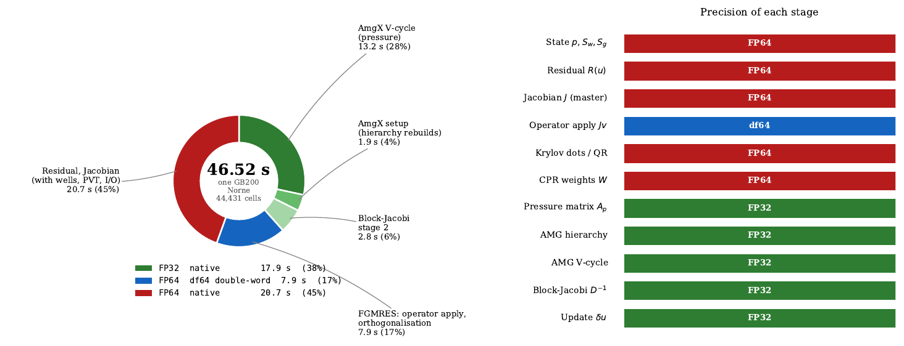
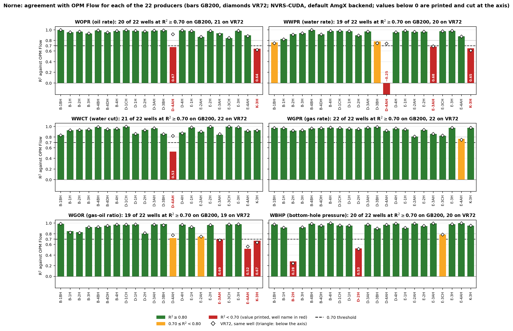
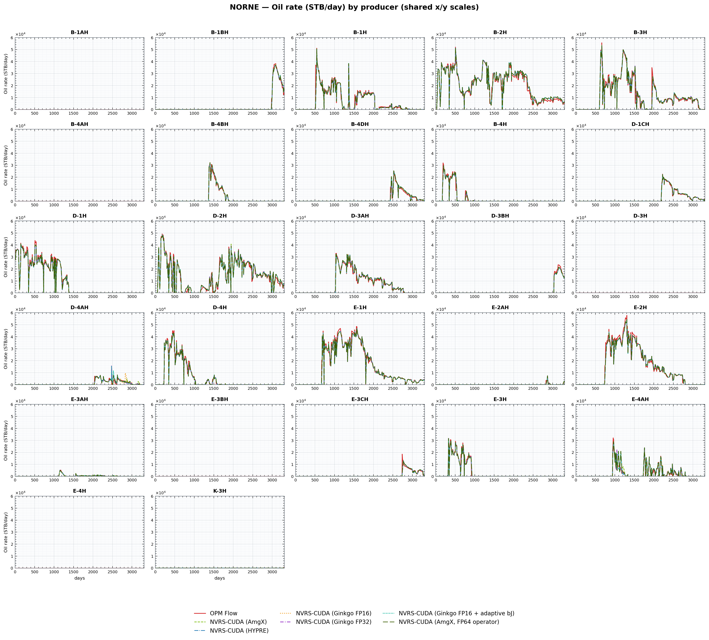
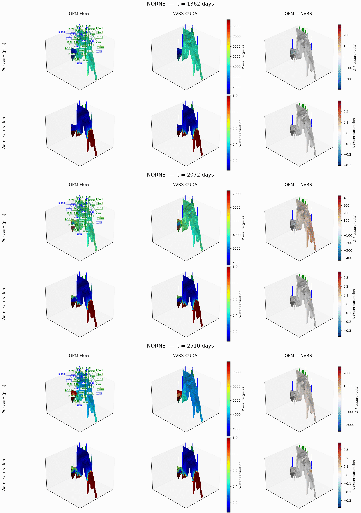
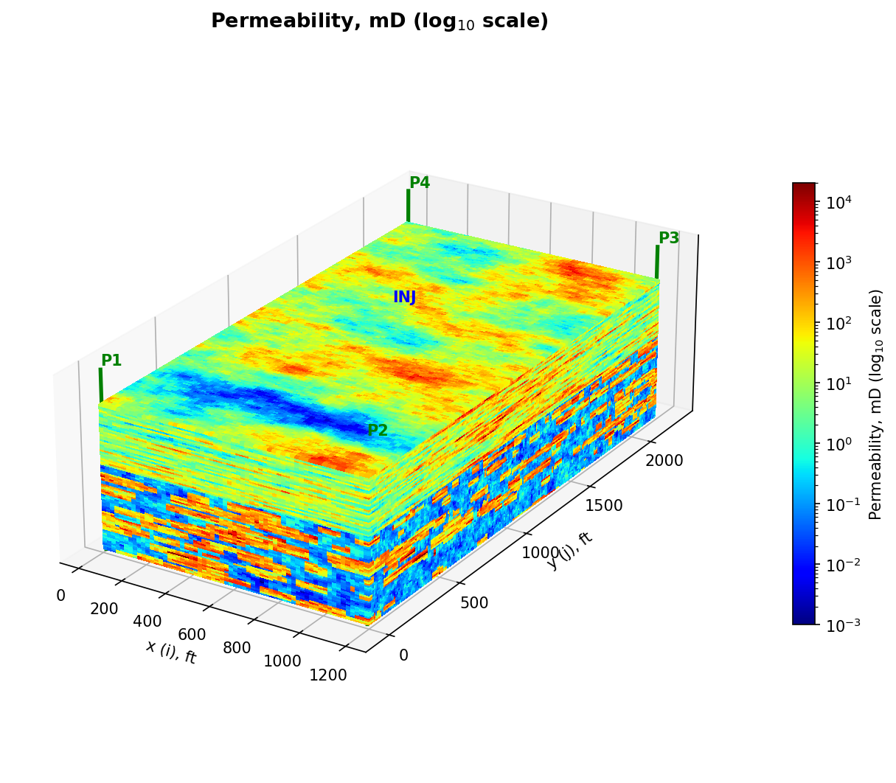
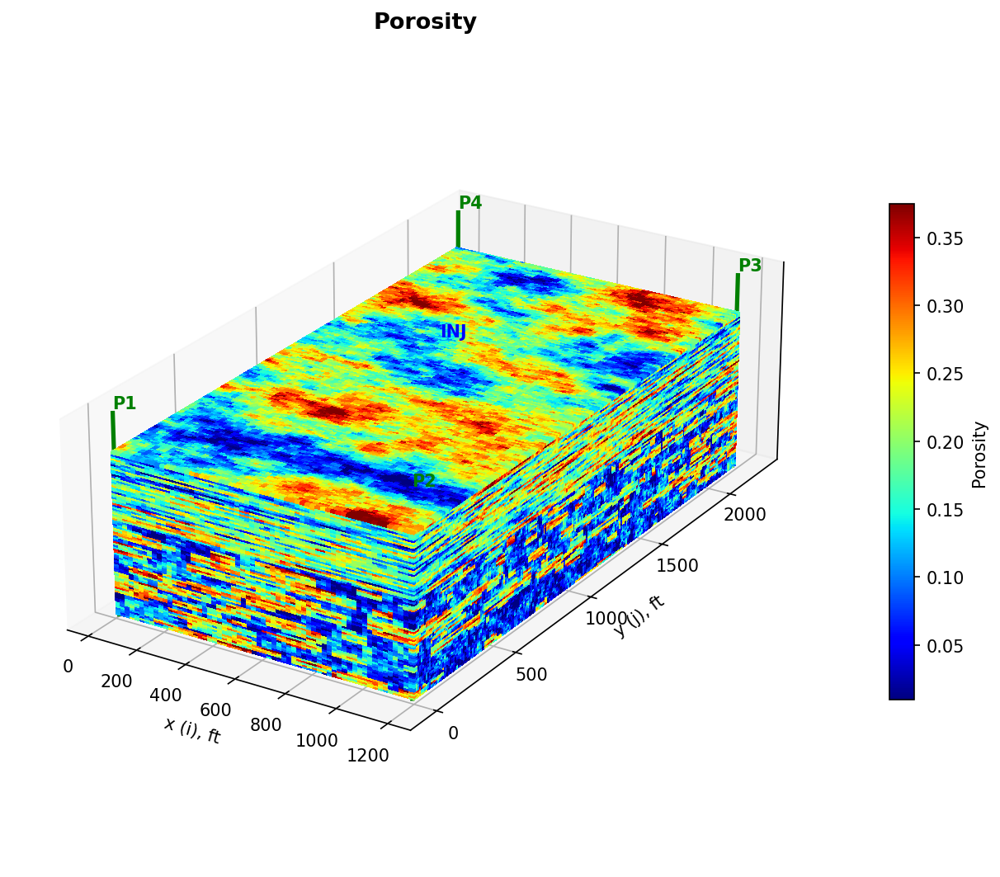
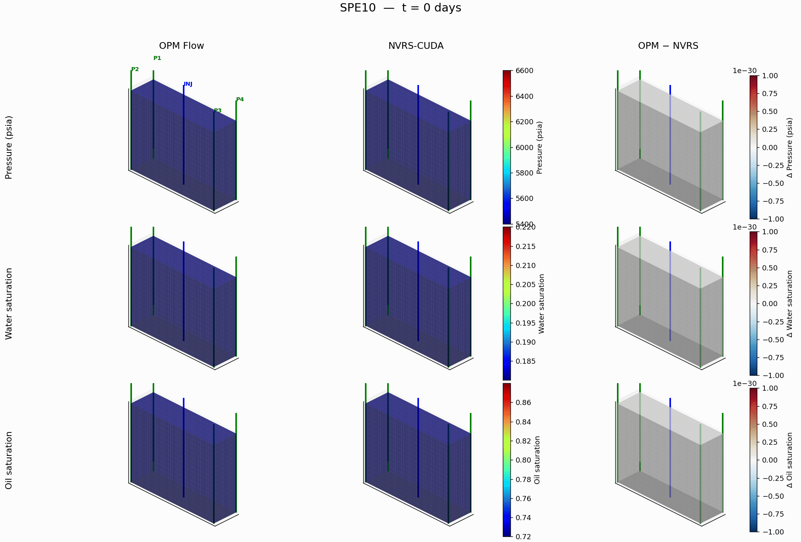
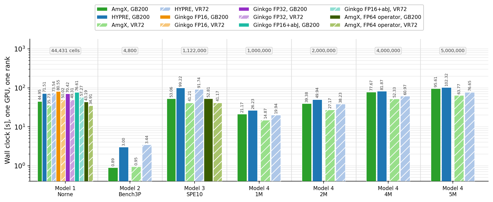
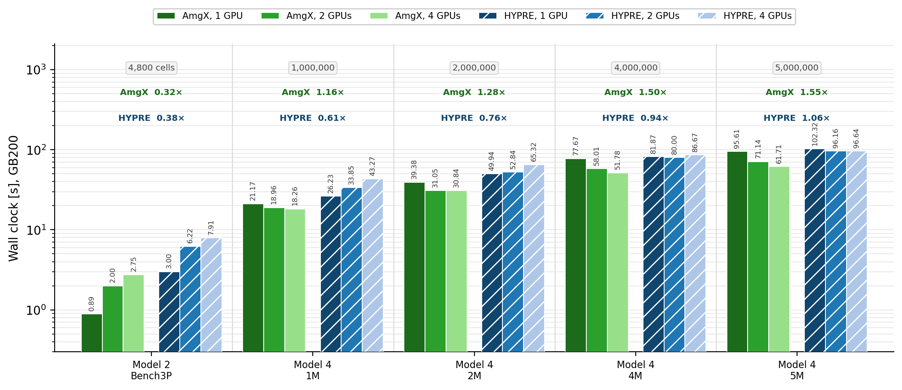
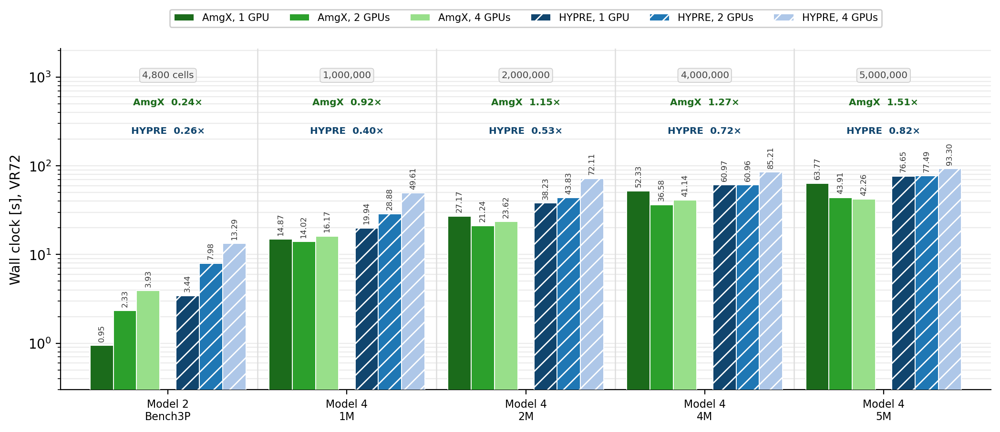

# NVRS-CUDA: A GPU-Native Reservoir Simulator

## Headline

The published **Norne field deck**, 44,431 active cells over 3312 days and 247
report steps, one GPU and one rank, with six solver arms run back to back on each
machine. All numbers are **version 2** of the code: the coupled operator stored
as 3x3 blocks with one index per block (`BLOCKSPMV 1`) and the Krylov tail
replayed from CUDA graphs (`CUDAGRAPH 1`). Version 1 is the same code with scalar
CSR and direct launches.

| Run | GB200 | VR72 | Over Flow, GB200 | Over Flow, VR72 |
|---|---|---|---|---|
| OPM Flow 2024.10 | 488.51 s | 243.88 s | | |
| NVRS-CUDA (HYPRE BoomerAMG, FP32) | 71.51 s | 73.54 s | 6.83x | 3.32x |
| NVRS-CUDA (Ginkgo, FP16) | 80.55 s | 50.02 s | 6.06x | 4.88x |
| NVRS-CUDA (Ginkgo, FP32) | 70.42 s | 49.31 s | 6.94x | 4.95x |
| NVRS-CUDA (Ginkgo FP16 + adaptive block-Jacobi) | 76.61 s | 57.27 s | 6.38x | 4.26x |
| NVRS-CUDA (AmgX, FP32, native FP64 operator) | 43.19 s | 34.91 s | 11.31x | 6.99x |
| **NVRS-CUDA (AmgX, FP32, default)** | **44.95 s** | **35.73 s** | **10.87x** | **6.83x** |

These are single runs from one session (the comparison session), used to compare the backends with
one another. Run three times in a second session, the default configuration takes **46.75 s**
[46.45, 46.99] on GB200 and 35.76 s on VR72, on the same Newton path (1,497 Newton, 41,114 Krylov);
the 4 % GB200 difference between sessions sits in the launch-bound phases. Wall clocks are compared
only within a session, and every factor against Flow below uses the repeated session.

Against Flow on one rank with two host threads NVRS is **10.45x** faster, and most of that is host work Flow does on two threads.
Given the whole node, Flow is fastest with its CPU CPR solver on 16 ranks, and
**the factor is 3.5x on GB200 and 2.5x on VR72** (NVRS median of three runs).

| Flow 2024.10 configuration | GB200 | NVRS faster by | VR72 | NVRS faster by |
|---|---|---|---|---|
| GPU ILU(0), 1 rank x 2 threads | 488.51 s | 10.45x | 243.88 s | 6.82x |
| GPU ILU(0), every host thread | 348.95 s | 7.46x | 543.49 s | 15.2x |
| **CPU CPR, 16 ranks (fastest)** | **165.62 s** | **3.54x** | **88.48 s** | **2.47x** |

NVRS runs a looser material-balance tolerance than Flow (MB 3.5e-5 against
1e-7); its exact discrete water balance closes to -0.68 %. At Flow's MB 1e-7 the NVRS Newton
iteration stagnates (one VR72 run took 2,901 s, 33x Flow's CPU CPR), so every factor here holds
only at the NVRS tolerance; this is the main limitation, and a trust-region saturation update is
the planned fix.

On GB200 the AmgX run takes 1,497 Newton iterations against Flow's 1,985, and
each costs 30.0 ms against 246.1 ms. It rebuilds the AMG hierarchy 172 times at
10.2 ms each and retries 3 of the 247 report steps; BoomerAMG takes 1,506 Newton
iterations. On VR72 the AmgX run takes 1,571 Newton iterations at 22.7 ms each.

Where the time goes on GB200, in seconds:

| Run | Total | Linear solve | of which AMG | Outside the solve |
|---|---|---|---|---|
| OPM Flow | 488.51 | 97.22 | n/a | 391.29 |
| NVRS-CUDA (AmgX) | **44.95** | 23.60 | 14.56 | 21.36 |
| NVRS-CUDA (HYPRE) | 71.51 | 49.91 | 34.12 | 21.61 |
| NVRS-CUDA (Ginkgo FP16) | 80.55 | 56.30 | 41.52 | 24.24 |

Under AmgX the run splits 38.2 % native FP32, 2.2 % emulated FP64 (the operator
apply alone) and 59.6 % native FP64 (54.3 / 2.5 / 43.1 % under BoomerAMG).



### Every ablation and study

Norne on one GPU unless a row says otherwise; each row changes one thing
from the default. GB200 walls are medians of three runs with [min, max]
unless marked as a single run; Newton and Krylov counts are GB200.

| Study | Change from the default | GB200 wall, s | Newton / Krylov | VR72 wall, s | Finding |
|---|---|---|---|---|---|
| **Default** | | | | | |
| Default configuration | block CSR, captured Krylov tail, df64 operator, quasi-IMPES, block-Jacobi stage 2, AMG reused up to 10 Newton | 46.75 [46.45, 46.99] | 1,497 / 41,114 | 35.76 [35.64, 36.62] | reference point; 11.6 s of it is output |
| **Storage and launch (2x2)** | | | | | |
| Scalar CSR, direct launches | version 1 operator | 51.24 [51.22, 51.55] | 2,004 / 45,125 | 40.08 | operator 64.1 us per Krylov |
| Block CSR, direct launches | no graph capture | 45.25 [44.74, 45.47] | 1,497 / 41,114 | 34.89 | 52.0 us: storage alone 1.23x (model 1.31x); fastest |
| Scalar CSR, captured tail | no block storage | 52.55 [52.44, 52.56] | 2,004 / 45,125 | 40.86 | capture costs 2.9 s; not repaid |
| Block CSR, captured, reuse guard | CUDAGRAPHMINREUSE 2 | 45.21 [44.91, 45.33] | 1,497 / 41,114 | 34.91 | guard stops after 192 captures (0.22 reuses each) |
| **Operator arithmetic** | | | | | |
| Native FP64 operator | EMULATE 0 | 44.04 [43.82, 44.21] | 1,400 / 38,869 | 34.56 | 11.37 us per apply; path differs, not arithmetic |
| FP32-stored operator, FP64 master | EMULATE 2 | 47.62 [47.52, 47.81] | 1,654 / 42,608 | 34.36 | apply 7% cheaper, run 8% slower; 9 of 1,663 solves continued on the true residual |
| **Preconditioner** | | | | | |
| Rebuild AMG every Newton | AMGREUSE 0 (single run) | 54.90 | 1,532 / 31,479 | 59.73 | reuse is worth 1.17x (1.67x on VR72) |
| Dynamic row-sum decoupling | CPRDECOUPLE DRS (single run) | 45.21 | 1,440 / 40,149 | 37.11 | Krylov per Newton 27.9 vs 27.5 |
| Plain row-sum decoupling | CPRDECOUPLE SUM (single run) | 47.41 | 1,596 / 42,864 | 37.41 | 26.9 per Newton: decoupling within 5% |
| Vertical line stage 2 | STAGE2 ZLINE | n/a | n/a | n/a | needs the Cartesian neighbour map; falls back to block-Jacobi on Norne |
| BoomerAMG, coarse grid 20,000 rows | AMGMAXCOARSE 20000, vs BoomerAMG 71.51 s (single run) | 87.35 | 1,723 / 136,274 | 73.39 | V-cycle 0.24 vs 0.44 ms but 1.87x Krylov |
| **Time integration** | | | | | |
| Flow's accepted substeps imposed | DTSEQFILE | 47.68 [47.23, 47.82] | 1,580 / 42,867 | 32.35 | Newton ratio to Flow 1.26 (1.33 unconstrained) |
| **Reference (Flow 2024.10)** | | | | | |
| (P) GPU ILU(0), 1 rank x 2 threads | two-thread configuration | 488.51 | 1,985 / 30,072 | 243.88 | NVRS 10.45x faster (VR72 6.82x) |
| (G) GPU ILU(0), every host thread | 1 x 144 (VR72 1 x 352) | 348.95 | 1,985 | 543.49 | 7.46x; threads slow VR72 down |
| (C) CPU CPR, best of 8/16/32 ranks | 16 ranks on both | 165.62 | 1,263 | 88.48 | 3.54x (VR72 2.47x) |
| **Scaling, 1 to 4 GPUs** | | | | | |
| 1 million cells | aggregation, NCCL, one imposed step sequence | 24.92 -> 27.22 | 683 -> 687 | 16.84 -> 25.67 | 0.92x (VR72 0.66x): too small to scale |
| 5 million cells | as above | 104.68 -> 80.60 | 683 -> 685 | 69.16 -> 56.73 | 1.30x, 33% efficiency (VR72 1.22x) |
| **Kernels in isolation** | | | | | |
| Block FP64 vs cuSPARSE CSR / BSR | Norne-sized box, us per apply | 14.4 vs 34.8 / 39.0 |  | 11.1 vs 29.7 / 32.3 | 2.42x / 2.71x (VR72 2.69x / 2.92x) |
| df64 vs native FP64 | same box | 18.5 vs 14.4 |  | 13.3 vs 11.1 | emulation costs 1.28x (VR72 1.21x) |
| Graph capture break-even r* | capture cost / saving per replay | 2.3 |  | 30 | Norne reuses each graph 1.16 times |
| **Accuracy** | | | | | |
| Pressure-matrix conditioning | cond2(A_p) = 5.2e3 | u32: 3e-4, u16: 2.5 |  | same | FP32 hierarchy safe; FP16 outside Proposition 1 |
| Exact discrete water ledger | NVRS_SUBSTEP_BALANCE=1 | -0.68% (trapezoid 1.75%) |  | -0.70% (1.15%) | bias due to the MB tolerance; the remainder is integration error in the balance |

### Version 2: block storage and CUDA graphs

| Norne, GB200, AmgX | Version 1 | Version 2 |
|---|---|---|
| Operator apply, per Krylov iteration | 64.0 us | **24.1 us** |
| Orthogonalisation (CGS2), per Krylov iteration | 91.0 us | **44.8 us** |
| AMG V-cycle | 0.31 ms | 0.31 ms |
| Kernel launches in the Nsight trace | 173,083 | **129,499** |
| Wall clock, GB200 | 46.52 s | **44.95 s** |
| Wall clock, VR72 | 44.65 s | **35.73 s** |

The two changes were introduced together; the 2x2 ablation below separates
them. Block storage makes the operator 1.23x cheaper per Krylov iteration, close
to the 1.31x the traffic model predicts. Graph capture halves the operator time
the solver's timer sees, but on Norne each graph is reused only 1.16 times
against a measured break-even of 2.3, the captures cost 2.9 s, and the run is
3 % slower than with direct launches. The reuse guard (`CUDAGRAPHMINREUSE`)
stops capturing after 192 captures and recovers the direct-launch time. On
SPE10 each graph is reused 159 times and capture stays on.

### Emulated against native FP64 in the operator

A sixth arm runs AmgX with `EMULATE 0`: the operator apply in native FP64,
everything else, the FP32 multigrid included, unchanged. It is not a comparison
of FP64 against FP32; both arms are equally mixed precision.

| AmgX, one GPU | Wall | Newton | Operator | Per apply |
|---|---|---|---|---|
| Norne, GB200, df64 | 44.95 s | 1,497 | 0.99 s | 11.8 us |
| Norne, GB200, native FP64 | 43.19 s | 1,400 | 0.90 s | 11.3 us |
| Norne, VR72, df64 | 35.73 s | 1,571 | 0.99 s | 11.6 us |
| Norne, VR72, native FP64 | 34.91 s | 1,526 | 0.96 s | 11.6 us |

Inside the solver the cost per apply is the same within 4 %, and the operator
is 2 % of the run, so the wall-clock differences are the Newton path, not the
arithmetic. Measured in isolation on a fixed input, the df64 apply costs 1.28x
the native one on GB200 and 1.21x on VR72: a df64 pair is the same 8 bytes as
FP64, but it does ten to twenty times the arithmetic. Emulation buys FP64
semantics, not speed. A third arm stores the operator in FP32 with an FP64
master for every residual that decides convergence (`EMULATE 2`): the apply is
7 % cheaper and the run 8 % slower on GB200, because the perturbed operator
lengthens the nonlinear path. On SPE10, whose deck already uses the native
operator, the two runs agree to 0.5 %.

### Ginkgo: a third multigrid, down to half precision

Ginkgo's parallel-graph-matching AMG (Anzt et al., ACM TOMS 2022) runs the whole
V-cycle in IEEE FP16 (or FP32 for a control), optionally with Ginkgo's
adaptive-precision block-Jacobi (Flegar et al., ACM TOMS 2021) as the second CPR
stage. It **does not beat AmgX**: its best arm is 1.57x slower on GB200 and 1.38x
on VR72, while beating BoomerAMG on both (1.02x and 1.49x).

| Norne, one GPU | V-cycle GB200 | V-cycle VR72 | Mean R^2 GB200 | Mean R^2 VR72 |
|---|---|---|---|---|
| **AmgX FP32** | **0.31 ms** | **0.23 ms** | 0.901 | 0.910 |
| AmgX FP32, native FP64 operator | 0.31 ms | 0.23 ms | 0.908 | 0.759* |
| BoomerAMG FP32 | 0.44 ms | 0.44 ms | 0.902 | 0.910 |
| Ginkgo FP16 | 0.65 ms | 0.36 ms | 0.851* | 0.903 |
| Ginkgo FP32 | 0.65 ms | 0.37 ms | 0.905 | 0.898 |
| Ginkgo FP16 + adaptive bJ | 0.64 ms | 0.36 ms | 0.893 | 0.911 |

\* One producer, D-4AH, moved its water breakthrough in that run; the other 21
wells match the other arms. The agreement measures used in the arXiv paper
(range-normalised error, cumulative error, breakthrough offset) are reported
there.

Half precision keeps the answer but not a speed-up. The measured conditioning
of the Norne pressure matrix puts FP16 outside the guarantee: cond(A_p) x u32 is
3e-4, well inside the condition of the paper's Proposition 1, but cond(A_p) x
u16 is 2.5, outside it. Per Newton iteration, however, FP16 Ginkgo needs no more
Krylov iterations than FP32 Ginkgo (32.0 against 33.5 on GB200, 35.5 against
34.6 on VR72); its 1.21x larger total comes from a longer nonlinear path (1,826
against 1,437 Newton), which `REVIEW_PARTS=fp16steps` tests on one imposed
substep sequence. On traffic: a CSR matrix with 32-bit
column indices moves 4 + w bytes per nonzero, so halving the value width saves at
most a quarter of the traffic, and the Nsight traces show the Norne kernels bound
by launch latency, with about 15 % of Ginkgo's GPU time in per-application solver
bookkeeping.

### Norne, every producer scored against Flow

Each of the 22 producers is scored separately by the R^2 of its whole history
against OPM Flow, on six quantities (GB200, AmgX). 🟢 R^2 >= 0.80,
🟡 0.70 to 0.80, 🔴 below 0.70. Where Flow's value is constant over the history
(a well held at a pressure limit), the error is measured against 5 % of that
level, so shut-in periods do not give negative scores.

| Well | WOPR | WWPR | WWCT | WGPR | WGOR | WBHP |
|---|---:|---:|---:|---:|---:|---:|
| B-1BH | 🟢 0.99 | 🟡 0.76 | 🟢 0.84 | 🟢 0.97 | 🟢 0.98 | 🟢 0.98 |
| B-1H | 🟢 0.95 | 🟢 0.83 | 🟢 0.93 | 🟢 0.97 | 🟢 0.85 | 🟢 0.92 |
| B-2H | 🟢 0.96 | 🟢 0.92 | 🟢 0.94 | 🟢 0.92 | 🟢 0.83 | 🔴 **0.28** |
| B-3H | 🟢 0.93 | 🟢 0.94 | 🟢 0.94 | 🟢 0.93 | 🟢 0.93 | 🟢 0.92 |
| B-4BH | 🟢 0.98 | 🟢 0.99 | 🟢 0.99 | 🟢 0.96 | 🟢 0.93 | 🟢 0.99 |
| B-4DH | 🟢 0.95 | 🟢 0.92 | 🟢 0.95 | 🟢 0.97 | 🟢 0.95 | 🟢 0.95 |
| B-4H | 🟢 0.98 | 🟢 0.98 | 🟢 0.96 | 🟢 0.98 | 🟢 0.97 | 🟢 1.00 |
| D-1CH | 🟢 0.99 | 🟢 0.98 | 🟢 1.00 | 🟢 0.97 | 🟢 0.97 | 🟢 0.96 |
| D-1H | 🟢 0.98 | 🟢 0.97 | 🟢 0.86 | 🟢 0.96 | 🟢 0.97 | 🟢 0.95 |
| D-2H | 🟢 0.97 | 🟢 0.90 | 🟢 0.93 | 🟢 0.95 | 🟢 0.80 | 🔴 **0.53** |
| D-3AH | 🟢 0.98 | 🟢 0.97 | 🟢 0.97 | 🟢 0.98 | 🟢 0.97 | 🟢 0.97 |
| D-3BH | 🟢 0.99 | 🟡 0.78 | 🟢 0.86 | 🟢 0.99 | 🟢 0.98 | 🟢 0.90 |
| D-4AH | 🔴 **0.67** | 🔴 **-0.25** | 🔴 **0.53** | 🟢 0.92 | 🟡 0.72 | 🟢 0.97 |
| D-4H | 🟢 0.98 | 🟢 0.95 | 🟢 0.89 | 🟢 0.96 | 🟢 0.97 | 🟢 0.99 |
| E-1H | 🟢 0.97 | 🟢 0.98 | 🟢 0.98 | 🟢 0.94 | 🟢 0.93 | 🟢 0.91 |
| E-2AH | 🟢 0.86 | 🟢 0.96 | 🟢 0.90 | 🟢 0.81 | 🟡 0.74 | 🟢 0.99 |
| E-2H | 🟢 0.98 | 🟢 0.96 | 🟢 0.99 | 🟢 0.94 | 🟢 0.96 | 🟢 0.94 |
| E-3AH | 🟢 0.93 | 🔴 **0.68** | 🟢 0.84 | 🟢 0.86 | 🔴 **0.69** | 🟢 0.99 |
| E-3CH | 🟢 0.84 | 🟢 0.97 | 🟢 0.99 | 🟢 0.82 | 🟢 0.97 | 🟡 0.78 |
| E-3H | 🟢 0.98 | 🟢 0.98 | 🟢 0.98 | 🟢 0.97 | 🟢 0.98 | 🟢 0.98 |
| E-4AH | 🟢 0.90 | 🟢 0.88 | 🟢 0.92 | 🟡 0.77 | 🔴 **0.52** | 🟢 1.00 |
| K-3H | 🔴 **0.64** | 🔴 **0.65** | 🟢 0.93 | 🟢 0.97 | 🔴 **0.67** | 🟢 0.95 |
| **wells >= 0.70** | **20/22** | **19/22** | **21/22** | **22/22** | **19/22** | **20/22** |

**20 of the 22 producers match Flow at R^2 >= 0.70 on oil rate, 21 on water cut,
all 22 on gas rate, and 19 on all four rate quantities at once** (all but D-4AH,
E-3AH and K-3H). The mean over producers and quantities is 0.901. The VR72 run
gives 20 of 22 on all four rates and a mean of 0.910.



Field recovery agrees to a fraction of a percent:

| | OPM Flow | NVRS-CUDA |
|---|---|---|
| Peak field oil rate | 227.52 k STB/day | 232.20 k STB/day |
| Best single well (E-2H) | 57.75 k STB/day | 54.33 k STB/day |
| Cumulative oil, 3312 days | 422.78 M STB | **425.07 M STB** |
| **Recovery factor** | **41.8 %** | **41.5 %** |
| Implied B_o | 1.303 | 1.289 |

The oil balance closes: what the saturation field gives up accounts for
**100 %** of what the well rates report. Water gained over the history is
523.0 M STB against Flow's 518.4; reconciled against reported injection the
water balance closes to +6.2 % (GB200) and +6.6 % (VR72) against Flow's +3.8 %.





### SPE10 model 2 against OPM Flow

1,122,000 cells, 1000 days, one Eclipse deck (`decks/SPE10_MATCHED.DATA`) read
by both simulators, CPRW, `LINTOL 3e-2`, native FP64 operator, one GPU. OPM Flow
runs on the VR72 host (its GPU bridge needs block size 3 and SPE10 is two-phase).





| Run | GB200 | VR72 | Over Flow | Mean R^2 |
|---|---|---|---|---|
| OPM Flow 2024.10 (CPU) | n/r | 766.16 s | | reference |
| NVRS-CUDA (HYPRE) | 99.22 s | 91.74 s | 8.37x | 0.999 |
| **NVRS-CUDA (AmgX)** | **53.06 s** | **41.21 s** | **18.59x** | **0.999** |

Recovery factor 21.1 % in both codes and the water balance closes exactly.
AmgX needs 39.2 Krylov iterations per Newton step against BoomerAMG's 69.9.



### Every model, every backend, both machines, one GPU



| Model | Cells | Flow GB200 | HYPRE GB200 | Ginkgo GB200 | AmgX GB200 | Flow VR72 | HYPRE VR72 | Ginkgo VR72 | AmgX VR72 |
|---|---|---|---|---|---|---|---|---|---|
| Norne, field | 44,431 | 488.51 | 71.51 | 80.55 | **44.95** | 243.88 | 73.54 | 50.02 | **35.73** |
| Bench3P | 4,800 | 9.25 | 3.00 | n/r | **0.89** | 5.32 | 3.44 | n/r | **0.95** |
| SPE10 model 2 | 1,122,000 | n/r | 99.22 | n/r | **53.06** | 766.16 (CPU) | 91.74 | n/r | **41.21** |
| Million | 1,000,000 | n/r | 26.23 | n/r | **21.17** | n/r | 19.94 | n/r | **14.87** |
| Million-2M | 2,000,000 | n/r | 49.94 | n/r | **39.38** | n/r | 38.23 | n/r | **27.17** |
| Million-4M | 4,000,000 | n/r | 81.87 | n/r | **77.67** | n/r | 60.97 | n/r | **52.33** |
| Million-5M | 5,000,000 | n/r | 102.32 | n/r | **95.61** | n/r | 76.65 | n/r | **63.77** |

Seconds, one GPU. AmgX is the fastest library on every model on both machines.
Solid bars are GB200, hatched bars VR72; green AmgX, blue BoomerAMG, on Norne
orange, violet and teal for the three Ginkgo arms (FP16 shown in the table), and
dark olive for AmgX with a native FP64 operator. `n/r` marks an arm that was not
run.

### Scaling across GPUs: AmgX against BoomerAMG, GB200 and VR72





At two and four GPUs the two arms take the same Newton path to within four
iterations, and each backend is also measured against **its own** single-GPU
rate:

| Cells | Backend | GB200 1 / 2 / 4 GPUs | GB200 1 to 4 | VR72 1 / 2 / 4 GPUs | VR72 1 to 4 |
|---|---|---|---|---|---|
| 4,800 | BoomerAMG | 3.00 / 6.22 / 7.91 s | 0.38x | 3.44 / 7.98 / 13.29 s | 0.26x |
| | AmgX | 0.89 / 2.00 / 2.75 s | 0.32x | 0.95 / 2.33 / 3.93 s | 0.24x |
| 1,000,000 | BoomerAMG | 26.23 / 33.85 / 43.27 s | 0.61x | 19.94 / 28.88 / 49.61 s | 0.40x |
| | AmgX | 21.17 / 18.96 / **18.26** s | **1.16x** | 14.87 / **14.02** / 16.17 s | 0.92x |
| 2,000,000 | BoomerAMG | 49.94 / 52.84 / 65.32 s | 0.76x | 38.23 / 43.83 / 72.11 s | 0.53x |
| | AmgX | 39.38 / 31.05 / **30.84** s | **1.28x** | 27.17 / **21.24** / 23.62 s | **1.16x** |
| 4,000,000 | BoomerAMG | 81.87 / 80.00 / 86.67 s | 0.94x | 60.97 / 60.96 / 85.21 s | 0.72x |
| | AmgX | 77.67 / 58.01 / **51.78** s | **1.50x** | 52.33 / 36.58 / **41.14** s | **1.27x** |
| 5,000,000 | BoomerAMG | 102.32 / 96.16 / 96.64 s | 1.06x | 76.65 / 77.49 / 93.30 s | 0.81x |
| | AmgX | 95.61 / 71.14 / **61.71** s | **1.55x** | 63.77 / 43.91 / **42.26** s | **1.51x** |

BoomerAMG does not scale on this problem: its hierarchy setup grows with ranks
(5.2 s to 17.6 s at a million cells on GB200) while AmgX's shrinks. At four GPUs
AmgX is faster in absolute terms by 1.64x to 2.37x on GB200 and 2.24x to 3.10x
on VR72. On one GPU from a million cells up AmgX takes about 694 Newton
iterations to BoomerAMG's 362 (its single-rank classical hierarchy; at two ranks
it builds aggregates and the counts agree), and is still 2.1x to 2.7x cheaper per
Newton iteration.

**VR72 against GB200.** AmgX gains 1.30x to 1.41x across the million-cell
family, 1.29x on SPE10 and 1.26x on Norne; Bench3P, at 4,800 cells, is too small
to gain. Keep the CUDA JIT cache enabled on VR72: the device reports a compute
capability no released toolkit targets, so every kernel is compiled from PTX at
load.

**Time integration follows OPM Flow's**: a continuous timestep carried across
report steps and rescaled from the Newton count of the last converged sub-step,
with Flow's pore-volume-weighted convergence criterion (`DTCONTROL`, `OPMCONV`,
`NEWTONSTALLMAX`).

Reproduce a case with
`cd full_reservoir_simulator/GPU_reservoir_simulator/cuda/benchmark && ./nvrs.sh all NORNE`
(or `SPE10`, or `BENCH3P`).

## Start here: the container

Everything in this repository was measured inside one image, and it is the
supported way to build and run any of it.  From this folder:

```bash
../build_container.sh
```

That builds the image if it does not exist and drops you into a shell already
in `/workspace/project`, which **is** this repository, mounted rather than
copied, so
an edit on the host is an edit in the container, and rebuilding the simulator
never means rebuilding the image.

Then, inside the container:

```bash
cd full_reservoir_simulator && ./quickstart.sh
```

Before trusting any multi-GPU timing, prove the image is what it claims:

```bash
../build_container.sh check
```

A container can carry CUDA and an MPI and still not have **CUDA-aware** MPI,
and a successful build says nothing either way.  `check` compiles and runs a
two-rank `MPI_Send`/`MPI_Recv` on a `cudaMalloc`'d pointer and reports what
actually happened.  It matters: NVRS ranks exchange *device* buffers directly,
and a stock OpenMPI stages them through host memory. It still runs, and it is
quietly several times slower, which is the worst kind of difference because
nothing fails.

[`Dockerfile`](../Dockerfile) is CUDA 12.8 on Ubuntu 22.04 with UCX
1.18.1, PMIx 4.2.8 and OpenMPI 4.1.5 built from source (`--with-cuda
--with-ucx --with-pmix --with-slurm`).  UCX's own test programs are not built: they are not used here, and pinning
them to one CUDA version is what broke the first build of this image.  The base image is multi-architecture,
so it builds on x86_64 and on aarch64 (GB200) unchanged.  The first build
compiles three libraries from source and takes tens of minutes; later builds
come from the layer cache.

[`build_container.sh`](../build_container.sh) also takes `build`,
`rebuild`, `shell`, `run <cmd>` and `help`.  It uses `podman` when `docker` is
absent, and where neither is permitted (common on a shared cluster) it prints
the Apptainer equivalent.

---

### From rock physics to Bayesian inversion, with a mixed-precision CPR solver

**Clement Etienam**¹ · **Tsubasa Onishi**¹ · **Oleg Ovcharenko**¹ · **Nick Luiken**¹ · **Issam Said**¹

¹ NVIDIA

---

A CUDA C++ black-oil and compositional reservoir simulator built around a
**mixed-precision CPR** linear solver that scales from a single GPU to
multi-node clusters, wrapped in an **α-REKI Bayesian history-matching** layer
whose forward map is either the simulator itself or a neural surrogate of it.
The multigrid inside CPR comes from **AmgX** (default) or **HYPRE BoomerAMG**,
chosen with one deck keyword, see §5.4.

This document develops the mathematics from first principles and maps every
equation onto the code that implements it.

> **Just want to run it?** See [Quickstart](#quickstart) immediately below.
> **Reviewing the numerics?** Start at [§0](#0-the-one-idea) and read straight through.

---

## Then: one command

`nvrs.sh` is the whole workflow behind one entry point. It does not replace any
of the scripts below; it calls them in order and knows which one a given case
needs, because that is where the steps were being lost: sourcing an environment
file between two installers, or knowing that Norne is downloaded
while SPE10 is generated and the BENCH cases are computed, or that the figures
need a second command after the profile.

```bash
cd full_reservoir_simulator/GPU_reservoir_simulator/cuda/benchmark

./nvrs.sh                  # what is installed, what is ready, what to type
./nvrs.sh install          # HYPRE, AmgX, OPM Flow, Nsight, and nvrs_cuda
./nvrs.sh all NORNE        # fetch it, run it, profile it, report it
```

That last line ends with `runs/compare_NORNE.html`: NVRS against OPM Flow, the
field images, the animation, and the Nsight Systems figures for both multigrid
backends, in one page.

Any case works the same way:

```bash
./nvrs.sh cases            # every case, and whether its deck is ready
./nvrs.sh all SPE10
./nvrs.sh all BENCH3P
NVRS_DECK=/path/to/MY.DATA ./nvrs.sh all MYFIELD
```

Or one step at a time, when a stage needs re-running on its own:

| Command | What it does |
|---|---|
| `./nvrs.sh` | the menu: commands, options, and what is ready on this machine |
| `./nvrs.sh install` | HYPRE, AmgX, OPM Flow, Nsight and `nvrs_cuda` |
| `./nvrs.sh cases` | every case, and whether its deck is ready |
| `./nvrs.sh get <CASE>` | fetch or generate the deck and its data |
| `./nvrs.sh run <CASE>` | the backends, against OPM Flow |
| `./nvrs.sh profile <CASE>` | Nsight Systems, once per backend |
| `./nvrs.sh report <CASE>` | the figures, folded into the HTML |
| `./nvrs.sh all <CASE>` | all four of the above, in order |

Options are flags, and every command prints the ones it takes when it starts,
so there is nothing to memorise:

```
  in effect now         --backend amgx --no-opm
  'profile' also takes  --backend  --fraction  --tend  --steps  --ncu  --deck
  full list             ./nvrs.sh --help
```

| Option | Applies to | Meaning |
|---|---|---|
| `--no-opm` | run, all | NVRS only; do not run OPM Flow |
| `--backend <b>` | run, profile | `amgx`, `hypre`, or `both` (default both) |
| `--ranks <n>` | run, profile | MPI ranks for NVRS |
| `--no-profile` | all | skip the profiling step |
| `--no-scaling` | run, all | one GPU only; skip the 2/4-GPU strong-scaling sweep |
| `--scaling` | run, all | force the sweep on (SPE10 defaults to off) |
| `--ncu` | profile, all | add Nsight Compute counters (~100x slower) |
| `--fraction <f>` | profile, all | history to profile: `0.25`, or `all` (default `0.1`) |
| `--tend <days>` | profile, all | profile exactly this many days instead |
| `--steps <n>` | profile, all | **NORNE only**: report steps, or `all` |
| `--heartbeat <s>` | profile, all | progress interval, `0` to silence |
| `--deck <path>` | get, run, all | your own `.DATA`, for a case not under `decks/` |

`--no-scaling` matters for the large cases. By default a run is repeated on 2,
4 and however many GPUs are present, which is the point for the BENCH family
and wasted time for SPE10: 1.12 million cells that exist to stress the solver,
where each extra rank repeats a long run to answer a question the case was not
chosen to ask. SPE10 therefore defaults to a single GPU, and `--scaling`
overrides that.

`--steps` is Norne-only on purpose: a report step is a fortnight there and
something else in every other deck, so it is refused rather than quietly
misapplied. Use `--fraction` or `--tend` elsewhere.

Some worked examples:

```bash
./nvrs.sh all NORNE --no-opm              # skip Flow, NVRS only
./nvrs.sh all NORNE --backend amgx        # one backend, faster
./nvrs.sh all NORNE --steps all           # the whole 247-step history
./nvrs.sh all SPE10 --fraction 0.5        # half of SPE10's history
./nvrs.sh all MYFIELD --deck /path.DATA   # a deck of your own
./nvrs.sh profile NORNE --ncu             # add the kernel counters
./nvrs.sh report NORNE                    # rebuild the HTML only
```

The older environment variables (`SKIP_OPM`, `NVRS_BACKENDS`, `PROF_FRACTION`
and the rest) still work; the flags override them.

Each install step is skipped when its output is already present, so
`./nvrs.sh install` is safe to re-run after a failure and resumes rather than
starting over. Nothing in it needs root.

## Newer GPUs, and machines without root

Two things are handled automatically and are worth knowing about:

**A GPU newer than any CUDA that can target it.** Vera Rubin reports compute
capability 10.7 and no toolkit has an sm_107 target. The install scripts emit
PTX for the newest architecture not newer than the device, which the driver
JIT-compiles into native code at load. `CUDA_ARCH=100` pins it if you are
cross-building. The first run pays the compile once; the benchmark scripts keep
the JIT cache on the mounted filesystem so it is not paid again, and timings
from a JIT-compiled machine are not comparable with a natively-built one.

**No root inside the container.** `dpkg` needs to be root and `sudo` is
usually not setuid, so missing dependencies are downloaded and unpacked into a
prefix rather than installed. That prefix is *appended* to `LD_LIBRARY_PATH`,
never prepended, because prepending it once shadowed the container's Open MPI and
broke the launcher.

Everything installs in one command:

```bash
cd full_reservoir_simulator/GPU_reservoir_simulator/cuda/benchmark && ./install_all.sh
```

## Quickstart

One command builds everything and runs a real reservoir simulation:

```bash
./quickstart.sh
```

That builds the two solver libraries (**HYPRE** and **AmgX**) then the
simulator, then runs `decks/FIELD.DATA`: a three-phase black-oil waterflood on
the 40×40×3 permeability field in `GPU_reservoir_simulator/data/iglesias3.out`.
Figures and an HTML report land in `GPU_reservoir_simulator/cuda/OUTPUT_FIELD/`.

### Building with AmgX

The CPR preconditioner takes its stage-1 multigrid from **AmgX by default**, or
from **HYPRE BoomerAMG** with `LINSOLVER HYPRE` in the deck. `quickstart.sh`
builds both. To build AmgX on its own, or into an existing checkout:

```bash
cd GPU_reservoir_simulator/cuda
./benchmark/install_amgx.sh                 # clone, build, install AmgX
source ../../amgx-install/amgx_env.sh       # sets AMGX_DIR
make clean && make -j                       # or the cmake line below
```

`make` and `cmake` both print the AmgX prefix they found, and a run names the
backend it used:

```
*      Mixed-precision CPR: AmgX aggregation AMG + block-Jacobi on CUDA      *
  Linear   : stage-1 multigrid from AmgX
```

**AmgX is optional.** Leave it out (`SKIP_AMGX=1 ./quickstart.sh`) and
everything still builds and runs on HYPRE BoomerAMG, `src/amgx_backend.cu`
compiles to nothing, and a deck asking for `LINSOLVER AMGX` gets HYPRE *and a
warning saying so*, so no log can mislabel which backend produced it. It is
worth having: on 46×112×22 AmgX is **4.5× faster** than BoomerAMG on one GB200, and it is the backend that keeps scaling past one GPU. See §5.4.

### The same four steps by hand

```bash
# 1. Build HYPRE with CUDA (once). CUDA_ARCH: 70 V100, 80 A100, 90 H100, 100 GB200
cd Mixed_precision && CUDA_ARCH=90 ./scripts/docker/install_hypre_sm100.sh
source hypre_env.sh
```

```bash
# 2. Build AmgX, which supplies the default stage-1 multigrid (optional --
#    without it everything runs on HYPRE and says so at start-up)
cd ../GPU_reservoir_simulator/cuda
./benchmark/install_amgx.sh && source ../../amgx-install/amgx_env.sh
```

```bash
# 3. Build the simulator
cmake -S . -B build \
  -DHYPRE_DIR=$HYPRE_FP32_DIR \
  -DAMGX_DIR=$AMGX_DIR \
  -DCMAKE_CUDA_ARCHITECTURES=100
cmake --build build -j
# or, with both env.sh files sourced:  make -j
```

**`make` and `cmake` produce different binaries, and the benchmarks use the
Makefile one.** `make -j` writes `cuda/nvrs_cuda`; `cmake --build build` writes
`cuda/build/nvrs_cuda`. Every script here runs the first and prints
`note : ignoring older .../cuda/build/nvrs_cuda` when the second exists. They
also find AmgX differently, since cmake is handed `-DAMGX_DIR` while make reads
the environment, so one build can have AmgX and the other not. If you build
both, build with `make` last.

Either way, read the AmgX line: `AmgX: /path/...` is good, `AmgX: not found --
HYPRE only` means the benchmark will measure BoomerAMG under a label that says
AmgX. `FORCE_AMGX=1 ./benchmark/install_all.sh` repairs the usual cause, a
prefix with the library but not `include/amgx_c.h`.

`cmake` prints `AmgX include`/`AmgX library` when it finds it, or
`AmgX : not found -- building HYPRE-only`. A run then names the backend it
actually used, in the banner and again after the deck is read:

```
*      Mixed-precision CPR: AmgX aggregation AMG + block-Jacobi on CUDA      *
  Linear   : stage-1 multigrid from AmgX
```

```bash
# 4. Run one simulation (from cuda/, so the deck's PERMFILE path resolves)
NGPU=1 ./scripts/run.sh decks/FIELD.DATA
```


Results appear in `cuda/OUTPUT_FIELD/`:

| What | Where |
|---|---|
| Report with every figure | `OUTPUT_FIELD/index.html` |
| ECLIPSE files for ResInsight / OPM | `OUTPUT_FIELD/FIELD.{EGRID,INIT,UNRST,SMSPEC,UNSMRY,RSM}` |
| Well rates | `OUTPUT_FIELD/FIELD.RSM`, `OUTPUT_FIELD/RSM_FVM.csv` |
| Written summary | `OUTPUT_FIELD/summary.txt` |

Other ready-to-run decks in `cuda/decks/`:

| Deck | Case |
|---|---|
| `FIELD.DATA` | **Start here.** 40×40×3 three-phase waterflood on a real permeability field |
| `SMOKE.DATA` | 8×8×2 two-phase, a few seconds, used by the CI smoke test |
| `RESERVOIR.DATA` | 46×112×22 three-phase, synthetic field, the large case |
| `COMPOSITIONAL.DATA` | 40×40×5 four-component gas condensate |

Multi-GPU is one flag: `NGPU=4 ./quickstart.sh`, or
`mpirun -np 4 NGPU=1 ./scripts/run.sh decks/FIELD.DATA`.

---

## Table of contents

| | |
|---|---|
| [0. The one idea](#0-the-one-idea) | Why every design decision follows from one observation |
| [1. Repository map](#1-repository-map) | What lives where |
| [2. The continuum model](#2-the-continuum-model) | Conservation, Darcy, black oil, compositional EOS |
| [3. Discretisation](#3-discretisation-tpfa--fully-implicit-newton) | TPFA, upstream weighting, FIM, Newton, **adaptive implicit** |
| [4. Wells](#4-wells-the-peaceman-model) | Peaceman inflow and the equivalent radius |
| [5. The linear solver](#5-the-linear-solver-cpr) | Krylov, AMG, CPR, two stages, **automatic hierarchy choice** |
| [6. Mixed precision](#6-mixed-precision-and-df64-emulation) | FP32 preconditioning and df64 error-free transforms |
| [7. Parallel decomposition](#7-parallel-decomposition-and-the-halo) | K-slabs, ghost cells, rank invariance |
| [8. Installation](#8-installation) | Prerequisites, HYPRE, build |
| [9. Running](#9-running) | Single GPU, multi-GPU, multi-node |
| [10. Deck reference](#10-deck-reference) | Every keyword |
| [11. Output and plotting](#11-output-and-plotting) | ECLIPSE/OPM files, 3-D views, slices, movies |
| [12. Bayesian history matching](#12-bayesian-history-matching-α-reki) | α-REKI and the surrogate forward map |
| [13. Verification](#13-verification-and-testing) | What is tested and how |
| [SPE10 model 2](#spe10-model-2) | The standard heterogeneity benchmark, and how 861 s became 342 s |
| [14. Status](#14-status-validation-and-provenance) | What was repaired, what OPM Flow says, what is in scope |

---

## 0. The one idea

Multiphase flow in porous media couples two problems of **opposite mathematical
character**:

- a **near-elliptic** pressure field: global, diffusive, stiff, with a condition
  number growing like $`\mathcal{O}(h^{-2})`$ under mesh refinement;
- **near-hyperbolic** saturation and composition fronts: local, advective, cheap
  per cell but sharp, and prone to spurious oscillation if discretised naively.

No single-character linear solver handles both well. Algebraic multigrid is
superb on the elliptic part and useless on the hyperbolic part; a local smoother
is the reverse. **Every** numerical decision in this repository (the CPR
preconditioner, the mixed-precision split, the upstream weighting, even the
domain decomposition) exists to attack each character with the tool that suits
it. Keep this split in mind; the rest is detail.

---

## 1. Repository map

```
full_reservoir_simulator/
├── README.md                          ← this document
├── quickstart.sh                      ★ build everything + run one simulation
├── run_all.sh                         one script: build + run everything
├── simulate.sh                        thin driver for a single deck
├── GPU_reservoir_simulator/
│   ├── NVRS/                          original CuPy reference (physics ground truth)
│   ├── data/                          real permeability fields (PERMFILE input)
│   │   ├── iglesias2.out              1089 values  → 33×33×1,  50–500 mD
│   │   ├── iglesias3.out              4800 values  → 40×40×3,  60–377 mD
│   │   └── test.out                   12000 values → 40×60×5,  0.0003–1 D
│   ├── RESULTS/                       reference outputs for regression
│   │   ├── 33331/  40403/  40605/     one folder per reference case
│   └── cuda/                          ★ the CUDA C++ simulator
│       ├── include/
│       │   ├── common.hpp             scalar types, error macros, capacity limits
│       │   ├── grid.hpp               K-slab decomposition + ghost index space
│       │   ├── halo.hpp               the one-layer K halo exchange
│       │   ├── deck.hpp               OPM/Eclipse-style deck
│       │   ├── fluid.hpp              rel-perm + analytic mobility derivatives
│       │   ├── pvt.hpp                black-oil PVT correlations
│       │   ├── physics.hpp            reservoir state + assembly contract
│       │   ├── linear_solver.hpp      the CPR-preconditioned Krylov solver
│       │   ├── ecl_io.hpp             ECLIPSE/OPM output (EGRID/INIT/UNRST/RSM…)
│       │   └── io.hpp                 snapshots, well rates, summary
│       ├── src/
│       │   ├── main.cu                driver: deck → decompose → Newton+CPR → output
│       │   ├── deck.cpp               keyword parser
│       │   ├── halo.cu                MPI ghost-layer exchange
│       │   ├── physics_host.cu        setup, sparsity/topology, Newton update, PVT
│       │   ├── assemble_blackoil.cu   FIM residual + analytic & numerical Jacobians
│       │   ├── assemble_compositional.cu  nc-component flash + residual/Jacobian
│       │   ├── cpr_solver.cu          CPR + FGMRES/BiCGSTAB, df64 SpMV, HYPRE
│       │   ├── amgx_backend.cu        AmgX stage-1 multigrid (optional)
│       │   ├── ecl_io.cpp             ECLIPSE unformatted writer
│       │   └── io.cu                  snapshots, well rates, summary
│       ├── decks/                     FIELD.DATA (start here), RESERVOIR.DATA,
│       │                              COMPOSITIONAL.DATA, SMOKE.DATA
│       ├── hm/                        α-REKI Bayesian history matching + FNO surrogate
│       ├── scripts/
│       │   ├── plot_results.py        automatic post-processor (driver)
│       │   ├── viz3d.py               3-D voxel views, slice panels, movies
│       │   ├── loaders.py             .mat / .npy / ASCII field readers
│       │   ├── ecl.py                 ECLIPSE/OPM file reader
│       │   ├── run.sh, slurm_multinode.sh, ci_smoke_test.sh, history_match.sh
│       └── docs/                      the full mathematical report
├── Mixed_precision/                   reference mixed-precision CPR + HYPRE build script
└── surrogate/                         PhysicsNeMo inverse pipeline (reference)
```

---

## 2. The continuum model

### 2.1 Conservation and Darcy's law

For each phase $`\alpha \in \{w, o, g\}`$ with saturation $`S_\alpha`$
(with $`\sum_\alpha S_\alpha = 1`$), density $`\rho_\alpha`$ and volumetric flux
$`\vec{u}_\alpha`$, mass conservation on the domain $`\Omega`$ is

```math
\frac{\partial}{\partial t}\big(\phi\,\rho_\alpha S_\alpha\big)
+ \nabla\!\cdot\!(\rho_\alpha \vec{u}_\alpha) \;=\; \rho_\alpha q_\alpha ,
```

with $`q_\alpha`$ the well source/sink and $`\phi`$ the porosity. The multiphase
extension of Darcy's law is

```math
\vec{u}_\alpha \;=\; -\frac{k_{r\alpha}(S)}{\mu_\alpha}\,
\mathbf{K}\,\big(\nabla p_\alpha - \rho_\alpha g\,\nabla z\big) ,
```

where $`k_{r\alpha}`$ is relative permeability, $`\mu_\alpha`$ viscosity,
$`\mathbf{K}`$ the absolute permeability tensor, and $`z`$ depth. Define the
phase **mobility** and **potential**

```math
\lambda_\alpha = \frac{k_{r\alpha}}{\mu_\alpha},
\qquad
\Phi_\alpha = p_\alpha - \rho_\alpha g z .
```

### 2.2 Relative permeability

Two-phase uses the Brooks–Corey closure on the normalised saturation
$`\bar S_w = (S_w - S_{wi})/(1 - S_{wi} - S_{wr})`$:

```math
k_{rw} = \bar S_w^{\,2}, \qquad k_{ro} = (1 - \bar S_w)^2 .
```

Three-phase oil relative permeability is genuinely two-dimensional in
$`(S_w, S_g)`$ and cannot be read from a single table. The maintained release
uses the ECLIPSE/OPM saturation-weighted default, interpolating between the
oil/water and oil/gas two-phase curves:

```math
k_{ro} =
\frac{S_g k_{rog}(S_g)+(S_w-S_{wco})k_{row}(S_w)}
     {S_g+S_w-S_{wco}} .
```

Its analytic quotient-rule partials with respect to both transported
saturations are used by the implicit Jacobian. The earlier Baker-product path
was removed from the maintained parity configuration; archived results made
before the three-phase correction release must be labelled accordingly. Implemented in
[`fluid.hpp`](GPU_reservoir_simulator/cuda/include/fluid.hpp) as `relperm2`
and `relperm3`, which return mobilities **and** derivatives in one pass.

### 2.3 Black-oil PVT

The black-oil model lumps hydrocarbons into surface "oil" and "gas"
pseudo-components. Reservoir volumes relate to stock-tank volumes through
formation volume factors $`B_\alpha(p)`$ and the solution gas–oil ratio
$`R_s(p)`$. With $`b_\alpha = 1/B_\alpha`$, conservation becomes the
surface-volume system

```math
\begin{aligned}
\partial_t(\phi\, b_w S_w) &+ \nabla\!\cdot\!(b_w \vec{u}_w) = b_w q_w, \\
\partial_t(\phi\, b_o S_o) &+ \nabla\!\cdot\!(b_o \vec{u}_o) = b_o q_o, \\
\partial_t\big(\phi[b_g S_g + R_s b_o S_o]\big) &+ \nabla\!\cdot\!(b_g \vec{u}_g + R_s b_o \vec{u}_o)
   = b_g q_g + R_s b_o q_o .
\end{aligned}
```

The implemented correlations, with $`\Delta p = p_{\text{atm}} - \min(p, p_b)`$:

```math
R_s(p) = C\Big(\tfrac{p}{p_b}\Big)^{1.3}, \quad
B_g = e^{-1.7\times10^{-3}\Delta p}, \quad
B_o = e^{\,8\times10^{-5}(p - p_{\text{atm}})}, \quad
\mu_g = 3\!\times\!10^{-10}p^2 + 10^{-6}p + 0.0133 .
```

Above the bubble point $`R_s = C`$ is constant and $`B_o`$ decreases with the oil
compressibility $`c_o`$. See [`pvt.hpp`](GPU_reservoir_simulator/cuda/include/pvt.hpp).

### 2.4 Compositional flow

When phase behaviour is composition-dependent (gas condensate, volatile oil, gas
injection/EOR), the black-oil closure fails and we track $`n_c`$ components with
overall molar densities $`N_i`$. Per cell we solve a two-phase vapour–liquid
flash: Wilson $`K`$-values

```math
K_i = \frac{p_{c,i}}{p}\exp\!\Big[5.373\,(1 + \omega_i)\Big(1 - \frac{T_{c,i}}{T}\Big)\Big]
```

followed by Rachford–Rice for the vapour mole fraction $`\beta`$,

```math
\sum_{i=1}^{n_c} \frac{z_i (K_i - 1)}{1 + \beta(K_i - 1)} = 0 ,
\qquad
x_i = \frac{z_i}{1 + \beta(K_i-1)}, \quad y_i = K_i x_i .
```

The pressure equation is the **volume balance**: the flashed fluid must exactly
fill the pore volume,

```math
\mathcal{R}_p \;=\; \underbrace{\frac{(1-\beta)N_t}{\rho_L}}_{V_o}
\;+\; \underbrace{\frac{\beta N_t}{\rho_V}}_{V_g} \;-\; 1 \;=\; 0 ,
```

with $`\rho_V = p/(Z R T)`$ and $`\rho_L = \big(\sum_i x_i v_{m,i}\big)^{-1}`$.

> **Note.** This closure must use the **unnormalised** phase volumes
> $`V_o, V_g`$. Written in terms of normalised saturations $`S_o + S_g - 1`$ it
> is identically zero, the pressure row of the Jacobian is structurally zero,
> and the CPR pressure block is singular. This was a real defect in the code and
> is [fixed](#14-status-validation-and-provenance).

---

## 3. Discretisation: TPFA + fully-implicit Newton

### 3.1 Two-point flux approximation

Integrating conservation over a cell and applying the divergence theorem gives a
balance of face fluxes. For a face between cells $`i, j`$ the geometric
**transmissibility** is the *harmonic* (series) combination

```math
T_{ij} = \Big(\tfrac{1}{T^{i}_{ij}} + \tfrac{1}{T^{j}_{ij}}\Big)^{-1},
\qquad T^{i}_{ij} = C\,\frac{k_i A_{ij}}{d_i} ,
```

with $`C = 1.127\times10^{-3}`$ the Darcy field-unit constant. This is not a
modelling choice: writing the one-sided Darcy fluxes to a shared face pressure
$`p_{ij}`$, $`q = T^i_{ij}(p_i - p_{ij}) = T^j_{ij}(p_{ij} - p_j)`$, and
eliminating $`p_{ij}`$ yields exactly the harmonic form. It is *exact* for
piecewise-constant $`\mathbf{K}`$ across a planar interface.

The discrete phase flux uses **single-point upstream weighting**:

```math
F^\alpha_{ij} = T_{ij}\,\lambda_\alpha^{\uparrow}\,\big(\Phi_{\alpha,j} - \Phi_{\alpha,i}\big),
\qquad
\lambda_\alpha^{\uparrow} =
\begin{cases}\lambda_\alpha(S_j) & \Phi_{\alpha,j} > \Phi_{\alpha,i}\\
             \lambda_\alpha(S_i) & \text{otherwise.}\end{cases}
```

**Proposition (monotonicity).** *For the scalar transport step with these fluxes
and a nondecreasing fractional flow $`f(S) = \lambda_w/(\lambda_w+\lambda_o)`$,
if*

```math
\Delta t \le \frac{V_i\phi_i}{\sum_j (T_{ij}\,\partial_S f)^+ |\Delta\Phi_{ij}|}
```

*then $`S_i^{n+1} \in [\min_k S_k^n, \max_k S_k^n]`$; the update is a convex
combination of neighbouring states and introduces no new extrema.*

Upstream weighting makes $`\partial S_i^{n+1}/\partial S_k^n \ge 0`$ for
$`k \neq i`$; the CFL bound keeps the self-coefficient nonnegative. All
coefficients nonnegative and summing to one is exactly a convex combination, so
the discrete maximum principle holds. A centred weighting loses the sign
condition and admits oscillations.

### 3.2 The fully-implicit residual

Collecting accumulation, fluxes and wells, the discrete residual for component
$`c`$ in cell $`i`$ over a step $`\Delta t`$ is

```math
R^c_i(\mathbf{u}) = \frac{V_i\phi_i}{\Delta t}\big(m^c_i - m^{c,n}_i\big)
 - \sum_{j\in\mathcal{N}(i)} b_c^{\uparrow} F^{c}_{ij}(\mathbf{u}) - Q^c_i(\mathbf{u}) .
```

Per-cell unknowns are $`(p, S_w)`$ for two-phase, $`(p, S_w, S_g)`$ for
three-phase, or $`(p, N_1, \dots, N_{n_c})`$ for compositional, a block size
$`b_s \in \{2, 3, n_c{+}1\}`$.

### 3.3 Newton's method

```math
\mathbf{J}(\mathbf{u}^{k})\,\delta\mathbf{u} = -\mathbf{R}(\mathbf{u}^{k}),
\qquad
\mathbf{u}^{k+1} = \mathbf{u}^{k} + \theta\,\delta\mathbf{u},
\qquad
\mathbf{J} = \frac{\partial \mathbf{R}}{\partial \mathbf{u}} .
```

Newton converges quadratically near the root: if $`\mathbf{J}`$ is Lipschitz with
constant $`\gamma`$ and $`\|\mathbf{J}(\mathbf{u}_\star)^{-1}\| \le \beta`$, then

```math
\|\mathbf{u}^{k+1} - \mathbf{u}_\star\| \le \tfrac12\beta\gamma\|\mathbf{u}^{k} - \mathbf{u}_\star\|^2 .
```

Because $`R^c_i`$ depends only on cell $`i`$ and its face neighbours,
$`\mathbf{J}`$ has a **7-point block-sparse** structure of $`b_s \times b_s`$
blocks.

**Two assembly paths, and why both exist.**

1. **Numerical** (`JACOBIAN NUMERICAL`): each thread copies its $`\le 7`$-member,
   $`b_s`$-unknown stencil into registers, evaluates the residual, then perturbs
   one unknown at a time,
   $`J_{ab} \approx [R_a(\mathbf{u} + \varepsilon e_b) - R_a(\mathbf{u})]/\varepsilon`$.
   This reproduces the exact sparsity with no hand-coded derivatives (a
   derivative-bug-free reference) at $`\mathcal{O}(7 b_s)`$ residual evaluations
   per cell.
2. **Analytic** (`JACOBIAN ANALYTIC`): exact derivatives for two- and three-phase
   black oil, differentiating the *same* residual. Each phase flux is
   differentiated with respect to its own potential-upstream cell, so saturation
   derivatives route to self or neighbour independently per phase.

The two must agree to $`\mathcal{O}(\varepsilon)`$. That is not a hope, it is a
**built-in test**: `./scripts/run.sh deck.DATA --jac-check` assembles both and reports
the maximum relative difference.

### 3.4 Adaptive implicit (`AIM`, on by default)

In a fully implicit step every cell carries an implicit saturation unknown,
including the great majority in which almost nothing moves. **Adaptive
implicit** keeps those cells implicit in *pressure only*: their face
mobilities are frozen at the start of the step, and their saturation
couplings leave the Jacobian. Wells and cells at a front stay fully implicit.

The accumulation term stays implicit **everywhere**, so every row remains well
posed, the sparsity pattern never changes, and the Newton loop, the residual
test and the CPR solve are untouched. Nothing downstream of the assembly knows
AIM is on.

**The switching rule** is the classical CFL condition written in reservoir
variables, flux per pore volume *is* the reciprocal residence time, so this is
$`v\,\Delta t/\Delta x`$:

```math
\mathrm{CFL}_c \;=\; \frac{\Delta t}{V\phi}\sum_{f}T_f\,\bigl|\Delta\Phi_p\bigr|\,
                     \left|\frac{\partial\lambda_p}{\partial S}\right| \;<\; \texttt{AIMCFL}
```

Below the threshold the cell is explicit; above it, implicit. Two details in
that formula were each found by measurement, and both matter:

1. **The sensitivity `∂λ/∂S`, not the mobility `λ`.** The stability limit of an
   explicit saturation update is set by how fast the flux *changes* with
   saturation. Near a Corey front the derivative is several times the mobility,
   so a mobility-weighted rule marks front-adjacent cells stable when they are
   not, and the timestep controller then collapses to whatever those cells
   tolerate (measured: dt pinned at 0.39 days, Newton count more than doubled).
2. **Both flow directions count, each with its donor's mobility.** Counting
   only outflow marks the cell just *downstream* of a front explicit (its own
   water is still immobile) while an implicit neighbour keeps filling it at a
   rate frozen for the substep. The receiver overfills past its physical
   bounds, the saturation clamp blocks the residual from closing, and Newton
   stalls at every dt.

**The rates come from a converged state.** They cannot be evaluated at the top
of a substep, where the pressure field is whatever the previous solve left, on
the very first substep that is the *uniform initial condition*, every potential
difference is zero, the throughput looks like zero everywhere, and the entire
field is flagged explicit including the cells about to be filled by the
injector. Until a converged measurement exists the run is fully implicit, so
the first substep of each report step is a plain FIM step; a timestep chop
resets to implicit, because the rates it measured describe a state that was
rolled back.

**What it buys.** On SPE10 model 2 over 2000 days on one GB200:

| | Wall clock | Newton | Krylov |
|---|---|---|---|
| Fully implicit | 402.6 s | 1984 | 203,414 |
| **Adaptive implicit** | **342.1 s** | **1789** | **175,728** |

The explicit fraction falls from 86% early in the run to 54% at the end, as the
timestep grows and more cells exceed the threshold.

The gain is real but smaller than adaptive implicitness classically delivers,
and the reason is worth stating: **CPR has already captured most of it.** AIM's
textbook benefit is a smaller coupled system, but stage 1 solves a
*pressure-only* system whose size AIM does not change, and the saturation
couplings it removes were being handled by a cheap block-Jacobi stage 2. What
remains is the assembly and operator saving, which is what the measurement
shows.

`AIM 0` restores fully implicit. It is the right first move if a result differs
from an older run and you want to know whether the scheme is responsible. AIM
requires `JACOBIAN ANALYTIC` (it freezes donor mobilities *inside the
residual*, and the numerical Jacobian would differentiate a different one) and
does not apply to compositional runs; both fall back to FIM automatically.

---

## 4. Wells: the Peaceman model

A grid cell is vastly larger than a wellbore radius, so the radial pressure
funnel cannot be resolved. Peaceman's model supplies the analytic correction:

```math
q_\alpha = \frac{2\pi\,C\,k\,h\,\lambda_\alpha}{\ln(r_e/r_w) + s}\,(p - p_{\text{wf}}),
\qquad r_e = 0.2\,\Delta x ,
```

with $`p_{\text{wf}}`$ the flowing bottom-hole pressure and $`s`$ the skin. The
**well index** $`\mathrm{WI} = 2\pi C k h/[\ln(r_e/r_w)+s]`$ is precomputed per
perforated cell.

*Where $`r_e = 0.2\Delta x`$ comes from.* In the well cell the true flow is
radial, $`p(r) = p_{\text{wf}} + \frac{q\mu}{2\pi k h}\ln(r/r_w)`$, but the
simulator carries only the cell-average $`p_i`$. Peaceman solved the discrete
five-point pressure equation for a single well in an infinite uniform grid and
matched it to the analytic radial solution: $`p_i`$ equals the steady radial
pressure at the **equivalent radius** where the numerical and analytic profiles
cross, $`r_e \approx 0.198\,\Delta x`$ for an isotropic square grid. The constant
is exposed as the deck keyword `REFACTOR`, so the well model is never hard-wired.

Injectors are rate-controlled; producers are BHP-controlled and their rates
therefore depend on $`p`$ and are differentiated inside the Newton Jacobian.

---

## 5. The linear solver: CPR

### 5.1 Block structure

Write the coupled Jacobian in pressure/saturation blocks:

```math
\mathbf{J} = \begin{pmatrix}\mathbf{A}_{pp} & \mathbf{A}_{ps}\\
                            \mathbf{A}_{sp} & \mathbf{A}_{ss}\end{pmatrix},
```

where $`\mathbf{A}_{pp}`$ is the elliptic pressure operator. **Constrained
Pressure Residual** (CPR) is a two-stage preconditioner tailored to exactly this
split. In additive-correction form, $`\mathbf{z} = \mathbf{M}^{-1}\mathbf{r}`$ is

```math
\begin{aligned}
\textbf{Stage 1:}\quad &\mathbf{z} \leftarrow \mathbf{R}_p^{\top}\,
   \mathrm{AMG}\big(\mathbf{R}_p\,\mathbf{r}\big), \\
\textbf{Stage 2:}\quad &\mathbf{z} \leftarrow \mathbf{z} + \mathbf{D}^{-1}\big(\mathbf{r} - \mathbf{J}\mathbf{z}\big),
   \qquad \mathbf{D} = \mathrm{blockdiag}(\mathbf{J}) .
\end{aligned}
```

Stage 1 removes the global elliptic mode with one AMG V-cycle; stage 2 is a
cell-local $`b_s \times b_s`$ block-Jacobi correction that cleans the hyperbolic
coupling.

**Proposition (why the two stages compose).** *Suppose (i) the AMG stage is
spectrally equivalent to $`\mathbf{A}_{pp}^{-1}`$ on the pressure block, and
(ii) block-Jacobi is exact on the cell-diagonal blocks. Write
$`\mathbf{A} = \mathbf{D} + \mathbf{O}`$. Stage 1 removes the pressure-range
component up to the AMG defect $`\varepsilon_{\mathrm{amg}} \ll 1`$; stage 2
inverts $`\mathbf{D}`$ exactly. What survives is $`\mathbf{D}^{-1}\mathbf{O}`$
acting on the AMG defect, so*

```math
\rho\big(\mathbf{I} - \mathbf{M}_{\mathrm{CPR}}^{-1}\mathbf{A}\big)
\;\lesssim\; \|\mathbf{D}^{-1}\mathbf{O}\|\;\varepsilon_{\mathrm{amg}} .
```

*For reservoir Jacobians $`\|\mathbf{D}^{-1}\mathbf{O}\| = \mathcal{O}(1)`$
(local coupling) and $`\varepsilon_{\mathrm{amg}}`$ is mesh-independent, so
$`\rho < 1`$ uniformly in $`h`$.* This is the reason outer iteration counts stay
nearly flat under mesh refinement.

### 5.2 The apply, as implemented

| Step | Operation | Kernel | Precision |
|---|---|---|---|
| 1 | $`\mathbf{r}_p \leftarrow \mathbf{R}_p\mathbf{r}`$ (gather, stride $`b_s`$) | `k_extract_p` | FP32 |
| 2 | $`\mathbf{z} \leftarrow \mathbf{R}_p^\top\mathrm{AMG}(\mathbf{r}_p)`$ | HYPRE BoomerAMG + `k_scatter_p` | FP32 |
| 3 | $`\mathbf{t} \leftarrow \mathbf{A}\mathbf{z}`$ | cuSPARSE SpMV or `k_spmv_df64` | FP64 / df64 |
| 4 | $`\mathbf{z} \leftarrow \mathbf{z} + \mathbf{D}^{-1}(\mathbf{r}-\mathbf{t})`$ | `k_stage2` | FP32 |

The block inverses $`\mathbf{D}^{-1}`$ are assembled in closed form for
$`b_s \le 3`$ (cofactor) and by Gauss–Jordan for compositional.

**Proposition (CPR is bandwidth-dominated).** One apply costs one coupled SpMV
($`\sim 7b_s^2`$ nnz), one AMG V-cycle on a scalar operator, and
$`\mathcal{O}(b_s^2)`$ block-smoother flops. All three are memory-bound and the
dominant traffic is reading the matrix values, which is precisely the lever
mixed precision pulls.

### 5.3 Outer Krylov

CPR is *always* the preconditioner; the outer accelerator is selectable.

- **FGMRES** (default): flexible GMRES with Givens QR and CGS2 reorthogonalisation.
  Flexible is required: the preconditioner is nonlinear across iterations because
  AMG is not a fixed linear operator to full precision.
- **BiCGSTAB**: shorter recurrence, constant memory, no restart parameter.

Both run in FP64 with MPI-reduced inner products.

### 5.4 Which multigrid: `LINSOLVER`, and which hierarchy inside it

Stage 1 needs a multigrid for $`\mathbf{A}_p`$, and the simulator carries two
libraries:

```
LINSOLVER AMGX     -- default: NVIDIA AmgX
LINSOLVER HYPRE    -- HYPRE BoomerAMG, classical PMIS coarsening
```

**Within AmgX the hierarchy is chosen automatically, by rank count**, and the
run banner states which and why:

| Ranks | Hierarchy | Why |
|---|---|---|
| **1** | classical PMIS + extended (D2) interpolation | The stronger preconditioner on heterogeneous rock. On SPE10 model 2 it halves the Krylov count against aggregation and halves the run: **117 s against 237 s** over four report steps. |
| **2+** | aggregation, `SIZE_8` | The hierarchy that survives a decomposition. |

The split is a property of the library, not a preference. AmgX's **distributed
classical** setup exhausts device memory while building its communication maps;
`markCoarseFinePoints` → `CommsMPIHostBufferStream::do_setup` →
`cudaMallocAsync` fails: within seconds of the first setup, at 2, 3 and 4
ranks alike, with either interpolator (D1 or D2), *on a problem each rank holds
less of than the single-rank run that succeeds*. Aggregation is unaffected and
scales. So single-GPU runs get the fast hierarchy and distributed runs get the
one that works, without anyone having to know this.

Overrides, in order of precedence:

```bash
NVRS_AMGX_CONFIG=<file>            # replace the configuration entirely
NVRS_AMGX_ALGO=CLASSICAL           # force classical (even on several ranks)
NVRS_AMGX_ALGO=AGGREGATION         # force aggregation (even on one)
```

Classical-on-many-ranks is deliberately left reachable so that a future AmgX
can be retested with one environment variable and no rebuild. Note also that a
scaling study should pin **one** hierarchy with `NVRS_AMGX_ALGO`, since a
speed-up column that compares classical at one rank against aggregation at four
is measuring two things at once.

It is worth being exact about what this does **not** change, because otherwise
the choice looks like it moves the precision story. It does not. The outer
Krylov is the same FP64 FGMRES; the operator it applies is the same
df64-emulated product of §6; the quasi-IMPES weights that build $`\mathbf{A}_p`$
are the same and still FP64; and stage 2 is the same $`b_s \times b_s`$
block-Jacobi correction. AmgX runs in `dFFI` mode (device, FP32 matrix, FP32
vector) which is exactly where the FP32 build of HYPRE sits. Both are
configured as a single V-cycle per application, iteration limit 1 and tolerance
0, so a comparison between them is a comparison of two multigrids and not of two
stopping rules.

They differ in kind. BoomerAMG coarsens with PMIS, an *iterative* parallel
maximal-independent-set computation whose passes exchange boundary state with
neighbours; the number of passes depends on the graph rather than on how much of
it each rank holds, so the setup cost barely divides when the grid does. AmgX
builds aggregates locally and its setup runs entirely on the device.

Measured on the 4,800-cell `BENCH3P` deck over the full twenty-step
schedule, one GB200, the one case where both arms take a comparable nonlinear
path:

| | HYPRE BoomerAMG | AmgX |
|---|---:|---:|
| Wall clock | 3.21 s | **0.88 s** |
| Newton iterations | 264 | 239 |
| Krylov iterations | 6,829 | **1,279** |
| AMG setup, total | 0.29 s | **0.13 s** |
| Hierarchy rebuilds | 48 | **24** |

A comparable nonlinear problem (264 and 239 Newton iterations) reached in a
fifth of the Krylov iterations, so AmgX is a better preconditioner and not
merely a cheaper one to build. On the Norne field deck the same ordering holds:
71.51 s against 44.95 s, 1,506 against 1,497 Newton iterations, with Ginkgo's best arm between them at 70.42 s.

The more consequential difference is what happens past one GPU. The full
measured ladder, every run the deck's whole schedule, wall-clock seconds on
GB200 and on VR72:

| Cells | Backend | GB200 1 GPU | 2 GPUs | 4 GPUs | 1 to 4 | VR72 1 GPU | 2 GPUs | 4 GPUs | 1 to 4 |
|---|---|---:|---:|---:|---:|---:|---:|---:|---:|
| 4,800 | HYPRE | 3.00 | 6.22 | 7.91 | 0.38× | 3.44 | 7.98 | 13.29 | 0.26× |
| | AmgX | **0.89** | 2.00 | 2.75 | 0.32× | **0.95** | 2.33 | 3.93 | 0.24× |
| 1,000,000 | HYPRE | 26.23 | 33.85 | 43.27 | 0.61× | 19.94 | 28.88 | 49.61 | 0.40× |
| | AmgX | 21.17 | 18.96 | **18.26** | 1.16× | 14.87 | **14.02** | 16.17 | 0.92× |
| 2,000,000 | HYPRE | 49.94 | 52.84 | 65.32 | 0.76× | 38.23 | 43.83 | 72.11 | 0.53× |
| | AmgX | 39.38 | 31.05 | **30.84** | 1.28× | 27.17 | **21.24** | 23.62 | 1.16× |
| 4,000,000 | HYPRE | 81.87 | 80.00 | 86.67 | 0.94× | 60.97 | 60.96 | 85.21 | 0.72× |
| | AmgX | 77.67 | 58.01 | **51.78** | 1.50× | 52.33 | 36.58 | **41.14** | 1.27× |
| 5,000,000 | HYPRE | 102.32 | 96.16 | 96.64 | 1.06× | 76.65 | 77.49 | 93.30 | 0.81× |
| | AmgX | 95.61 | 71.14 | **61.71** | 1.55× | 63.77 | 43.91 | **42.26** | 1.51× |

Two readings. Across the ladder AmgX is faster at every size and every rank
count: 3.6× on the small case, 1.09–1.26× on one GB200 from one to five million cells, and 1.64–2.37× at four GB200 GPUs (2.24–3.10× on VR72). And the two
backends scale in opposite directions: HYPRE never gets past its own single GPU on GB200 and loses ground on VR72, while AmgX gains from the
one-million-cell case on and its scaling grows with problem size (1.28× at 2M, 1.50× at 4M, 1.55× at 5M on GB200; 1.51× at 5M on VR72). The mechanism is the
hierarchy setup: BoomerAMG's grows from 9.2 s to 23.1 s across one to four GB200 ranks on the 5M case while AmgX's falls from 10.7 s to 1.7 s. The phase
that refused to divide is the phase aggregation coarsening makes cheap enough
not to matter.


`scripts/backend_study.sh` runs both across 1, 2 and 4 GPUs on a ladder of grid
sizes and writes the comparison, including the well curves and saturation panels
that show the two agree. AmgX is optional at build time: without it
`src/amgx_backend.cu` compiles to nothing, a deck asking for `LINSOLVER AMGX`
gets HYPRE **and a warning saying so**, and no log can silently mislabel which
backend produced it.

---

## 6. Mixed precision and df64 emulation

IEEE-754 FP64/FP32 carry 52/23 mantissa bits, unit roundoff
$`u = 2^{-53}, 2^{-24}`$. The arithmetic model is
$`\mathrm{fl}(a \odot b) = (a \odot b)(1+\delta)`$, $`|\delta| \le u`$.

### 6.1 Mixed CPR

The outer Krylov and the true residual run in **FP64**; the CPR preconditioner (BoomerAMG and the stage-2 blocks) runs in **FP32**.

**Proposition (backward error is unaffected).** *Let FGMRES run with the exact
operator but a perturbed preconditioner
$`\widehat{\mathbf{M}}^{-1} = \mathbf{M}^{-1} + \mathbf{E}`$. The computed
iterate satisfies the same stopping test
$`\|\mathbf{b} - \mathbf{A}\mathbf{x}_m\| \le \tau\|\mathbf{b}\|`$ in the
operator precision; only the iteration count changes.*

FGMRES minimises the **true** residual over the flexible Krylov space regardless
of which $`\mathbf{z}_j = \widehat{\mathbf{M}}^{-1}\mathbf{v}_j`$ built that
space. The preconditioner chooses search directions, not the residual functional.
So $`\mathbf{E}`$ moves the *rate*, never the *limit*.

### 6.2 Double–single (df64) emulation

On hardware where the FP64:FP32 throughput ratio is punishing (1:32 on consumer
and some datacentre parts), the FP64 **operator** itself can be emulated in
double–single arithmetic: represent $`x`$ as a pair of FP32 values
$`(hi, lo)`$ with $`hi + lo \approx x`$. Using error-free transformations,

```math
\mathrm{TwoSum}(a,b) = (s,e),\; s = \mathrm{fl}(a+b),\; e = b - (s-a);
\qquad
\mathrm{TwoProd}(a,b) = (p,e),\; e = \mathrm{fl}_{\mathrm{FMA}}(ab - p),
```

both add and multiply become pure FP32 sequences.

**Lemma (df64 accuracy).** *For $`hi = \mathrm{fl}_{32}(x)`$,
$`lo = \mathrm{fl}_{32}(x - hi)`$,*

```math
|(hi + lo) - x| \le u_{32}^2\,|x| \approx 2^{-48}|x| .
```

*Proof.* $`hi = x(1+\delta_1)`$ with $`|\delta_1| \le u_{32}`$, so
$`r := x - hi = -x\delta_1`$ with $`|r| \le u_{32}|x|`$. Then
$`lo = \mathrm{fl}_{32}(r) = r(1+\delta_2)`$, so $`hi + lo = x + r\delta_2`$ and
$`|(hi+lo) - x| = |r||\delta_2| \le u_{32}^2|x|`$. ∎

So df64 carries $`\approx 48`$ correct bits, comfortably enough to preserve
Krylov convergence to reservoir tolerances of $`10^{-6}`$, while every
instruction issues on the FP32 pipeline. Implemented in `k_spmv_df64`; the
operator is split into $`(hi, lo)`$ FP32 slices after each assembly.

Setting `EMULATE 0` selects a native-FP64 operator, which lets you verify
*emulated-FP64 mixed* $`\equiv`$ *true-FP64 mixed*.

---

## 7. Parallel decomposition and the halo

The global grid is sliced into contiguous slabs along the $`K`$ axis, one slab
per MPI rank, one GPU per rank. Global natural ordering
$`g = (k \cdot n_y + j)\cdot n_x + i`$ means each rank owns a **contiguous global
row range** $`[\text{row}_0, \text{row}_0 + n_{\text{local}})`$, exactly the
layout HYPRE's IJ interface wants, so the pressure AMG runs distributed with zero
renumbering.

### 7.1 Why the halo is not optional

The TPFA stencil reaches one cell across the slab boundary. Each rank therefore
stores a one-layer **ghost** region appended after its interior cells:

```
local index   0 .. N-1                    interior (owned)
              N .. N+L-1                  ghost layer at global k₀-1
              N+L .. N+L+L'-1             ghost layer at global k₀+nz_local
```

The coupled operator is consequently **rectangular in the local index space**:
$`n`$ owned rows by $`n_{\text{ext}}`$ columns. Every vector handed to the SpMV
must carry the ghost tail, and `halo_exchange` refreshes it before every assembly
and every SpMV.

Without this, the off-rank $`K`$ faces are silently no-flow and an $`N`$-rank run
becomes $`N`$ **independent reservoirs stacked on top of each other**: the
answer then depends on the rank count. This is invisible on one rank, which is
what makes it dangerous. The guard is a regression test:

```bash
./scripts/ci_smoke_test.sh   # stage 7 compares 1-rank vs 2-rank final state
```

Cell-centre depth is likewise measured from the **global** datum via a per-cell
global-$`K`$ array, otherwise each rank would apply gravity from its own slab
origin.

### 7.2 Scaling modes

| Configuration | Ranks | Launch |
|---|---|---|
| 1 node, 1 GPU | 1 | `NGPU=1 ./scripts/run.sh deck.DATA` |
| 1 node, G GPUs | G | `./scripts/run.sh deck.DATA` |
| N nodes × G GPUs | N·G | `sbatch scripts/slurm_multinode.sh deck.DATA` |

By default halo layers are staged through pinned host buffers, which works with
any MPI. Export `NVRS_CUDA_AWARE_MPI=1` to pass device pointers straight to MPI
(UCX/HPC-X, MPICH+GDRCopy) and skip the staging copies.

---

## 8. Installation

### 8.1 Prerequisites

| Requirement | Minimum | Notes |
|---|---|---|
| NVIDIA GPU | Compute capability 7.0+ | Ampere/Hopper/Blackwell tested targets |
| CUDA Toolkit | 11.8+ (12.x recommended) | provides `nvcc`, cuSPARSE, cuBLAS, cuSOLVER |
| MPI | OpenMPI 4.x / MPICH / HPC-X | needs `mpicxx` |
| CMake | 3.24+ | 3.24 required for `CUDA_ARCHITECTURES=native` |
| C++ compiler | C++17 | GCC 9+ / Clang 12+ |
| HYPRE | 2.28+, built with CUDA | §8.2, always needed |
| AmgX | 2.5+, built with CUDA + MPI | §8.3, supplies the **default** multigrid; optional, but the simulator is 4.5× slower without it |
| Python | 3.8+ | `numpy`, `matplotlib`; `pillow` for GIFs |

```bash
python3 -m pip install numpy matplotlib pillow
```

### 8.2 Build HYPRE with GPU support

HYPRE must be compiled against CUDA, and for mixed precision you want the FP32
build. The helper script builds both variants:

```bash
cd Mixed_precision
CUDA_ARCH=100 ./scripts/docker/install_hypre_sm100.sh    # → hypre-install/{fp32,fp64}
source hypre_env.sh                                       # sets HYPRE_FP32_DIR / HYPRE_FP64_DIR
```

Set `CUDA_ARCH` to your target: `70` (V100), `80` (A100), `90` (H100), `100`
(GB200/Blackwell).

| Variable | Default | Effect |
|---|---|---|
| `CUDA_ARCH` | `100` | Target SM version |
| `HYPRE_VARIANTS` | `fp64 fp32` | Which precisions to build, set to `fp32` alone to halve the wait |
| `HYPRE_UMPIRE` | `OFF` | Umpire device pooling (see below) |
| `JOBS` | `16` | Parallel build jobs |

> **Umpire is off by default, deliberately.** With `HYPRE_ENABLE_UMPIRE=ON`,
> HYPRE routes device allocation through `hypre_umpire_device_pooled_allocate`
> rather than calling `cudaMalloc` itself. If the bundled Umpire is configured
> without CUDA support, its "device" allocator silently returns **host** memory;
> HYPRE then calls `cudaMemset` on that pointer and the run dies with
>
> ```
> CUDA ERROR (code = 1, invalid argument) at .../utilities/memory.c:136
> ... exclusive_scan: cudaErrorInvalidDevice: invalid device ordinal
> ```
>
> The second message is misleading, nothing is wrong with the device or the
> binding; the AMG hierarchy is being built in host memory. Pooling buys nothing
> here (the CPR pressure block is allocated once and reused), so plain
> `cudaMalloc` is both simpler and correct. Check an existing install with
> `grep -i umpire $HYPRE_FP32_DIR/include/HYPRE_config.h`.

**Building HYPRE manually.**

```bash
git clone https://github.com/hypre-space/hypre.git
cd hypre/src
./configure --with-cuda --enable-single \
            --with-gpu-arch="80 90" \
            --prefix=$HOME/hypre-fp32
make -j && make install
export HYPRE_FP32_DIR=$HOME/hypre-fp32
```

`--enable-single` gives the FP32 build used by the mixed-precision path. Drop it
(and use a separate prefix) for the FP64 reference build.

### 8.3 Build AmgX

AmgX supplies the **default** stage-1 multigrid (`LINSOLVER AMGX`). It is 4.5×
faster than BoomerAMG on the benchmark case and is the backend that keeps
scaling past one GPU, so this step is worth taking.

```bash
cd GPU_reservoir_simulator/cuda
./benchmark/install_amgx.sh              # clone, build, install
source ../../amgx-install/amgx_env.sh    # sets AMGX_DIR and LD_LIBRARY_PATH
```

The script handles three things that are easy to get wrong by hand, each of
which otherwise fails quietly and surfaces much later:

- **CMake.** AmgX does not build under CMake 4; it still uses policies and
  variables that 4.x removed. The script provisions a 3.x if the system one is
  too new.
- **Architecture.** It takes the SM from `nvidia-smi` rather than a default list
  that omits GB200. Getting this wrong does not fail the build; it fails at run
  time, with a kernel-launch error a long way from the cause.
- **Headers.** AmgX's install target has not always shipped `amgx_c.h`, so the
  script stages the public headers itself and verifies them before finishing.

Override the defaults if you need to:

```bash
AMGX_PREFIX=/opt/amgx CUDA_ARCH=100 ./benchmark/install_amgx.sh
AMGX_SRC=/path/to/existing/AMGX ./benchmark/install_amgx.sh   # reuse a clone
```

**Skipping it is supported.** Without AmgX, `src/amgx_backend.cu` compiles to
nothing, the simulator builds and runs on HYPRE BoomerAMG, and a deck asking for
`LINSOLVER AMGX` gets HYPRE **and a warning saying so**: never a silent
substitution that would mislabel a benchmark.

### 8.4 Build the simulator

**CMake (recommended).** The CUDA architecture is auto-detected, `native` when a
GPU is visible on the build node, `all-major` (an Ampere→Blackwell fat binary)
otherwise.

```bash
cd GPU_reservoir_simulator/cuda
cmake -S . -B build   -DHYPRE_DIR=$HYPRE_FP32_DIR   -DAMGX_DIR=$AMGX_DIR   -DCMAKE_CUDA_ARCHITECTURES=100   -DNVRS_MIXED_PRECISION=ON
cmake --build build -j
```

**`make` and `cmake` produce different binaries, and the benchmarks use the
Makefile one.** `make -j` writes `cuda/nvrs_cuda`; `cmake --build build` writes
`cuda/build/nvrs_cuda`. Every script here runs the first and prints
`note : ignoring older .../cuda/build/nvrs_cuda` when the second exists. They
also find AmgX differently, since cmake is handed `-DAMGX_DIR` while make reads
the environment, so one build can have AmgX and the other not. If you build
both, build with `make` last.

Either way, read the AmgX line: `AmgX: /path/...` is good, `AmgX: not found --
HYPRE only` means the benchmark will measure BoomerAMG under a label that says
AmgX. `FORCE_AMGX=1 ./benchmark/install_all.sh` repairs the usual cause, a
prefix with the library but not `include/amgx_c.h`.

Configure reports which AmgX it found:

```
-- HYPRE include : .../hypre-install/fp32/include
-- AmgX include  : .../amgx-install/include
-- AmgX library  : .../amgx-install/lib/libamgxsh.so
```

or `AmgX : not found -- building HYPRE-only` if `AMGX_DIR` is unset and no AmgX
is in the environment.

**Makefile (single command).** It reads `HYPRE_FP32_DIR` and `AMGX_DIR` straight
from the environment, so with both `env.sh` files sourced it is one word:

```bash
make -j                    # auto arch
make -j CUDA_ARCH=90       # or pin sm_90
```

It prints the AmgX prefix before linking, and fails with the exact command to
run if `HYPRE_DIR` is unset rather than expanding it to `-I/include` and
reporting three "cannot open source file HYPRE.h" errors that name nothing.

**Build options**

| Option | Default | Effect |
|---|---|---|
| `-DHYPRE_DIR=<prefix>` | *(required)* | HYPRE install containing `include/` and `lib/` |
| `-DAMGX_DIR=<prefix>` | `$AMGX_DIR` | AmgX install containing `include/amgx_c.h` and `lib/libamgxsh.so`. Omitted → HYPRE-only build |
| `-DNVRS_MIXED_PRECISION=ON\|OFF` | `ON` | FP32 (`ON`) or FP64 (`OFF`) CPR preconditioner |
| `-DCMAKE_CUDA_ARCHITECTURES=<sm>` | queried from nvidia-smi | e.g. `100` for GB200. sm_60 is the floor: below it there is no double-precision `atomicAdd` and the residual kernels will not compile |
| `-DCMAKE_BUILD_TYPE=<type>` | `Release` | standard CMake build types |

### 8.5 Verify the build

```bash
./scripts/ci_smoke_test.sh
```

This runs seven stages: toolchain check, HYPRE check, configure + build, a tiny
run of `decks/SMOKE.DATA`, output check, the **analytic-vs-numerical Jacobian
cross-check**, and the **1-rank vs 2-rank invariance test**. It exits non-zero on
any failure and degrades to build-only when no GPU is visible (a CI login node,
for instance). A GitHub Actions template that drives it on a self-hosted GPU
runner is in `ci/ci.yml`.

Check which multigrid the binary actually has. The banner and the line after the
deck is read both name it, so this can be read off any run:

```
*      Mixed-precision CPR: AmgX aggregation AMG + block-Jacobi on CUDA      *
  Linear   : stage-1 multigrid from AmgX
  AmgX     : dFFI (FP32), aggregation AMG, 1 V-cycle per apply
```

`HYPRE BoomerAMG` there instead means either the deck asked for it, or AmgX was
not found at build time, in which case a deck requesting `LINSOLVER AMGX` also
prints a warning. Neither case can be mistaken for the other after the fact,
which matters when a log is the evidence behind a benchmark number.

---

## 9. Running

### 9.1 Basic invocation

Run from `GPU_reservoir_simulator/cuda/`, so the deck's relative `PERMFILE`
path resolves:

```bash
NGPU=1 ./scripts/run.sh decks/FIELD.DATA
```

or through the launcher, which detects GPUs and sets up `LD_LIBRARY_PATH`:

```bash
# single GPU
NGPU=1 ./scripts/run.sh decks/FIELD.DATA

# every GPU on the node
./scripts/run.sh decks/FIELD.DATA

# the large synthetic case
./scripts/run.sh decks/RESERVOIR.DATA

# compositional case (BiCGSTAB outer Krylov, selected in the deck)
./scripts/run.sh decks/COMPOSITIONAL.DATA
```

### 9.2 Multi-node

```bash
sbatch scripts/slurm_multinode.sh decks/RESERVOIR.DATA
```

or directly:

```bash
mpirun -np 16 --map-by ppr:4:node ./build/nvrs_cuda decks/RESERVOIR.DATA
```

One rank per GPU. The grid is K-slab decomposed automatically, so the rank count
must not exceed `NZ`.

### 9.3 Verification mode

```bash
NGPU=1 ./scripts/run.sh decks/RESERVOIR.DATA --jac-check
```

Assembles the analytic and numerical Jacobians on the initial state and reports
the maximum absolute and relative difference. A relative difference below
$`10^{-4}`$ is a pass.

### 9.4 Environment variables

| Variable | Effect |
|---|---|
| `NVRS_CUDA_AWARE_MPI=1` | Pass device pointers to MPI; skip host staging in the halo exchange |
| `NVRS_PLOT_SCRIPT=<path>` | Override the location of `plot_results.py` |
| `NVRS_PYTHON=<exe>` | Python interpreter used for automatic plotting |
| `CUDA_VISIBLE_DEVICES` | Restrict which GPUs are used |

### 9.5 Everything at once

```bash
./run_all.sh          # build + run all decks + history matching + plots
```

### 9.6 Running the benchmarks

From `GPU_reservoir_simulator/cuda/`, with both environment scripts sourced
and `make -j` done:

```bash
# The whole suite: bench3p (46×112×22) + the 1M/2M/4M/5M ladder + SPE10,
# both backends at 1–4 GPUs, with OPM Flow once on bench3p as the reference
GPUS="1 2 3 4" ./scripts/backend_study.sh all
```

```bash
# One case: bench3p | million | 2m | 4m | 5m | spe10
GPUS="1 2 3 4" ./scripts/backend_study.sh million
```

```bash
./scripts/run_spe10.sh      # SPE10 full run + the detailed spe10.html report
./scripts/spe10_tune.sh     # solver A/B on a short SPE10 slice
```

**Where everything lands**, relative to `cuda/`:

| Path | Contents |
|---|---|
| `benchmark/backend_study/index.html` | Performance report, all six cases |
| `benchmark/backend_study/study.log` | **One log for the whole session**, in order |
| `benchmark/backend_study/<case>/<backend>/scaling.json` | Timings, Newton and Krylov counts |
| `benchmark/backend_study/<case>/<backend>/console.log` | That arm's transcript |
| `benchmark/backend_study/bench3p/opm/flow.log` | The OPM Flow reference run |
| `benchmark/backend_study/bench3p/physics.html` | Well curves and fields vs Flow |
| `benchmark/spe10/spe10.html` | **Detailed SPE10 report**: rock, movie, wells |
| `benchmark/spe10/spe10_run.log` | The SPE10 run, start to finish |
| `runs_scaling/<timestamp>/<n>gpu/run.log` | Individual run output |

Environment variables: `GPUS` (rank counts), `STEPS` (shorten a case), `GRID`
(resize without editing the deck), `BACKENDS="amgx"` (skip the HYPRE arm),
`RUN_OPM=0` (skip the Flow arm), `SPE10_GPUS` (SPE10 rank counts, default 1),
`STUDY_LOG` (session log path).

---

## 10. Deck reference

The grammar follows OPM Flow / Eclipse convention: uppercase keywords introduce
sections, one record per line, `/` terminates a record list, `--` starts a
comment. Unknown scalars are ignored for forward compatibility.

### Model and grid

| Keyword | Default | Meaning |
|---|---|---|
| `TITLE` | - | Run title |
| `MODEL` | `BLACKOIL` | `BLACKOIL` or `COMPOSITIONAL` |
| `NCOMP` | 3 | Black oil: 2 = oil/water, 3 = oil/water/gas. Compositional: number of components (≤ 8). **Must precede `MODEL`.** |
| `OUTDIR` | `OUTPUT` | Output directory |
| `NX NY NZ` | 1 | Grid dimensions |
| `DX DY DZ` | 50/50/20 | Cell size [ft] |
| `KZMULT` | 0.2 | $`K_z = \text{KZMULT} \cdot K_x`$ |
| `PERMMIN PERMMAX` | 5 / 500 | [mD] range for the synthetic permeability field |
| `POROMIN POROMAX` | 0.05 / 0.30 | Porosity range |
| `PERMFILE` | - | External permeability file (one value per global cell, natural order) |

### Fluid properties

| Keyword | Default | Meaning |
|---|---|---|
| `UW UO UG` | 1.0 / 2.5 / 0.02 | Viscosities [cP] |
| `BW BO BG` | 1.0 / 1.2 / 0.005 | Formation volume factors |
| `RHOW RHOO RHOG` | 1.0 / 0.8 / 0.01 | Densities [g/cc] |
| `CFW CFO CT` | 1e-5 / 1e-5 / 2e-5 | Compressibilities [1/psi] |
| `SWI SWR` | 0.1 / 0.1 | Irreducible water / residual saturations |
| `PINIT PBUB PATM` | 3000 / 3000 / 14.6959 | Initial, bubble-point, atmospheric pressure [psia] |
| `SWINIT SGINIT SOINIT` | 0.2 / 0.02 / 0.78 | Initial saturations |
| `GRAVITY` | 1 | 1 = on, 0 = off |
| `SWOF` / `SGOF` | - | Rel-perm tables: `(Sw, Krow, Krw)` / `(Sg, Krog, Krg)`, `/`-terminated |

### Compositional (EOS)

| Keyword | Meaning |
|---|---|
| `ZMF` | Overall feed mole fractions (`NCOMP` values) |
| `TCRIT` | Critical temperatures [R] |
| `PCRIT` | Critical pressures [psia] |
| `ACF` | Acentric factors |
| `VMOL` | Liquid molar volumes [ft³/lbmol] |
| `TEMP` | Reservoir temperature [R] |
| `ZFACTOR` | Gas compressibility factor |

### Solver

| Keyword | Default | Meaning |
|---|---|---|
| `KRYLOV` | `FGMRES` | Outer accelerator: `FGMRES` or `BICGSTAB`. CPR is always the preconditioner. |
| `LINTOL` | 1e-6 | Linear relative tolerance |
| `LINMAXIT` | 100 | Maximum Krylov iterations |
| `RESTART` | 30 | FGMRES restart length |
| `MIXED` | 1 | 1 = FP32 AMG (mixed), 0 = FP64 AMG |
| `EMULATE` | 1 | 1 = double-word (df64) FP64 operator, 0 = native FP64 |
| `JACOBIAN` | `NUMERICAL` | `NUMERICAL` (all models) or `ANALYTIC` (black oil 2- and 3-phase). Required by `AIM`. |
| `LINSOLVER` | `AMGX` | Stage-1 multigrid library: `AMGX` or `HYPRE`. The hierarchy *within* AmgX is chosen automatically, see §5.4. |
| `STAGE2` | `JACOBI` | CPR second stage: `JACOBI` (per-cell block) or `ZLINE` (block tridiagonal along each vertical column) |
| `AIM` | **1** | **Adaptive implicit**: see §3.4. `AIM 0` (or `IMPLICIT FIM`) for fully implicit. |
| `AIMCFL` | 0.5 | Throughput CFL below which a cell runs explicit in saturation |
| `APPLEYARD` | 0 | Truncate saturation updates that cross a relperm endpoint (measured slower on SPE10) |
| `FIELDSATFUNC` | **1** | Take `SWOF`/`SGOF` from the deck named by `FIELDDECK` rather than the run deck. Converts ECLIPSE's `Sw krw krow` order to this format's oil-curve-second; prints the four curve corners at startup so a swap cannot pass silently. |
| `PROPSARRAYS` | 0 | Read per-cell arrays from `PROPS`/`REGIONS`/`SOLUTION`, not just `GRID`. Makes ENDSCALE's endpoints visible, and also gives equilibration the deck's `SWL` and `EQLNUM`, which changes the initial state. Runs with 0 and 1 are not comparable. |
| `USEENDSCALE` | 0 | Scale each cell's relperm onto its own endpoints (needs `PROPSARRAYS 1`). Two-point, or three-point where the field deck sets `SCALECRS YES`. |

### Physical constants (deck-overridable: nothing is hard-wired)

| Keyword | Default | Meaning |
|---|---|---|
| `DARCY` | 1.127e-3 | Field-unit transmissibility constant |
| `GRAVGRAD` | 0.4335 | psi/ft per (g/cc) fluid density |
| `REFACTOR` | 0.2 | Peaceman equivalent radius / `DX` |
| `FDEPS` | 1e-7 | Numerical-Jacobian finite-difference step scale |

### Time and output

| Keyword | Default | Meaning |
|---|---|---|
| `DTREPORT` | 100 | Days per report step |
| `TEND` | 2000 | Simulated period [days] |
| `NEWTONMAX` | 20 | Maximum Newton iterations per step |
| `NEWTONTOL` | 5e-3 | Newton relative tolerance |
| `MAKECSV MAKEVTK MAKESUMMARY` | 1 | Output toggles |
| `AUTOPLOT` | 1 | Render plots at end of run (set 0 inside history-matching loops) |
| `ECLOUT` | 1 | Write the ECLIPSE/OPM file family (EGRID, INIT, UNRST, SMSPEC, UNSMRY, RSM) |
| `CASENAME` | `NVRS` | ECLIPSE base name for those files |

### Wells

```
WELLS
--  I   J  TYPE  RATE   RW   SKIN  PWF  PERF  NAME
   10  91    1   1000  500   0.0   100  all   I1
    7   9   -1     -1  100   0.0   100  all   P1
/
```

`TYPE` is `1` for a rate-controlled injector, `-1` for a BHP-controlled producer.
`PERF` is `all` layers or `last` (bottom layer only).

---

## 11. Output and plotting

### 11.1 ECLIPSE / OPM Flow compatible output

Every run writes the standard ECLIPSE file family, so results open directly in
**ResInsight**, OPM's `summary` and `compare_ECL_*` tools, Petrel, and anything
else in the usual toolchain, and so a run can be diffed against **OPM Flow** on
the same deck, which is the strongest verification available.

| File | Contents |
|---|---|
| `CASE.EGRID` | Grid geometry: `COORD`/`ZCORN` corner-point pillars + `ACTNUM` |
| `CASE.INIT` | Static properties: `PORO`, `PERMX/Y/Z`, `DX/DY/DZ`, `TOPS`, `DEPTH`, `PORV` |
| `CASE.UNRST` | Unified restart: `PRESSURE`, `SWAT`, `SGAS`, `SOIL` per report step |
| `CASE.SMSPEC` | Summary vector specification (mnemonics, units, well names) |
| `CASE.UNSMRY` | Unified summary data, the time series themselves |
| `CASE.RSM` | The human-readable ASCII summary ECLIPSE prints |

The binary files use the ECLIPSE *unformatted* convention: big-endian Fortran
sequential records, each bracketed by a 4-byte byte-count marker. A named array
is a header record

```
[int32 16]["KEYWORD "][int32 count]["TYPE"][int32 16]
```

followed by data in blocks of at most 1000 elements (105 for `CHAR`), each block
bracketed by its own markers. Types are `INTE`, `REAL`, `DOUB`, `LOGI`, `CHAR`
and `MESS`. Implemented in
[`ecl_io.cpp`](GPU_reservoir_simulator/cuda/src/ecl_io.cpp); controlled by the
deck keywords `ECLOUT` (default 1) and `CASENAME`.

Summary vectors written: `TIME`, per-producer `WOPR`, `WWPR`, `WGPR`, `WWCT`,
`WBHP`, and field-level `FOPR`, `FWPR`, `FOPT`, `FWPT`, `FWCT`, `FPR`, `FPAV`.
Cumulatives use the trapezoidal rule over the report interval, matching
ECLIPSE's `FOPT`/`FWPT`.

A pure-Python reader for the same format,
[`scripts/ecl.py`](GPU_reservoir_simulator/cuda/scripts/ecl.py): reads both this
simulator's output and OPM Flow's:

```bash
python3 scripts/ecl.py OUTPUT/NVRS.UNRST      # dump keyword inventory
```

```python
from ecl import EclipseCase
case = EclipseCase("OUTPUT/NVRS")
nx, ny, nz = case.dims
P = case.restart_field("PRESSURE")     # (nsteps, nz, ny, nx)
t, vectors = case.summary()            # time series by "KEYWORD:WELL"
```

### 11.2 Native output

| File | Contents |
|---|---|
| `meta.json` | Grid, times, solver telemetry, well list |
| `state_%04d.bin` | float32, four planes of $`n_x n_y n_z`$: $`[p, S_w, S_o, S_g]`$ |
| `rock.bin` | float32, two planes of $`n_x n_y n_z`$: $`[k, \phi]`$: the static model, written once |
| `RSM_FVM.csv` | Per-report-step well rates |
| `summary.txt` | Written insight summary |

### 11.3 The post-processor is fully automatic

Run with **no arguments** and it finds the output directories itself, processes
every one, and writes a browsable HTML report:

```bash
python3 scripts/plot_results.py                  # discover and plot everything
python3 scripts/plot_results.py OUTPUT           # one specific directory
python3 scripts/plot_results.py --watch          # re-plot as a long run advances
```

It is also invoked automatically at the end of a run (unless `AUTOPLOT 0`), with
the script path resolved relative to the executable, so the working directory
does not matter.

**It reads four kinds of input**, not just its own:

```bash
# this simulator's native output
python3 scripts/plot_results.py OUTPUT

# any ECLIPSE/OPM case -- including an OPM Flow run, for side-by-side comparison
python3 scripts/plot_results.py --ecl OUTPUT/NVRS

# a MATLAB or NumPy array: 3-D (k,j,i) or 4-D (t,k,j,i), time first
python3 scripts/plot_results.py --file pressure.mat --out figs
python3 scripts/plot_results.py --file fields.npz --key SWAT

# flat ASCII (whitespace or comma separated; ECLIPSE n*value repeats understood)
python3 scripts/plot_results.py --file perm.txt --dims 40 40 5
```

Array names are recognised automatically, `PRESSURE`, `press`, `SWAT`, `Sw`,
`SGAS`, `So`, `PERMX`, `phi` and similar all map onto the right label and colour
map.

### 11.4 What it produces

- **3-D voxel views** with every well drawn as a vertical line running the full
  model height and continuing above the top face, labelled and coloured by type
  (injectors black, producers red): the style of the original CuPy reference
  plotter, in orthographic projection at aspect $`[n_x, n_y, 2n_z]`$. Large
  grids are block-averaged down to a render budget first, so the cost stays
  bounded without distorting the picture.
- **Orthogonal slice panels**: areal plan ($`K`$), and cross-sections along
  $`I`$ and $`J`$, with wells annotated on the plan view.
- **Movies**: GIF always, plus MP4 when `ffmpeg` is available, for both the 3-D
  views and the slice panels.
- **Field maps** per snapshot with well markers and a colour scale shared across
  frames (so an animation shows real change, not autoscale churn).
- **Layer panels**: the final state across every $`K`$ layer.
- **Field evolution**: mean/min/max pressure, saturations, recovery factor.
- **Well response**: rates, water cut, cumulative production.
- **Solver convergence**: Newton and Krylov iterations per report step.
- **`index.html`**: everything tied together in one page.

By design it is **never fatal**: every renderer is individually guarded and the
script exits 0 unless `--strict` is passed, so a plotting problem can never turn
a good simulation into a failed job. A missing `matplotlib` degrades to a printed
text summary rather than a traceback; a missing `Pillow` or `ffmpeg` just means
fewer movie formats.

Modules: [`plot_results.py`](GPU_reservoir_simulator/cuda/scripts/plot_results.py)
(driver), [`viz3d.py`](GPU_reservoir_simulator/cuda/scripts/viz3d.py) (3-D,
slices, movies), [`loaders.py`](GPU_reservoir_simulator/cuda/scripts/loaders.py)
(array input), [`ecl.py`](GPU_reservoir_simulator/cuda/scripts/ecl.py) (ECLIPSE
reader).

---

## 12. Bayesian history matching (α-REKI)

The inverse problem: given observed well data $`\mathbf{d}`$, recover the
permeability/porosity fields $`\mathbf{m}`$ under the forward map
$`\mathcal{G}`$ (the simulator, or a trained surrogate of it). The posterior is

```math
\pi(\mathbf{m}\mid\mathbf{d}) \propto
\exp\!\Big(-\tfrac12\|\mathbf{d}-\mathcal{G}(\mathbf{m})\|^2_{\mathbf{C}_D^{-1}}
           -\tfrac12\|\mathbf{m}-\mathbf{m}_0\|^2_{\mathbf{C}_M^{-1}}\Big) .
```

**Regularising ensemble Kalman inversion** tempers the likelihood across steps
with inflation factors $`\alpha_i`$ satisfying $`\sum_i 1/\alpha_i = 1`$, so the
telescoping product recovers the full likelihood exactly. Each step is a Gaussian
conditional update

```math
\mathbf{m}_j \leftarrow \mathbf{m}_j
 + \mathbf{C}_{MD}\big(\mathbf{C}_{DD} + \alpha_i \mathbf{C}_D\big)^{-1}
   \big(\mathbf{d} + \sqrt{\alpha_i}\,\boldsymbol{\varepsilon}_j - \mathcal{G}(\mathbf{m}_j)\big).
```

**Adaptive inflation (α-REKI).** Rather than fixing the schedule, choose each
$`\alpha_i`$ from the current misfit. With
$`\Phi_j = \tfrac12\|\mathbf{d}-\mathcal{G}(\mathbf{m}_j)\|^2_{\mathbf{C}_D^{-1}}`$,
at the correct noise level $`2\Phi_j`$ is a $`\chi^2_{N_d}`$ variate, so
$`\mathbb{E}[2\Phi] = N_d`$ and $`\mathrm{Var}(2\Phi) = 2N_d`$, the discrepancy
principle. Matching the expected reduction gives $`\alpha \approx N_d/(2\mu_\Phi)`$;
controlling the spread gives $`\alpha \approx \sqrt{N_d/(2\sigma_\Phi^2)}`$.
Taking the more conservative and capping by the remaining budget:

```math
\alpha_i = \Big[\min\Big(\max\Big(\tfrac{N_d}{2\mu_\Phi},\ \sqrt{\tfrac{N_d}{2\sigma_\Phi^2}}\Big),\
  1-\textstyle\sum_{k<i}\tfrac{1}{\alpha_k}\Big)\Big]^{-1} ,
```

so the final step lands exactly on $`\sum_i 1/\alpha_i = 1`$. Large early
$`\alpha_i`$ (small steps) when the misfit is huge; $`\alpha_i \to 1`$ as the
ensemble approaches the data.

```bash
cd GPU_reservoir_simulator/cuda/hm
python3 run_history_match.py --config config.yaml
```

See [`hm/README.md`](GPU_reservoir_simulator/cuda/hm/README.md).

---

## 13. Verification and testing

| Test | Command | What it proves |
|---|---|---|
| Build + smoke | `./scripts/ci_smoke_test.sh` | Toolchain, HYPRE link, a full tiny run, outputs written |
| Jacobian cross-check | `./scripts/run.sh deck.DATA --jac-check` | Analytic derivatives match the finite-difference reference to $`\mathcal{O}(\varepsilon)`$ |
| Rank invariance | stage 7 of the smoke test | The K-slab decomposition and halo exchange are correct: 1-rank and 2-rank results agree |
| Precision equivalence | `EMULATE 0` vs `EMULATE 1` | df64-emulated FP64 reproduces native FP64 |
| Preconditioner equivalence | `MIXED 0` vs `MIXED 1` | FP32 preconditioning changes the rate, not the answer |
| ECLIPSE format round-trip | `python3 scripts/ecl.py OUTPUT/NVRS.EGRID` | The binary output parses back to the values written |
| Cross-simulator | `benchmark/run_comparison.sh` | Fields and well rates agree with OPM Flow on a deck matched term by term, see §13.1 |
| Physics regression | compare against `GPU_reservoir_simulator/RESULTS/` | Fields and well rates match the CuPy reference |

The last one is the one that matters for production use and requires running the
reference cases (33×33×1, 40×40×3, 40×60×5) on real hardware.

### 13.1 Head-to-head against OPM Flow

`GPU_reservoir_simulator/cuda/benchmark/` runs this simulator and
[OPM Flow](https://opm-project.org/) on the same case and writes a **second**
HTML report, `benchmark/runs/compare.html`, separate from the `index.html` a
single run produces:

```bash
cd GPU_reservoir_simulator/cuda/benchmark
./install_opm_gpu.sh        # build Flow 2024.10 with CUDA
./run_comparison.sh         # run both, time both, write runs/compare.html
```

The report carries, per case: a wall-clock table with the hardware and rank
count each simulator used; one figure per well quantity (WOPR, WWPR, WWCT,
WGOR, WBHP) overlaying both simulators for every producer with the per-well
difference beneath; a per-report-step error table; and, for every report step, a
3 × 4 grid of **3-D** renderings: columns OPM Flow / NVRS-CUDA / difference,
rows $`p`$, $`S_w`$, $`S_o`$, $`S_g`$.

Both decks are emitted from one parameter set by `benchmark/make_decks.py`, and
the two formulations are matched term by term: constant PVT via the new
**`PVTCONST`** keyword (the correlations in `pvt.hpp` are a port of the CuPy
reference and are not a dimensionally consistent field-unit property set, so
they cannot be transcribed into an ECLIPSE table), zero compressibility to match
NVRS's $`V\phi/\Delta t`$ accumulation, `RS 0` with no `DISGAS`, densities
chosen so $`\rho_{\text{surf}}/B`$ agrees with the surface density NVRS uses in
the gravity head, and the well index written explicitly into `COMPDAT` item 8.

Two cases are shipped to isolate the phase paths. The former three-phase
relative-permeability difference has been removed: both current decks use the
ECLIPSE/OPM saturation-weighted $`k_{ro}`$ form.

- **`BENCH2P`** (oil/water) is *exact*. NVRS's two-phase kernel uses analytic
  Corey curves and never reads `SWOF`; the ECLIPSE deck tabulates precisely
  those curves to $`6\\times10^{-6}`$. Every term matches, so any difference is
  discretisation, linear solver and time stepping alone. This is the case that
  measures the simulator.
- **`BENCH3P`** (oil/water/gas) exercises the common three-phase path and
  supplies the gas comparison. A current discrepancy belongs to properties,
  controls, nonlinear stepping or the linear solve, not a known $`k_{ro}`$
  convention mismatch.

See `benchmark/README.md` for the full derivation.

---

## SPE10 model 2

The Tenth SPE Comparative Solution Project, model 2 (Christie & Blunt, SPE
72469) is the standard stress test for algebraic multigrid on reservoir
pressure systems: **60 × 220 × 85 = 1,122,000 cells** at 20 × 10 × 2 ft, the
geostatistical Brent-sequence permeability field with a **3 × 10⁷** contrast,
two-phase, one central injector against four corner producers, 2000 days. It
was built as an *upscaling* challenge, most of the original participants could
not run the fine grid at all.

```bash
./scripts/backend_study.sh spe10   # timings, into the study report
./scripts/run_spe10.sh             # full run + benchmark/spe10/spe10.html
./scripts/spe10_tune.sh            # solver A/B, one variable per row
```

SPE10 is the **sixth case of the backend study**, alongside `bench3p` and the
1M/2M/4M/5M ladder, and is included in `backend_study.sh all`. It sweeps one
GPU where the ladder sweeps 1–4, for the reasons under *Why single-GPU* below.

`run_spe10.sh` is the deep dive rather than the timing run: it writes
`benchmark/spe10/spe10.html` (the rock, a flood animation across all twenty
report steps, well responses, timings and the log) plus
`benchmark/spe10/spe10_run.log` with the complete run.

`benchmark/make_spe10.py` downloads the public dataset (in the ECLIPSE include
form redistributed by OPM's `opm-data` under ODbL) into
`cuda/dataset/SPE10/` on first use: 77 MB, git-ignored, downloaded to a
temporary name and renamed only when complete, so an interrupted fetch cannot
masquerade as the dataset. It then writes the deck and the per-cell rock files.

Two things make the case faithful rather than approximate. The spec's quadratic
Corey curves with `Swc = Sor = 0.2` are **analytically identical** to the
two-phase kernel (`krw = S²`, `kro = (1−S)²`) at `SWI = SWR = 0.2`, so no
saturation table is involved on either side. And the generator verifies
`ky == kx` in the published data before writing anything, rather than assuming
the isotropy NVRS relies on. Every simplification it *does* make (dead oil with
constant B, surface-rate rather than voidage injection, adaptive substepping in
place of the reference deck's fixed TSTEP ramp) is listed in its header.

Reading SPE10 required two simulator features that are now defaults:
per-cell **`POROFILE`** (SPE10's porosity is an independent measurement, not a
function of permeability) and **`PERMZFILE`** (its kv/kh is not a scalar).

### The result

Each row below is a measured A/B against the row above it, on one GB200:

| Configuration | Wall clock (2000 days) | Speed-up |
|---|---:|---:|
| Aggregation hierarchy, fully implicit | 861.3 s | 1.00× |
| Classical PMIS hierarchy (§5.4) | 402.6 s | 2.14× |
| **+ adaptive implicit (§3.4)** | **342.1 s** | **2.52×** |

*That ablation was measured earlier on the 2000-day SPE10 configuration. On the matched SPE10 deck (1000 days, CPRW, one Eclipse deck read by both simulators) SPE10 model 2 completes in **53.06 s** on one GB200 and **41.21 s** on one VR72 under AmgX, 18.5x faster
than OPM Flow on the VR72 host, with a mean per-well R^2 of 0.999.*


Both are now defaults, so a plain `mpirun -np 1 ./nvrs_cuda SPE10.DATA`
produces the last row.

### The candidates that lost

Recorded because negative results are results, and each cost a measurement:

| Candidate | Outcome |
|---|---|
| 2 pre/post smoothing sweeps | 235 s vs 287 s baseline: cheaper cycles, unchanged convergence |
| `SIZE_4` aggregates | 197 s, same |
| `MULTICOLOR_DILU` smoother | Converges in far fewer iterations; smoother itself ~3× dearer, net loss |
| Two V-cycles per application | **Diverged**: the timestep controller could not recover |
| `RESTART 60` | CGS2 *more* expensive per iteration at a third the iteration count |
| Appleyard endpoint chop | 143 s vs 120 s: more Newton iterations, no larger timesteps |
| `STAGE2 ZLINE` | Krylov per Newton 61.5 → 45.6, but the kernel costs 3× block-Jacobi: one thread per areal column is only 13,200 threads |

Reproduce any of them with `./scripts/spe10_tune.sh <candidate>`.

### Why single-GPU

SPE10 is reported on one GPU, which is how published numbers for it are quoted.
At 1.12 M cells the field is below the ~5 × 10⁵ cells-per-GPU threshold of §7
where decomposition starts to pay, and multiple ranks would additionally force
the weaker aggregation hierarchy (§5.4). The size ladder in
`benchmark/backend_study/` is where the scaling story is told.

---

## 14. Status, validation and provenance

### What was audited and repaired

This codebase was reviewed and corrected as part of preparing it for release. The
findings are recorded here because they matter to anyone who trusts the results.

**The code had never been compiled.** `linear_solver.hpp` forward-declared
`struct hypre_amg_impl` at global scope while `cpr_solver.cu` defined it inside
`namespace nvrs`, making them distinct types, a hard compile error on the first
build. All eight translation units now compile clean and device-link under
`nvcc -rdc=true`.

**The MPI halo exchange did not exist.** Both `grid.hpp` and `cpr_solver.cu`
documented a one-layer K halo exchanged each timestep. There was no such code:
`build_sparsity` marked every off-rank K neighbour as no-flow. Multi-GPU and
multi-node runs therefore solved $`N`$ decoupled reservoirs and produced
rank-count-dependent answers, silently. This is now implemented
(`halo.hpp`/`halo.cu`, ghost index space, rectangular local operator, global
column ids for HYPRE) and guarded by a rank-invariance regression test.

Also fixed:

| Defect | Consequence |
|---|---|
| Cell depth computed from the *local* K index | Gravity referenced each rank's slab origin, not the global datum |
| Race in `k_scatter_p` | The AMG pressure correction was randomly zeroed depending on block scheduling |
| `k_stage2` fixed `rr[8]` | Stack overrun for compositional runs with $`b_s = n_c + 1 = 9`$ |
| Compositional volume balance written as $`S_o + S_g - 1`$ | Identically zero by construction → structurally singular pressure block |
| Compositional initial state never seeded from `ZMF` | Newton started from an empty reservoir |
| Well-rate post-processing used `PERMMIN` and omitted the Darcy constant | Reported rates wrong by ~900× and inconsistent with the simulated field |
| `NCOMP` unvalidated against the kernels' fixed-size storage | Out-of-bounds access for `NCOMP > 8` |
| `ensure_dir` used `_mkdir` without `<direct.h>` | Did not compile on Windows; could not create nested output paths |
| The pressure matrix was handed to HYPRE from **host** pointers while `HYPRE_MEMORY_DEVICE` was selected | HYPRE dereferenced host addresses as device memory: `CUDA ERROR (code = 1, invalid argument)` in HYPRE's `memory.c`, then a bogus thrust `invalid device ordinal`. Every GPU run died at the first linear solve. |
| GPU binding used the global MPI rank, ignored both CUDA return codes, and never forced context creation | Wrong device on multi-node; a failed bind surfaced far away inside HYPRE instead of at the call |
| A rank throwing an exception unwound alone | The other ranks blocked forever in the next collective, so a clear error looked like a hang |
| `AUTOPLOT` hardcoded `python3 scripts/plot_results.py` | Plotting only worked from one specific working directory |

### Validated against OPM Flow

The open question in earlier revisions of this document (*does it agree with a
reference simulator?*) is now closed. `GPU_reservoir_simulator/cuda/benchmark`
runs NVRS-CUDA and [OPM Flow](https://opm-project.org/) on decks generated from
one parameter set, matched term by term, and reports the difference field by
field and well by well.

On `BENCH3P` at 46 × 112 × 22 (113,344 cells), both simulators on one GB200:

| Measure | OPM Flow | NVRS-CUDA |
|---|---|---|
| Wall clock | 161.60 s | **38.67 s** |
| Water in place at 2000 d | 3.652 Mbbl | 3.590 Mbbl |
| Implied water injected vs the 4 Mbbl the deck asks for | −0.8 % | −0.5 % |
| Oil recovery factor | 41.8 % | 45.0 % |

Water is conserved to under 1 % on both sides, which is the test that says the
two are solving the same system rather than two plausible-looking ones. These
figures predate the three-phase correction and are retained as archived
benchmark provenance, not as the current Norne parity result. `BENCH2P`
isolates the oil/water path; its two-phase agreement is 0.305 % of range in
$`S_w`$ RMS. Current `BENCH3P` runs use the common ECLIPSE/OPM
saturation-weighted $`k_{ro}`$ form.

Reproduce with:

```bash
cd GPU_reservoir_simulator/cuda/benchmark
BENCH_GRID="46 112 22" ./run_comparison.sh BENCH3P
```

See [benchmark/README.md](GPU_reservoir_simulator/cuda/benchmark/README.md) for
what is matched, what cannot be, and how to read the wall clock honestly.

`./scripts/ci_smoke_test.sh` remains the fast gate: it runs the
analytic-vs-numerical Jacobian cross-check and the 1-rank vs 2-rank invariance
test, and it is what to run first on any new node.

### Scope of the model

These are not defects; they are the boundaries of what is implemented, and they
belong next to any number taken from this code.

1. **The compositional EOS is a reference closure**: Wilson $`K`$-values,
   ideal-gas vapour density, constant liquid molar volume. The data path is
   complete (deck EOS keywords, $`n_c`$-component transport, wells, and CPR at
   $`b_s = n_c + 1`$); swap in a full Peng–Robinson flash for quantitative
   compositional accuracy.
2. **Compositional Jacobians are numerical.** Analytic derivatives are
   implemented for two- and three-phase black oil and cross-checked against the
   finite-difference path by `--jac-check`.
3. **Well controls are static.** There is no rate/BHP switching: an injector
   holds its rate and a producer holds its BHP for the whole run, whatever the
   field pressure does. Check that the deck's `PWF` gives a sensible voidage
   balance, see the comments in `decks/FIELD.DATA`.
4. **Decomposition is 1-D (K-slabs).** The rank count cannot exceed `NZ`, and
   the surface-to-volume ratio degrades at high rank counts on thin models.
   Separately, and more often the binding constraint in practice: below roughly
   500,000 cells per GPU the parallel BoomerAMG setup costs more than the split
   saves, so a small model belongs on one GPU regardless of `NZ`.
5. **`PERMFILE` reading is serial on every rank**: each rank reads the whole
   global file and slices its own slab.

---

## Norne/OPM parity release (version 2 results)

The CUDA C++ simulator now carries an explicit OPM-parity path for the metric
Norne history case. The release preserves the central mixed-precision design:
the nonlinear residual and outer Krylov convergence are evaluated in FP64,
while AmgX or HYPRE supplies the FP32 CPR pressure preconditioner. No parity
correction changes that precision boundary.

### Reproducible cluster installation

```bash
git lfs install
git clone --branch feature/norne-examples --single-branch \
  https://github.com/clementetienam/physicsnemo.git
cd physicsnemo/examples/reservoir_simulation/reservoir_simulator

cd full_reservoir_simulator/GPU_reservoir_simulator/cuda
source ../../../mixed_precision_emmulation/hypre_env.sh
source ../../amgx-install/amgx_env.sh       # if AmgX is installed

cmake -S . -B build \
  -DHYPRE_DIR="$HYPRE_FP32_DIR" \
  -DAMGX_DIR="$AMGX_DIR" \
  -DCMAKE_CUDA_ARCHITECTURES=100 \
  -DNVRS_MIXED_PRECISION=ON
cmake --build build -j
cd benchmark
./get_norne.sh
SKIP_OPM=1 ./run_norne.sh
```

`cmake --build build -j` is the compilation; a second `make -j` is neither
needed nor desirable. If the Makefile path was used originally, use `make -j`
for later incremental builds instead. After an update:

```bash
cd /workspace/project
git switch ir-develop
git pull --ff-only origin ir-develop
git lfs pull
cd full_reservoir_simulator/GPU_reservoir_simulator/cuda
cmake --build build -j
```

Local experiments should be committed or stashed before pulling. Do not delete
the untracked `AMGX/` or `Mixed_precision/hypre/` source/build trees merely to
obtain a clean Git status; they are external dependencies, not conflicting
tracked files.

### Discrete conservation and connection flow

For phase $\alpha\in\{w,o,g\}$ in cell $i$, backward Euler gives

```math
R_{\alpha,i}^{n+1}=
\frac{V_i}{\Delta t}\left(M_{\alpha,i}^{n+1}-M_{\alpha,i}^{n}\right)
+\sum_{j\in N(i)}F_{\alpha,ij}^{n+1}-Q_{\alpha,i}^{n+1}=0.
```

The TPFA connection flux uses phase-potential upwinding,

```math
F_{\alpha,ij}=T_{ij}\lambda_{\alpha,\mathrm{up}}
\left[(p_{\alpha,i}-p_{\alpha,j})-\rho_{\alpha,\mathrm{up}}g(z_i-z_j)\right],
```

with $\lambda_\alpha=k_{r\alpha}/\mu_\alpha$. The ECLIPSE/OPM default
three-phase oil curve is the saturation-weighted interpolation between the two
oil two-phase curves; it replaces the earlier Baker-product interpretation.
Endpoint scaling applies its coordinate transform and chain rule consistently
to residual and Jacobian. Carlson model-0 hysteresis stores the maximum gas
saturation and shifts the non-wetting gas curve continuously on reversal.

For completion $c$, the signed Peaceman phase rate is

```math
q_{\alpha,c}=WI_c\lambda_{\alpha,c}
\left[p_c-p_{bh}-\rho_{\alpha,c}g(z_c-z_{ref})\right].
```

Summing live completions before enforcing the scalar target is essential: a
well target belongs to the whole well, not independently to every completion
or MPI rank. A history target of exactly zero is an active shut condition, not
a missing control. WWCT and WGOR are reported from the same signed surface
phase rates used by the well ledger,

```math
WWCT=\frac{q_w}{q_o+q_w},\qquad WGOR=\frac{q_g}{q_o},
```

only where their denominators are physically valid; shut/near-zero points are
masked rather than turned into artificial steps or spikes.

### OPM-style history RESV conversion

`WCONHIST RESV` supplies observed surface oil, water and gas rates. It is not a
ready-made reservoir-volume rate. For a PVT region evaluated at its
hydrocarbon-pore-volume-weighted average state, the reservoir voidage target is

```math
q_{RESV}=B_w q_w+B_o q_o+B_g\max(q_g-R_s q_o,0),
```

with the corresponding live-oil/wet-gas coupling used when vaporised oil is
active. The regional state is computed once per report step and cached; doing
this work inside each Newton iteration both changes the control while solving
it and caused the severe slowdown seen in intermediate experiments.

For a producer controlled to scalar total $Q_t$, define a signed connection
coefficient $C_c=WI_c\sum_\alpha\lambda_{\alpha,c}$ and phase/gravity offset
$H_c$. The closed-form well pressure used by the schedule path is

```math
p_{bh}=\frac{\sum_c(C_c p_c-H_c)-Q_t}{\sum_c C_c}.
```

This preserves the target across active completions without adding a new CUDA
Jacobian kernel. `GCONINJE RATE` is then applied as a phase-specific ceiling:
if the stated injector targets in group $G$ sum above $Q_G$, each is multiplied
by $\gamma_G=Q_G/\sum_{i\in G}Q_i$. `RESV`, `REIN` and `VREP` group-injection
modes are parsed but are not yet enforced.

### Units, measured result and remaining error

Norne is metric. Liquid surface rates are converted from sm³/day using
$1\ \mathrm{m^3}=6.28981077\ \mathrm{stb}$; gas rates use the standard-gas
volume conversion rather than the liquid factor. Pressures and completion
hydrostatic offsets are likewise converted exactly once at the parser boundary.

| 247-step run, one GB200 | Wall time | Linear time | Fraction linear |
|---|---:|---:|---:|
| OPM Flow | 488.51 s | 97.22 s | 21% |
| NVRS-AmgX | **44.95 s** | 23.60 s | 54% |
| NVRS-Ginkgo FP16 | **80.55 s** | 56.30 s | 70% |
| NVRS-HYPRE | **71.51 s** | 49.91 s | 70% |

The physical curves of the solver arms are essentially coincident, so the
differences between them are the multigrid alone. At 3260 days the implied water
injection is 664.8 M STB in Flow and 656.7 M STB in NVRS; cumulative oil is 425.07 M STB against Flow's 422.78 (0.54 %), and the field pressure RMS difference is 327 psi at 3260 days. 19 of the 22 producers match Flow at R^2 >= 0.70 on all four rate quantities, 21 on water cut and all 22 on gas rate; the
per-producer table is at the top of this page.

Per-well R² is retained but is not interpreted as a percentage. A nearly
constant or mostly shut OPM trace has negligible variance and can yield a huge
negative R² for a small absolute error. Release decisions therefore combine
R² with active-time NRMSE, cumulative-volume error, event-date error and a
denominator-validity flag. The full derivation, per-well triage table,
experiment matrix and regression checklist are in the 100-page
[`GPU_reservoir_simulator/cuda/docs/manual.pdf`](GPU_reservoir_simulator/cuda/docs/manual.pdf),
Chapter 10.

---

## Authors

**Clement Etienam**, **Tsubasa Onishi**, **Oleg Ovcharenko**, **Nick Luiken**, **Issam Said**
NVIDIA

The physics, discretisation and solver mirror the CuPy NVRS reference
one-to-one; the execution layer is CUDA C++ with HYPRE and MPI.

## Citation

```bibtex
@software{nvrs_cuda,
  title  = {NVRS-CUDA: A GPU-Native Reservoir Simulator with
            Mixed-Precision CPR and Bayesian History Matching},
  author = {Etienam, Clement and Onishi, Tsubasa and
            Ovcharenko, Oleg and Luiken, Nick and Said, Issam},
  note   = {NVIDIA}
}
```

## License

Apache-2.0. See the SPDX headers in each source file.

## Profiling: Nsight Systems (and Nsight Compute if you want it)

Run these from `GPU_reservoir_simulator/cuda/benchmark`
(and `scripts/backend_study.sh` from `GPU_reservoir_simulator/cuda`).

`nsys` answers *where the time goes*, independently of the wall-clock split the
run claims for itself. That independence is the point: a phase boundary drawn
in the wrong place inside the code produces a self-consistent table that is
wrong, and only an outside measurement catches it.

Any benchmark profiles itself if asked. `NVRS_PROFILE=1` adds **Nsight
Systems** only:

```bash
NVRS_PROFILE=1 ./run_norne.sh                      # Norne
NVRS_PROFILE=1 ./run_comparison.sh BENCH2P BENCH3P # the generated cases
NVRS_PROFILE=1 ./scripts/backend_study.sh all      # every arm of the study
```

Or standalone, on **any deck**, without re-running a benchmark:

```bash
./profile_case.sh SPE1                 # nsys, first 10% of that deck's history
./profile_case.sh SPE10 both           # add the kernel counters
./profile_case.sh NORNE                # any case under decks/
./profile_case.sh                      # lists the decks it can see
NVRS_DECK=/path/to/MY.DATA ./profile_case.sh MYFIELD
```

The case name picks the deck (`decks/<CASE>.DATA`, unless `NVRS_DECK` names
one) and decides where the output goes. Nothing else differs between cases:
one implementation, so profiling a new field cannot quietly behave differently
from profiling Norne.

How much of the history to cover:

```bash
PROF_FRACTION=0.25 ./profile_case.sh SPE1  # a quarter of the deck's TEND
PROF_FRACTION=all  ./profile_case.sh SPE1  # the deck as written
PROF_TEND=140      ./profile_case.sh SPE1  # exactly 140 days
```

A **fraction**, not a step count, because a step count means nothing without
knowing how long a step is and that varies by deck. Norne's are a fortnight;
`profile_norne.sh` is a thin wrapper that keeps `PROF_STEPS` for the one deck
where the answer is known:

```bash
./profile_norne.sh                     # nsys, 24 report steps
PROF_STEPS=10 ./profile_norne.sh       # shorter
PROF_STEPS=all ./profile_norne.sh      # all 247 steps
```

Both backends, kept side by side rather than one overwriting the other:

```bash
./profile_case.sh SPE1                        # amgx
NVRS_BACKEND=hypre ./profile_case.sh SPE1     # hypre, alongside it
```

Then the figures and the report:

```bash
python3 profile_plots.py --case SPE1  # draws them
python3 compare.py --case SPE1        # folds them into compare_SPE1.html
```

Everything lands in `runs/<CASE>/profile/<backend>/`, and the figures go into
the **same** `runs/compare_<CASE>.html` as the field images and the animation.
There is no separate profiling report. The field images come from the full
unprofiled benchmark runs; only the profile figures come from here.

With more than one backend profiled, each figure is drawn once per backend and
named for it, `profile_timeline_amgx.png` beside `profile_timeline_hypre.png`
, and the report captions say which is which. `profile_cpr.png` is drawn once,
because it comes from the run's own timers and already shows both together.

### What each figure needs

| Figure | Needs | Answers |
|---|---|---|
| `profile_cpr.png` | **no profiler** | how the linear solve divides: AMG setup, V-cycles, stage-2, operator SpMV, CGS2 |
| `profile_timeline.png` | nsys | *when* each phase runs, the whole run above, the busiest window below |
| `profile_time.png` | nsys | *how much* GPU time each phase and kernel takes |
| `profile_roofline.png` | ncu | where each kernel sits against the roofline |
| `profile_limiters.png` | ncu | what limits each kernel: bandwidth, compute, or latency |

The first needs no profiler because the solver times its own CPR phases and
writes them to `meta.json`. That is the only way to tell a multigrid V-cycle
from the operator apply in the Krylov loop: they are the same sparse kernel, and
no trace can separate them from outside.

In `profile_timeline.png`, each row of the upper panel is shaded against **its
own** busiest moment, so colours show when a phase is active and are **not**
comparable between rows. Use `profile_time.png` for relative size.

### Nsight Compute, when you want it

Off by default and asked for explicitly, because it serialises and replays every
kernel and is roughly **100x slower per kernel**:

```bash
./profile_case.sh NORNE both         # timeline + counters
./profile_case.sh NORNE ncu          # counters only
NCU_COUNT=40 ./profile_case.sh NORNE ncu   # fewer, faster
```

Bounded by `NCU_SKIP` (launches to skip past cold start-up, default 200) and
`NCU_COUNT` (launches to profile, default 120) rather than let loose on a run.
`NCU_CLOCK` defaults to `--clock-control none`: pinning the GPU to base clocks
needs a privilege a container usually lacks, and refusing to profile is worse
than absolute rates that depend on where the clocks were. Nothing here quotes an
absolute rate, the counters give ratios, the wall clock comes from unprofiled
runs.

### Watching it, and what it is doing

The run's own output goes to the terminal and to `nsys_run.log`, and a heartbeat
prints elapsed time and GPU utilisation every 20 seconds (`NVRS_HEARTBEAT=0` to
silence, or a different interval):

```
  [profile] profiling ...   40s   util 87 %, device mem 3565 MiB in use
```

A GPU at 90% is working. A GPU at 0% for minutes is worth interrupting. The
memory figure is the **whole device**, CUDA context, library workspaces, every
process on it, not this run's arrays.

The heartbeat also covers the phase after the run, where `nsys stats` builds a
SQLite database from the report in silence. On a long trace that takes as long
as the run did.

When it finishes, the heaviest kernels are printed without opening anything:

```
  [profile] top 3 kernels by GPU time (of 46 distinct), over 140 days:
  [profile]   1.  41.2%    12345.7 ms     48231 x  amgx::spmv_kernel
```

`NVRS_TOPK` changes how many.

### The profiler options

The defaults are copied from a configuration that produces working reports on
this hardware, not derived:

```
--trace=cuda,nvtx --cuda-memory-usage=true --wait=all --mpi-impl=openmpi
```

`--mpi-impl` is passed only when the launcher was detected as Open MPI, and both
it and `--wait` are checked against `nsys profile --help` first, so an older
build is never handed an option it will reject. `NSYS_OPTS` replaces the set
entirely, useful for narrowing a profiler problem by hand, and setting it also
suppresses the automatic retry described below.

A profiled deck sets `AUTOPLOT 0`. At the end of a run the simulator shells out
to `plot_results.py`, and under a profiler that Python process is a traced
child; with `--wait=all` nsys will not finalise until it exits, so a four-second
simulation ends up held open by matplotlib for minutes. It reads as a hang, and
interrupting it aborts nsys before it flushes, which is how a run that launched
thousands of kernels produces a report containing none. `PROF_PLOTS=1` draws
them afterwards instead, with the profiler detached.

### The trace, and its size

`profile_timeline.png` is drawn from `cuda_gpu_trace`, one row per kernel launch.
A full 247-step Norne run launches on the order of ten million, so the trace is
**sampled, not truncated**: every Nth launch, with N derived from the launch
count in the kernel summary so that it fits `PROF_TRACE_ROWS` (default 400 000).
Truncating would keep the opening minutes and draw them as though they were the
history. The stride is stated in the figure whenever it is not 1.

```bash
PROF_TRACE_ROWS=2000000 ./profile_case.sh SPE1    # finer, larger file
PROF_TIMELINE=0 ./profile_case.sh SPE1            # skip the trace entirely
```

`PROF_TRACE_ROWS` applies to `profile_plots.py` as well, so set it on both when
you raise it.

### If it captures no kernels

The script prints `nsys_run.log` and the program's own output at the point of
failure, then retries once with a minimal option set. An empty kernel table
means nsys wrote no kernel rows, which happens both when a process launches none
and when the profiler cannot attach or the process dies before the buffers
flush, so read the logs rather than assuming either.

A profiled run is deliberately **shortened**. The kernel *mix* is the
benchmark's, since the same assembly, V-cycle and SpMV run at every step; the
wall-clock *total* is not, and neither the report nor the paper quotes it as one.

## References

The three interchangeable stage-1 multigrids, the reference simulator, and the
methods and cases behind every number above.

**Solver libraries**

- **AmgX** (default stage-1 multigrid, `LINSOLVER AMGX`). M. Naumov, M. Arsaev,
  P. Castonguay, J. Cohen, J. Demouth, J. Eaton, S. Layton, N. Markovskiy,
  I. Reguly, N. Sakharnykh, V. Sellappan and R. Strzodka, *AmgX: a library for
  GPU accelerated algebraic multigrid and preconditioned iterative methods*,
  SIAM J. Sci. Comput. 37(5), S602–S626, 2015.
  <https://github.com/NVIDIA/AMGX>
- **HYPRE BoomerAMG** (`LINSOLVER HYPRE`). V. E. Henson and U. M. Yang,
  *BoomerAMG: a parallel algebraic multigrid solver and preconditioner*, Appl.
  Numer. Math. 41(1), 155–177, 2002; R. D. Falgout and U. M. Yang, *hypre: a
  library of high performance preconditioners*, ICCS, 632–641, 2002.
  <https://github.com/hypre-space/hypre>
- **Ginkgo** (`LINSOLVER GINKGO`, FP16 or FP32 hierarchy). H. Anzt, T. Cojean,
  G. Flegar, F. Göbel, T. Grützmacher, P. Nayak, T. Ribizel, Y.-H. M. Tsai and
  E. S. Quintana-Ortí, *Ginkgo: a modern linear operator algebra framework for
  high performance computing*, ACM TOMS 48(1), 1–33, 2022.
  <https://github.com/ginkgo-project/ginkgo>
- **Adaptive-precision block-Jacobi** (`STAGE2 GINKGO`). G. Flegar, H. Anzt,
  T. Cojean and E. S. Quintana-Ortí, *Adaptive precision block-Jacobi for high
  performance preconditioning in the Ginkgo linear algebra software*, ACM TOMS
  47(2), 1–28, 2021.
- **OPM Flow** (the reference simulator). A. F. Rasmussen et al., *The Open
  Porous Media Flow reservoir simulator*, Comput. Math. Appl. 81, 159–185,
  2021. <https://opm-project.org>

**Method**

- J. R. Wallis, *Incomplete Gaussian elimination as a preconditioning for
  generalized conjugate gradient acceleration*, SPE 12265, 1983; H. Cao,
  H. A. Tchelepi, J. R. Wallis and H. E. Yardumian, *Parallel scalable
  unstructured CPR-type linear solver for reservoir simulation*, SPE 96809,
  2005.
- J. W. Ruge and K. Stüben, *Algebraic multigrid*, in Multigrid Methods, SIAM,
  73–130, 1987.
- Y. Saad, *A flexible inner-outer preconditioned GMRES algorithm*, SIAM
  J. Sci. Comput. 14(2), 461–469, 1993.
- S. C. Eisenstat and H. F. Walker, *Choosing the forcing terms in an inexact
  Newton method*, SIAM J. Sci. Comput. 17(1), 16–32, 1996.
- D. W. Peaceman, *Interpretation of well-block pressures in numerical
  reservoir simulation*, SPE J. 18(3), 183–194, 1978.

**Mixed precision and emulation**

- T. J. Dekker, *A floating-point technique for extending the available
  precision*, Numer. Math. 18, 224–242, 1971.
- K. Ozaki, T. Ogita, S. Oishi and S. M. Rump, *Error-free transformations of
  matrix multiplication by using fast routines of matrix multiplication and its
  applications*, Numer. Algorithms 59, 95–118, 2012; H. Ootomo, K. Ozaki and
  R. Yokota, *DGEMM on integer matrix multiplication unit*, Int. J. HPC Appl.,
  2024.
- N. J. Higham and T. Mary, *Mixed precision algorithms in numerical linear
  algebra*, Acta Numerica 31, 347–414, 2022.
- S. Williams, A. Waterman and D. Patterson, *Roofline: an insightful visual
  performance model for multicore architectures*, Comm. ACM 52(4), 65–76, 2009.

**Cases, inversion and surrogates**

- M. A. Christie and M. J. Blunt, *Tenth SPE comparative solution project*, SPE
  Reservoir Eval. Eng. 4(4), 308–317, 2001 (SPE10 model 2).
- Open Porous Media initiative, *The Norne field data set*, 2012.
- M. A. Iglesias, K. J. H. Law and A. M. Stuart, *Ensemble Kalman methods for
  inverse problems*, Inverse Problems 29(4), 045001, 2013.
- Z. Li, N. Kovachki, K. Azizzadenesheli, B. Liu, K. Bhattacharya, A. Stuart
  and A. Anandkumar, *Fourier neural operator for parametric partial
  differential equations*, ICLR, 2021.

The full bibliography, with the derivations that use it, is in the user manual
(`full_reservoir_simulator/GPU_reservoir_simulator/cuda/docs/manual.pdf`,
Chapter "References").
