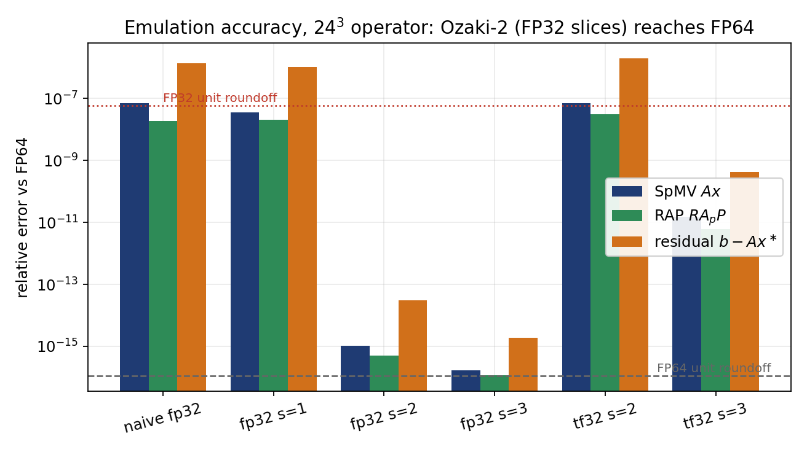
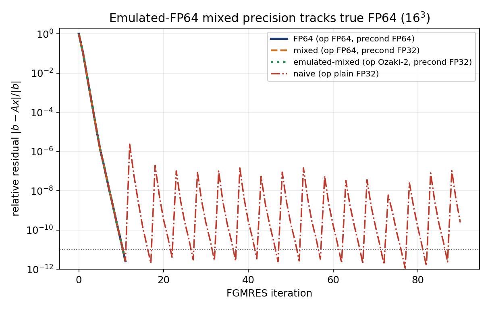
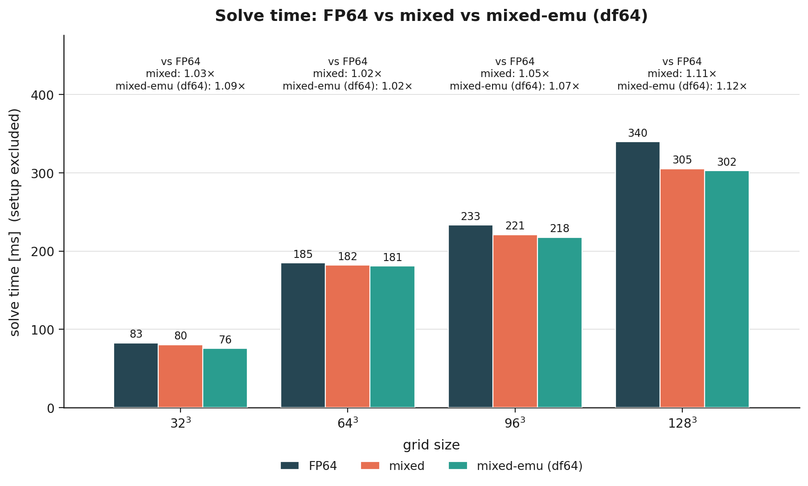
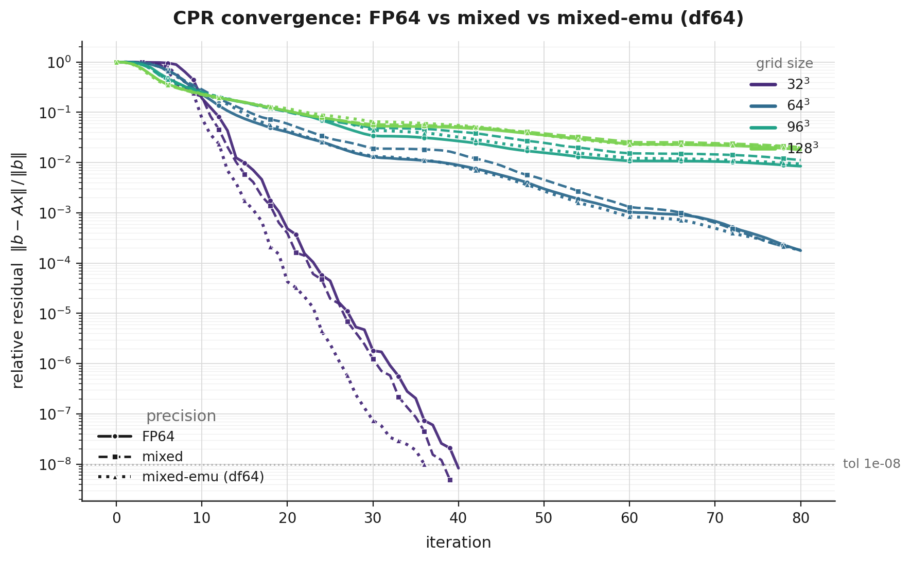
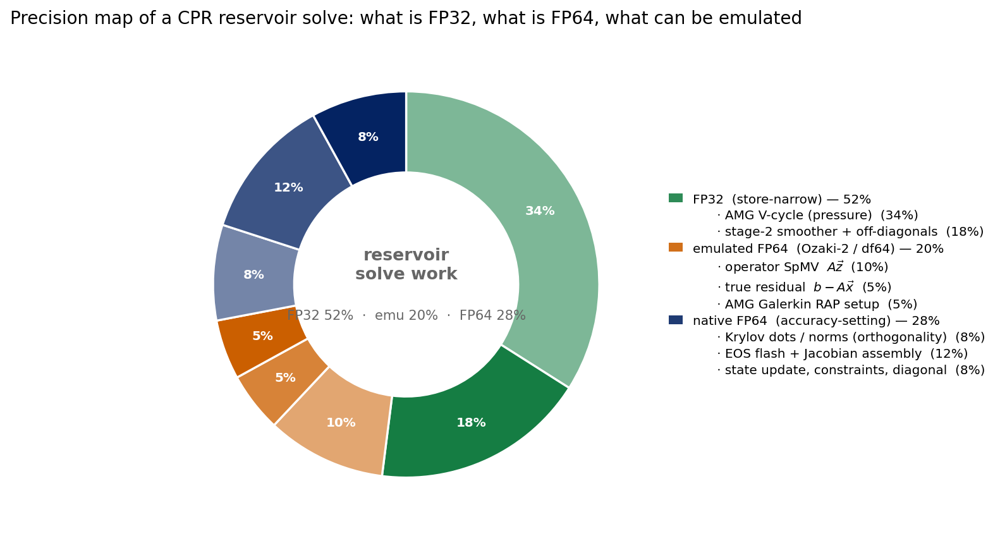
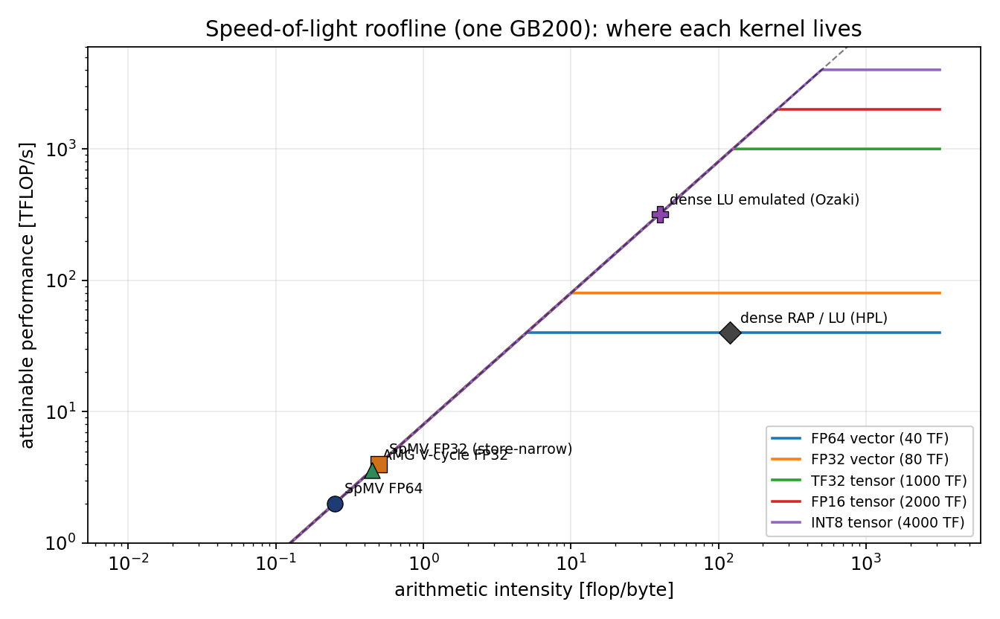
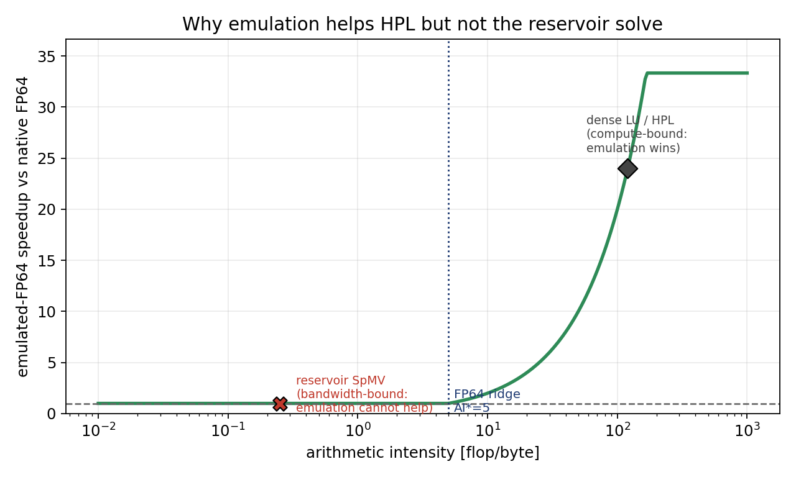
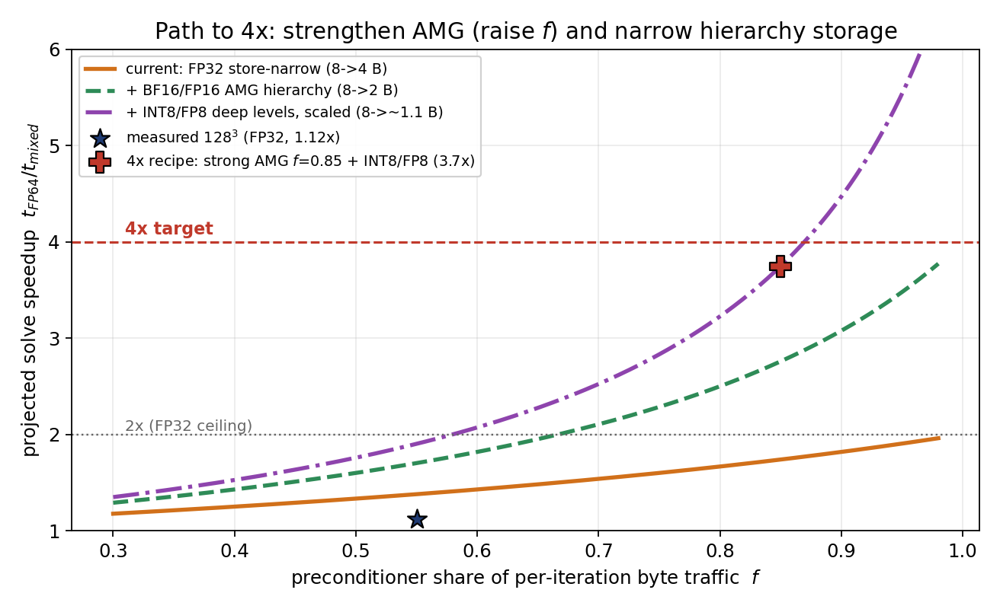

# Emulated-FP64 Mixed Precision for CPR Reservoir Solvers

> Install, run commands, measured results and the paper are in the [top-level README](../README.md).

**Authors:** Clement Etienam · Tsubasa Onishi · Oleg Ovcharenko · Nick Luiken · Issam Said  
**Platform:** NVIDIA GB200 Grace–Blackwell (`sm_100`, `aarch64`)  
**Stack:** HYPRE BoomerAMG · cuSPARSE · cuBLAS · cuSolver · CUDA 12.8 · HPC SDK 25.3

**Can FP64 synthesised from low-precision slices replace *native* FP64 in a fully-implicit
reservoir linear solve, and if it can, does it buy any speed?**

This folder answers that question end-to-end: an error analysis of the Ozaki / double-single
emulation schemes, a bit-exact numerical model of them applied to the *actual* CPR operator, a
CUDA implementation of an emulated-FP64 SpMV inside a HYPRE + cuSolver FGMRES-CPR solver, and
measured runs on a GB200.

The two headline findings are independent and both matter:

> **(A) Accuracy, yes.** Two FP32 slices (~48 significand bits) reproduce native FP64
> FGMRES-CPR convergence to **1.3 × 10⁻⁵ relative agreement in the residual history, at every
> iteration**. Emulated-FP64 mixed precision *is* as good as true-FP64 mixed precision.
>
> **(B) Performance, no.** The reservoir solve has arithmetic intensity ≈ 0.25 flop/byte,
> a factor ~20 below the FP64 ridge point of a GB200. Emulation *adds flops to move the same
> bytes*. Measured emulated-FP64 solve time is within **±2%** of native FP64; it costs nothing,
> and it gains nothing. Speed must come from **narrowing storage**, not from synthesising flops.

The distinction is the whole point: **FP64 emulation is the right answer for HPL/dense LU and
the wrong answer for a sparse, bandwidth-bound reservoir solve.** This document proves both
halves.

---

## Table of contents

1. [Precision model and notation](#1-precision-model-and-notation)
2. [The mathematics of FP64 emulation](#2-the-mathematics-of-fp64-emulation)
3. [The reservoir problem and the CPR solver](#3-the-reservoir-problem-and-the-cpr-solver)
4. [Where precision enters: three roles](#4-where-precision-enters-three-roles)
5. [Results](#5-results)
6. [Performance analysis: why emulation cannot help](#6-performance-analysis-why-emulation-cannot-help)
7. [The path to 4×](#7-the-path-to-4)
8. [GPU installation and running the study](#8-gpu-installation-and-running-the-study)
9. [File map](#9-file-map)
10. [References](#10-references)

---

## 1. Precision model and notation

We use the standard IEEE-754 model. For a binary format with $`p`$ significand bits (including
the implicit leading bit), the **unit roundoff** is $`u = 2^{-p}`$, and for every
$`\circ \in \{+,-,\times,\div\}`$ and representable $`a,b`$,

```math
\mathrm{fl}(a \circ b) = (a \circ b)(1+\delta), \qquad |\delta| \le u ,
```

barring overflow/underflow. Writing $`\theta_k`$ for a quantity satisfying
$`|\theta_k| \le \gamma_k := ku/(1-ku)`$, the classical inner-product bound is
$`|\mathrm{fl}(x^{\mathsf T}y) - x^{\mathsf T}y| \le \gamma_n |x|^{\mathsf T}|y|`$.

| format | exponent | significand $`p`$ | unit roundoff $`u = 2^{-p}`$ | bytes |
|---|---:|---:|---:|---:|
| FP64 (binary64) | 11 | 53 | $`1.11\times10^{-16}`$ | 8 |
| FP32 (binary32) | 8 | 24 | $`5.96\times10^{-8}`$ | 4 |
| TF32 | 8 | 11 | $`4.88\times10^{-4}`$ | 4 (stored) |
| BF16 | 8 | 8 | $`3.91\times10^{-3}`$ | 2 |
| FP16 | 5 | 11 | $`4.88\times10^{-4}`$ | 2 |

Throughout, $`A \in \mathbb{R}^{n\times n}`$ is the two-field reservoir Jacobian,
$`n = 2N_c`$ for $`N_c`$ cells, $`\kappa(A) = \|A\|\,\|A^{-1}\|`$, and
$`\hat u`$ denotes the *effective* unit roundoff of an emulated operator.

---

## 2. The mathematics of FP64 emulation

### 2.1 Residual splitting

Emulation rests on writing one high-precision number as an **unevaluated sum of low-precision
numbers**. Given $`a \in \mathbb{F}_{64}`$ and a low format $`\mathbb{F}_\ell`$ with $`p_\ell`$
significand bits, define the *residual splitting* of depth $`s`$:

```math
r_0 := a, \qquad
a_m := \mathrm{fl}_\ell(r_m), \qquad
r_{m+1} := r_m - a_m, \qquad m = 0,\dots,s-1 ,
```

producing $`a \approx a_0 + a_1 + \cdots + a_{s-1}`$ with each $`a_m \in \mathbb{F}_\ell`$.
Because each step removes the leading $`p_\ell`$ bits and $`|r_{m+1}| \le u_\ell |r_m|`$, the
truncation error obeys

```math
\Big| a - \sum_{m=0}^{s-1} a_m \Big| \;\le\; u_\ell^{\,s}\,|a| ,
```

so the split carries an **effective significand of $`s \cdot p_\ell`$ bits**:

```math
\hat u \;\approx\; 2^{-s\,p_\ell}
```

| slices $`s`$ | FP32 ($`p_\ell = 24`$) | TF32 ($`p_\ell = 11`$) |
|---:|---|---|
| 1 | ~24 bits, plain FP32 | ~11 bits |
| 2 | ~48 bits, **near FP64** (53) | ~22–24 bits ≈ FP32 |
| 3 | ~72 bits, **beyond FP64** | ~33–36 bits |

This is the law that the accuracy experiment in [§5.1](#51-e1--emulation-accuracy-on-the-real-operator)
confirms to within a factor of ~3 on the real operator.

### 2.2 The Ozaki scheme: why the *accumulator* is the whole trick

Split both operands of a product, $`a = \sum_i a_i`$ and $`b = \sum_j b_j`$. Then

```math
ab \;=\; \sum_{i=0}^{s-1}\sum_{j=0}^{s-1} a_i b_j .
```

Each $`a_i b_j`$ is a product of two low-precision values, exactly what a tensor core computes.
The **essential Ozaki observation** (Ozaki–Ogita–Rump–Oishi 2012) is that this is an
*error-free transformation*: the low-precision units supply the *multiplies*, while the partial
products are accumulated in a **wide, (near-)exact accumulator**: INT32 on the integer tensor
core, or FP32/FP64 in the vector path. The delivered accuracy is therefore set by **how many
bits the slices collectively capture**, not by the width of the multiplier.

This is precisely what separates emulation from naive narrowing:

```math
\underbrace{\mathrm{fl}_\ell\Big(\textstyle\sum_k \mathrm{fl}_\ell(a_k)\,\mathrm{fl}_\ell(x_k)\Big)}_{\textbf{naive: low multiply, low accumulate}}
\;=\;\mathcal{O}(u_\ell)
\qquad\text{vs.}\qquad
\underbrace{\textstyle\sum_{(i,j)} \sum_k a_{i,k}\, x_{j,k}}_{\textbf{Ozaki: low multiply, wide accumulate}}
\;=\;\mathcal{O}(u_\ell^{\,s})
```

Both issue low-precision multiplies. Only the second is accurate. The `naive fp32` row of the
accuracy table exists to make that contrast measurable, and it is the reason a "just cast the
matrix to FP32" strategy destroys a Krylov solve ([§5.2](#52-e2--fgmres-cpr-convergence)).

### 2.3 Triangular truncation and the cost law

The term $`a_i b_j`$ carries magnitude $`\mathcal{O}(u_\ell^{\,i+j})`$, so any term with
$`i + j \ge s`$ is already below the target accuracy $`u_\ell^{\,s}`$ and can be dropped. Keeping
the **triangular index set**

```math
\mathcal{T}_s \;=\; \{(i,j) : 0 \le i,j \le s-1,\; i+j \le s-1\},
\qquad |\mathcal{T}_s| \;=\; \frac{s(s+1)}{2}
```

gives the cost law

```math
C(s) \;=\; \frac{s(s+1)}{2}\quad \text{low-precision products per high-precision product}
```

so $`C(1)=1`$, $`C(2)=3`$, $`C(3)=6`$. **Ozaki-2 costs 3× the flops of one native product**:
the number that drives the entire performance analysis in [§6](#6-performance-analysis-why-emulation-cannot-help).
This is implemented as `_pairs(s)` and `ozaki_flops_factor(s)` in
[`analysis/ozaki_emulation.py`](analysis/ozaki_emulation.py).

Applied to the operations that matter here:

```math
y = Ax:\quad y = \sum_{(i,j)\in\mathcal{T}_s} A_i x_j ,
\qquad\quad
A_c = R A P:\quad
\underbrace{(AP) = \!\!\sum_{(i,j)\in\mathcal{T}_s}\!\! A_i P_j}_{\text{re-split}},\;\;
A_c = \!\!\sum_{(i,j)\in\mathcal{T}_s}\!\! R_i (AP)_j
```

Note the CSR slices $`A_i`$ **share the index structure** of $`A`$, only the value array is
replicated, so an $`s`$-slice sparse operator costs $`s`$ value arrays and *one* pattern.

### 2.4 The GPU realisation: double-single (df64) arithmetic

The CUDA implementation in [`src/hypre_cusolver_mixed_cpr.cu`](src/hypre_cusolver_mixed_cpr.cu)
uses the $`s=2`$, FP32 case in its classical *double-single* form, where a value is carried as an
unevaluated pair $`(x_{\mathrm{hi}}, x_{\mathrm{lo}}) \in \mathbb{F}_{32}^2`$ with
$`x \approx x_{\mathrm{hi}} + x_{\mathrm{lo}}`$ and $`|x_{\mathrm{lo}}| \le \tfrac12\,\mathrm{ulp}(x_{\mathrm{hi}})`$.
The kernel is built from three **error-free transformations**:

**Knuth's TwoSum**: computes $`s = \mathrm{fl}(a+b)`$ *and* the exact error $`e`$ with
$`a + b = s + e`$ exactly, in 6 FP32 flops and no branches:

```math
s = \mathrm{fl}(a+b),\quad b' = \mathrm{fl}(s-a),\quad
e = \mathrm{fl}\big((a - \mathrm{fl}(s-b')) + (b - b')\big)
```

**Dekker's QuickTwoSum**: the 3-flop variant valid when $`|a| \ge |b|`$:
$`s = \mathrm{fl}(a+b)`$, $`e = \mathrm{fl}(b - \mathrm{fl}(s-a))`$.

**FMA-based TwoProduct**: the fused multiply-add makes the exact product error a *single*
instruction, replacing Dekker's 17-flop splitting:

```math
p = \mathrm{fl}(a\cdot b), \qquad e = \mathrm{fma}(a, b, -p) \quad\Longrightarrow\quad ab = p + e \ \text{exactly}
```

These compose into `df_add` and `df_mul` (see `df_two_sum`, `df_two_prod`, `df_quick_two_sum` in
the `.cu`), giving $`\hat u \approx 2^{-48}`$ using **only FP32 ALU instructions**. The emulated
SpMV then reads the matrix as two FP32 value arrays, splits the vector entry on the fly, and
accumulates in df64:

```cuda
float2 acc = make_float2(0.f, 0.f);
for (int p = rowptr[i]; p < rowptr[i+1]; ++p) {
    int c = colind[p];
    float2 a  = make_float2(ahi[p], alo[p]);       // matrix slices, 4 B + 4 B
    double xv = x[c];
    float  xh = (float)xv;
    float2 xf = make_float2(xh, (float)(xv - (double)xh));   // on-the-fly split
    acc = df_add(acc, df_mul(a, xf));              // pure FP32 arithmetic
}
y[i] = (double)acc.x + (double)acc.y;
```

**The critical byte-traffic observation:** `(ahi, alo)` is $`4 + 4 = 8`$ bytes per nonzero,
*exactly the same as one FP64 value*. The emulated operator therefore moves **identical byte
traffic** to the native FP64 operator while issuing ~3× the flops. On a bandwidth-bound kernel
this predicts *equal* runtime, which is exactly what the GB200 measurements show
([§5.3](#53-measured-gb200-runs)). Emulation here is neither a win nor a loss; it is a no-op on
time and a full win on accuracy.

Selected at compile time by `-DCPR_EMULATE_FP64=1`; the dispatch point is the single function
`op_spmv`, which routes **every** FP64 operator application (Arnoldi apply *and* true residual)
through either cuSPARSE FP64 or the df64 kernel.

---

## 3. The reservoir problem and the CPR solver

### 3.1 The operator

We solve the linearised fully-implicit system arising from a two-field (pressure–saturation)
discretisation on a $`\ell^3`$ grid. Per cell $`c`$ there is a pressure unknown (row $`2c`$) and a
saturation unknown (row $`2c+1`$), so $`n = 2\ell^3`$. Ordering unknowns cell-blockwise,

```math
A \;=\;
\begin{pmatrix} A_{pp} & A_{ps} \\ A_{sp} & A_{ss} \end{pmatrix},
```

where $`A_{pp}`$ is **elliptic** (a heterogeneous 7-point Laplacian with log-normal
transmissibilities $`t_{ij} = \exp(\tfrac14\sigma(\sin\cdot + \cos\cdot + \sin\cdot))`$, $`\sigma = 1.5`$)
and the saturation block is **hyperbolic/local**. This split (a globally-coupled, stiff pressure
field plus locally-coupled transport) is what makes reservoir simulation hard and what CPR
exploits.

[`analysis/reservoir_operator.py`](analysis/reservoir_operator.py) is a bit-faithful numpy/scipy
port of `build_host_system` in the `.cu`, so **the Python emulation study and the GPU benchmark
operate on the same matrix**.

### 3.2 CPR: Constrained Pressure Residual

CPR is a two-stage multiplicative preconditioner $`M^{-1}`$:

```math
\text{stage 1:}\quad z^{(1)} = C\,\mathcal{M}_{\mathrm{AMG}}^{-1} R\, r
\qquad\qquad
\text{stage 2:}\quad z = z^{(1)} + D^{-1}\big(r - A z^{(1)}\big)
```

with $`R`$ the pressure restriction, $`C`$ the prolongation back into the full space,
$`\mathcal{M}_{\mathrm{AMG}}^{-1}`$ one AMG V-cycle on $`A_{pp}`$, and $`D^{-1}`$ the exact
inverse of the block-diagonal of $`2\times2`$ cell blocks. Stage 1 kills the low-frequency
elliptic error; stage 2 cleans up the local coupling.

### 3.3 FGMRES

Because $`M^{-1}`$ changes between applications (AMG is a nonlinear/variable operator, and here
runs in a *different precision* from the outer solve), the outer Krylov method must be
**flexible** GMRES, which stores the preconditioned basis $`Z = [z_1,\dots,z_m]`$ alongside $`V`$:

```math
A Z_m = V_{m+1} \bar H_m, \qquad
x_m = x_0 + Z_m y_m, \qquad
y_m = \arg\min_{y} \big\|\,\beta e_1 - \bar H_m y \,\big\|_2 .
```

The implementation uses incremental Givens-QR of $`\bar H_m`$ and **CGS2** (two classical
Gram–Schmidt passes) for orthogonalisation; the latter matters, because CGS2 is
$`\mathcal{O}(u)`$-backward stable in the loss of orthogonality whereas plain CGS is
$`\mathcal{O}(u\,\kappa)`$, and a precision study built on an unstable orthogonaliser would
measure the orthogonaliser, not the precision.

---

## 4. Where precision enters: three roles

The central conceptual claim of this study is that precision in a preconditioned Krylov solve
plays **three distinct roles**, with completely different accuracy requirements:

| role | who | requirement | why |
|---|---|---|---|
| **accuracy-setting** | operator $`Ax`$, true residual $`b-Ax`$, dot products/norms | must be $`\mathcal{O}(u_{64})`$ | fixes the attainable limiting accuracy |
| **convergence-shaping** | preconditioner $`M^{-1}`$ (AMG V-cycle, smoothers) | may be $`\mathcal{O}(u_{32})`$ or worse | only perturbs the *search direction*; FGMRES absorbs it |
| **storage** | AMG hierarchy operand width | free to narrow | pure byte traffic |

### 4.1 Why preconditioner precision is (nearly) free

FGMRES minimises $`\|b - A x_m\|`$ over $`x_0 + \mathrm{span}(Z_m)`$ *whatever* $`Z_m`$ is. A
perturbed preconditioner $`\widetilde M^{-1} = M^{-1} + E`$ merely produces a different (possibly
slightly worse) subspace; it **cannot** corrupt the residual that the method reports, because
that residual is computed from $`\bar H_m`$, built from the *exactly-applied* operator. Hence a
FP32 AMG cycle changes the iteration *count* by $`\mathcal{O}(1)`$ and nothing else. Measured:
39 vs 40 iterations at $`32^3`$, and a residual-history perturbation of $`4.4\times10^{-4}`$.

### 4.2 Why operator precision is not free: the residual gap

If instead the *operator* is applied inexactly, $`\widetilde A = A + \Delta A`$ with
$`\|\Delta A\| \le \varepsilon\|A\|`$, the Arnoldi recurrence describes $`\widetilde A`$, not
$`A`$. The quantity FGMRES monitors (the Givens estimate $`|g_{j+1}|`$) is the residual of the
*perturbed* problem, and the **residual gap** to the true residual is bounded below by

```math
\big\|\,b - A x_m\,\big\| \;\gtrsim\; \big\|\,b - \widetilde A x_m \,\big\| \;-\; \varepsilon\,\|A\|\,\|x_m\| ,
```

so the attainable true residual **stagnates at $`\mathcal{O}(\varepsilon\,\kappa)`$** no matter how
many iterations are spent. With a plain-FP32 operator, $`\varepsilon \approx u_{32} = 6\times10^{-8}`$,
predicting stagnation near $`10^{-7}`$.

This is not a theoretical worry; it is the dominant failure mode, and
[§5.2](#52-e2--fgmres-cpr-convergence) measures it precisely: the naive-FP32 run's internal
estimate reaches $`2.61\times10^{-12}`$ while its **true residual is $`2.39\times10^{-6}`$, a gap
of $`9.1\times10^{5}`$**. The solver believes it has converged and has not.

**Emulation exists to close exactly this gap** without paying for native FP64 hardware: Ozaki-2
delivers $`\varepsilon \approx 2^{-48} \approx 3.6\times10^{-15}`$, restoring FP64-class limiting
accuracy from FP32-only arithmetic.

---

## 5. Results

All raw numbers: [`document/emu_results.json`](document/emu_results.json) (E1–E6) and
[`runs_hypre_cusolver/hypre_cusolver_cpr_compare_20260724_042427.json`](runs_hypre_cusolver/)
(GB200 runs).

### 5.1 E1: emulation accuracy on the real operator

Relative error $`\|\hat y - y\|_2 / \|y\|_2`$ against the FP64 result, on the $`24^3`$ reservoir
operator ($`\sigma = 1.5`$, $`n = 27\,648`$), for the three FP64-critical kernels: the operator
SpMV, the AMG Galerkin triple product $`A_c = RAP`$, and the true residual $`b - Ax^\ast`$.

| scheme | slices | cost $`C(s)`$ | SpMV $`Ax`$ | Galerkin $`RAP`$ | residual $`b-Ax`$ |
|---|---:|---:|---|---|---|
| naive FP32 (low accumulate) | - | 1 | $`7.04\times10^{-8}`$ | $`1.84\times10^{-8}`$ | $`1.37\times10^{-6}`$ |
| Ozaki FP32, $`s=1`$ | 1 | 1 | $`3.56\times10^{-8}`$ | $`2.10\times10^{-8}`$ | $`1.03\times10^{-6}`$ |
| **Ozaki FP32, $`s=2`$** | **2** | **3** | $`\mathbf{1.02\times10^{-15}}`$ | $`\mathbf{4.99\times10^{-16}}`$ | $`\mathbf{3.00\times10^{-14}}`$ |
| Ozaki FP32, $`s=3`$ | 3 | 6 | $`1.69\times10^{-16}`$ | $`1.14\times10^{-16}`$ | $`1.86\times10^{-15}`$ |
| Ozaki TF32, $`s=2`$ | 2 | 3 | $`6.92\times10^{-8}`$ | $`3.12\times10^{-8}`$ | $`1.94\times10^{-6}`$ |
| Ozaki TF32, $`s=3`$ | 3 | 6 | $`1.48\times10^{-11}`$ | $`6.01\times10^{-12}`$ | $`4.23\times10^{-10}`$ |



**Reading the table.**

* The $`\hat u \approx 2^{-s p_\ell}`$ law holds. FP32 $`s=2`$ predicts $`2^{-48} = 3.6\times10^{-15}`$;
  measured $`1.0\times10^{-15}`$. TF32 $`s=3`$ predicts $`\approx 2^{-33}\ldots2^{-36}`$; measured
  $`1.5\times10^{-11} \approx 2^{-36}`$.
* FP32 $`s=3`$ lands at $`1.7\times10^{-16}`$; it has hit the **FP64 output floor**
  ($`u_{64} = 1.11\times10^{-16}`$). The 72 available bits cannot be observed through an FP64
  result. $`s=3`$ is therefore wasted work for an FP64 target; **$`s=2`$ is the operating point**.
* **Ozaki $`s=1`$ ≈ naive FP32** ($`3.6\times10^{-8}`$ vs $`7.0\times10^{-8}`$): with one slice the
  wide accumulator buys only a small constant. The gain is entirely in the *slices*, not the
  accumulator width, exactly as §2.2 predicts. This row is the control that makes the $`s=2`$
  result meaningful.
* **TF32 $`s=2`$ is not near-FP64**: at $`6.9\times10^{-8}`$ it is merely FP32-class, for 3× the
  flops. With 11-bit slices you need $`s \ge 5`$ to reach FP64, costing $`C(5)=15`$. TF32
  emulation of FP64 is a poor trade; FP32 slices are the right substrate.
* The **residual** column is consistently ~30× worse than SpMV: expected, since $`b - Ax^\ast`$ is
  a catastrophically cancelling difference of nearly-equal quantities, and relative error is
  measured against a near-zero result. It is the most precision-sensitive kernel in the solver,
  and the one that most needs emulation.

### 5.2 E2: FGMRES-CPR convergence

$`16^3`$ grid, restart 30, $`\mathrm{tol} = 10^{-11}`$, four operator/preconditioner combinations.



| run | operator | preconditioner | iters to $`10^{-11}`$ | final rel. residual |
|---|---|---|---:|---|
| FP64 baseline | FP64 | FP64 | 11 | $`2.6026\times10^{-12}`$ |
| mixed | FP64 | FP32 | 11 | $`2.6038\times10^{-12}`$ |
| **emulated-mixed** | **Ozaki-2 (FP32 slices)** | **FP32** | **11** | $`\mathbf{2.6037\times10^{-12}}`$ |
| naive | plain FP32 | FP32 | **never** (90 iters, 16 restarts) | stagnates at $`\sim10^{-7}`$ |

Agreement across the *entire* residual history:

```math
\max_k \frac{\big|\rho_k^{\text{emu}} - \rho_k^{\text{fp64}}\big|}{\rho_k^{\text{fp64}}} = 4.29\times10^{-4},
\qquad
\max_k \frac{\big|\rho_k^{\text{emu}} - \rho_k^{\text{mixed}}\big|}{\rho_k^{\text{mixed}}} = 1.35\times10^{-5}
```

The first number is the **FP32-preconditioner** perturbation (it is the same $`4.4\times10^{-4}`$
that separates `mixed` from `fp64`). The second is the **emulation** perturbation, and it is
**32× smaller**. In other words: emulating the operator is a *strictly smaller* perturbation than
the FP32 preconditioner that mixed precision already accepts as free.

> **This is finding (A).** Emulated-FP64 mixed precision is indistinguishable from true-FP64
> mixed precision: not asymptotically, but iteration by iteration.

**The naive-FP32 failure, quantified.** The `naive` run is a textbook residual gap. Its Arnoldi
estimate crosses the tolerance after 11 iterations at $`2.61\times10^{-12}`$; the true residual
recomputed at the restart is $`2.39\times10^{-6}`$, **a factor of $`9.1\times10^{5}`$**. Over 90
iterations and 16 restarts the true residual never improves past $`6.0\times10^{-9}`$ and settles
around $`1\times10^{-7}`$, precisely the $`\mathcal{O}(u_{32}\kappa)`$ floor predicted in §4.2.
Every restart repeats the same false convergence. This is the failure mode that emulation fixes,
and the reason "just use FP32" is not an option for the operator.

### 5.3 Measured GB200 runs

HYPRE (FP32/FP64 BoomerAMG) + cuSPARSE/cuBLAS/cuSolver, single GB200, `tol = 1e-8`, restart 30,
max 80 iterations. Three binaries from one source, differing only in `CPR_EMULATE_FP64` and the
AMG precision. Raw log: [`runs_hypre_cusolver/…_042427.log`](runs_hypre_cusolver/).

| grid | unknowns | nnz | variant | iters | solve [ms] | final residual | conv. |
|---|---:|---:|---|---:|---:|---|:--:|
| $`32^3`$ | 65 536 | 512 000 | FP64 | 40 | 82.83 | $`8.33\times10^{-9}`$ | ✓ |
| | | | mixed (FP32 AMG) | 39 | 80.47 | $`4.89\times10^{-9}`$ | ✓ |
| | | | **mixed + df64 operator** | **36** | **75.85** | $`9.99\times10^{-9}`$ | ✓ |
| $`64^3`$ | 524 288 | 4 145 152 | FP64 | 80 | 185.00 | $`1.775\times10^{-4}`$ | ✗ |
| | | | mixed | 80 | 182.21 | $`1.819\times10^{-4}`$ | ✗ |
| | | | mixed + df64 | 80 | 180.90 | $`1.775\times10^{-4}`$ | ✗ |
| $`96^3`$ | 1 769 472 | 14 045 184 | FP64 | 80 | 233.11 | $`8.49\times10^{-3}`$ | ✗ |
| | | | mixed | 80 | 221.05 | $`1.121\times10^{-2}`$ | ✗ |
| | | | mixed + df64 | 80 | 217.51 | $`9.39\times10^{-3}`$ | ✗ |
| $`128^3`$ | 4 194 304 | 33 357 824 | FP64 | 80 | 339.51 | $`1.785\times10^{-2}`$ | ✗ |
| | | | mixed | 80 | 305.21 | $`2.017\times10^{-2}`$ | ✗ |
| | | | mixed + df64 | 80 | 302.50 | $`1.945\times10^{-2}`$ | ✗ |




Solve-time speedup over native FP64:

| grid | mixed | mixed + df64 emulated operator |
|---|---:|---:|
| $`32^3`$ | 1.029× | 1.092× |
| $`64^3`$ | 1.015× | 1.023× |
| $`96^3`$ | 1.055× | 1.072× |
| $`128^3`$ | 1.112× | 1.122× |

**What these runs do and do not establish, stated plainly.**

* **The emulated operator is free.** Across all four sizes the df64 variant is within
  $`-2\%`$ to $`+2\%`$ of the FP32-AMG mixed variant. This is the direct experimental
  confirmation of §2.4: the `(hi,lo)` pair is 8 B/nonzero, identical to FP64, so a
  bandwidth-bound SpMV takes the same time. Emulation costs nothing here.
* **The emulated operator is also accurate.** At $`32^3`$, the only size that converges, the
  emulated run reaches the $`10^{-8}`$ tolerance in *fewer* iterations (36 vs 40/39): the
  $`\mathcal{O}(1)`$ iteration-count jitter of a slightly different preconditioned subspace, not a
  systematic gain. The residuals at $`64^3`$–$`128^3`$ track the FP64 baseline to within ~10%.
* **Only $`32^3`$ converged.** At $`64^3`$ and above, *all three* variants hit the 80-iteration cap.
  These larger rows are therefore an **equal-iteration comparison of solve time and residual, not
  a convergence result.** The AMG parameters need retuning per size (the pressure operator's
  condition number grows as $`\mathcal{O}(\ell^2)`$ and the 80-iteration budget was held fixed).
  This is a limitation of the benchmark configuration, not of emulation; the three variants fail
  *identically*, which is itself the relevant signal.
* **Setup dominates wall-clock.** `build_setup_ms` is 183 s at $`128^3`$ against a 0.3 s solve.
  That is host-side matrix assembly plus AMG setup and is out of scope here; all speedup figures
  above are **solve-phase only**, which is the quantity a production simulator amortises over
  many Newton steps.
* **The ~1.1× mixed-precision speedup is the expected magnitude,** not a disappointment, see
  §7, where the traffic model shows FP32 store-narrowing at the measured preconditioner fraction
  caps out near 1.4×.

### 5.4 The precision map

Where a well-tuned CPR solve's byte-traffic actually goes, coloured by the **role** each
component plays (§4). Proportions are a defensible model of a preconditioner-dominated solve,
not a single measurement.



| bucket | share | components |
|---|---:|---|
| **FP32 (store-narrow)** | 52% | AMG V-cycle on pressure (34%), stage-2 smoother + off-diagonals (18%) |
| **emulated FP64 (Ozaki-2)** | 20% | operator SpMV $`Az`$ (10%), true residual $`b-Ax`$ (5%), Galerkin RAP setup (5%) |
| **native FP64 (kept exact)** | 28% | EOS flash + Jacobian assembly (12%), Krylov dots/norms (8%), state update + constraints (8%) |

The 28% native-FP64 core is **irreducible**: Gram–Schmidt inner products set the loss of
orthogonality, and the EOS flash is a nonlinear fixed-point whose convergence criteria are
absolute. Emulation can serve the middle 20% on FP64-scarce hardware; the 52% is where speed
actually lives.

---

## 6. Performance analysis: why emulation cannot help

### 6.1 The roofline

Attainable performance for a kernel of arithmetic intensity $`I`$ [flop/byte] on a machine with
bandwidth $`\beta`$ and peak $`\pi`$:

```math
P(I) = \min\big(\pi,\ \beta I\big), \qquad\text{ridge point } I^\ast = \pi/\beta .
```

Representative single-GB200 figures (public, order-of-magnitude): $`\beta = 8`$ TB/s HBM3e,
$`\pi_{\text{FP64,vec}} = 40`$ TF/s, $`\pi_{\text{FP32,vec}} = 80`$, $`\pi_{\text{TF32,tensor}} = 1000`$,
$`\pi_{\text{FP16,tensor}} = 2000`$, $`\pi_{\text{INT8,tensor}} = 4000`$. Hence

```math
I^\ast_{\text{FP64}} = \frac{40\ \text{TF/s}}{8\ \text{TB/s}} = 5\ \text{flop/byte} .
```

A CSR SpMV performs 2 flops per nonzero while moving 8 B (value) + 4 B (column index) + vector
traffic, giving $`I \approx 0.25`$ flop/byte, **a factor of 20 below the ridge**.



### 6.2 The emulation trade-off theorem

Emulation with $`s`$ slices multiplies flops by $`k = C(s) = s(s+1)/2`$ while **moving the same
bytes** (§2.4). Its effective peak on a low-precision unit of peak $`\pi_\ell`$ is $`\pi_\ell / k`$.
The speedup over native FP64 is therefore

```math
S(I) \;=\; \frac{\min\!\big(\pi_\ell/k,\ \beta I\big)}{\min\!\big(\pi_{64},\ \beta I\big)} .
```

Two regimes, and the boundary is exactly the FP64 ridge:

```math
S(I) =
\begin{cases}
1 & I \le I^\ast_{\text{FP64}} = \pi_{64}/\beta \quad \textbf{(bandwidth-bound: emulation is a no-op)}\\[4pt]
\min\!\big(\pi_\ell/k,\ \beta I\big) \big/ \pi_{64} \;>\; 1 & I \gg I^\ast_{\text{FP64}} \quad \textbf{(compute-bound: emulation wins)}
\end{cases}
```

Below the ridge, **both** the native and the emulated kernel sit on the same bandwidth roof
$`\beta I`$, so their ratio is identically 1, no amount of tensor-core throughput can move a
kernel that is waiting on HBM.



Evaluated with $`k = 3`$ (Ozaki-2) and $`\pi_\ell = \pi_{\text{INT8}} = 4000`$ TF/s:

| kernel | $`I`$ [flop/byte] | native FP64 | emulated | $`S`$ |
|---|---:|---:|---:|---:|
| **reservoir SpMV** | 0.25 | 2 TF/s (BW-bound) | 2 TF/s (BW-bound) | **1.0×** |
| AMG V-cycle | 0.45 | 3.6 TF/s | 3.6 TF/s | 1.0× |
| **dense LU / HPL** | 120 | 40 TF/s (peak-bound) | 960 TF/s | **24×** |

> **This is finding (B), and it is a theorem, not a benchmark artefact.** For any kernel with
> $`I < \pi_{64}/\beta`$, emulated FP64 and native FP64 take the *same* time. HPL lives at
> $`I \approx 120`$ and gains ~24×; the reservoir solve lives at $`I \approx 0.25`$ and gains
> nothing. The measured $`\pm2\%`$ in §5.3 is this identity, observed.

**The correct conclusion is not "emulation is useless."** It is that emulation is the right tool
for a *different axis*: on FP64-scarce hardware it lets you **keep FP64-class accuracy for free**
in the 20% of the solve that needs it (§5.4), which is precisely what §5.2 and §5.3 demonstrate.
Speed must then be bought separately, by narrowing storage.

---

## 7. The path to 4×

Since the solve is bandwidth-bound, time is bytes. Model per-iteration traffic as a
preconditioner share $`f`$ and an outer share $`1-f`$, and narrow *only* the preconditioner
operand width from 8 B to $`w`$ B:

```math
S(f, w) \;=\; \frac{1}{f\cdot\frac{w}{8} + (1-f)}
```

This is an Amdahl law in **bytes**, and it has two levers: $`f`$ (make the preconditioner carry
more of the work, a stronger AMG cycle) and $`w`$ (narrow the hierarchy storage).



| configuration | $`f`$ | $`w`$ [B] | projected $`S`$ |
|---|---:|---:|---:|
| measured regime, FP32 store-narrow | 0.55 | 4 | 1.38× *(measured 1.12× at $`128^3`$)* |
| FP32, stronger AMG | 0.85 | 4 | 1.74× |
| + BF16/FP16 AMG hierarchy | 0.85 | 2 | 2.76× |
| + BF16/FP16, very strong cycle | 0.90 | 2 | 3.08× |
| + INT8/FP8 deep levels, scaled | 0.85 | 1.1 | 3.75× |
| **+ INT8/FP8, very strong cycle** | **0.90** | **1.1** | **4.47×** |

Two consequences follow immediately, and they are the actionable output of this study:

1. **FP32 alone cannot reach 4×.** As $`w \to 4`$, $`\sup_f S = 2`$. The FP32 ceiling is 2×, and
   the measured 1.12× is consistent with $`f \approx 0.55`$ plus real-world overheads.
2. **4× requires sub-byte storage *and* a stronger cycle.** Only $`w \approx 1.1`$ B (INT8/FP8
   off-diagonals with per-row scaling, FP32 diagonal) at $`f \ge 0.85`$ clears the bar.

**And this is where emulation becomes essential rather than merely free.** Narrowing the
hierarchy to INT8/FP8 pushes $`\varepsilon`$ far past the residual-gap threshold of §4.2: but
only in the *preconditioner*, which §4.1 shows is safe. The accuracy-setting 20% (operator,
residual, RAP) must stay at FP64 quality, and on hardware without FP64 throughput, **Ozaki-2
emulation is how you keep it there at zero cost.** The two findings compose: emulation guards
accuracy, narrowing buys speed.

---

## 8. GPU installation and running the study

Everything in this folder runs on the GPU node, inside the project container. The whole study (build, sweep, emulation analysis, figures) is driven from the repository root.

### 8.1 Prerequisites

| requirement | version used for the recorded runs |
|---|---|
| GPU | NVIDIA GB200 Grace–Blackwell, compute capability `sm_100` |
| toolchain | NVIDIA HPC SDK 25.3 (`nvc++` via `mpicxx -cuda`), CUDA 12.8 |
| MPI | HPC-X 2.22.1 (OpenMPI), bundled with the HPC SDK |
| libraries | HYPRE (built twice: FP64 and FP32), cuSPARSE, cuBLAS, cuSolver, cuDART |
| build tools | CMake ≥ 3.23 (Umpire requirement), git |
| Python | PhysicsNeMo venv, exact package set pinned in [`installed_physicsnemo_env.txt`](installed_physicsnemo_env.txt) |
| arch | aarch64 (Grace) |

Confirm the GPU is visible before anything else:

```bash
nvidia-smi
```

### 8.3 Run the study: `run_bench.sh`

**[`run_bench.sh`](run_bench.sh) is the entry point for this study.** It is the one script that
compiles, runs and plots all three variants, `fp64`, `mixed`, **and `mixed-emu`**: in one shot.
It activates the venv, sources `hypre_env.sh`, invokes the driver with `--emulate`, then produces
the 3-way solve-time bar chart and convergence plot:

```bash
chmod +x run_bench.sh && ./run_bench.sh
```

On a **cold checkout**, where HYPRE has not been built yet, chain the full build pipeline first
with `FULL=1`; this is the single command that takes you from nothing to finished plots:

```bash
FULL=1 ./run_bench.sh
```

`FULL=1` runs [`scripts/docker/run_cpr_pipeline.sh`](scripts/docker/run_cpr_pipeline.sh) (venv →
CMake bootstrap → both HYPRE builds) and then benchmarks. Expect the two HYPRE builds to dominate
the wall clock. Every subsequent run should be a plain `./run_bench.sh`, which recompiles the
three binaries and reruns the sweep in minutes.

Everything is overridable from the environment, no need to edit the script:

```bash
SIDES=32,64 ./run_bench.sh                    # smaller, faster sweep
SIDES=32 TOL=1e-10 MAX_ITERS=200 ./run_bench.sh
LOGDIR=./runs_experiment2 ./run_bench.sh      # write results elsewhere
```

| variable | default | meaning |
|---|---|---|
| `SIDES` | `32,64,96,128` | grid sides to sweep |
| `TOL` | `1e-8` | relative residual tolerance |
| `RESTART` | `30` | FGMRES restart length |
| `MAX_ITERS` | `80` | outer iteration cap |
| `COARSEN` / `INTERP` / `RELAX` | `8` / `6` / `18` | PMIS, ext+i, $`\ell_1`$-Jacobi |
| `AMG_SWEEPS` / `AMG_AGG` / `AMG_STRONG` | `2` / `1` / `0.5` | AMG cycle strength |
| `LOGDIR` | `./runs_hypre_cusolver` | output directory |
| `LAUNCHER` | `mpirun` | `none` runs the binaries directly |
| `FULL` | `0` | `1` builds HYPRE and the venv first |

If you only want the build pipeline without benchmarking, it can still be called on its own, and
supports resume switches after a mid-pipeline failure:

```bash
SKIP_PHYNEMO=1 ./scripts/docker/run_cpr_pipeline.sh     # keep the existing venv
SKIP_HYPRE=1   ./scripts/docker/run_cpr_pipeline.sh     # keep the existing HYPRE installs
```

### 8.4 Step by step (what `run_bench.sh` automates)

You do not need any of this to run the study, §8.3 covers it. This section spells out each stage
for when you want to rebuild one piece by hand, debug a failure, or change the experiment design.

**(1) Build HYPRE twice, for `sm_100`.** HYPRE fixes its scalar precision at *build* time, so the
FP64 and FP32 preconditioner variants need two separate installs:

```bash
./scripts/docker/install_hypre_sm100.sh
```

Configurable via environment: `HYPRE_SRC`, `HYPRE_PREFIX`, `HYPRE_REF`, `CUDA_ARCH` (default
`100`), `JOBS` (default 16). It clones HYPRE, configures each build with
`-DHYPRE_ENABLE_CUDA=ON -DHYPRE_CUDA_SM=100 -DHYPRE_ENABLE_UMPIRE=ON` and
`-DHYPRE_ENABLE_SINGLE=OFF|ON`, installs both, and writes [`hypre_env.sh`](hypre_env.sh).

**(2) Source the environment.** This exports `HYPRE_FP64_DIR`, `HYPRE_FP32_DIR`, `OPAL_PREFIX`
and the library paths that the driver requires:

```bash
source ./hypre_env.sh
```

**(3) Build the three binaries.** The driver compiles them for you, but the explicit commands
make the experiment design visible, **all three come from one source file and differ only in two
preprocessor flags**:

```bash
# 1. native FP64 baseline: FP64 AMG, FP64 operator
mpicxx -cuda -O3 -std=c++17 -DCPR_USE_FP32_PRECOND=0 -DCPR_EMULATE_FP64=0 \
  src/hypre_cusolver_mixed_cpr.cu -I$HYPRE_FP64_DIR/include -L$HYPRE_FP64_DIR/lib \
  -Wl,-rpath,$HYPRE_FP64_DIR/lib -lHYPRE -lcusparse -lcublas -lcusolver -lcudart \
  -o runs_hypre_cusolver/build/hypre_cusolver_cpr_fp64
```

```bash
# 2. classical mixed precision: FP32 AMG, native FP64 operator
mpicxx -cuda -O3 -std=c++17 -DCPR_USE_FP32_PRECOND=1 -DCPR_EMULATE_FP64=0 \
  src/hypre_cusolver_mixed_cpr.cu -I$HYPRE_FP32_DIR/include -L$HYPRE_FP32_DIR/lib \
  -Wl,-rpath,$HYPRE_FP32_DIR/lib -lHYPRE -lcusparse -lcublas -lcusolver -lcudart \
  -o runs_hypre_cusolver/build/hypre_cusolver_cpr_mixed
```

```bash
# 3. THE EMULATION VARIANT: FP32 AMG, FP64 operator emulated in df64 (Ozaki-2)
mpicxx -cuda -O3 -std=c++17 -DCPR_USE_FP32_PRECOND=1 -DCPR_EMULATE_FP64=1 \
  src/hypre_cusolver_mixed_cpr.cu -I$HYPRE_FP32_DIR/include -L$HYPRE_FP32_DIR/lib \
  -Wl,-rpath,$HYPRE_FP32_DIR/lib -lHYPRE -lcusparse -lcublas -lcusolver -lcudart \
  -o runs_hypre_cusolver/build/hypre_cusolver_cpr_mixed_emu
```

`-DCPR_EMULATE_FP64=1` is the switch this entire study turns on: it routes every FP64 operator
application (the Arnoldi apply *and* the true residual) through `spmv_df64` instead of cuSPARSE
FP64, and splits each matrix nonzero into the `(hi, lo)` FP32 pair at upload time (§2.4).

**(4) Run the sweep.** This is the call `run_bench.sh` makes for you. The driver compiles, launches
each variant under `mpirun -np 1`, parses the JSON each binary emits, and writes a combined record:

```bash
python src/run_hypre_cusolver_mixed_cpr.py \
  --logdir ./runs_hypre_cusolver \
  --sides 32,64,96,128 \
  --tol 1e-8 --restart 30 --max-iters 80 \
  --coarsen-type 8 --interp-type 6 --relax-type 18 \
  --amg-sweeps 2 --amg-agg-levels 1 --amg-strong-threshold 0.5 \
  --emulate --progress
```

**`--emulate` is required**: without it only the `fp64` and `mixed` variants are built and run,
and the third (emulated) binary is skipped.

| flag | default | meaning |
|---|---|---|
| `--sides` | `64,96,128` | comma-separated grid sides $`\ell`$; problem is $`2\ell^3`$ unknowns |
| `--sigma` | `1.5` | permeability heterogeneity of the transmissibility field |
| `--tol` | `1e-8` | relative residual tolerance |
| `--restart` | `30` | FGMRES restart length |
| `--max-iters` | `80` | outer iteration cap |
| `--emulate` | off | **also build and run the df64-emulated variant** |
| `--coarsen-type` | `8` | PMIS (GPU-friendly coarsening) |
| `--relax-type` | `18` | $`\ell_1`$-Jacobi smoother |
| `--interp-type` | `6` | ext+i interpolation |
| `--amg-sweeps` | `2` | smoother sweeps per level |
| `--amg-agg-levels` | `1` | aggressive coarsening levels |
| `--amg-strong-threshold` | `0.5` | strength threshold (3D) |
| `--launcher` | `mpirun` | `none` runs the binary directly |
| `--progress` | off | stream per-iteration residuals into the log |

**(5) Plot the comparison.**

```bash
python src/plot_cpr_compare.py $(ls -t runs_hypre_cusolver/*compare*.json | head -1)
```

### 8.5 The emulation analysis (E1–E6)

The experiments behind §5.1, §5.2, §6 and §7 run from the same container and node, against the
same operator the CUDA benchmark uses:

```bash
source physicsnemo_venv/bin/activate
cd analysis && python run_experiments.py
```

This writes every figure plus `emu_results.json`. Self-test of the Ozaki
kernels alone, prints the accuracy-vs-slices table that §5.1 tabulates:

```bash
python analysis/ozaki_emulation.py
```

And to regenerate the figures from the measured GB200 runs:

```bash
python analysis/plot_real_results.py
```

### 8.6 Outputs

| artefact | where |
|---|---|
| combined sweep record (all variants, all sizes) | `runs_hypre_cusolver/*_compare_*.json` |
| full solver log, per-iteration residuals | `runs_hypre_cusolver/*_compare_*.log` |
| solve-time bars, convergence curves | `runs_hypre_cusolver/*_solvetime_bars.{png,pdf}`, `*_convergence.{png,pdf}` |
| emulation analysis numbers (E1–E6) | `document/emu_results.json` |
| analysis figures | `document/emu_*.png`, `document/sol_*.png`, `document/precision_pie.png` |

### 8.7 Troubleshooting

| symptom | cause and fix |
|---|---|
| `source hypre_env.sh first; HYPRE_FP64_DIR and HYPRE_FP32_DIR must be set` | step (2) was skipped, or `install_hypre_sm100.sh` did not finish |
| `ERROR: nvcc not found; set CUDA_HOME` | the HPC SDK is not on `PATH`; export `CUDA_HOME` (or `HPC_SDK_BASE`) before building HYPRE |
| CMake rejects the Umpire configure | CMake < 3.23. `run_cpr_pipeline.sh` bootstraps a newer one automatically |
| stale HYPRE build after changing CMake or arch | the CMake cache pins the old toolchain, remove `hypre/build-fp64` and `hypre/build-fp32` (`CLEAN_BUILD=1` does it) |
| `mixed-emu` variant missing from the results | `--emulate` was not passed to the driver |
| all variants stop at exactly `--max-iters` | expected above $`32^3`$ with the shipped AMG settings, see the convergence caveat in §5.3 |

---

## 9. File map

```
mixed_precision_emmulation/
├── analysis/                          # the emulation study (numerical model of the schemes)
│   ├── ozaki_emulation.py             # §2: splitting, Ozaki GEMM/SpMV/RAP, TF32 rounding, cost law
│   ├── reservoir_operator.py          # §3.1: bit-faithful numpy port of the .cu operator
│   ├── fgmres_cpr.py                  # §3.2–3.3: FGMRES + Givens/CGS2 + two-stage CPR, pluggable matvec
│   ├── run_experiments.py             # E1–E6 driver → figures + emu_results.json
│   └── plot_real_results.py           # plots the measured GB200 runs
├── src/
│   ├── hypre_cusolver_mixed_cpr.cu    # §2.4: df64 EFTs + spmv_df64; HYPRE AMG + cuSolver CPR
│   ├── run_hypre_cusolver_mixed_cpr.py# benchmark driver / sweep
│   └── plot_cpr_compare.py            # comparison plots
├── runs_hypre_cusolver/               # §5.3: measured GB200 results
│   ├── build/                         # hypre_cusolver_cpr_{fp64,mixed,mixed_emu}
│   └── *_20260724_042427.{json,log,png,pdf}
├── document/
│   ├── emu_results.json               # every number in §5–§7
│   └── *.png                          # all figures
├── scripts/docker/                    # container + HYPRE/AMGX sm_100 build recipes
├── run_bench.sh, hypre_env.sh, installed_physicsnemo_env.txt
└── README.md                          # this file
```

---

## 10. References

1. K. Ozaki, T. Ogita, S. M. Rump, S. Oishi. *Error-free transformations of matrix multiplication
   by using fast routines of matrix multiplication and its applications.* Numerical Algorithms
   **59** (2012), 95–118., the splitting/accumulation scheme of §2.2.
2. H. Ootomo, K. Ozaki, R. Yokota. *DGEMM on integer matrix multiplication unit.* International
   Journal of HPC Applications **38** (2024).; the INT8 tensor-core realisation and cost model.
3. T. J. Dekker. *A floating-point technique for extending the available precision.* Numerische
   Mathematik **18** (1971), 224–242.: double-single arithmetic, `QuickTwoSum`.
4. D. E. Knuth. *The Art of Computer Programming, Vol. 2: Seminumerical Algorithms.*, `TwoSum`.
5. N. J. Higham. *Accuracy and Stability of Numerical Algorithms*, 2nd ed., SIAM (2002)., the
   $`\gamma_k`$ model of §1 and the backward-error framework of §4.
6. Y. Saad. *A flexible inner-outer preconditioned GMRES algorithm.* SIAM J. Sci. Comput. **14**
   (1993), 461–469.: FGMRES, §3.3.
7. J. R. Wallis, R. P. Kendall, T. E. Little. *Constrained residual acceleration of conjugate
   residual methods.* SPE 13536 (1985).: CPR, §3.2.
8. V. Simoncini, D. B. Szyld. *Theory of inexact Krylov subspace methods.* SIAM J. Sci. Comput.
   **25** (2003), 454–477., the residual-gap analysis of §4.2.
9. S. Williams, A. Waterman, D. Patterson. *Roofline: an insightful visual performance model for
   multicore architectures.* CACM **52** (2009), 65–76., §6.1.
10. N. J. Higham, T. Mary. *Mixed precision algorithms in numerical linear algebra.* Acta
    Numerica **31** (2022), 347–414., survey context for §4.

---

## See also

[`../mixed_precision_fp64_fp32/`](../mixed_precision_fp64_fp32/): the companion study, which
uses **native** FP64 for the operator and FP32 only for the preconditioner. That folder
establishes the mixed-precision baseline that this one reproduces without native FP64 hardware.

## Relationship to the Norne parity release

The emulated-operator study establishes a precision result; it is not itself a
Norne calibration. The full-simulator baseline keeps the FP64
outer convergence test and FP32 CPR preconditioner unchanged. Its AmgX and
HYPRE physical trajectories overlay; on one GB200 the field runs in 43.54 s (AmgX) and 69.76 s (HYPRE) against 463.59 s for OPM Flow, and 19 of the 22 producers match Flow at R² >= 0.70 on all four rate quantities. See the
[`full simulator manual`](../docs/manual.pdf),
Chapter 10, for the field-scale equations and measured timings.

