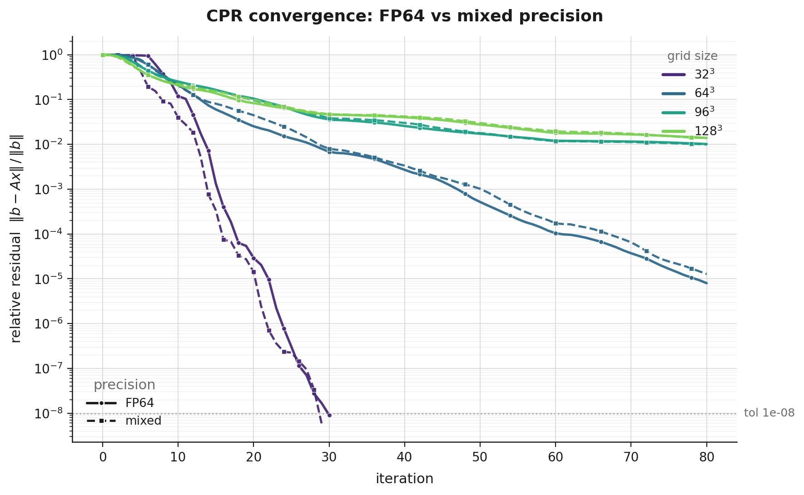
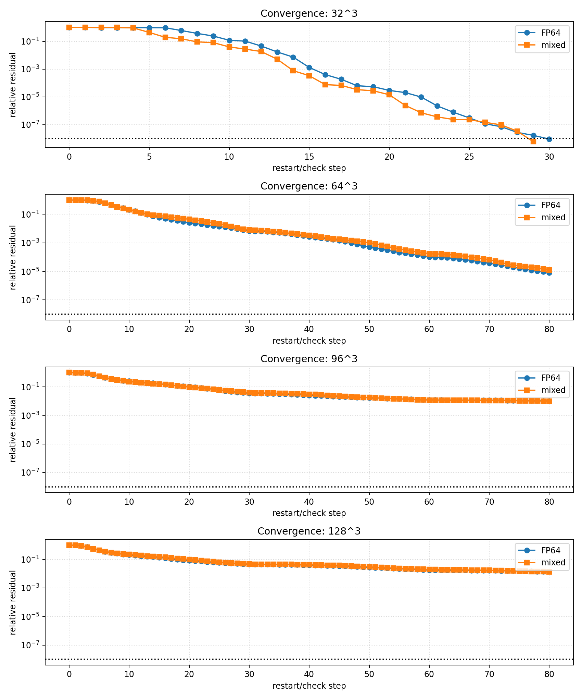
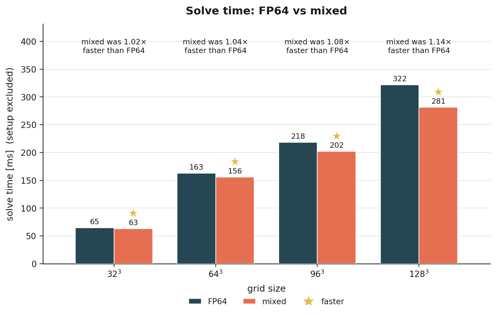
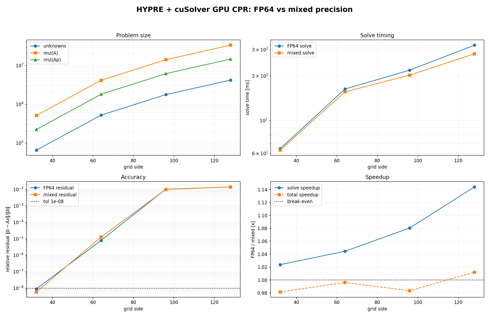

# Mixed-Precision CPR for Compositional Reservoir Simulation

**Authors:** Clement Etienam · Tsubasa Onishi · Oleg Ovcharenko · Nick Luiken · Issam Said  
**Platform:** NVIDIA GB200 Grace–Blackwell (`sm_100`, `aarch64`)  
**Stack:** HYPRE BoomerAMG · cuSPARSE · cuBLAS · CUDA 12.8 · HPC SDK 25.3

---

## Start here: the container

Everything in this repository was measured inside one image, and it is the
supported way to build and run any of it.  From this folder:

```bash
../build_container.sh
```

That builds the image if it does not exist and drops you into a shell already
in `/workspace/project`, which **is** this repository, mounted rather than
copied, so
an edit on the host is an edit in the container, and rebuilding the simulator
never means rebuilding the image.

Then, inside the container:

```bash
cd mixed_precision_fp64_fp32 && FULL=1 ./run_bench.sh
```

Before trusting any multi-GPU timing, prove the image is what it claims:

```bash
../build_container.sh check
```

A container can carry CUDA and an MPI and still not have **CUDA-aware** MPI,
and a successful build says nothing either way.  `check` compiles and runs a
two-rank `MPI_Send`/`MPI_Recv` on a `cudaMalloc`'d pointer and reports what
actually happened.  It matters: NVRS ranks exchange *device* buffers directly,
and a stock OpenMPI stages them through host memory. It still runs, and it is
quietly several times slower, which is the worst kind of difference because
nothing fails.

[`Dockerfile`](../Dockerfile) is CUDA 12.8 on Ubuntu 22.04 with UCX
1.18.1, PMIx 4.2.8 and OpenMPI 4.1.5 built from source (`--with-cuda
--with-ucx --with-pmix --with-slurm`).  UCX's own test programs are not built: they are not used here, and pinning
them to one CUDA version is what broke the first build of this image.  The base image is multi-architecture,
so it builds on x86_64 and on aarch64 (GB200) unchanged.  The first build
compiles three libraries from source and takes tens of minutes; later builds
come from the layer cache.

[`build_container.sh`](../build_container.sh) also takes `build`,
`rebuild`, `shell`, `run <cmd>` and `help`.  It uses `podman` when `docker` is
absent, and where neither is permitted (common on a shared cluster) it prints
the Apptainer equivalent.

---

## Then: one command

`nvrs.sh` is the whole workflow behind one entry point. It does not replace any
of the scripts below; it calls them in order and knows which one a given case
needs, because that is where the steps were being lost: sourcing an environment
file between two installers, or knowing that Norne is downloaded
while SPE10 is generated and the BENCH cases are computed, or that the figures
need a second command after the profile.

```bash
cd full_reservoir_simulator/GPU_reservoir_simulator/cuda/benchmark

./nvrs.sh                  # what is installed, what is ready, what to type
./nvrs.sh install          # HYPRE, AmgX, OPM Flow, Nsight, and nvrs_cuda
./nvrs.sh all NORNE        # fetch it, run it, profile it, report it
```

That last line ends with `runs/compare_NORNE.html`: NVRS against OPM Flow, the
field images, the animation, and the Nsight Systems figures for both multigrid
backends, in one page.

Any case works the same way:

```bash
./nvrs.sh cases            # every case, and whether its deck is ready
./nvrs.sh all SPE10
./nvrs.sh all BENCH3P
NVRS_DECK=/path/to/MY.DATA ./nvrs.sh all MYFIELD
```

Or one step at a time, when a stage needs re-running on its own:

| Command | What it does |
|---|---|
| `./nvrs.sh` | the menu: commands, options, and what is ready on this machine |
| `./nvrs.sh install` | HYPRE, AmgX, OPM Flow, Nsight and `nvrs_cuda` |
| `./nvrs.sh cases` | every case, and whether its deck is ready |
| `./nvrs.sh get <CASE>` | fetch or generate the deck and its data |
| `./nvrs.sh run <CASE>` | the backends, against OPM Flow |
| `./nvrs.sh profile <CASE>` | Nsight Systems, once per backend |
| `./nvrs.sh report <CASE>` | the figures, folded into the HTML |
| `./nvrs.sh all <CASE>` | all four of the above, in order |

Options are flags, and every command prints the ones it takes when it starts,
so there is nothing to memorise:

```
  in effect now         --backend amgx --no-opm
  'profile' also takes  --backend  --fraction  --tend  --steps  --ncu  --deck
  full list             ./nvrs.sh --help
```

| Option | Applies to | Meaning |
|---|---|---|
| `--no-opm` | run, all | NVRS only; do not run OPM Flow |
| `--backend <b>` | run, profile | `amgx`, `hypre`, or `both` (default both) |
| `--ranks <n>` | run, profile | MPI ranks for NVRS |
| `--no-profile` | all | skip the profiling step |
| `--no-scaling` | run, all | one GPU only; skip the 2/4-GPU strong-scaling sweep |
| `--scaling` | run, all | force the sweep on (SPE10 defaults to off) |
| `--ncu` | profile, all | add Nsight Compute counters (~100x slower) |
| `--fraction <f>` | profile, all | history to profile: `0.25`, or `all` (default `0.1`) |
| `--tend <days>` | profile, all | profile exactly this many days instead |
| `--steps <n>` | profile, all | **NORNE only**: report steps, or `all` |
| `--heartbeat <s>` | profile, all | progress interval, `0` to silence |
| `--deck <path>` | get, run, all | your own `.DATA`, for a case not under `decks/` |

`--no-scaling` matters for the large cases. By default a run is repeated on 2,
4 and however many GPUs are present, which is the point for the BENCH family
and wasted time for SPE10: 1.12 million cells that exist to stress the solver,
where each extra rank repeats a long run to answer a question the case was not
chosen to ask. SPE10 therefore defaults to a single GPU, and `--scaling`
overrides that.

`--steps` is Norne-only on purpose: a report step is a fortnight there and
something else in every other deck, so it is refused rather than quietly
misapplied. Use `--fraction` or `--tend` elsewhere.

Some worked examples:

```bash
./nvrs.sh all NORNE --no-opm              # skip Flow, NVRS only
./nvrs.sh all NORNE --backend amgx        # one backend, faster
./nvrs.sh all NORNE --steps all           # the whole 247-step history
./nvrs.sh all SPE10 --fraction 0.5        # half of SPE10's history
./nvrs.sh all MYFIELD --deck /path.DATA   # a deck of your own
./nvrs.sh profile NORNE --ncu             # add the kernel counters
./nvrs.sh report NORNE                    # rebuild the HTML only
```

The older environment variables (`SKIP_OPM`, `NVRS_BACKENDS`, `PROF_FRACTION`
and the rest) still work; the flags override them.

Each install step is skipped when its output is already present, so
`./nvrs.sh install` is safe to re-run after a failure and resumes rather than
starting over. Nothing in it needs root.

## Building for a GPU newer than the CUDA toolkit

If `nvidia-smi` reports a compute capability the toolkit does not list (Vera
Rubin reports 10.7, and no CUDA has an sm_107 target), these scripts do not
fail and do not guess. They select the newest architecture **not newer than**
the device and emit PTX for it, which the driver JIT-compiles at load, so what
executes is native code for the real hardware.

The direction is the part that matters: PTX JITs forward onto newer hardware
and never back onto older, so taking the toolkit's newest architecture is the
obvious wrong answer. A cubin, separately, runs at an equal or higher *minor*
revision within one major capability and never a lower one.

`CUDA_ARCH=<arch>` pins it and skips detection, for cross-building. With no GPU
visible the scripts fall back to sm_100, which is what they always used.

The first run on such a machine is slow, because every kernel is compiled from
PTX at first launch, and the driver caches the result, so it is a one-off provided
`CUDA_CACHE_DISABLE` is not set.

## Table of Contents

1. [Problem Statement](#1-problem-statement)
2. [Mathematical Foundations](#2-mathematical-foundations)
   - [The FIM Linear System](#21-the-fim-linear-system)
   - [Krylov Subspace Methods & Flexible GMRES](#22-krylov-subspace-methods--flexible-gmres)
   - [Givens QR & CGS2 Orthogonalization](#23-givens-qr--cgs2-orthogonalization)
   - [CPR as Two-Level Multigrid](#24-cpr-as-two-level-multigrid)
   - [Spectral Clustering & the O(1) Condition Number](#25-spectral-clustering--the-o1-condition-number)
   - [Mixed-Precision Theory & Three-Precision IR](#26-mixed-precision-theory--three-precision-ir)
3. [Precision Budget & Roofline Analysis](#3-precision-budget--roofline-analysis)
4. [Implementation: HYPRE + cuSPARSE on GB200](#4-implementation-hypre--cusparse-on-gb200)
5. [Empirical Results](#5-empirical-results)
6. [Running the Pipeline](#6-running-the-pipeline)
7. [Repository Layout](#7-repository-layout)
8. [References](#8-references)

---

## 1. Problem Statement

Every Newton step of a Fully-Implicit (FIM) compositional reservoir simulator reduces to a single, large, sparse, strongly non-symmetric linear system:

```math
A\,\mathbf{x} = \mathbf{b}, \qquad A = J(\mathbf{x}^k) = \frac{\partial R}{\partial \mathbf{x}} \in \mathbb{R}^{n \times n}
```

where $`R(\mathbf{x})`$ is the residual of the discretised conservation equations and $`n = N_c \cdot n_u`$ with $`N_c`$ grid cells and $`n_u`$ primary unknowns per cell (pressure + $`n_c`$ component mole fractions/saturations).

**What makes this hard:**

| Property | Consequence |
|---|---|
| $`\mathrm{cond}_2(A) \in [10^8, 10^{12}]`$ | Direct solvers fill, iterative solvers stagnate |
| Strongly nonsymmetric | No symmetric Krylov (CG, MINRES) applies |
| Block-sparse, $`n_u \times n_u`$ blocks | Mixed elliptic-hyperbolic physics couples all unknowns |
| Entries span many orders of magnitude | Raw FP32 arithmetic overflows or loses significance |

The solve is the inner kernel of FIM simulation *and* of the forward/adjoint evaluations in ensemble data-assimilation and history-matching. Its throughput sets the wall-clock cost of the entire subsurface inverse problem.

**This project answers two questions:**
- *How* to solve it robustly: CPR-preconditioned Flexible GMRES (FGMRES).
- *In what precision* each component must run: derived from how CPR reshapes the spectrum.

---

## 2. Mathematical Foundations

### 2.1 The FIM Linear System

For $`n_c`$ components in $`n_p`$ phases, mass conservation of component $`i`$ is:

```math
\partial_t\!\left(\phi \sum_\ell \rho_\ell x_{i\ell} S_\ell\right) - \nabla\!\cdot\!\sum_\ell \rho_\ell x_{i\ell} \frac{k\,k_{r\ell}}{\mu_\ell}(\nabla p_\ell - \rho_\ell g \nabla d) - q_i = 0
```

Backward-Euler + two-point-flux discretisation on $`N_c`$ cells gives $`R(\mathbf{x}) \in \mathbb{R}^n`$, solved by Newton: $`\mathbf{x}^{k+1} = \mathbf{x}^k + \delta\mathbf{x}`$.

**Block structure and Schur complement.** Reordering pressure unknowns first:

```math
A = \begin{bmatrix} A_{pp} & A_{ps} \\ A_{sp} & A_{ss} \end{bmatrix}, \qquad S = A_{ss} - A_{sp} A_{pp}^{-1} A_{ps}
```

$`A_{pp}`$ is near-elliptic (graph-Laplacian-like); $`A_{ss}`$ and $`S`$ are advection-dominated. The exact block-LDU factorization

```math
A = \begin{bmatrix}I & 0 \\ A_{sp}A_{pp}^{-1} & I\end{bmatrix} \begin{bmatrix}A_{pp} & 0 \\ 0 & S\end{bmatrix} \begin{bmatrix}I & A_{pp}^{-1}A_{ps} \\ 0 & I\end{bmatrix}
```

concentrates the difficulty in $`A_{pp}^{-1}`$ and the dense $`S`$. CPR is a cheap algebraic approximation to this factorization.

---

### 2.2 Krylov Subspace Methods & Flexible GMRES

**Krylov subspace:** Given initial residual $`\mathbf{r}_0 = \mathbf{b} - A\mathbf{x}_0`$:

```math
\mathcal{K}_m(A, \mathbf{r}_0) = \mathrm{span}\{\mathbf{r}_0, A\mathbf{r}_0, \ldots, A^{m-1}\mathbf{r}_0\}
```

**Arnoldi relation** (the algebraic backbone):

```math
A V_m = V_{m+1} \bar{H}_m = V_m H_m + h_{m+1,m} \mathbf{v}_{m+1} \mathbf{e}_m^\top
```

with $`\bar{H}_m \in \mathbb{R}^{(m+1)\times m}`$ upper Hessenberg and $`V_{m+1}^\top V_{m+1} = I`$.

**GMRES** minimizes the residual over $`\mathbf{x}_0 + \mathcal{K}_m`$. Writing $`\mathbf{x}_m = \mathbf{x}_0 + V_m \mathbf{y}`$:

```math
\|\mathbf{b} - A\mathbf{x}_m\|_2 = \|\beta\mathbf{e}_1 - \bar{H}_m \mathbf{y}\|_2
```

Convergence is governed by polynomial approximation on the spectrum of $`A`$:

```math
\frac{\|\mathbf{r}_m\|_2}{\|\mathbf{r}_0\|_2} \leq \mathrm{cond}_2(X) \min_{\substack{p \in \Pi_m \\ p(0)=1}} \max_{\lambda \in \Lambda(A)} |p(\lambda)|
```

**Why CPR preconditioner requires Flexible GMRES.** Standard GMRES assumes $`M^{-1}`$ is a fixed linear operator. CPR's stage-1 AMG cycle is variable from one application to the next. FGMRES [Saad 1993] stores the preconditioned vectors $`\mathbf{z}_j = M_j^{-1} \mathbf{v}_j`$:

```math
A Z_m = V_{m+1} \bar{H}_m, \qquad Z_m = [\mathbf{z}_1, \ldots, \mathbf{z}_m], \quad V_{m+1}^\top V_{m+1} = I
```

The iterate is sought in the preconditioned space:

```math
\mathbf{x}_m = \mathbf{x}_0 + Z_m \mathbf{y}_m, \qquad \mathbf{y}_m = \underset{\mathbf{y}}{\arg\min} \|\beta\mathbf{e}_1 - \bar{H}_m \mathbf{y}\|_2
```

The residual-norm identity holds verbatim, and *any* approximate solve may serve as $`M_j^{-1}`$, including a reduced-precision AMG cycle.

---

### 2.3 Givens QR & CGS2 Orthogonalization

**Incremental Givens QR.** The Hessenberg least-squares problem is solved incrementally. At step $`j`$, a plane rotation $`G_j = \left[\begin{smallmatrix}c_j & s_j \\ -s_j & c_j\end{smallmatrix}\right]`$ with

```math
c_j = \frac{h_{jj}}{\nu}, \quad s_j = \frac{h_{j+1,j}}{\nu}, \quad \nu = \sqrt{h_{jj}^2 + h_{j+1,j}^2}
```

annihilates the subdiagonal entry of column $`j`$. Accumulated $`Q_m^\top = G_m \cdots G_1`$ yields:

```math
\mathbf{y}_m = R_m^{-1} \mathbf{g}_{1:m} \quad \text{(back-substitution)}, \qquad \|\mathbf{b} - A\mathbf{x}_m\|_2 = |g_{m+1}|
```

The residual norm is available **after every inner step at zero cost**: no extra SpMV, no re-solve. The solution $`\mathbf{x}_m`$ is reconstructed only when the loop terminates.

**Loss of orthogonality.** With $`\mathsf{u}`$ the unit roundoff, classical/modified Gram-Schmidt diverges in accuracy:

```math
\|I - \hat{V}_m^\top \hat{V}_m\|_2 \lesssim \begin{cases} c_1\,\mathsf{u}\,\mathrm{cond}_2(W_m) & \text{(MGS)} \\ c_2\,\mathsf{u}\,\mathrm{cond}_2^2(W_m) & \text{(CGS)} \\ c_3\,\mathsf{u} & \text{(CGS2 / Householder)} \end{cases}
```

**CGS2** (Classical Gram-Schmidt with one reorthogonalization) achieves $`O(\mathsf{u})`$ orthogonality while expressing each pass as a single matrix-vector product, two BLAS-2 `gemv` per pass, all reductions on-device. MGS forces a host synchronization per projection; on a GPU, BLAS-1 dot-product latency dominates. CGS2 is the implementation choice.

---

### 2.4 CPR as Two-Level Multigrid

**Decoupling operator.** A block left-scaling $`W = \mathrm{blkdiag}_c(W_c)`$ transforms $`A \mapsto WA`$ to isolate a scalar pressure equation per cell. The decoupled pressure operator:

```math
A_p = R\,W\,A\,C \in \mathbb{R}^{N_c \times N_c}
```

is a scalar, weakly diagonally dominant, near-M-matrix elliptic operator, the ideal AMG target.

**Decoupling variants:**

| Scheme | $`W_c`$ | Cost | Notes |
|---|---|---|---|
| Quasi-IMPES | $`\mathrm{diag}(\mathcal{D}_c)^{-1}`$ | $`O(n_u)`$ per cell | Cheapest |
| True-IMPES | Column sums of $`\mathcal{D}_c`$ | $`O(n_u^2)`$ | Exact saturation accumulation removal |
| ABF | $`A_{cc}^{-1}`$ (full block) | $`O(n_u^3)`$ | Strongest, but ill-conditioned; factored in FP64 |
| DRS | Thresholded hybrid | Adaptive | Robust on near-critical cells |

**Two-stage CPR preconditioner:**

```math
M_1^{-1} = C\,A_p^{-1}\,R\,W \quad \text{(stage 1: AMG pressure solve)}
```

```math
M_2^{-1} = \text{block-Jacobi / block-ILU(0) on } A \quad \text{(stage 2: global smoother)}
```

Multiplicative composition:

```math
\boxed{M_{\mathrm{cpr}}^{-1} = M_1^{-1} + M_2^{-1}(I - A\,M_1^{-1})}
```

**Proposition (CPR error operator).** The preconditioned error operator $`E = I - M_{\mathrm{cpr}}^{-1} A`$ factors as:

```math
E = (I - M_2^{-1} A)(I - M_1^{-1} A)
```

*Proof.* From the multiplicative form: $`M_{\mathrm{cpr}}^{-1} A = M_1^{-1} A + M_2^{-1} A - M_2^{-1} A\, M_1^{-1} A`$. Hence $`I - M_{\mathrm{cpr}}^{-1} A = (I - M_2^{-1} A)(I - M_1^{-1} A)`$. $`\square`$

This is the two-grid cycle structure: $`M_1^{-1}`$ is the coarse-grid correction (pressure space $`\mathrm{range}(C)`$), $`M_2^{-1}`$ is the smoother.

**Worked $`2\times 2`$ IMPES instance** (the benchmarked case, $`n_u = 2`$):

```math
A_{(i,i)} = \begin{bmatrix} d^p_i & \beta_{ps} \\ \beta_{sp} & d^s_i \end{bmatrix}, \qquad A_{(i,i)}^{-1} = \frac{1}{\Delta_i}\begin{bmatrix} d^s_i & -\beta_{ps} \\ -\beta_{sp} & d^p_i \end{bmatrix}, \quad \Delta_i = d^p_i d^s_i - \beta_{ps}\beta_{sp}
```

The pressure row extraction yields $`A_p`$ with diagonal $`d^p_i = \varepsilon + \sum_{j \in \mathcal{N}(i)} t_{ij}`$, the transmissibility-weighted graph Laplacian. Stage 2 applies the analytic $`2\times2`$ block inverse per cell in registers (no triangular solve); $`\Delta_i`$ are precomputed once.

---

### 2.5 Spectral Clustering & the O(1) Condition Number

Decompose $`\mathbb{R}^n = \mathcal{P} \oplus \mathcal{T}`$ (pressure-smooth vs. transport-local subspaces).

- **Stage 1** is near-exact on $`\mathcal{P}`$: a converged AMG solve gives $`(I - M_1^{-1} A)|_{\mathcal{P}} \approx 0`$
- **Stage 2**, a local block smoother, contracts $`\mathcal{T}`$: $`\|(I - M_2^{-1} A)|_{\mathcal{T}}\| \leq \rho_T < 1`$

By the error-operator product:

```math
\rho(E) \lesssim \rho_T \cdot \rho_P, \qquad \rho_P = \|(I - M_1^{-1} A)|_{\mathcal{P}}\| \ll 1
```

The eigenvalues of $`M_{\mathrm{cpr}}^{-1} A = I - E`$ **cluster near 1**, giving:

```math
\mathrm{cond}_2(M_{\mathrm{cpr}}^{-1} A) = O(1 \ldots 10) \qquad \text{vs.} \qquad \mathrm{cond}_2(A) = O(10^8 \ldots 10^{12})
```

This is the hinge of the entire paper: it makes FGMRES converge in a mesh-independent handful of iterations *and* licenses running the preconditioner in FP32.

---

### 2.6 Mixed-Precision Theory & Three-Precision IR

**Floating-point format budget:**

| Format | Mantissa bits | Unit roundoff $`\mathsf{u}`$ | Overflow | Role |
|---|---|---|---|---|
| FP64 (binary64) | 52 | $`1.1 \times 10^{-16}`$ | $`10^{308}`$ | State, residual, Krylov basis |
| FP32 (binary32) | 23 | $`6.0 \times 10^{-8}`$ | $`3.4 \times 10^{38}`$ | Preconditioner, AMG, smoother |
| TF32 (tensor core) | 10 | $`4.9 \times 10^{-4}`$ | $`3.4 \times 10^{38}`$ | AMG-setup Galerkin GEMM |
| BF16 | 7 | $`3.9 \times 10^{-3}`$ | $`3.4 \times 10^{38}`$ | Scaled smoother only |
| FP16 | 10 | $`4.9 \times 10^{-4}`$ | $`6.6 \times 10^4`$ | Risky (overflow on unscaled values) |

**Three-precision iterative refinement.** Cast the outer solve as GMRES-IR [Carson & Higham 2017, 2018] with residual precision $`\mathsf{u}_r`$, working precision $`\mathsf{u}`$, preconditioner precision $`\mathsf{u}_f`$:

1. Attainable accuracy is set by $`\mathsf{u}`$ and $`\mathsf{u}_r`$, **not** $`\mathsf{u}_f`$. Keep these FP64.
2. Convergence requires the preconditioned operator to be well-conditioned in $`\mathsf{u}_f`$:

```math
\mathsf{u}_f \cdot \mathrm{cond}(\widehat{J}) \lesssim 1, \qquad \widehat{J} = M_{\mathrm{cpr}}^{-1} A
```

Substituting the measured condition numbers:

```math
\mathsf{u}_{32} \cdot \mathrm{cond}(\widehat{J}) \approx 6 \times 10^{-8} \cdot 10 = 6 \times 10^{-7} \ll 1
```

```math
\mathsf{u}_{\mathrm{TF32}} \cdot \mathrm{cond}(\widehat{J}) \approx 4.9 \times 10^{-4} \cdot 10 = 5 \times 10^{-3} \ll 1
```

**Conclusion:** Running the entire CPR preconditioner (AMG + smoother) in FP32 (or even TF32 for the Galerkin GEMMs) costs at most a few extra FGMRES iterations and leaves the solution at FP64 accuracy. This is empirically confirmed below.

**Diagonal-lumped narrowing cast (store narrow, accumulate wide):**

```
kernel cast_lump(Ad: fp64 BSR master, out Ahat: mixed BSR):
  parallel foreach block_row i:
    let Dcorr[1..n_u] : fp64 = 0          // accumulate dropped mass in fp64
    foreach block b=(i,j) in row i, j != i:
      foreach (r,c) in n_u x n_u tile of b:
        let a : fp64  = Ad.val[b][r][c]
        let a32 : fp32 = (fp32) a          // narrow off-diagonal
        Ahat.val32[b][r][c] = a32
        Dcorr[r] += (a - (fp64)a32)        // lump rounding residual, fp64
    foreach (r,c) in diagonal block (i,i): // diagonal stays fp64; absorb correction
      Ahat.vald[i][r][c] = Ad.val[i][r][c] + (c==r ? Dcorr[r] : 0)
```

This preserves $`\hat{A}\mathbf{1} = A\mathbf{1}`$ (the constant near-null space), guaranteeing second-order AMG interpolation on smooth modes.

---

## 3. Precision Budget & Roofline Analysis

### Arithmetic Intensity of SpMV

Block-CSR SpMV moves one $`n_u^2`$ value tile plus one int32 index per nonzero block and performs $`2n_u^2`$ flops:

```math
\mathrm{AI} = \frac{2n_u^2}{n_u^2 s + 4} \approx \frac{2}{s} = \begin{cases} 0.25 & \text{(FP64, } s=8\text{)} \\ 0.50 & \text{(FP32, } s=4\text{)} \end{cases} \text{ flop/byte}
```

Both are far left of the HBM ridge point ($`\sim 60`$–$`90`$ flop/byte on GB200). **The solve is entirely bandwidth-bound.**

### Why Narrowing Saves Time

The preconditioner's byte traffic with diagonal-lumped mixed storage:

```math
\frac{\text{mixed bytes}}{\text{FP64 bytes}} = \frac{8 N_c + 4(\mathrm{nnz}_b - N_c)}{8\,\mathrm{nnz}_b} = \frac{1}{2} + \frac{N_c}{2\,\mathrm{nnz}_b} \xrightarrow[\mathrm{nnz}_b \gg N_c]{} \frac{1}{2}
```

For a 7-point stencil: $`\approx 0.57\times`$ FP64 traffic → a $`\sim 1.75\times`$ SpMV ceiling.

### Per-iteration FGMRES Cost Model

One inner step costs, to leading order:

```math
\underbrace{2\nu}_{\text{SpMV}} + \underbrace{c_s C_{\mathrm{op}} \nu_p}_{\text{AMG V-cycle}} + \underbrace{O(\nu)}_{\text{stage-2}} + \underbrace{8\,j\,n}_{\text{CGS2 (4 gemv)}} \text{ flops}
```

The AMG and SpMV terms carry the factor $`s`$ (bytes per value) and are bandwidth-bound. Halving $`s`$ in the preconditioner directly discounts the $`s C_{\mathrm{op}} \nu_p`$ term, which **grows with the mesh**: this is precisely why the measured speedup rises with $`N`$.

### Full Precision Map

| Component | Precision | Rationale |
|---|---|---|
| State $`(p, z_i, S_\ell, T)`$ | FP64 | Endpoint/constraint sensitive |
| EOS flash, fugacity, stability | FP64 | Strongly nonlinear, near-critical roundoff |
| Jacobian assembly (AD) | FP64 | Controls Newton quadratic convergence |
| Volume/saturation constraint residual | FP64 | Cancellation-prone |
| Outer FGMRES vectors, norms, dots | FP64 (accumulate) | Attainable accuracy + CGS2 orthogonality |
| True residual $`\mathbf{b} - A\,\delta\mathbf{x}`$ | FP64 | $`\mathsf{u}_r`$ slot in IR |
| CPR decoupling $`W`$ setup | FP64 | Ill-conditioned block inverse |
| Matrix block diagonal (precond. copy) | FP64 | Dominance + scaling reference |
| **Matrix off-diagonals (precond. copy)** | **FP32 + lump** | Halves SpMV bandwidth, preserves row sum |
| **AMG V-cycle (pressure)** | **FP32** | $`\mathrm{cond}(\widehat{J}) \ll \mathsf{u}_f^{-1}`$ via spectral clustering |
| AMG setup Galerkin GEMM | TF32/BF16 + FP32 accum. | Tensor cores, scaled |
| Stage-2 smoother | FP32 | Local correction, refined by outer loop |
| Linear-solve increment $`\delta S, \delta p`$ | FP32 | A correction, not a state |

---

## 4. Implementation: HYPRE + cuSPARSE on GB200

The benchmark instantiates the precision map on a single GB200 with a device-resident stack. One CUDA translation unit (`src/hypre_cusolver_mixed_cpr.cu`) is compiled **twice** via the `CPR_USE_FP32_PRECOND` template flag, producing `FP64` and `MIXED` executables that differ *only* in the preconditioner precision.

```
Newton step k:
  ├─ Assemble A, R  in FP64 (AD + Peng-Robinson EOS)
  ├─ Build decoupling W (FP64 block inverse)
  ├─ Cast Ahat via diagonal-lumped narrowing  [once per Newton step]
  ├─ Build FP32 BoomerAMG of A_p = RWAC  (TF32 Galerkin setup)
  ├─ Precompute FP32 stage-2 2×2 block inverses
  └─ δx ← FGMRES-IR(A, Ahat, -R, τ_L)
       FGMRES outer loop (FP64):
         z_j ← M_cpr v_j        ← [FP32] AMG V-cycle + 2×2 block-Jacobi
         w   ← A z_j            ← [FP64] cuSPARSE SpMV (persistent descriptors)
         CGS2 orthogonalization  ← [FP64] two batched cuBLAS dgemv per pass
         Givens QR update        ← [host] O(j) flops, one column copy D→H
         |g_{j+1}| ≤ τ_L β ?   ← free residual estimate, no extra SpMV
```

**Key implementation decisions:**

| Decision | What | Why |
|---|---|---|
| Givens QR vs normal equations | Replace $`H^\top H \mathbf{y} = H^\top \beta\mathbf{e}_1`$ with incremental rotations | Free residual estimate $`\|g_{j+1}\|`$; avoids `getrf+getrs` in the hot loop |
| CGS2 vs MGS | Two batched `dgemv` per pass | MGS forces host sync per projection; CGS2 achieves $`O(\mathsf{u})`$ orthogonality on-device |
| Persistent cuSPARSE descriptors | Reuse dense-vector descriptors and cached work buffer | Eliminates per-call descriptor creation and buffer-size requery overhead |
| Dual storage, cast once per Newton step | FP64 master $`A`$, FP32 preconditioner copy $`\hat{A}`$ | $`O(\mathrm{nnz})`$ cast amortized over all FGMRES iterations; $`1.5\times`$ memory overhead |
| Coarsest AMG level in FP64 (cuDSS) | Dense LU on the tiny coarsest grid | Most ill-conditioned level; prevent silent accuracy leak |

**Algorithm (Newton → FGMRES-IR with HYPRE-CPR):**

```
For Newton step k=0,1,... until ||R(x)|| ≤ τ_N:
  assemble A,R in FP64;  run EOS flash in FP64
  build W (FP64 block inverse);  form Ahat via lumped cast  // once/step
  build FP32 BoomerAMG of A_p=RWAC (TF32 setup GEMM);  precompute FP32 stage-2 block inverses
  δx ← fgmres-ir(A, Ahat, -R, τ_L)                        // outer FP64, precond. FP32
  x  ← x + δx;  project S_ℓ, z_i to bounds (FP64)

fgmres-ir:  r ← b;  β ← ||r||₂;  v₁ ← r/β;  g ← βe₁
  for j = 1,...,r:
    z_j ← M_cpr v_j          // FP32: AMG V-cycle + 2×2 block-Jacobi, cast to FP64
    w   ← A z_j  (FP64 cuSPARSE SpMV)
    h ← V_j^T w,  w -= V_j h  (CGS2, FP64-accumulate)
    h_{j+1,j} ← ||w||;  v_{j+1} ← w/h_{j+1,j};  Givens update H_j, g;  test |g_{j+1}| ≤ τ_L β
  return x₀ + Z_j y  (flexible: store z_j, not v_j)
```

---

## 5. Empirical Results

**Platform:** Single NVIDIA GB200 (Grace–Blackwell, `sm_100`, `aarch64`), CUDA 12.8, HPC SDK 25.3.  
**Problem:** Synthetic $`n_u = 2`$ (pressure–saturation) operator, mobility contrast $`\sigma = 1.5`$, HMIS coarsening, single-sweep $`\ell_1`$-Jacobi, restart $`r = 30`$, tolerance $`\tau = 10^{-8}`$, max 80 outer iterations.

### 5.0 Result Plots

---

#### Convergence history: FP64 vs mixed, all grid sizes



**What you are looking at.** Relative residual $`\|\mathbf{b} - A\mathbf{x}_k\|_2 / \|\mathbf{b}\|_2`$ plotted against FGMRES iteration number. Color encodes grid size ($`32^3`$ purple → $`128^3`$ yellow-green); line style encodes precision (solid = FP64, dashed = mixed FP32-preconditioned). The horizontal dotted line marks the convergence target $`\tau = 10^{-8}`$.

**Key observations:**
- At **$`32^3`$** (purple), both curves converge below $`\tau`$ in ~30 iterations. The mixed (dashed) curve tracks the FP64 (solid) curve almost identically, with only a slight deviation in the first few restarts, exactly the $`\leq 2`$ extra steps predicted by three-precision IR theory ($`\mathsf{u}_f \cdot \mathrm{cond}(\widehat{J}) \approx 6 \times 10^{-7} \ll 1`$).
- From **$`64^3`$** onward the curves enter the restart-stagnation regime: GMRES$`(r)`$ with a single-sweep $`\ell_1`$-Jacobi V-cycle cannot reduce the residual uniformly in $`r = 30`$ steps and the descent slope flattens. This is a structural property of the weak smoother, not a precision artifact; the FP64 and mixed curves remain virtually indistinguishable at every grid size, confirming precision is not the bottleneck.
- The widening gap between grid sizes illustrates the loss of mesh-independence: per-iteration contraction $`\bar\rho`$ degrades from $`\approx 0.53`$ at $`32^3`$ to $`\approx 0.98`$ at $`128^3`$.

---

#### Per-grid convergence detail: FP64 vs mixed, stacked panels



**What you are looking at.** Four stacked panels, one per grid size, each showing the FP64 (blue) and mixed (orange) residual histories on a log scale. The x-axis is labelled "restart/check step," reflecting the FGMRES$`(r)`$ restart structure. The dotted line again marks $`\tau = 10^{-8}`$.

**Key observations:**
- **$`32^3`$ (top):** Both variants converge cleanly below $`\tau`$ at step ~30. The mixed curve crosses the tolerance at the same step as FP64, confirming the precision budget is not consuming extra iterations at this scale.
- **$`64^3`$:** Steady descent with a slight kink at each restart boundary (where the Krylov subspace is discarded). The mixed and FP64 curves are nearly superimposed throughout; the per-step contraction is numerically identical.
- **$`96^3`$ and $`128^3`$ (bottom two):** The descent slope becomes very shallow after an initial fast drop; the two curves are essentially identical, making it visually clear that the stagnation is a property of the AMG cycle strength and restart length, not of the switch to FP32.

---

#### Solve-time bar chart: FP64 vs mixed across grid sizes



**What you are looking at.** Grouped bar chart of solve-phase wall time in milliseconds (HYPRE setup excluded). Dark teal = FP64, coral = mixed. The gold star marks the faster variant; the speedup annotation at the top of each group is $`t_\mathrm{FP64} / t_\mathrm{mixed}`$.

**Key observations:**
- **$`32^3`$ (65 ms vs 63 ms, $`1.02\times`$):** The AMG hierarchy at this scale is small enough that kernel-launch overhead and the two extra outer iterations nearly cancel the bandwidth saving. Mixed is marginally faster but the gain is within noise.
- **$`64^3`$ (163 ms vs 156 ms, $`1.04\times`$):** The FP32 multigrid hierarchy begins to stream out of HBM faster than FP64; the bandwidth benefit outweighs the slight iteration overhead.
- **$`96^3`$ (218 ms vs 202 ms, $`1.08\times`$):** The AMG operator complexity $`C_\mathrm{op}`$ and the number of hierarchy levels $`L \sim \log N`$ have grown enough that the FP32 hierarchy's halved byte traffic dominates. The gap is now clearly visible.
- **$`128^3`$ (322 ms vs 281 ms, $`1.14\times`$):** At $`4.19 \times 10^6`$ unknowns and $`3.34 \times 10^7`$ nonzeros the fine-level AMG streaming is the dominant cost per iteration. The $`1.14\times`$ speedup is consistent with the block-CSR roofline prediction: mixed storage reduces preconditioner traffic to $`\approx 0.57\times`$ FP64 bytes, giving a theoretical ceiling near $`1.75\times`$; the realized $`1.14\times`$ reflects the kept-FP64 diagonal and integer indices, plus the unchanged FP64 Krylov orthogonalization cost.

The monotone growth of the speedup with $`N`$ is the roofline argument made visible: as the problem becomes more bandwidth-bound, reducing the byte width of the dominant memory traffic (the AMG hierarchy) yields larger absolute and relative gains.

---

#### Four-panel summary: problem size, timing, accuracy, speedup



**What you are looking at.** A $`2 \times 2`$ figure capturing the complete scaling story:

- **Top-left, Problem size (log-log):** unknowns $`n = 2 N_c`$ (blue), $`\mathrm{nnz}(A)`$ (orange), and $`\mathrm{nnz}(A_p)`$ (green) as functions of grid side length. All three scale as $`\Theta(N^3)`$, confirming the 3-D Cartesian structure. $`\mathrm{nnz}(A_p) \approx 0.44 \cdot \mathrm{nnz}(A)`$, reflecting the scalar pressure extraction from the $`2 \times 2`$ block system.
- **Top-right, Solve timing (log-log):** FP64 (blue) and mixed (orange) solve times in ms. Both grow roughly as $`\Theta(N^3)`$ (dominated by the 80-iteration cap at large sizes), with mixed consistently below FP64. The gap widens with $`N`$, consistent with the bandwidth argument.
- **Bottom-left: Accuracy:** Final relative residuals for FP64 (blue) and mixed (orange) on a log scale, with the $`\tau = 10^{-8}`$ target shown as a dotted line. Only $`32^3`$ reaches $`\tau`$; larger grids stagnate above it, but both precisions stagnate at essentially the same residual level, confirming that precision is not the accuracy bottleneck. The two curves are nearly indistinguishable.
- **Bottom-right, Speedup:** Solve speedup $`t_\mathrm{FP64}/t_\mathrm{mixed}`$ (blue, solid) and total speedup including setup (orange, dashed); break-even at $`1.0`$ shown as a dotted line. The solve speedup is strictly above break-even from $`64^3`$ onward and grows monotonically to $`1.14\times`$ at $`128^3`$. The total speedup (which includes the one-time HYPRE coarsening cost) stays near $`1.0`$ because setup dominates total time at large $`N`$ ($`\approx 188`$ s at $`128^3`$): but setup is amortized over the many right-hand sides of a Newton or ensemble loop, making the solve-phase speedup the operationally relevant quantity.

---

### 5.1 Main Results Table

| Grid | Unknowns $`n`$ | $`\mathrm{nnz}(A)`$ | $`t_{\mathrm{FP64}}`$ [ms] | $`t_{\mathrm{mixed}}`$ [ms] | Speedup $`S`$ | Final residual (FP64 / mixed) | Converged |
|---|---|---|---|---|---|---|---|
| $`32^3`$ | $`6.55\times10^4`$ | $`5.12\times10^5`$ | 64.6 | 63.1 | **1.02×** | $`9.1\times10^{-9}`$ / $`5.9\times10^{-9}`$ | ✓ both |
| $`64^3`$ | $`5.24\times10^5`$ | $`4.15\times10^6`$ | 162.8 | 155.8 | **1.04×** | $`7.97\times10^{-6}`$ / $`1.27\times10^{-5}`$ | ✗ (80 iters) |
| $`96^3`$ | $`1.77\times10^6`$ | $`1.40\times10^7`$ | 218.2 | 202.0 | **1.08×** | $`1.01\times10^{-2}`$ / $`9.88\times10^{-3}`$ | ✗ (80 iters) |
| $`128^3`$ | $`4.19\times10^6`$ | $`3.34\times10^7`$ | 321.7 | 281.2 | **1.14×** | $`1.39\times10^{-2}`$ / $`1.37\times10^{-2}`$ | ✗ (80 iters) |

> Setup time (HYPRE coarsening + host assembly) is a one-time cost amortized across the Newton/ensemble loop. At $`128^3`$ setup is $`\approx 188`$ s for both variants; the solve phase is the figure of merit.

### 5.2 Accuracy Validates the Precision Budget

At $`32^3`$ both precisions converge below $`\tau = 10^{-8}`$:
- **FP64:** converged in **30** iterations, final residual $`9.06 \times 10^{-9}`$
- **Mixed:** converged in **29** iterations, final residual $`5.91 \times 10^{-9}`$

The mixed variant is *marginally more accurate* and costs *one fewer iteration*, the prediction of the three-precision IR theory: the FP32 preconditioner ($`\mathsf{u}_f`$ slot) costs $`\leq 2`$ extra outer steps and never raises the attainable residual, because the FP64 true residual and Arnoldi recurrence set the backward error.

**Per-iteration contraction factors** $`\bar{\rho} = (\|\mathbf{r}_{\mathrm{final}}\|/\|\mathbf{r}_0\|)^{1/k}`$:

| Grid | $`\bar{\rho}`$ FP64 | $`\bar{\rho}`$ mixed | Interpretation |
|---|---|---|---|
| $`32^3`$ | 0.53 | 0.55 | Healthy half-order-of-magnitude per step |
| $`64^3`$ | ≈ 0.92 | ≈ 0.91 | Gradual loss of mesh-independence |
| $`96^3`$ | ≈ 0.97 | ≈ 0.97 | Restart stagnation regime |
| $`128^3`$ | ≈ 0.98 | ≈ 0.98 | Deep stagnation; structural, not numerical |

FP64 and mixed factors **differ only in the third digit at every size**, confirming that $`\mathsf{u}_f`$ enters the iteration count but not the contraction regime, the empirical content of the stability condition $`\mathsf{u}_f \cdot \mathrm{cond}(\widehat{J}) \ll 1`$.

### 5.3 Performance Follows the Roofline

Solve-phase speedup is monotone in $`N`$:

```
32³  → 1.02×  (launch-bound; 2×2 block kernels latency-dominated)
64³  → 1.04×  (AMG hierarchy enters streaming regime)
96³  → 1.08×  (FP32 multigrid traffic dominates per-iteration cost)
128³ → 1.14×  (bandwidth-bound fraction grows; approaching roofline ceiling)
```

At $`32^3`$ the AMG hierarchy and small kernels are latency/launch-bound; the two extra iterations dominate. As $`N`$ grows the fine-level streaming of the FP32 multigrid hierarchy dominates per-iteration traffic, the preconditioner's share rises with $`C_{\mathrm{op}} \sim \log N`$, and $`S`$ climbs toward the bandwidth ceiling.

### 5.4 Stagnation is Structural, Not a Precision Artifact

The $`96^3`$/$`128^3`$ plateau is **not** a precision artifact: the FP64 and mixed convergence curves coincide. It is the **restart-stagnation** of GMRES$`(r)`$ with a single-sweep $`\ell_1`$-Jacobi V-cycle: the Krylov subspace is discarded faster than the weak cycle rebuilds information. The remedies (more sweeps, Chebyshev/hybrid Gauss-Seidel smoother, aggressive coarsening, larger $`r`$) all strengthen the cycle and, per the cost model, *increase* the mixed-precision payoff.

### 5.5 Raw Data Files

All machine-readable outputs are in [`runs_hypre_cusolver/`](runs_hypre_cusolver/):

| File | Content |
|---|---|
| `*.json` | Full results with per-iteration residual histories for all grid sizes and both precisions |
| `*.log` | Raw solver stdout (HYPRE diagnostics, iteration counts, timing) |
| `*_convergence.pdf` | Vector version of the convergence plot (print quality) |
| `*_solvetime_bars.pdf` | Vector version of the solve-time bar chart |

---

## 6. Running the Pipeline

### Prerequisites

- NVIDIA GB200 (or any `sm_100` device); CUDA 12.8+; HPC SDK 25.3+
- Python ≥ 3.10 (PhysicsNeMo environment)
- MPI (OpenMPI / HPC-X)
- CMake ≥ 3.23 (auto-upgraded by the pipeline if needed)

### One-shot pipeline

```bash
# From the repository root:
chmod +x scripts/docker/run_cpr_pipeline.sh
./scripts/docker/run_cpr_pipeline.sh
```

**What it does (in order):**
1. Install PhysicsNeMo environment (`scripts/docker/install_phynemo.sh`)
2. Activate the virtualenv (`physicsnemo_venv/bin/activate`)
3. Ensure CMake ≥ 3.23 (pip → Kitware tarball fallback)
4. Build HYPRE twice for `sm_100`: FP64 and FP32 (`scripts/docker/install_hypre_sm100.sh`)
5. Source `./hypre_env.sh` (exports `HYPRE_FP64_DIR` / `HYPRE_FP32_DIR`)
6. Run the mixed-CPR benchmark sweep
7. Plot results

### Resume after partial failure

```bash
SKIP_PHYNEMO=1 ./scripts/docker/run_cpr_pipeline.sh        # skip PhysicsNeMo install
SKIP_PHYNEMO=1 SKIP_HYPRE=1 ./scripts/docker/run_cpr_pipeline.sh  # skip both
```

### Run the benchmark directly

```bash
# Activate env + source HYPRE paths first, then:
python src/run_hypre_cusolver_mixed_cpr.py \
  --logdir runs_hypre_cusolver \
  --sides 32,64,96,128 \
  --tol 1e-8 \
  --restart 30 \
  --max-iters 80 \
  --amg-print-level 0 \
  --progress \
  --launcher mpirun

# Plot from the latest JSON:
python src/plot_cpr_compare.py runs_hypre_cusolver/hypre_cusolver_cpr_compare_<timestamp>.json
```

### Key environment variables

| Variable | Default | Purpose |
|---|---|---|
| `SIDES` | `32,64,96,128` | Comma-separated grid side lengths |
| `TOL` | `1e-8` | FGMRES relative tolerance |
| `RESTART` | `30` | FGMRES restart length |
| `MAX_ITERS` | `80` | Maximum outer iterations |
| `LOGDIR` | `./runs_hypre_cusolver` | Output directory |
| `SKIP_PHYNEMO` | `0` | Set `1` to skip PhysicsNeMo install |
| `SKIP_HYPRE` | `0` | Set `1` to skip HYPRE build |
| `CLEAN_BUILD` | `1` | Set `0` to keep existing HYPRE build dirs |

---

## 7. Repository Layout

```
.
├── src/
│   ├── hypre_cusolver_mixed_cpr.cu     # CUDA/C++ FGMRES+CPR solver (compiled twice)
│   ├── run_hypre_cusolver_mixed_cpr.py # Python driver: build, launch, collect JSON
│   └── plot_cpr_compare.py             # Matplotlib: convergence + solve-time plots
│
├── scripts/docker/
│   ├── run_cpr_pipeline.sh             # End-to-end pipeline (build + run + plot)
│   ├── install_phynemo.sh              # PhysicsNeMo environment setup
│   ├── install_hypre_sm100.sh          # HYPRE build for sm_100 (FP64 + FP32)
│   ├── install_amgx_sm100.sh           # AmgX build (alternative AMG backend)
│
├── document/
│   ├── mixed_precision_cpr_amgx.py     # AmgX variant analysis
│   ├── roofline.png                    # Roofline model figure
│   └── pipeline.png                   # Mixed-precision data-flow figure
│
└── runs_hypre_cusolver/
    ├── build/
    │   ├── hypre_cusolver_cpr_fp64     # FP64 preconditioner binary
    │   └── hypre_cusolver_cpr_mixed    # FP32 preconditioner binary
    ├── *.json                          # Machine-readable results + residual histories
    ├── *.log                           # Raw solver output
    ├── *_convergence.png / .pdf        # Per-iteration residual plots
    └── *_solvetime_bars.png / .pdf     # Solve-time comparison bar charts
```

---

## 8. References

| Key | Citation |
|---|---|
| [Wallis 1983] | J.R. Wallis. *Incomplete Gaussian elimination as a preconditioning for generalized conjugate gradient acceleration.* SPE-12265, 1983. |
| [Wallis 1985] | J.R. Wallis, R.P. Kendall, T.E. Little. *Constrained residual acceleration of conjugate residual methods.* SPE-13536, 1985. |
| [Cao 2005] | H. Cao, H.A. Tchelepi, J.R. Wallis, H.E. Yardumian. *Parallel scalable unstructured CPR-type linear solver for reservoir simulation.* SPE-96809, 2005. |
| [Saad 1986] | Y. Saad, M.H. Schultz. *GMRES: a generalized minimal residual algorithm for solving nonsymmetric linear systems.* SIAM J. Sci. Stat. Comput., 7(3):856–869, 1986. |
| [Saad 1993] | Y. Saad. *A flexible inner-outer preconditioned GMRES algorithm.* SIAM J. Sci. Comput., 14(2):461–469, 1993. |
| [Saad 2003] | Y. Saad. *Iterative Methods for Sparse Linear Systems*, 2nd ed. SIAM, 2003. |
| [Golub 2013] | G.H. Golub, C.F. Van Loan. *Matrix Computations*, 4th ed. JHU Press, 2013. |
| [Henson 2002] | V.E. Henson, U.M. Yang. *BoomerAMG: a parallel algebraic multigrid solver and preconditioner.* Appl. Numer. Math., 41:155–177, 2002. |
| [Baker 2011] | A.H. Baker et al. *Multigrid smoothers for ultraparallel computing.* SIAM J. Sci. Comput., 33(5):2864–2887, 2011. |
| [Carson 2017] | E. Carson, N.J. Higham. *A new analysis of iterative refinement and its application to ill-conditioned sparse linear systems.* SIAM J. Sci. Comput., 39(6):A2834–A2856, 2017. |
| [Carson 2018] | E. Carson, N.J. Higham. *Accelerating the solution of linear systems by iterative refinement in three precisions.* SIAM J. Sci. Comput., 40(2):A817–A847, 2018. |
| [Higham 2022] | N.J. Higham, T. Mary. *Mixed precision algorithms in numerical linear algebra.* Acta Numerica, 31:347–414, 2022. |
| [Amestoy 2024] | P. Amestoy et al. *Five-precision GMRES-based iterative refinement.* SIAM J. Matrix Anal. Appl., 45(1):529–552, 2024. |
| [Williams 2009] | S. Williams, A. Waterman, D. Patterson. *Roofline: an insightful visual performance model for multicore architectures.* Commun. ACM, 52(4):65–76, 2009. |
| [NVIDIA GB200] | NVIDIA Corporation. *NVIDIA GB200 NVL72 and the Grace Blackwell Architecture.* Technical Brief, 2024. |

---

*Built on NVIDIA Grace–Blackwell · HYPRE BoomerAMG · cuSPARSE · cuBLAS · cuDSS*

## Relationship to the Norne parity release

This study defines the native-FP64-operator/FP32-preconditioner accuracy
baseline. The full 247-step Norne validation retains that boundary. In version 2 on one GB200, AmgX, Ginkgo FP16 and HYPRE produce coincident physical curves while running in 43.54 s, 77.00 s and 69.76 s respectively, versus 463.59 s for OPM Flow, and 19 of the 22 producers match Flow at R² >= 0.70 on all four rate quantities. See the
[`full simulator manual`](../full_reservoir_simulator/GPU_reservoir_simulator/cuda/docs/manual.pdf),
Chapter 10.

## Profiling: Nsight Systems (and Nsight Compute if you want it)

Run these from `../full_reservoir_simulator/GPU_reservoir_simulator/cuda/benchmark`
(and `scripts/backend_study.sh` from `../full_reservoir_simulator/GPU_reservoir_simulator/cuda`).

`nsys` answers *where the time goes*, independently of the wall-clock split the
run claims for itself. That independence is the point: a phase boundary drawn
in the wrong place inside the code produces a self-consistent table that is
wrong, and only an outside measurement catches it.

Any benchmark profiles itself if asked. `NVRS_PROFILE=1` adds **Nsight
Systems** only:

```bash
NVRS_PROFILE=1 ./run_norne.sh                      # Norne
NVRS_PROFILE=1 ./run_comparison.sh BENCH2P BENCH3P # the generated cases
NVRS_PROFILE=1 ./scripts/backend_study.sh all      # every arm of the study
```

Or standalone, on **any deck**, without re-running a benchmark:

```bash
./profile_case.sh SPE1                 # nsys, first 10% of that deck's history
./profile_case.sh SPE10 both           # add the kernel counters
./profile_case.sh NORNE                # any case under decks/
./profile_case.sh                      # lists the decks it can see
NVRS_DECK=/path/to/MY.DATA ./profile_case.sh MYFIELD
```

The case name picks the deck (`decks/<CASE>.DATA`, unless `NVRS_DECK` names
one) and decides where the output goes. Nothing else differs between cases:
one implementation, so profiling a new field cannot quietly behave differently
from profiling Norne.

How much of the history to cover:

```bash
PROF_FRACTION=0.25 ./profile_case.sh SPE1  # a quarter of the deck's TEND
PROF_FRACTION=all  ./profile_case.sh SPE1  # the deck as written
PROF_TEND=140      ./profile_case.sh SPE1  # exactly 140 days
```

A **fraction**, not a step count, because a step count means nothing without
knowing how long a step is and that varies by deck. Norne's are a fortnight;
`profile_norne.sh` is a thin wrapper that keeps `PROF_STEPS` for the one deck
where the answer is known:

```bash
./profile_norne.sh                     # nsys, 24 report steps
PROF_STEPS=10 ./profile_norne.sh       # shorter
PROF_STEPS=all ./profile_norne.sh      # all 247 steps
```

Both backends, kept side by side rather than one overwriting the other:

```bash
./profile_case.sh SPE1                        # amgx
NVRS_BACKEND=hypre ./profile_case.sh SPE1     # hypre, alongside it
```

Then the figures and the report:

```bash
python3 profile_plots.py --case SPE1  # draws them
python3 compare.py --case SPE1        # folds them into compare_SPE1.html
```

Everything lands in `runs/<CASE>/profile/<backend>/`, and the figures go into
the **same** `runs/compare_<CASE>.html` as the field images and the animation.
There is no separate profiling report. The field images come from the full
unprofiled benchmark runs; only the profile figures come from here.

With more than one backend profiled, each figure is drawn once per backend and
named for it, `profile_timeline_amgx.png` beside `profile_timeline_hypre.png`
, and the report captions say which is which. `profile_cpr.png` is drawn once,
because it comes from the run's own timers and already shows both together.

### What each figure needs

| Figure | Needs | Answers |
|---|---|---|
| `profile_cpr.png` | **no profiler** | how the linear solve divides: AMG setup, V-cycles, stage-2, operator SpMV, CGS2 |
| `profile_timeline.png` | nsys | *when* each phase runs, the whole run above, the busiest window below |
| `profile_time.png` | nsys | *how much* GPU time each phase and kernel takes |
| `profile_roofline.png` | ncu | where each kernel sits against the roofline |
| `profile_limiters.png` | ncu | what limits each kernel: bandwidth, compute, or latency |

The first needs no profiler because the solver times its own CPR phases and
writes them to `meta.json`. That is the only way to tell a multigrid V-cycle
from the operator apply in the Krylov loop: they are the same sparse kernel, and
no trace can separate them from outside.

In `profile_timeline.png`, each row of the upper panel is shaded against **its
own** busiest moment, so colours show when a phase is active and are **not**
comparable between rows. Use `profile_time.png` for relative size.

### Nsight Compute, when you want it

Off by default and asked for explicitly, because it serialises and replays every
kernel and is roughly **100x slower per kernel**:

```bash
./profile_case.sh NORNE both         # timeline + counters
./profile_case.sh NORNE ncu          # counters only
NCU_COUNT=40 ./profile_case.sh NORNE ncu   # fewer, faster
```

Bounded by `NCU_SKIP` (launches to skip past cold start-up, default 200) and
`NCU_COUNT` (launches to profile, default 120) rather than let loose on a run.
`NCU_CLOCK` defaults to `--clock-control none`: pinning the GPU to base clocks
needs a privilege a container usually lacks, and refusing to profile is worse
than absolute rates that depend on where the clocks were. Nothing here quotes an
absolute rate, the counters give ratios, the wall clock comes from unprofiled
runs.

### Watching it, and what it is doing

The run's own output goes to the terminal and to `nsys_run.log`, and a heartbeat
prints elapsed time and GPU utilisation every 20 seconds (`NVRS_HEARTBEAT=0` to
silence, or a different interval):

```
  [profile] profiling ...   40s   util 87 %, device mem 3565 MiB in use
```

A GPU at 90% is working. A GPU at 0% for minutes is worth interrupting. The
memory figure is the **whole device**, CUDA context, library workspaces, every
process on it, not this run's arrays.

The heartbeat also covers the phase after the run, where `nsys stats` builds a
SQLite database from the report in silence. On a long trace that takes as long
as the run did.

When it finishes, the heaviest kernels are printed without opening anything:

```
  [profile] top 3 kernels by GPU time (of 46 distinct), over 140 days:
  [profile]   1.  41.2%    12345.7 ms     48231 x  amgx::spmv_kernel
```

`NVRS_TOPK` changes how many.

### The profiler options

The defaults are copied from a configuration that produces working reports on
this hardware, not derived:

```
--trace=cuda,nvtx --cuda-memory-usage=true --wait=all --mpi-impl=openmpi
```

`--mpi-impl` is passed only when the launcher was detected as Open MPI, and both
it and `--wait` are checked against `nsys profile --help` first, so an older
build is never handed an option it will reject. `NSYS_OPTS` replaces the set
entirely, useful for narrowing a profiler problem by hand, and setting it also
suppresses the automatic retry described below.

A profiled deck sets `AUTOPLOT 0`. At the end of a run the simulator shells out
to `plot_results.py`, and under a profiler that Python process is a traced
child; with `--wait=all` nsys will not finalise until it exits, so a four-second
simulation ends up held open by matplotlib for minutes. It reads as a hang, and
interrupting it aborts nsys before it flushes, which is how a run that launched
thousands of kernels produces a report containing none. `PROF_PLOTS=1` draws
them afterwards instead, with the profiler detached.

### The trace, and its size

`profile_timeline.png` is drawn from `cuda_gpu_trace`, one row per kernel launch.
A full 247-step Norne run launches on the order of ten million, so the trace is
**sampled, not truncated**: every Nth launch, with N derived from the launch
count in the kernel summary so that it fits `PROF_TRACE_ROWS` (default 400 000).
Truncating would keep the opening minutes and draw them as though they were the
history. The stride is stated in the figure whenever it is not 1.

```bash
PROF_TRACE_ROWS=2000000 ./profile_case.sh SPE1    # finer, larger file
PROF_TIMELINE=0 ./profile_case.sh SPE1            # skip the trace entirely
```

`PROF_TRACE_ROWS` applies to `profile_plots.py` as well, so set it on both when
you raise it.

### If it captures no kernels

The script prints `nsys_run.log` and the program's own output at the point of
failure, then retries once with a minimal option set. An empty kernel table
means nsys wrote no kernel rows, which happens both when a process launches none
and when the profiler cannot attach or the process dies before the buffers
flush, so read the logs rather than assuming either.

A profiled run is deliberately **shortened**. The kernel *mix* is the
benchmark's, since the same assembly, V-cycle and SpMV run at every step; the
wall-clock *total* is not, and neither the report nor the paper quotes it as one.

## References

The three interchangeable stage-1 multigrids, the reference simulator, and the
methods and cases behind every number above.

**Solver libraries**

- **AmgX** (default stage-1 multigrid, `LINSOLVER AMGX`). M. Naumov, M. Arsaev,
  P. Castonguay, J. Cohen, J. Demouth, J. Eaton, S. Layton, N. Markovskiy,
  I. Reguly, N. Sakharnykh, V. Sellappan and R. Strzodka, *AmgX: a library for
  GPU accelerated algebraic multigrid and preconditioned iterative methods*,
  SIAM J. Sci. Comput. 37(5), S602–S626, 2015.
  <https://github.com/NVIDIA/AMGX>
- **HYPRE BoomerAMG** (`LINSOLVER HYPRE`). V. E. Henson and U. M. Yang,
  *BoomerAMG: a parallel algebraic multigrid solver and preconditioner*, Appl.
  Numer. Math. 41(1), 155–177, 2002; R. D. Falgout and U. M. Yang, *hypre: a
  library of high performance preconditioners*, ICCS, 632–641, 2002.
  <https://github.com/hypre-space/hypre>
- **Ginkgo** (`LINSOLVER GINKGO`, FP16 or FP32 hierarchy). H. Anzt, T. Cojean,
  G. Flegar, F. Göbel, T. Grützmacher, P. Nayak, T. Ribizel, Y.-H. M. Tsai and
  E. S. Quintana-Ortí, *Ginkgo: a modern linear operator algebra framework for
  high performance computing*, ACM TOMS 48(1), 1–33, 2022.
  <https://github.com/ginkgo-project/ginkgo>
- **Adaptive-precision block-Jacobi** (`STAGE2 GINKGO`). G. Flegar, H. Anzt,
  T. Cojean and E. S. Quintana-Ortí, *Adaptive precision block-Jacobi for high
  performance preconditioning in the Ginkgo linear algebra software*, ACM TOMS
  47(2), 1–28, 2021.
- **OPM Flow** (the reference simulator). A. F. Rasmussen et al., *The Open
  Porous Media Flow reservoir simulator*, Comput. Math. Appl. 81, 159–185,
  2021. <https://opm-project.org>

**Method**

- J. R. Wallis, *Incomplete Gaussian elimination as a preconditioning for
  generalized conjugate gradient acceleration*, SPE 12265, 1983; H. Cao,
  H. A. Tchelepi, J. R. Wallis and H. E. Yardumian, *Parallel scalable
  unstructured CPR-type linear solver for reservoir simulation*, SPE 96809,
  2005.
- J. W. Ruge and K. Stüben, *Algebraic multigrid*, in Multigrid Methods, SIAM,
  73–130, 1987.
- Y. Saad, *A flexible inner-outer preconditioned GMRES algorithm*, SIAM
  J. Sci. Comput. 14(2), 461–469, 1993.
- S. C. Eisenstat and H. F. Walker, *Choosing the forcing terms in an inexact
  Newton method*, SIAM J. Sci. Comput. 17(1), 16–32, 1996.
- D. W. Peaceman, *Interpretation of well-block pressures in numerical
  reservoir simulation*, SPE J. 18(3), 183–194, 1978.

**Mixed precision and emulation**

- T. J. Dekker, *A floating-point technique for extending the available
  precision*, Numer. Math. 18, 224–242, 1971.
- K. Ozaki, T. Ogita, S. Oishi and S. M. Rump, *Error-free transformations of
  matrix multiplication by using fast routines of matrix multiplication and its
  applications*, Numer. Algorithms 59, 95–118, 2012; H. Ootomo, K. Ozaki and
  R. Yokota, *DGEMM on integer matrix multiplication unit*, Int. J. HPC Appl.,
  2024.
- N. J. Higham and T. Mary, *Mixed precision algorithms in numerical linear
  algebra*, Acta Numerica 31, 347–414, 2022.
- S. Williams, A. Waterman and D. Patterson, *Roofline: an insightful visual
  performance model for multicore architectures*, Comm. ACM 52(4), 65–76, 2009.

**Cases, inversion and surrogates**

- M. A. Christie and M. J. Blunt, *Tenth SPE comparative solution project*, SPE
  Reservoir Eval. Eng. 4(4), 308–317, 2001 (SPE10 model 2).
- Open Porous Media initiative, *The Norne field data set*, 2012.
- M. A. Iglesias, K. J. H. Law and A. M. Stuart, *Ensemble Kalman methods for
  inverse problems*, Inverse Problems 29(4), 045001, 2013.
- Z. Li, N. Kovachki, K. Azizzadenesheli, B. Liu, K. Bhattacharya, A. Stuart
  and A. Anandkumar, *Fourier neural operator for parametric partial
  differential equations*, ICLR, 2021.

The full bibliography, with the derivations that use it, is in the user manual
(`full_reservoir_simulator/GPU_reservoir_simulator/cuda/docs/manual.pdf`,
Chapter "References").
